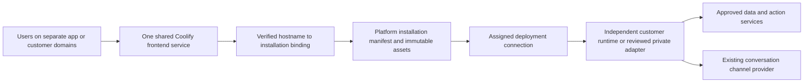

# 010.36 LoomAI Engage Standalone App Implementation Plan

- **Architecture blocker, owner correction 2026-10-18:** customer AI deployments must not provision dealership inventory/lead systems, the example dealership backend/database, or an external provider simulator as customer-product defaults. The current simulated-dealership dependency graph violates this boundary and must not be applied/promoted unchanged. [010.44](010_44_CUSTOMER_SYSTEM_INTEGRATION_BOUNDARY_CORRECTION_PLAN.md) supersedes conflicting simulator/receiver/database provisioning assumptions in section 10, including R5. Keep the AI solution and DATA/ACTION integrations, separate external demo fixtures, preserve customer-managed storage and optional BYO vector services, and explicitly account for required AI operational state. Historical implementation evidence below is retained, not acceptance of the invalid architecture. UI extraction remains last.

- Latest source checkpoint, 2026-10-19: 010.44 AI-only templates, explicit AI-state storage choice, scoped external DATA/ACTION bindings, immutable candidate credentials and customer/shared-service ownership guards are implemented locally. Final actual-module backend regression passes3,343 tests across350 classes with zero failures/errors/skips; offline backend packaging also passes. Both approved Platform backups pass the final195-to201 migration rehearsal, all201 validations and preservation of21 tables without ownership backfill. Foundation is locally committed as `5cef0210a`, shared-service/final ownership follow-ups as `12fb4e4b2`. Focused SQL/customer/support results remain separately recorded and overlap the full suite. No push or hosted upgrade: the public-origin/private-product repository decision is still required. Hosted apply/promotion/P7 remain open; UI extraction remains last.
- Hosted checkpoint, 2026-10-18, reconfirmed image inventory2026-10-19: both control planes remain on `cab320545` / migration195, previously public-health verified UP. Runtime artifact remains `d2b1a9792` / AI Fabric0.8.36. The architecture correction above blocks the dealership customer offer regardless of earlier test/publication success. The22:47:42UTC audit found no managed-dependency graphs on either plane and no release/model allocation for `dep-6e29bab9`; its reservation remains held. Cancellation-only HTTP handling passed20 tests and is committed locally as `00f3852c5`, not pushed/deployed. No valid cancellation, corrected customer apply or production promotion has been performed. See [010.44 audit](010_44_CUSTOMER_SYSTEM_OWNERSHIP_BOUNDARY_AUDIT.md) and its execution record. Earlier dated checkpoints below are historical, not instructions to resume the invalid graph.

- Earlier hosted checkpoint, 2026-10-18: both control planes were strictly verified on `d2b1a9792` / migration193 / public healthUP after fresh private pre-V193 backups and successful isolated restores of both. Runtime CI39164527840 passed; the exact image `sha256:3809a6585ad19f25c0139d60cf1b9aa742b7831a6213fcec4bdfe6fb52e0b140` was inspected offline and all20 framework0.8.36 jars match Central. Its source/capability manifest matched committed code. Artifact `dsa-94841998` was registered/promoted on staging only. Template1.8, spec1.8 and offer v11 were the next composition at that checkpoint; older published offers stay immutable. No customer runtime apply, provider credit allocation or production promotion had occurred. Superseded by the current checkpoint and architecture blocker above.

- Status: standalone delivery source implemented; shared frontend deployed on staging and production; earlier hosted public, identity, handover, and recovery canaries passed. Section 10 backend contracts are live through `58bf670de` on both control planes, migration 192, including reviewed retained-external vector binding, pre-allocation validation and resolved inventory projection. Template 1.7 is seeded on both control planes; dependent spec 1.7 and offer v10 are published on staging only as a full-feature 2,750mCPU measurement candidate, not approved production capacity. Prior offers remain immutable. The inspected runtime image remains pinned to `600f136bf` with AI Fabric 0.8.35. Nine real-owner v10 configuration-only checks, six additional read-only binding/configuration checks, eleven earlier exact-image offline budget-denial checks and a local exact-image budget-store export/restore rehearsal pass; these do not prove hosted runtime activation, provider use or safe stale-snapshot reactivation. The same attended staging campaign has owner-approved cumulative ceilings of 50 interactive requests, 200,000 tokens and USD 12 total provider spend including embeddings, without resets; its sole grant remains unallocated. Owner approved existing Free-01 and the existing broader serving key at zero additional vector cost, retaining cluster and data. Native-token integration/publication, actual binding, measured admission, hosted provisioning/indexing/recovery, retained-index lifecycle completion, production fit and complete P7 acceptance remain open. Local UI extraction remains uncommitted and undeployed until the non-extraction functional gate. See the execution record for exact evidence and remaining gates.
- Current vector-auth update, 2026-10-18: owner explicitly authorized the existing broader API key for the exact Free-01 synthetic staging campaign. Another password, restricted key or allocation approval is not pending. This exception does not establish provider-enforced tenant ACLs or authorize another cluster, account/key/role changes, paid infrastructure or production promotion. Native SDK metadata authentication passed with zero collections and no writes/model calls. Framework0.8.36 publication passed; BOM/core/Milvus artifacts were verified on Central. Private backend476, runtime425, provider-accounting140, connector76 and vectorization32 tests passed, all zero skips. The local runtime contains20 framework0.8.36 jars and the token capability; this is not hosted image proof. No runtime has received the credential yet. This supersedes earlier credential/scope blockers while preserving all spending, retention and admission gates.
- Independent acceptance update, 2026-10-18: both pre-V192 control-plane backups passed actual isolated local PostgreSQL18 restore; the support gate passed77/77 and the separate actual-module/browser-fixture auth gate passed9/9. Host baselines were measured on both servers. These do not close hosted recovery, real-provider auth, workload capacity or P7. UI extraction remains last.
- Created: 2026-10-13.
- Execution priority: 2.
- Source review baseline: Platform `db58acd9`; framework `561659dc`; AI Fabric `0.8.32`. Current implementation target: AI Fabric `0.8.36`, framework release commit `0808b2d5`; deployed runtime remains on `0.8.35` until exact-image verification and rollout.
- Owners: generic AI Workspace, experience packs, and Platform installation/delivery.
- Product naming decision, 2026-10-13: **LoomAI Engage** is the commercial product name; **AI Workspace** remains the technical reference for its reusable interface and integration contracts.
- Authentication decision, 2026-10-13: support entry-time and action-time sign-in; login starts a new authenticated conversation. Anonymous-to-authenticated conversation transfer is excluded.
- Hosting and delivery decision, 2026-10-13: all twelve recommendations confirmed; use one shared frontend service on production Coolify with separate customer installations, domains, and assigned runtimes.
- Future mobile direction confirmed, 2026-10-14: one LoomAI Engage host app with a common AI Workspace renderer, remotely configured business experiences, reviewed bundled packs, business selection, and deep links. Build the web release to preserve this target; native implementation and publication are deferred.
- Customer portal decision, 2026-10-14: reuse `CUSTOMER_ADMIN`, the existing Platform UI, configuration editors, and APIs. AWS Console/Cloudscape are layout and design-system inspiration. Complete and verify non-extraction work first; shared-editor extraction and customer-shell changes are the final, independently reversible implementation phase.
- Placement decision, 2026-10-14: customer staging runs only on staging Coolify (`46.224.145.148`); production Coolify (`46.225.162.106`) is reserved for production-target deployments and shared production services. Enforce bounded staging admission, resource reuse/reconciliation, expiry, and post-promotion retirement; never spill staging onto production.
- Preservation and promotion decision, 2026-10-14: retain the dated [admin/operator capability baseline](010_36_ADMIN_OPERATOR_UI_CAPABILITY_BASELINE_2026_10_14.md), prove staff parity after extraction, and expose an evidence-backed Production Readiness and Go-Live checklist with separate post-activation staging-retirement closure.
- Code-assessment adaptation, 2026-10-14: section 10.12 defines the target/release administration, atomic activation, scoped retirement, S3-first documents, dedicated dependency provisioning, customer authorization, and operating contracts. The direction is approved; P0 must close its concrete contracts/prerequisites before P1. This documentation is not implementation or production-readiness evidence.
- Related: [010.16](010_16_PRACTICAL_DEV_STAGING_PRODUCTION_DEPLOYMENT_MODEL.md), [010.23](010_23_LOOMAI_DEPLOYMENT_BEHAVIOR_MARKET_READINESS_EXECUTION_PLAN.md), [010.26](010_26_AUTOTRADER_DEALERSHIP_FIRST_RELEASE_AND_MEETING_DEMO_PLAN.md), [010.29](010_29_GENERIC_MAX_MODE_INJECTABLE_ACTION_UI_AND_DEALERSHIP_EXPERIENCE_PLAN.md), [010.31](010_31_PLATFORM_HOSTED_AI_WORKSPACE_INSTALLATION_AND_ASSIGNED_RUNTIME_DISCOVERY_PLAN.md), completed [010.34](010_34_TEMPORARY_HUMAN_CONVERSATION_HANDOVER_AND_LIVE_AGENT_EXTENSION_PLAN.md), [010.38](010_38_DEPLOYMENT_OWNED_WORKSPACE_STARTUP_CONTEXT_IMPLEMENTATION_PLAN.md).

## 1. Outcome And Verdict

Provide a standalone, responsive AI Workspace on a business-owned domain. It opens as the primary application surface and supports the same conversations, sources, attachments, governed actions, and human handover as the embedded workspace.

This is a delivery form of AI Workspace, not a new deployment behavior type. Templates, plugins, assigned runtimes, and reviewed experience packs remain the composition model. A customer can keep an existing website or use this workspace as a separate application address.

### 1.1 Product Name And Technical Reference

- **Commercial product:** LoomAI Engage.
- **Technical reference:** AI Workspace, including its reusable widget, installer, experience packs, connection profiles, and standalone shell.
- **Positioning:** AI experiences that connect people to a business and help them get things done using its knowledge, live systems, and permitted actions.
- **Creation command:** **Create AI App** in the Platform; each customer can give its own app a business-specific name.
- **Product boundary:** LoomAI Platform composes and operates the capabilities; LoomAI Engage delivers the user-facing experiences. Background Smart Brain execution is not renamed as Engage merely because it uses the same Platform.

Keep existing technical API paths, schemas, package identifiers, installation IDs, source directories, and related plan filenames unchanged by this naming decision. This is a commercial/technical vocabulary distinction, not an authorization change or a new execution engine.

### 1.2 Web Now, Mobile Target Later

The current implementation scope is the standalone web product on the shared Coolify frontend. A future mobile app is an explicit design target, not a current deliverable or an excuse to delay the web release.

The accepted future path is a **single LoomAI Engage host app**: its initial screen lets a user find a business, and selection or a business link opens that business's configured experience through the **common AI Workspace renderer**. Reuse the same UI code and reviewed component/pack contracts as the web delivery. A business is an installation/configuration/assigned-runtime binding, not a new renderer or native binary for each customer.

Implement now only the reusable boundaries that prevent a contradictory web design: typed configuration and data projections, host-independent core components, reviewed domain extensions, scoped identity/state, explicit mount/unmount lifecycle, and isolated host capabilities. Native business search/catalogue, store binaries, platform plugins, Universal/App Links, push, native credential persistence, and device/store verification are future work. Detailed future constraints are in section 9.

## 2. Current Code Evidence

This is the original pre-implementation inventory. Statements below about
missing generic packs, standalone delivery, or a dealership-only registry
describe that source snapshot, not today's hosted state. Sections 6.1 and 6.2
supersede those gaps; section 10 identifies the additional productization work.

- `max-mode-widget/src/entries/MaxModeWidget.tsx`: reusable full-workspace React entry with `isOpen`, `onClose`, API configuration, host config, features, and theme.
- `max-mode-widget/src/entries/iife.ts`: script entry with open/close, attachments, and send-message commands.
- `max-mode-widget/src/config.ts`: generic tool groups, command rail, presentation, theme, initial attachments, and host context.
- `max-mode-widget/src/installer/types.ts`: typed installation manifest and all three connection modes, including handover routes.
- `max-mode-widget/src/installer/install.ts`: immutable asset/pack loading, connection handlers, and assignment refresh.
- `experience-packs/dealership-experience/src/index.ts`: existing dealership-specific host configuration.
- `Platfrom/backend/src/main/java/com/ai/fabric/platform/backend/aiworkspace/service/AIWorkspaceExperiencePackRegistry.java`: currently accepts only `dealership@1.1.0`.
- `.../AIWorkspaceConfigurationValidator.java`: currently requires dealership configuration such as `dealer` and page kind.
- `.../AIWorkspaceConnectionProfileRegistry.java`: anonymous direct, conditionally configured authenticated broker, and Shopify private-adapter profiles.
- `max-mode-widget/src/config.ts`, `MaxModeRuntimeAuthConfig`: bearer-token supplier, anonymous bootstrap, renewal, and auth-context probing.
- `ai-infrastructure-module/ai-fabric-runtime/src/main/java/com/ai/fabric/runtime/auth/RuntimePublicTokenService.java`: separate anonymous and authenticated token issuance/validation primitives; it does not itself implement a customer identity-provider login flow.
- `max-mode-widget/src/chatResult.ts`: existing Shopify-oriented customer-account connect handling; general standalone authentication must use a domain-neutral contract.
- `Platfrom/ui/src/pages/AIWorkspacesPage.tsx`: installation management surface to extend.
- `Platfrom/backend/src/main/java/com/ai/fabric/platform/backend/productservice/model/CreatePlatformManagedProductServiceRequest.java` and `.../productservice/service/PlatformManagedProductServiceService.java`: managed-service registration, deployment targets, source/build settings, and desired replicas are foundations for the shared frontend. A reviewed standalone-workspace service binding remains implementation work.
- `.../productservice/service/PlatformManagedProductAdminService.java`: existing managed-service health and provider operations to reuse for the shared frontend lifecycle.
- `max-mode-widget/package.json` and `vite.config.ts`: React/TypeScript web library with Vite ESM/CJS output plus separate script/installer builds. These are reusable web assets, not a native mobile app project.
- `max-mode-widget/src/installer/install.ts`: browser script-element bootstrap, Platform-origin asset validation, remote script loading, and manifest-derived connection configuration. A packaged native shell needs an explicit reviewed bootstrap path rather than pretending its local origin is a customer website.
- `max-mode-widget/src/api/client.ts` and `context.ts`: browser `sessionStorage` persists session credentials/bindings and attachment state. This does not establish secure native credential storage or restoration after an app process is terminated.
- `max-mode-widget/src/hooks/useConversationHandover.ts`: foreground fetch-based event streaming and reconnect behavior. Native suspension/resume and optional background notifications need their own proof.
- `max-mode-widget/src/mount.ts` and `pageAttachment.ts`: embedded fixed-height/DOM mounting and current-page extraction. Native keyboard/safe-area behavior and the meaning of current-page context must be verified, not assumed from desktop embedding.
- `max-mode-widget/src/actionPresentation.ts`: exact action/renderer IDs, schema versions, bounded data projections, and registered React/custom-element renderers already separate generic presentation contracts from domain components. This is a common-renderer foundation, not proof of a universal component catalogue or native host.

The generic widget and manifest are implemented. A domain-neutral Platform experience pack and a supported standalone shell/lifecycle are missing. The existence of a broker handler does not prove a customer identity broker is configured. The current authenticated profile uses a Platform-configured broker URL; customer-specific authentication requires explicit reviewed customer/installation/deployment bindings, not an assumption that every customer shares one identity provider.

## 3. Proposed Architecture

Platform remains the installation/configuration and asset source; no CDN is required for this release. One shared frontend service on production Coolify serves the thin shell for registered app domains. Per-message traffic uses each customer's independently assigned runtime or configured private adapter. The shared frontend is not a chat gateway and does not hold customer provider credentials, conversations, indexes, or business effects.

### 3.1 Confirmed Decisions

The user confirmed all recommendations on 2026-10-13. These are accepted design decisions, not evidence of implemented or deployed support:

1. **Hosting:** LoomAI-managed production Coolify first. Customer-hosted frontend delivery is deferred; a full customer-hosted deployment bundle remains [010.41](010_41_CUSTOMER_HOSTED_DEPLOYMENT_BUNDLE_IMPLEMENTATION_PLAN.md).
2. **Frontend topology:** one shared, versioned frontend service; separate customer installations/configuration and domains. A dedicated frontend per customer is not required for the first release.
3. **Runtime isolation:** independent assigned runtime and tenant, identity, data, and action boundaries for each customer. Shared frontend delivery does not share customer state.
4. **Domains:** `<app-name>.apps.loomai.pro` by default, with an optional customer-owned domain such as `assistant.customer.com`. Activate only after ownership, DNS, TLS, and exact-origin checks.
5. **Creation:** a **Create AI App** workflow in the existing AI Workspace management surface. Bind an existing verified deployment or create one through the existing template workflow, then select pack, authentication policy, and domain.
6. **Authentication defaults:** public-facing templates use `PUBLIC_WITH_PROTECTED_CAPABILITIES`; private/internal templates use `LOGIN_REQUIRED`. The reviewed template declares the policy, not an LLM or browser guess.
7. **Identity integrations:** a generic customer-owned provider/adapter contract. Prove Supabase Auth first; standards-based OIDC follows. Preserve existing customer-session and Shopify private-adapter paths.
8. **Authentication broker:** deployment-local adapter by default; an existing reviewed customer backend is optional. Supported provider integration must not require a customer to author a new backend.
9. **Login transition:** start a new authenticated conversation, clear active anonymous state and pending work, and require a new user request. No anonymous conversation transfer, history merge, handover transfer, or automatic replay.
10. **Customization:** reviewed configuration and experience packs for branding, layouts, tools, prompts, and approved renderers. No arbitrary customer JavaScript upload/execution in the first release.
11. **Release ownership:** frontend, installation configuration, and runtime are separately versioned resources using existing Platform workflows. Routine frontend publication does not redeploy customer runtimes.
12. **Readiness:** verify each app's domain, installation, assignment, authentication, and representative interaction flows, including confirmation and human handover when enabled. Shared frontend health alone cannot make every app ready.

There is no arbitrary **100-app ceiling**. That number was illustrative, not a measured capacity claim. Use measured traffic, resource envelopes, routing/TLS behavior, and operational limits to establish capacity; [010.40](010_40_SMALL_PERSISTENT_LUCENE_DEPLOYMENT_PROFILE_IMPLEMENTATION_PLAN.md) covers runtime efficiency measurement separately from the shared frontend.

### 3.2 Shared Frontend And Customer Boundaries

Reuse the managed-product-service lifecycle for a reviewed shared workspace frontend service and its Coolify target. Do not create a frontend runtime role or a frontend container for every customer merely to serve installation-specific settings. Stage and verify changes on a separate staging instance before promoting the same immutable frontend artifact to production.

Customer-specific state remains bound to the installation, assigned deployment, and verified identity. Partition browser persistence and manifest caches accordingly; never share identity cookies across `.apps.loomai.pro` or cache one customer's configuration for another host. Keep secret-bearing authentication profiles server-side and expose only reviewed public metadata.

Shared delivery creates a shared frontend outage/release blast radius. Monitor the service independently, retain immutable release evidence, and test multiple installations before promotion. A frontend release changes delivery assets, not customer runtime ownership or assignment. Keep only the current supported contracts; do not introduce a parallel legacy product path.

### 3.3 Domain Binding And Activation

Bind each normalized exact hostname to one authorized installation through Platform-owned configuration, with uniqueness and customer-ownership validation. Resolve the browser hostname using this registered binding; do not accept a browser-provided runtime URL or installation override as authority. Unknown, disabled, or unverified hosts must fail closed.

Wildcard DNS for `*.apps.loomai.pro` simplifies resolution but does not authorize an app or prove proxy routing/TLS. Provision and verify the intended Coolify routes and certificate strategy explicitly. Customer-owned domains require their own DNS/ownership proof, TLS, exact-origin allowlist, and provider callback/logout bindings. Removing or moving a domain must revoke its installation/origin association safely.

### 3.4 App Creation And Resource Lifecycle

**Create AI App** composes existing resources rather than inventing a new AI execution type:

1. Select an existing verified customer deployment, or complete the existing template-based deployment workflow.
2. Create/bind its AI Workspace installation and select a reviewed generic or domain-specific experience pack.
3. Select the template's interaction policy and configure the reviewed authentication profile when needed.
4. Reserve the app slug/default hostname and optionally add a customer-owned domain.
5. Publish the installation/configuration revision, reconcile domain delivery, and run app-specific readiness checks.
6. Show the app URL and independently observable frontend, installation, domain, authentication, and runtime status.

A registered installation is not a verified runtime, and publishing a shell is not a successful app activation. Reuse existing deployment release/verification and consumer-assignment workflows. Deleting an app must not implicitly delete its independently managed runtime or customer data.

Proposed source locations:

- `workspace-apps/standalone-ai-workspace/`: thin app shell and static build.
- `experience-packs/generic-workspace-experience/`: domain-neutral default pack.
- existing widget/installer, Platform pack registry/validator, asset catalog, and installation UI.

These new locations are proposed. Do not copy the dealership demo frontend as generic product code.

## 4. Configuration And Lifecycle

Add typed installation presentation configuration for `embedded` versus `standalone`, with title, approved logo, theme, initial workspace view, and allowed host commands. Keep connection URLs and credentials outside customer-editable presentation data. Confirm the exact schema placement during implementation and use one current schema revision.

Standalone lifecycle must define:

1. Load the installation and obtain the selected auth context.
2. Open the primary workspace without a launcher or storefront dock.
3. Preserve conversation identity, messages, confirmed/pending actions, attachments, and handover state through navigation and reload within the same verified identity/session.
4. Replace widget close with an explicit supported app navigation/exit command, or omit it.
5. Keep new-conversation, sign-out, attachment removal, and navigation as separate commands.
6. Apply assignment changes to new sessions; never move an active conversation silently.
7. On anonymous-to-authenticated login, establish a new authenticated conversation and clear identity-bound anonymous state from the active workspace. Login is not a navigation or token-renewal event.

Browser context remains advisory. Host labels and attached pages cannot grant resource authority or select hidden action targets.

## 5. Authentication And Human In The Loop

### 5.1 Authentication Policy Is Separate From Transport

Support three configurable interaction policies. The names below are proposed contract values, not existing fields:

- `PUBLIC`: anonymous interaction with only the sources/actions allowed by deployment policy.
- `LOGIN_REQUIRED`: authenticate before any conversation, private evidence, startup reads, or AI interaction is available. A sign-in/loading shell may remain visible.
- `PUBLIC_WITH_PROTECTED_CAPABILITIES`: anonymous interaction is allowed; protected data or operations require sign-in at the point of use. Provide an explicit sign-in command as well.

These policies are not new runtime connection modes. A mixed installation needs approved anonymous and authenticated connection bindings to the same intended deployment; it must not swap to an arbitrary runtime after login.

Confirmed defaults: public-facing templates declare `PUBLIC_WITH_PROTECTED_CAPABILITIES`; private/internal templates declare `LOGIN_REQUIRED`. `PUBLIC` remains available only for a reviewed use case that needs no protected capability. A public template without an operational authenticated binding cannot claim mixed-mode readiness.

For example, public inventory and public policies may be anonymous, while an existing customer's reservation or account data may require authentication and resource ownership. A contact enquiry may remain anonymous when its action policy permits it. Name/email/phone intake is contact capture, not proof of a signed-in identity. A write does not automatically require login, and login does not replace action confirmation, Human Review, or domain authorization.

The runtime and authoritative action/data services enforce access. The workspace's entry screen and tool visibility improve the experience but are not the security boundary. An LLM cannot grant identity or override the declared policy.

### 5.2 Reuse Existing Connection Semantics

Support the existing declared connection modes:

- Anonymous: deployment-issued owner proof, renewal, exact-origin boundaries, and direct runtime routes.
- Authenticated: a real reviewed identity broker and deployment token validation. Do not activate from a UI toggle alone.
- Private adapter: the reviewed backend owns private credentials; the browser never receives assignment keys or private assertions.

Use a trusted deployment-local broker/authentication adapter by default. An existing reviewed customer backend is an optional integration path. Platform owns configuration/discovery; sign-in does not require a shared central per-message gateway or customer-authored backend code when a supported deployment-local adapter is selected.

The adapter validates issuer, subject, signature or verified provider session, audience/client binding, expiry, callback state, and customer/deployment membership. It derives permitted scopes and role/resource mappings server-side and supplies the supported short-lived deployment credential. Browser-supplied email, role, tenant, or scope is not authorization. Use Authorization Code with PKCE for supported browser OIDC flows; signing and confidential-client secrets stay server-side.

### 5.3 Authentication Integration Options

Implement one domain-neutral authentication adapter contract and prove customer-owned Supabase Auth first. Standards-based OIDC is the next provider integration, not a first-release compatibility claim. Preserve the existing customer-session and Shopify private-adapter paths while expanding the supported catalog:

1. Existing customer authentication: a reviewed backend/session adapter validates the customer's existing signed-in session and issues the supported deployment credential.
2. Standards-based OIDC: configure a reviewed provider/broker binding for supported customer identity systems, including Auth0 or Keycloak.
3. Supabase Auth: a provider adapter can support the customer's enabled password, passwordless, or social methods and validate the resulting identity before deployment credential issuance.
4. Shopify private path: retain the existing Bridge/customer-account flow where selected; do not put store-specific labels, URL assumptions, or account logic into the generic sign-in component.

Configuration belongs to the customer/installation's reviewed authentication profile: public provider/client information, approved redirect/logout origins, adapter reference, backend secret references, identity/scope mapping, and readiness evidence. Keep these settings separate from experience-pack presentation. Reuse connection-profile primitives; do not add a Marketplace plugin type merely to show a sign-in button.

External capability references: [Supabase Auth](https://supabase.com/docs/guides/auth), [Auth0 enterprise identity providers](https://auth0.com/docs/authenticate/identity-providers/enterprise-identity-providers), and [Keycloak OIDC](https://www.keycloak.org/securing-apps/oidc-layers). Provider compatibility is a planned integration until its configured end-to-end flow passes.

### 5.4 Login At A Protected Capability

The proposed generic flow is:

1. The runtime identifies the selected capability's authentication requirement and blocks protected access/effects before execution.
2. It returns a typed authentication requirement bound to the configured authentication profile. Distinguish missing authentication from a signed-in user lacking permission; do not interpret all access denials as invitations to log in.
3. The workspace shows a provider-neutral sign-in command using the reviewed configured integration. Do not detect login needs from answer text or model-supplied URLs.
4. On successful authentication, validate the new credential/auth context and create a new authenticated conversation.
5. Tell the user that sign-in started a new conversation. The user requests the operation again there.
6. Re-resolve trusted targets and enforce current scopes, resource ownership, confirmation/review, and domain authorization under the authenticated identity.

Do not automatically replay the anonymous query or execute its pending action after login. Do not retain anonymous extracted parameters, target/evidence handles, or confirmation receipts as authenticated authority. If a future product adds a user-reviewed task prefill, that is a separately specified capability, not implied conversation transfer.

### 5.5 Identity Transition And Session Lifecycle

Preserving an anonymous conversation after login is explicitly out of scope. Do not add an anonymous-owner claim/link/migration API, merge anonymous history into authenticated history, or relabel an anonymous subject as a user.

On successful login, clear the active anonymous conversation ID, messages, attachments, pending confirmations/actions, source/context handles, queued prompts, and client-side handover state. Namespace new state by the authenticated identity and connection binding. Failed/cancelled login leaves the anonymous session usable only where the mixed/public policy allows it and never performs the blocked operation.

Anonymous transcript retention and any active human queue remain owned by the original anonymous session under existing lifecycle rules. The new authenticated conversation cannot read or adopt them. Changing browser identity must not forge an AI-resume, human-release, or conversation-close command; existing channel work continues or terminates through its already authorized lifecycle.

Token renewal for the same verified subject/session preserves the current conversation. Logout/account switching clears the active identity-bound state and follows the entry policy: a login gate for `LOGIN_REQUIRED`, or a fresh anonymous session for the mixed policy. Revocation must prevent reuse of private context.

### 5.6 Completed Human In The Loop Baseline

Human Review and Conversation Handover are completed dependencies. Reuse existing control/event routes and Basic Inbox or a reviewed channel. Verify queue, human reply, reload, cancellation, and return to AI in the new app surface. Do not broaden handover into specialist-team or Smart Brain deployments.

These continuity checks apply within the same verified owner. They do not require transferring an anonymous handover to the newly authenticated conversation.

## 6. Implementation Phases

### W0. Separate Generic Pack And Shell Contracts

- [x] Apply LoomAI Engage commercial naming while retaining AI Workspace technical contracts and **Create AI App** terminology.
- [x] Define the shared frontend managed-service binding, installation/domain ownership, and independent app readiness contract.
- [x] Specify standalone presentation and lifecycle fields.
- [x] Define the small host capability boundary for credential/state storage, login callbacks, lifecycle, navigation, and attachments; keep native SDK imports outside the generic workspace.
- [x] Keep core UI, reviewed generic components, domain pack code, and business configuration separate so the same UI package can support future mobile delivery without business-specific forks.
- [x] Define explicit mount/unmount and identity-bound reset rules for one active installation; avoid design assumptions that prevent later safe business switching.
- [x] Define public, entry-gated, and mixed interaction policy independently from connection transport.
- [x] Define customer-scoped authentication adapter/profile, typed challenge, and new-conversation-on-login behavior.
- [x] Define the generic pack schema without vehicle, cart, dealership, or Shopify fields.
- [x] Generalize registry resolution to reviewed pack descriptors and pack-specific validators.
- [x] Preserve strict asset version/integrity checks and existing dealership validation.

### W1. Build The Standalone Shell

- [x] Build a thin shell using the existing installer/entry, shared controller, and styles.
- [x] Configure always-open layout with deliberate close/navigation behavior.
- [x] Implement loading, installation failure, expired identity, offline/reconnect, and disabled installation states.
- [x] Implement reviewed-provider sign-in, callback/cancel/failure, sign-out, and account-switch states behind the generic host capability contract.
- [x] Gate first interaction when required and show structured sign-in requests at protected capability points.
- [x] Keep tool groups, rail commands, and action renderers injected through the pack.
- [x] Reuse registered renderer/schema contracts for structured data and configuration; unsupported renderer requirements must be explicit, not arbitrary remote code execution or silent behavioral substitution.
- [x] Register/package generic and dealership packs through the same asset pipeline.
- [x] Produce a standalone static build with an `index.html` and local assets, suitable for later PWA/Capacitor packaging; do not couple the UI to a Coolify hostname.
- [x] Make the composer, tools, dialogs, and rich results usable with touch, safe areas, orientation changes, and an open software keyboard.

### W2. Add Platform Configuration And Delivery

- [x] Extend `AIWorkspacesPage` and installation APIs with the typed delivery configuration.
- [x] Add **Create AI App** using existing deployment templates, verified assignments, installation creation, and reviewed pack selection.
- [x] Expose the supported shell URL and instructions for a customer domain.
- [x] Add unique app-slug/default-hostname reservation and exact-host installation bindings; reject unknown or unverified hosts.
- [x] Reconcile and verify Coolify routes, DNS/TLS, domain ownership, and domain removal/rebinding with safe origin/callback updates.
- [x] Validate the exact origin, deployment assignment, pack/schema, asset versions, and connection readiness before activation.
- [x] Add reviewed authentication profile/broker bindings and interaction-policy controls to installation configuration.
- [x] Validate current-provider configuration and deployment-owned issuer/JWK/audience/origin/scope bindings server-side; expose only safe public login metadata.
- [x] Keep installation/connection resolution explicit and host-independent internally; web hostname lookup remains the approved web bootstrap. Native origin/client bindings are a separately verified future profile, not a wildcard web-origin exception.
- [x] Register and deploy one shared standalone frontend service on production Coolify through the existing managed-service lifecycle.
- [x] Prove the same immutable frontend artifact on a separate staging service before production promotion.
- [x] Keep frontend publication, installation revisions, runtime release/assignment, and app activation independently observable; do not redeploy runtimes for routine frontend updates.
- [x] Implement app-specific readiness reporting rather than inheriting success from shared frontend health.
- [x] Keep hosting configuration replaceable without changing chat/runtime ownership.

### W3. Preserve State And Security

- [x] Prove two separate app hostnames resolve only their registered installations in the shared-shell browser contract; hosted assigned-runtime evidence remains a rollout gate.
- [x] Prove browser persistence and authentication state are namespaced across apps and identities; hosted cookie/provider evidence remains a rollout gate.
- [x] Prove page changes and reload preserve the same owned conversation and attachments.
- [x] Prove identity renewal preserves anonymous ownership and active handover.
- [x] Prove successful login starts a new authenticated conversation and clears active anonymous messages, attachments, pending work, and evidence handles.
- [ ] Prove failed/cancelled login cannot execute a blocked operation or silently expand access.
- [x] Prove canonical private message submission is denied server-side before orchestration, even with a modified browser; action-time protected-capability acceptance remains a separate check below.
- [x] Prove login does not replay an anonymous request and resets the anonymous installation namespace; hosted confirmation/handover evidence remains a rollout gate.
- [ ] Prove sign-out/revocation prevents old private-context reuse.
- [x] Define interrupted-request recovery through authoritative readback; never automatically resend a possibly executed write after reconnect or foreground resume.
- [x] Prevent an assignment revision change from copying an active session to another deployment; hosted reassignment evidence remains a rollout gate.
- [x] Add a real customer-owned Supabase Auth/deployment-local broker canary before claiming authenticated standalone support.
- [ ] Regress existing customer-session and Shopify private-adapter paths when shared authentication code changes; keep OIDC readiness separate until proved.

### W4. Release And External Guide

- [x] Demonstrate generic knowledge/support and dealership packs on the same shell.
- [ ] Verify desktop, narrow mobile, keyboard, accessibility, and safe-area layout.
- [x] Document domain, installation, authentication policies/providers, the fresh-conversation login boundary, pack customization, and operator recovery.
- [x] Record exact deployment, asset versions, browser requests, and live results.
- [x] Verify per-app activation failures and shared frontend outage/recovery without falsely marking customer runtimes or other app checks successful.
- [ ] Measure shared frontend load/resource use and record operational limits without introducing an unmeasured 100-app cap.
- [x] Document web-first delivery and the later PWA/Capacitor path, including the work not covered by web readiness or commercial naming.
- [x] Review the web implementation against the future common-renderer host constraints; no contradictory dependency was introduced by the shared web shell or typed host-capability boundary.

### 6.1 Implementation Evidence, 2026-10-14

- Platform schema: migration `V158` adds delivery, app slug, interaction policy,
  authentication profile/configuration, and exact domain ownership records.
- Platform control plane: **Create AI App**, reviewed generic/dealership packs,
  standalone domain status, DNS instructions, route verification, app-specific
  readiness, exact-host bootstrap, and manifest v2 are implemented.
- Domain operation: customer TXT ownership precedes Coolify route activation;
  route reconciliation tracks only Platform-owned domains; TLS health uses the
  approved resolved addresses directly and follows no redirect.
- Frontend: `workspace-apps/standalone-ai-workspace` implements the shared shell,
  Supabase entry/action-time authentication, identity-scoped storage, offline and
  failure states, and immutable installer loading.
- Runtime: the deployment-local external identity broker validates provider JWT
  issuer, JWK signature, audience, expiry, verified-email policy, exact origin,
  and rate limits before issuing bounded runtime tokens.
- Publication: standalone source changes have a dedicated image workflow; core
  backend/UI publication now builds only the image affected by changed paths.
- Local evidence: the clean Platform backend gate applied all 158 migrations
  in PostgreSQL Testcontainers and passed 42/42 focused tests. The clean runtime
  broker/startup gate passed 15/15. Widget type/build and four contract smokes,
  generic-pack type/build, Platform UI build/smoke, and the full public-site
  browser integration smoke passed. The standalone shell passed type/build,
  its server contract, six browser scenarios, and a production Docker image
  health/configuration probe with the intended security headers.
- Identity hardening: password and magic-link login both remove anonymous app
  state before mounting an authenticated workspace; logout removes private and
  stale anonymous state before returning to the entry policy; expired or
  malformed provider sessions cannot restore private workspace state. The
  deployment-local broker now refuses startup without complete deployment,
  customer, and tenant ownership defaults.
- Hosted evidence still required: publish immutable images, reconcile the shared
  staging service, prove two real app hosts and a real Supabase broker, promote
  the same source revision to production, and regress dealership/Shopify paths.

### 6.2 Hosted Evidence And Remaining Acceptance, 2026-10-14

- Shared service `loomai-engage-web` is `ACTIVE`, one replica per environment,
  on source `f305938c2f44592937b964897f722c94500120f8` and digest
  `sha256:76f00f8781e5c8c0d66ac0fa9f461368996dbef304a9d3a20410aae457124209`.
  Both Platform backends use source `c6274f3ec3f51c898069a8fd115ab2c842b29e23`.
  The UI remains on its separately verified `18ac7b5f1...` image.
- Dealership `northfield-demo` and generic `northfield-support` share the staging
  shell and verified runtime `dep-f023c863`, version `ver-59379dc5`, release
  `rel-a7c74618`, artifact `dsa-3c32e702`, runtime source `b41b60c1f...`.
  The framework remains `0.8.32`; no framework binary release was made here.
- Both app browser gates returned six sources and one read action. Reload
  preserved messages/attachments with no request replay. Desktop and 390/320px
  mobile checks passed without browser errors.
- Genuine Supabase ES256 identity passed password sign-in, failed-login state
  preservation, fresh authenticated ownership, foreign anonymous history 404,
  active anonymous handover isolation, tampered-signature/origin/operator
  rejection, real provider refresh, and logout. Explicit grants include the
  seven customer conversation scopes required by handover, never admin scopes.
- Both packs passed UI handover, human-pending message admission without AI,
  real anonymous token renewal preserving owner/conversation/handover, and UI
  cancellation returning to AI. The synthetic episodes were cancelled.
- Private-entry canary `dep-ebf4c7c3` passed on release `rel-76611709`:
  real sign-in, anonymous canonical message HTTP 401, disabled anonymous
  bootstrap, foreign deployment token rejection using a registered origin,
  and logout restoring the entry gate. It contained no private knowledge, so
  this is authorization evidence, not answer-quality evidence.
- Disabled installation returned 403, another app remained available, and an
  unregistered origin was denied. A controlled shared-shell outage blocked
  `APP_DELIVERY` while `ASSIGNMENT` and runtime liveness stayed valid. Reconcile
  through `dtp-coolify-staging` restored the same immutable image. The
  `*-behavior` profile is runtime-only and correctly rejects this service.
- The production wildcard `*.apps.loomai.pro` resolves to `46.225.162.106`.
  Production shared delivery is live; no production Northfield customer app
  was created and no staging customer secrets/configuration were copied there.
- Shopify private-adapter bootstrap returned its current typed contract without
  exposing a runtime token. Full storefront/private-adapter query acceptance
  remains distinct from this bootstrap check.
- A bounded 40-request, four-concurrent static-shell sample had p95 169ms and
  maximum 230ms, with no failures. This is not a user/app capacity guarantee.
  Fresh container RAM/disk measurements remain unavailable because SSH is
  blocked; do not mark the resource-capacity checkbox complete.
- Retired the temporary private installation/consumer and services after proof,
  retaining disabled configuration/binding history. Deleted the synthetic
  Supabase account and private credential export. Staging is now 33 apps/five
  databases, with no duplicate application names. Production is 17 apps/three
  databases. Volumes were preserved; temporary management access was closed.
- Evidence: `verification-support/standalone-ai-workspace/evidence/2026-10-14-live/`.

Remaining acceptance is not silently declared complete: a real action-time
protected capability/login challenge, explicit cancelled-sign-in browser proof,
the provider revocation/expiry contract, full Shopify query regression, and
full keyboard/accessibility/safe-area and container-resource/capacity measurements.
Local browser contracts cover the
structured challenge and magic-link transitions; password/provider and owner
boundaries have real hosted evidence. A production customer installation is a
separate provisioning decision, not implied by a healthy shared service.

## 7. Verification And Completion

Focused contract tests cover registry selection, generic/dealership schema isolation, manifest integrity, and readiness denial. Browser tests cover tools, attachments, action confirmation/rendering, source access, history, handover, and reconnection. Hosted canaries cover allowed/denied origins, direct traffic topology, identity boundaries, assignment changes, and custom-domain TLS.

Hosting verification must cover at least two separately bound app domains on the same frontend, an unknown hostname, a disabled installation, invalid DNS/TLS, and an unready assigned runtime. Prove that frontend health can remain green while an individual app is correctly blocked. Verify cache/state isolation, exact authentication redirects, and frontend promotion/recovery across both installations; record routing and capacity measurements separately from runtime health.

The authentication matrix must include entry-gated sign-in; mixed anonymous
public use followed by a protected capability; denied signed-in permissions;
cancelled/failed sign-in; expiry/renewal; logout/account switching; and a real
configured provider/broker. Prove fresh-conversation login behavior with an
anonymous conversation containing attachments and pending work. Existing
anonymous history must remain unavailable under the new authenticated owner,
and the blocked action must execute only after a new authorized request and
its required confirmation/review.

Extend the existing `AIWorkspaceConfigurationValidatorTest`,
`AIWorkspaceInstallationServiceTest`, `PublicAIWorkspaceManifestServiceTest`,
`AIWorkspaceAssetCatalogServiceTest`, and `PublicAIWorkspaceControllerTest` in
the Platform backend. Reuse `ConversationHandoverControllerTest` and
`RuntimeConversationHandoverServiceTest` as runtime regression coverage when
shared auth/routes change. New shell-specific browser tests belong with the
standalone application, not in a copied dealership-only test harness.

Complete when two distinct packs and separate customer app domains share one generic Coolify frontend, **Create AI App** can reach verified activation through existing Platform resources, the supported auth paths have real evidence, and no business logic or product-specific default controls have entered generic components. Source and capability checkboxes alone are insufficient. OIDC, customer-hosted frontend, and dedicated frontend variants are not implied first-release claims.

Web completion also requires a design/source check against section 9's portability constraints. It does **not** require a mobile business catalogue, a native app, an app-store submission, or completed M1-M3 checks. Keep these later capabilities explicitly unimplemented until they have their own execution approval and evidence.

## 8. Release Impact And Risks

No framework release is expected merely for sign-in UI or provider integration. Trace any missing reusable typed authentication-requirement contract before claiming a framework change is necessary; a generic access-denied error is not itself a complete login challenge. Widget/pack/Platform/runtime adapter contracts and asset versions may change together under the current-only policy. Keep existing embedded installation and Shopify adapter behavior verified when shared code changes. No framework owner-transfer contract is required because anonymous conversation preservation is excluded.

Principal risks are accidental dealership-only configuration, close-button semantics inherited from embedding, stale identity/session state, assignment switching across active conversations, cross-host configuration/cache leakage, and the shared frontend's release/outage blast radius. Treat those as specific implementation/verification tasks, not reasons to recreate the runtime or Human in the Loop.

## 9. Mobile Delivery Verdict And Build Constraints

### 9.1 Technical Verdict

**Confirmed future path: one LoomAI Engage iOS/Android host app using a common AI Workspace renderer and remotely configured business experiences. Implement the web product first; native delivery remains future work.** The existing React, TypeScript, DOM/CSS, and Vite stack supports substantial reuse. Capacitor remains the preferred packaging candidate for later evaluation: it accepts an existing web project with built assets and an `index.html` and supplies the native container rather than replacing the web UI. [Capacitor overview](https://capacitorjs.com/docs), [installation requirements](https://capacitorjs.com/docs/getting-started).

Do not promise "without changes." The goal is **no second workspace UI or AI engine**, with limited, explicit host integration for identity, storage, device lifecycle, routing, permissions, and packaging. Keep deployment-local chat, retrieval, actions, and human-control APIs as the data plane; any missing native-client authentication/bootstrap contract must be proved and addressed before claiming mobile support.

Delivery choices:

1. **Installable PWA:** lowest additional delivery effort, preserving the shared Coolify frontend and HTTPS business domain. Add an app-specific web manifest, icons, launch scope, and browser-tested installation behavior. It is a web app, not automatically an App Store/Play Store listing. A service worker is an optional offline/update capability, not permission to cache private responses. [MDN installability guide](https://developer.mozilla.org/en-US/docs/Web/Progressive_web_apps/Guides/Making_PWAs_installable).
2. **Common-renderer native host, with Capacitor as the preferred candidate:** bundle the reusable UI and approved pack/component implementations, fetch safe business configuration, and connect to the selected business's assigned runtime. The app does not need to load a separately hosted business web page to render each experience. The same UI code serves the browser through Coolify; Platform remains configuration/asset authority, and Coolify continues operating the backend services. Adding or hiding businesses/configuration stays dynamic; adding new executable renderers or native capabilities requires a reviewed app release.
3. **React Native or Flutter:** consider only if a later requirement demands a substantially different native interface. React Native uses native view components rather than the current DOM/CSS components; it is not a zero-rewrite conversion of this workspace. [React Native component model](https://reactnative.dev/docs/intro-react-native-components).

Ionic UI is not required merely to use Capacitor. Preserve the existing React interface and design system rather than replacing components solely for packaging.

A hosted-business-page WebView remains a technically possible alternative, but it is **not the selected primary future path**. Do not make arbitrary hosted-page execution or downloading unreviewed executable packs a requirement of the current web architecture. This distinction is an engineering decision, not a claim that Apple or Android categorically prohibits remote web experiences.

### 9.2 Constraints To Apply While Building The Web Release

1. **Reusable UI and a thin host:** mount the same generic workspace and reviewed pack in the web shell or future native shell. Common rendering means reusable components/contracts, not identical screens or one hard-coded workflow for every business. Keep credentials, lifecycle, navigation, device attachment selection, and persistence behind a small typed host capability boundary. Declare unsupported capabilities explicitly. Do not put dealership logic or Capacitor imports into generic conversation/action components, and do not invent a broad proprietary UI language solely for this future path.
2. **Reviewed bootstrap and authority:** web apps resolve exact registered hostnames. A bundled native app needs an explicit approved app/client-to-installation binding, not `window.location.hostname` as its customer identity. Validate native origin/CORS and credential issuance independently; no wildcard origins, no secret in the binary, and no authorization based only on a spoofable app ID, Origin, or deep link. Preserve assignment verification and active-conversation isolation.
3. **Native authentication:** prepare the adapter contract for externally completed sign-in and registered callbacks without hard-coding browser cookies. OAuth native clients use an external user-agent and Authorization Code with PKCE, not provider login inside the workspace WebView. Validate state, callback, audience, subject, expiry, and approved installation/deployment scope. Preserve the confirmed fresh authenticated conversation after login and no replay/anonymous transfer. [RFC 8252](https://www.rfc-editor.org/rfc/rfc8252), [Capacitor deep links](https://capacitorjs.com/docs/guides/deep-links).
4. **State versus secrets:** separate non-sensitive presentation preferences from owner proofs, tokens, attachments, and pending work. A native host must use a reviewed Keychain/Keystore-backed mechanism for persistent credentials; ordinary preferences are not the security boundary. Do not assume browser `sessionStorage` survives termination or that client state can grant conversation access. Restore only after the current identity/assignment is validated. [Capacitor preferences](https://capacitorjs.com/docs/apis/preferences).
5. **Mobile interaction:** design for narrow screens, touch targets, accessibility, font enlargement, software keyboard resizing, dynamic viewport height, safe-area insets, orientation changes, and Android back behavior. A back gesture must not execute an action, erase a conversation, or end handover accidentally. Browser screenshots alone do not prove WebView/device behavior.
6. **Suspension and interrupted work:** close/reconnect foreground streams deliberately and reconcile current control/transcript on resume, using the existing durable event cursor where supported. Do not assume a browser stream stays alive while a phone locks. Interrupted writes require status/readback and idempotency support; never resend a confirmation or treat an unknown outcome as failure/success. Notifications, if later selected, are separately scoped hints that lead to authenticated readback, not action commands. [Capacitor app lifecycle](https://capacitorjs.com/docs/apis/app).
7. **Attachments and page context:** preserve generic typed attachments and host-supplied current-screen context. A native workspace can attach its own supported screen content; it cannot silently inspect another app, an unrelated website, or the dealership page that is not loaded inside it. Add file/camera/share adapters only with declared permissions, bounded size/type rules, and reviewed storage/retention behavior.
8. **Online and offline behavior:** AI execution and authoritative business operations require connectivity in this design. An optional service worker may cache the immutable app shell; exclude credentials, manifests with identity-sensitive configuration, private transcripts/evidence, and write requests from shared/offline caches. Show offline/pending/unknown states honestly; no background queue that silently replays business writes.
9. **Reviewed code and release identity:** package a known immutable workspace/pack build for native delivery. Do not ship production as a WebView pointed at an arbitrary remote site, enable broad native bridges for external pages, or use live-reload configuration as a release shortcut. Capacitor documents `server.url` as development/live-reload configuration rather than production delivery. Native binary, workspace assets, installation configuration, and runtime remain separately identifiable; current-only contracts must fail clearly when a client requires update. [Capacitor configuration](https://capacitorjs.com/docs/config).

These are portability constraints for the first web implementation. They do not authorize installing mobile dependencies, shipping native plugins, broadening authentication origin policy, or promising push/offline/native support in the first release.

### 9.3 Later Mobile Adoption And Evidence

Native and PWA delivery are later, separately approved **implementation work**. The future architectural direction is agreed; execution has not started. The standalone web release is not blocked on a store submission or native SDK rollout. The first native direction is one Engage host app with business selection and common rendering. Dedicated customer-branded binaries are a possible subsequent delivery form, not part of the current release or a reason to fork the shared UI.

- [ ] **M1, PWA:** prove app-specific branding/start scope and installation on supported iOS/Android browsers; verify tenant-safe cache/update and offline behavior.
- [ ] **M2, common-renderer host canary:** confirm packaging technology, bundle reviewed components/packs, add approved business discovery and installation resolution, and exercise one real iOS device and one Android device against actual assigned runtimes.
- [ ] **M2, links and dynamic configuration:** prove verified links open the intended business or fall back to its web app, and published businesses/visibility/configuration can change without a binary release when supported by the bundled catalogue.
- [ ] **M2, critical checks:** prove anonymous ownership, authenticated entry/action-time login, exact callbacks, secure credential restoration, logout, account switching, foreground/background/relaunch, event replay, attachment permissions, keyboard/back behavior, confirmations, human handover, interrupted-write readback, and cross-business teardown/state isolation.
- [ ] **M3, release:** record immutable web/native identities, signed artifacts, provider/plugin versions, privacy/permission declarations, customer branding/rights, distribution ownership, store-policy assessment, and device results before any supported native-app claim.

Store approval is independent of successful packaging. Apple requires utility beyond a repackaged website and imposes specific rules for commercial template-generated and hosted experiences. Its aggregated-app and mini-app provisions are relevant, but bundling a renderer is not an automatic exemption. Assess catalogue/link metadata, privacy/consent, moderation/reporting, age controls, purchases where applicable, native API exposure, and applicable Apple/Google policies at the future submission. Do not promise approval or require enrollment in Apple's optional Mini Apps Partner Program merely to deliver this architecture. [Apple guidelines, 4.2, 4.2.6 and 4.7](https://developer.apple.com/app-store/review/guidelines/).

No framework release is expected solely for PWA or Capacitor delivery. Generic runtime/native-client contract gaps, if proved, belong to their actual owning layer; do not hide them behind a mobile-side bypass.

### 9.4 Future Shared Host And Dynamic Business Apps

This section records the 2026-10-14 future direction only; it does not authorize immediate mobile implementation.

The host may initially present only business-name search and an explicit business selector. A published business share link selects the same installation without requiring search. The resulting experience is rendered by the shared core and approved bundled generic/domain components. A full public discovery marketplace, recommendations, favorites, QR tools, and notifications are optional later capabilities, not implied current scope.

1. **Dynamic discovery/configuration:** Platform publishes safe business metadata and configuration using existing installation, pack, assignment, and readiness primitives. New businesses, supported tool configuration, branding, and visibility changes do not inherently require a native binary update. Private/unlisted visibility and authoritative access policy remain distinct from search results; hiding an entry does not revoke access by itself.
2. **Controlled executable catalogue:** native delivery contains reviewed renderer/pack code. Remote configuration selects known capabilities and binds approved data/action schemas; it does not supply arbitrary JavaScript, native plugins, provider credentials, or action authority. New executable components require an app release unless a different delivery mechanism is separately designed and approved.
3. **Scoped switching:** initially render one active business. Explicitly cancel/unmount prior streams/controllers and keep storage, owner proofs, conversations, attachments, pending actions, and handover bound to their installation/deployment/identity. Retain earlier sessions separately only when their existing lifecycle allows it; validate the same owner before restoring them. Never migrate state between businesses or between anonymous and authenticated identities.
4. **Business authentication:** anonymous access works only under the selected business's policy. A host account or installation ID is not permission for business data/actions. Keep customer-owned provider/adapter bindings, fresh authenticated conversations, and runtime authorization independent; do not introduce a central chat/auth bypass.
5. **Verified links:** a future canonical LoomAI-owned HTTPS link resolves an approved public app reference, then selects its installation. Register Universal Links/App Links and preserve web fallback. Links cannot name arbitrary runtime URLs or grant private ownership. The link domain/path and native association files are future delivery configuration, not live endpoints added by this plan.
6. **Same source, separate delivery:** the browser receives the shared web build from production Coolify; the future host packages the same core and reviewed pack code. Both obtain customer-specific configuration from Platform and use assigned deployment-local APIs. A native app has its own signed release and capability checks, without turning the Platform into a shared per-message gateway.

At the future mobile gate, prove at least two distinct business sectors on the same core and record where extra domain components were required. Do not infer universal app support from one dealership canary. Modern declarative UI and mini-app approaches inform this design; no A2UI, AG-UI, or other protocol implementation/compatibility is claimed or required by this decision.

## 10. Productization: Production Self-Service And Customer Staging

Approved direction: 2026-10-14. Status: `IN_PROGRESS`, P0 source-safety work;
all P0-P7 acceptance tasks below remain open. See the dated
[execution record](010_36_PRODUCTIZATION_EXECUTION_RECORD.md) for implemented
source slices, verification evidence and remaining integration gates. This does
not change the hosted facts in section 6.2. No new productized customer app,
target profile, deployment, assignment or provider service has been created.

Implementation checkpoint, 2026-10-15: the latest P0-P5 source foundations are
locally integrated through `db48e9f2b`. The clean Platform backend gate passes
1,551 tests and the deployment-local runtime gate passes 319 tests, both with
zero failures, errors or skips. These results do not close the unchecked hosted
acceptance items below: the immutable image, target-scoped customer lifecycle,
notification, capacity/reclamation and production gates still require live
evidence. `Platfrom/ui` remains untouched; P6 has not started.

Readiness verdict after the code assessment: the architecture is correct, but
existing primitives are foundations rather than complete self-service behavior.
Section 10.12 is the implementation contract and code-gap resolution register.
P0 may start; P1 must not start until the P0 contract/prerequisite gate closes.
The first external offer is invite-based early access, not unrestricted public
signup, real Auto Trader partner access, enterprise operator SSO, or an implied
high-availability service. Production-grade acceptance remains evidence-based.

### 10.1 Customer Outcome And First Offer

A customer signs in to the **production Platform**, selects a published
Dealership Experience template, creates a customer-owned staging deployment,
and creates/configures a **LoomAI Engage** app on production delivery. The app
initially connects to that verified staging release. The customer can then
promote the verified composition to a production target and explicitly switch
the app's consumer assignment after production verification.

The first published self-service template uses **Simulated Auto Trader**, fictional
stock/media, approved fictional dealership policies, and clearly labelled
test enquiries. Simulation is an explicit selected integration, not an
automatic fallback when real provider access fails. It must exercise actual
sync, indexing, retrieval, actions, confirmations, and handover where enabled;
it must not return fake readiness or bypass normal authorization.

Engage is the user-facing product. The dealership template is a reviewed
domain package composed on the generic Platform, not a new execution engine
or a requirement to build a dealership website. Generic knowledge/support
experiences reuse the same creation, assignment, delivery, and promotion flow.

### 10.2 Ownership, Placement, And Environment Intent

Keep three independent facts visible in Platform UI and readiness evidence:

- **Control-plane owner:** production Platform owns the customer, template
  installs, deployment/draft/version/releases, consumers, app configuration,
  secrets references, and audit history throughout the journey.
- **Runtime target:** a reviewed customer-staging or production profile selects
  infrastructure placement, immutable source policy, storage, networking,
  resource limits, and provider credentials. A production-owned deployment can
  target staging infrastructure without using the staging Platform database.
- **App delivery:** the production shared Engage frontend serves the registered
  app domain. Its currently bound runtime can initially be on staging. Frontend
  health, runtime target intent, and app readiness remain separate.

Developer staging is experimental/disposable. Customer staging is an
authorized, isolated customer environment and must never be removed by a
developer fixture cleanup. This does not exempt it from its authorized
customer-staging expiry, offboarding, or post-promotion retirement policy.

For this offer the approved physical placement is explicit:

- **Customer staging:** staging Coolify server `46.224.145.148`, including
  target-provisioned runtime, connector, workers, explicitly selected managed
  AI-state PostgreSQL and optional managed Basic Inbox. External simulator,
  dealership business services and customer storage are bindings, not resources
  created or owned by the AI deployment.
- **Customer production:** production Coolify server `46.225.162.106` for
  production-target deployments and their reviewed dependencies.
- **Shared production services:** production Platform control plane and Engage
  frontend remain on production. They may manage or deliver an app bound to a
  staging runtime; that does not place the staging runtime on production.

External customer-owned storage and reviewed external AI/vector providers
remain external bindings; the rule governs LoomAI-provisioned server placement.
The broader placement alternatives in 010.16 are not approved alternatives for
010.36. Revalidate actual provider/server placement, not just an environment
label, at profile selection, provisioning, apply, and promotion. Reject a
customer-staging target mapped to production. If staging capacity is exhausted,
return an explicit capacity/admission failure and create no resource; never
fall back to production, relabel a production target, or use production services
as a hidden staging dependency. Additional capacity requires operator approval
of a staging-only target, not customer-directed server selection.

Existing `dtp-coolify-staging-behavior` and
`dtp-coolify-production-behavior` are runtime-profile foundations, not proof
that customer-staging self-service is ready. Validate their placement,
durability, resource envelope, authorized customer use, and required capability
manifest. Reuse/adapt existing target-profile records rather than giving the
customer unrestricted access to every active profile. The production shared
frontend keeps its managed-service target, `dtp-coolify-production`, instead
of a runtime-only `*-behavior` profile.

The first offer does not provision a simulator, dealership backend, test-command
receiver or inventory/lead database. It binds explicitly approved external stock
and action services through DATA/ACTION plugins. The independently hosted demo
fixtures remain example customer/provider systems, not a customer-tenancy pool.
AI-state PostgreSQL hosting is an explicit managed/customer-provided choice;
Basic Inbox is the optional LoomAI-owned conversation service. The production
Platform/Engage frontend remains shared. Any external fixture/account capacity
must be established and reviewed independently of the AI deployment.

Normal promotion follows 010.16: the same logical deployment lineage, a
verified immutable version/artifact, and a new release on a different target.
It does not require exporting/importing between Platform databases or moving
the existing Coolify application in place. Export/import remains a separate
backup, disaster-recovery, or control-plane migration operation.

This lineage choice requires R1's explicit target/release administration
context. Today the deployment has one environment/runtime URL/active version,
and release execution updates that projection during apply. Those fields must
not authorize or route staging/production administration after this change.
Resource ownership and effective bindings resolve through the selected target
and release, not the deployment's latest runtime URL.

#### 10.2.1 Bounded Customer Staging And Orphan Prevention

- **Admission:** set measured fleet and per-customer limits for active staging
  environments, replicas, CPU/RAM/disk, databases, indexes, and dependencies.
  Reserve capacity atomically before provisioning; concurrent creation must not
  exceed limits. Define the concrete quotas and retention durations in P0,
  expose them to customers, and verify them before admitting the first pilot.
- **Reuse:** default to one current staging resource set per logical deployment.
  Updating composition or retrying a failed operation reconciles that set; each
  revision must not create another permanent runtime/database fleet. Any
  temporary replacement is explicitly tracked, capacity-bounded, and retired.
- **Ownership:** record customer, deployment, target, service/resource role,
  operation identity, and provider handle before/through provisioning. Compare
  durable handles with actual provider state after timeout/restart and recover
  or clean up safely. An incomplete record or an unassigned draft is not alone
  proof that a customer resource is disposable.
- **Failed creation:** reconcile partial applies and remove only proved-unused
  resources created by that operation. Preserve a still-working staging
  assignment. Protect shared dependencies and independently owned resources;
  retries and delayed provider callbacks must not create duplicates or delete
  a later successful apply. Surface unresolved cleanup rather than fake success.
- **Unused staging:** use a published inactivity/expiry policy with notice and
  an explicit authorized extension within quota. Track lifecycle activity and
  assignment/session/human-work dependencies. Expiry must block new sessions
  and complete a bounded drain or an explicit authorized resolution before
  resource removal; it cannot silently delete a customer's active environment.
- **After promotion:** default to retirement of staging after production
  activation and the declared session/human-work drain and recovery window.
  Keeping staging requires an explicit entitled customer choice within quota;
  it is not an indefinite automatic duplicate. Describe when retiring staging
  makes immediate rollback to that target unavailable. Retain release/config
  evidence and support a new verified staging apply if testing is needed later.
- **Reclamation:** audit retired service/database/index and volume ownership,
  backup/retention, and current references before bounded removal. Do not leave
  untracked databases or volumes merely because the container stopped, and do
  not delete customer source objects, shared services, or production resources.
  Cleanup failures remain visible and count against capacity until reconciled.

These are customer lifecycle rules using existing deployment/resource-handle
primitives, not developer fixture cleanup or a new provisioning engine. They
must be implemented and verified in P0-P5 before the final UI extraction.
No existing customer resource is authorized for deletion by this plan update.

### 10.3 Complete Self-Service Journey

1. **Select template:** display a published exact Dealership Experience
   template version, compatible Engage pack, included contributions,
   simulation status, prerequisites, supported authentication, and limits.
2. **Configure customer staging:** select only an entitled customer-staging
   target on staging Coolify and pass capacity admission. Enter business
   branding and reviewed integration settings; choose public interaction or a
   fully configured supported authentication policy.
   Platform supplies provider credentials through scoped secret references.
3. **Create and verify the deployment:** install/compile the exact template and
   plugins through Marketplace/V04, provision its target-scoped dependencies,
   apply the reviewed artifact, synchronize inventory/documents, and run the
   template's blocking verification packs. Show resumable progress and failures.
4. **Create the Engage app:** reuse the verified deployment, create a
   customer-owned release-bound consumer and installation, select the reviewed
   dealership pack, configure tools/branding/authentication, and reserve
   `<app-name>.apps.loomai.pro` or verify a customer-owned domain. No customer
   backend is required merely to bootstrap the workspace.
5. **Use the production-delivered staging app:** verify TLS, registered origins,
   authentication callbacks, assignment, direct runtime traffic, and app flows.
   Show `Runtime: Customer staging` separately from production app delivery and
   `Integration: Simulated Auto Trader`. The public installation ID grants no
   administrative or operator access.
6. **Prepare promotion:** freeze the chosen verified version/artifact and
   present target-specific bindings, data initialization, resource/cost limits,
   outstanding blockers, and expected session behavior. Edited composition
   requires publication and staging verification again; it cannot silently
   replace the candidate after approval. Bind the candidate to the consumer's
   verified staging assignment and carry its expected binding revision and
   operation identity; do not select latest verified as an implicit substitute.
7. **Apply and verify production:** create a separate target-scoped release and
   resources, establish approved production bindings, populate its index, and
   run release plus app-level canaries without changing the current assignment.
   Simulated integration may remain selected on a production target; this does
   not turn it into real Auto Trader data or authorization.
8. **Activate explicitly:** after all selected-contract gates pass, switch the
   app's consumer to the verified production release/target through the
   existing guarded assignment mechanism. Keep the app domain and installation
   stable. Implement R2's atomic compare-and-set and readiness revalidation;
   display the effective release and target after manifest refresh.
9. **Operate and recover:** provide customer-safe status, retry/readback,
   deliberate rollback to a still-ready authorized release, and explicit
   staging retirement under section 10.2.1, with expiry/retention and quota
   visible. App deletion does not implicitly delete the deployment,
   source objects, inbox, or independently managed data. Retire only the
   selected target through R3, never whole-deployment deletion.

Customer self-service means ordinary authorized customer roles can complete
these operations through Platform UI/APIs without editing YAML, running shell
commands, handling Coolify credentials, or requesting engineering-only binding
repairs. Initial operator publication of reviewed templates/profiles is not a
per-customer manual onboarding step. A customer must still provide necessary
business, storage, or identity-provider configuration when selecting those
capabilities.

### 10.4 Template Composition And Simulation Boundaries

The exact first template must declare and verify its complete dependency set:

- `CONVERSATIONAL` behavior, current supported immutable runtime/connector
  artifacts, reviewed inference/vector profiles, curated modes/prompts, and
  applicable verification packs.
- DATA contributions for provider stock and optional dealership documents;
  ACTION contributions for approved reads and customer-confirmed test enquiry
  effects; the existing INTEGRATION conversation-channel contribution and
  Basic Inbox when human handover is enabled; the reviewed dealership pack.
- An externally supplied customer/environment-scoped simulator account/fixture namespace, token
  material, webhook subscription/signature binding, media allowlist, and
  target-specific connector configuration. The simulator and its source data
  are independently operated outside the AI deployment; shared-service tenancy
  must be separately proved. Customers
  cannot reuse Northfield's simulator account or records. Global fixture reset
  is never exposed as a customer-scoped reset on shared infrastructure.
- Reviewed immutable external profiles, write-only credentials and account scope
  for DATA/ACTION integrations. Bootstrap compiles symbolic aliases, not a live
  provider account. Target-scoped bindings and actual access/sync/indexing
  evidence are required before apply/readiness. No simulator, business database,
  receiver seeding/reset or customer system lifecycle is part of the dependency
  graph. R5 provisions only selected AI operational services, including optional
  Basic Inbox; managed AI-state PostgreSQL is separately explicit and counted.
  The dealership website/backend remains independent. No Auto Trader bridge or
  customer-authored chat-bootstrap backend is introduced.
- An approved per-customer copy of fictional policy/operations fixtures for
  the simulated template. The promotable template uses the same S3-compatible
  connector contract in staging and production, with target-specific approved
  customer-owned bindings and bounded text/JSON formats from 010.24. Provide
  fixture files for the customer to place in that storage outside LoomAI's
  document API; the runtime remains list/read-only. Mounted files remain a
  separate non-production developer-demo/canary path, not a production fixture
  shortcut or a promotable source configuration. No managed object-storage,
  general PDF/Word upload, or production-mount guard bypass is introduced.
- Protected staff/operator configuration for test receipt readback and human
  replies. Anonymous visitors receive only the permitted enquiry/participant
  capabilities; their contact details are not operator authentication.

Reset/mutation controls must be authenticated and limited to the caller's
synthetic namespace. No real deal/lead is sent to Auto Trader by this offer.
Real provider activation is a separately reviewed configuration with advertiser
authorization, rights, exact package/access verification, and its own canaries.
Do not substitute synthetic data for an unavailable real integration.

### 10.5 Promotion, Assignment, Data, And Session Safety

Reuse existing release, resource-handle, verification, and consumer primitives.
Do not create a second promotion/deployment aggregate or a dealership-specific
promotion engine. Proposed progress labels must project existing durable
release/assignment evidence, not invent optimistic UI-only states.

The current `DeploymentPracticalPromotionService` has two known adoption gaps:
activation hardcodes `dtp-coolify-production`, and superseding staging hardcodes
`dtp-coolify-prod-staging`. Its controller permits Platform admin/operator roles,
not a complete customer self-service path. Align validation with the reviewed
source/target environment intent and ownership, including immutable runtime
profiles. Add customer-scoped authorization through existing access/entitlement
services; do not grant Platform admin or expose trusted-caller bypasses publicly.
The generic Revisions Apply selector alone is not a complete promotion wizard.

Implement R1-R3 and R6 rather than assuming that changing profile IDs and
controller roles closes the gap. Current candidate selection can choose latest
verified instead of the consumer-bound release; the activation request lacks
an expected binding revision. Existing consumer verified-release checks are
valuable, but they do not provide the required atomic activation contract.
Target-only retirement is distinct from deployment-wide deletion and orphan
metadata marking. Section 10.12 assigns the owning files and acceptance tests.

Required invariants:

- Resolve candidates from the customer's verified **bound staging release**,
  not the latest mutable deployment state. Validate exact version/artifact
  compatibility, immutable image digest, source/target intent, current scopes,
  profile entitlement, and customer ownership on plan, apply, and activation.
  Artifact-channel promotion is approval, not deployment or customer activation.
- Keep resources, databases, index collections/namespaces, source handles,
  provider sessions, secrets, webhook callbacks, and human-channel bindings
  target-scoped. Same logical `deploymentId` does not prove cross-target token
  isolation: validate reviewed signing/audience/issuer boundaries and reject
  staging credentials at production APIs, including operator credentials.
- Rebuild/reconcile the production index from the approved source and verify
  stock, documents, and media. Configuration promotion is not a copy of runtime
  files, conversations, attachments, pending confirmations, or human queues.
  Environment-bound URLs/credentials must be resolved through reviewed target
  bindings, not retained as hidden staging dependencies or copied blindly.
- Keep the existing assignment unchanged while apply/verification runs or
  fails. Activation must revalidate readiness and the expected current binding
  atomically; concurrent edits, double clicks, retries, or delayed workers
  cannot switch to a different/unverified candidate or create duplicate services.
- Existing conversations stay pinned to their original release/runtime. New
  sessions resolve the activated assignment. Do not silently move an active
  conversation, replay its messages/actions, merge histories, or carry authority
  across targets. If the original target becomes unavailable or is retired,
  offer an explicit fresh session with a clear explanation, never a hidden retry
  on production. Human work must be resolved or deliberately drained before
  retiring its target; sign-in still follows section 5.5.
- Keep only the current supported framework/runtime contract. Temporary
  same-version staging/production resources are environment separation, not
  multiversion support. Resource overlap is bounded by measured capacity and
  explicit retention/drain policy; no perpetual duplicate fleet is required.
  Rollback is available only when its retained release/resources and bindings
  are actually ready, never promised from an archived record alone.
- Enforce staging-only physical placement and the section 10.2.1 lifecycle.
  A promotion creates production resources only for its production-target
  candidate. Failed/abandoned production applies require owned-resource
  reconciliation, protecting assigned releases and shared dependencies; never
  accumulate production orphan fleets for staging tests. Retiring staging
  preserves historical evidence but removes its live rollback readiness.

#### 10.5.1 Customer Production Readiness And Go-Live Checklist

Yes: promotion must expose a customer-facing **Production Readiness & Go-Live**
checklist so configuration, verification, activation, and staging cleanup do not
become disconnected tasks. Reuse existing production-readiness/security
scorecards, release/verification/provisioning evidence, app/domain readiness,
resource handles, and consumer guards. It is a projection of the existing
lifecycle, not a second promotion engine or a manual checkbox bypass.

The current `DeploymentProductionReadinessScorecardService` and Overview are
foundations, not the complete checklist. Their latest-deployment/draft summaries
must not substitute for evidence bound to the exact selected immutable candidate
and production target. Add/verify missing bindings and cleanup evidence in
P0-P5; the final customer presentation remains P6.

**Before production apply:** confirm the exact staging-verified version/artifact,
customer ownership, entitled production target/actual server placement,
capacity/admission, approved integration choice, required production bindings,
data initialization plan, and declared staging drain/retention/rollback policy.
Show unresolved prerequisites before creating production resources.

**Before activation:** require current, candidate-bound proof for:

1. **Composition:** immutable version/image/template/plugin/pack identities,
   compatible current runtime, and selected contract's blocking verification.
2. **Production connections:** correct target-scoped AI/vector/storage/identity/
   action/webhook/inbox bindings and secret readiness; no unintended staging
   dependency or shared test account. External source/provider rights are the
   customer's declared approved configuration, not inferred by the LLM.
3. **Knowledge:** successful stock sync and approved document indexing where
   installed, source freshness/audience policy, retrieval/citation proof, and
   failure/reconciliation visibility. Queue acceptance is not index readiness.
4. **Experience delivery:** exact-host registration, TLS, origins, app/installer
   assets, production-target connectivity, and assigned installation/consumer.
   Shared frontend health and wildcard DNS do not satisfy app readiness.
5. **Security and behavior:** representative chat/action/confirmation/handover
   and selected authentication checks, tenant/target isolation and missing-scope
   denial, no cross-target state migration or private-source disclosure.
6. **Operations:** measured resource limits, owner/operator access, alerts,
   backup/source-rebuild responsibility, and recovery/rollback prerequisites.
7. **Integration truth:** Simulated Auto Trader remains explicitly labelled
   with isolated fictional records/test effects even on a production target.
   Real provider access requires its own approved account/rights and canaries;
   promotion never silently turns simulation into real-provider writes.

Each item shows its actual status, evidence/run/reference, checked time,
applicability, blocker/next supported action, and relevant owner. Exact
status/schema values must align with existing contracts during P0; any new
projection values are not already implemented by this document. Missing,
failed, pending, or stale mandatory evidence blocks activation. A customer
attestation may confirm source approval or an explicitly permitted business
choice; it cannot turn an automated security/readiness failure into a pass.
`Not applicable` must follow the installed template/capabilities, not an
unrestricted user skip. Revalidate evidence and expected consumer binding at
activation; changes to candidate, target, configuration, or assignment invalidate
the affected proof. An average score or old green suite cannot bypass blockers.

**After activation: staging retirement and leftover closure.** Do not delete
staging before production activation merely to make the checklist green. Track
the following as a separate customer-visible closure:

1. Read back the intended production assignment and verify new-session routing;
   show that existing conversations remain pinned to staging until resolved.
2. Apply the declared drain/recovery window, close or explicitly resolve human
   work, and confirm the customer retained staging within entitlement or chose
   the default retirement. Never silently replay/move messages or effects.
3. Disable retired-target new sessions and remove target-specific callbacks,
   scheduled work, provider sessions, and credentials when no authorized work
   still depends on them. Preserve other targets' authority and shared services.
4. Reconcile owned runtime/connector/worker/inbox, managed AI-state database,
   derived index/namespace and volume ownership/reference/retention before
   reclamation. Detach retained external source/business bindings without
   deleting their simulator, inventory, receiver, database, files or accounts.
   Preserve customer source objects and independently owned/shared dependencies.
5. Reconcile abandoned/partial apply resources and read back actual provider
   state. Retain immutable history/configuration/audit evidence and report that
   immediate staging rollback is unavailable after that target is retired.

Production activation and lifecycle cleanup are distinct observable outcomes.
An active production app with drain or failed cleanup outstanding must show
those outstanding tasks, not a misleading all-complete badge. Its assigned
production service must remain usable while cleanup retries safely. Explicitly
retained staging is visible with quota/expiry and is not an orphan; unresolved
cleanup remains visible and counts against capacity until reconciled.

No complete customer-promotion claim until mandatory activation gates and all
applicable post-activation tasks are evidenced or an authorized retained-staging
choice is recorded. Optional guidance is separately labelled; only supported
contract requirements block. This checklist does not require rebuilding the
whole fleet or running unrelated framework matrices on each customer promotion.

### 10.6 Outstanding Engage Acceptance Remains Required

Preserve every open item from section 6.2 and close it with fresh evidence:

1. **Protected-capability sign-in:** a real anonymous request selects a protected
   capability; the server blocks private access/effects and returns the typed
   challenge. Complete real sign-in, start a new authenticated conversation,
   and execute only a new authorized request with required confirmation/review.
   No answer-text matching, hidden replay, or UI-only permission check.
2. **Cancelled/failed sign-in and expiry/revocation:** cancel in the actual
   browser/provider flow and prove unchanged permitted anonymous state and no
   effect. Prove invalid/expired/revoked credentials are denied, refresh has
   bounded semantics, and logout/account switching cannot reuse private state.
   Document actual bearer-token revocation latency rather than equating client
   state clearing with immediate server revocation.
3. **Shopify regression:** run the complete private-adapter query/session/action
   contract after shared installer/widget/auth changes. Bootstrap-only proof is
   insufficient. Record unrelated Shopify answer-quality/listing failures
   separately without relabelling the aggregate Platform gate as green.
4. **Usability:** close keyboard navigation/focus, accessibility, safe-area,
   software-keyboard resizing, and supported narrow/mobile viewport acceptance
   for entry, tools, attachments, confirmation, and human handover. Native/PWA
   publication remains deferred.
5. **Capacity/operations:** measure shared frontend and full customer template
   CPU, memory, disk, persistent storage, concurrency, and cold-start/redeploy
   behavior on both target classes. Enforce measured quotas/admission limits,
   reserve promotion headroom, document source/index backup and recovery
   ownership, and verify alerts/retention/offboarding. The static-shell
   40-request sample is not a customer-runtime capacity guarantee.
6. **First production-owned customer app:** prove its exact registered hostname,
   TLS, installer/assets, customer authorization, and complete staging-to-
   production journey. Production shared-service health and wildcard DNS alone
   remain insufficient. The existing staging Northfield installation is not
   evidence of this new flow and must not be relabelled or cloned silently.

A narrow public simulation pilot may be assessed against its explicitly
declared capabilities, but cannot claim mixed/protected authentication,
enterprise operations, or full 010.36 closure while those gates remain open.
Completion of this productization scope requires all applicable P0-P7 evidence
and the outstanding Engage checks above; do not waive them through a demo badge.

### 10.7 Customer Identity And Minimum Self-Service Surface

Use the existing `CUSTOMER_ADMIN` role, bound to one customer account, for the
business owner configuring deployments and Engage apps. Password/session
sign-in uses the existing production Platform UI; do not give external
customers shared Platform API keys or global admin/operator privileges. Initial
customer-account/login provisioning may remain a LoomAI-admin operation for
early adoption. Public self-registration is not implied by this scope.

Keep customer configuration identity separate from anonymous/authenticated
Engage visitors and conversation-channel operators. An administrator owning an
app does not automatically receive runtime human-reply authority. Delegated
staff permissions require their own reviewed contract; do not invent a new
customer role solely to render a different navigation menu.

The customer-facing shell inside `Platfrom/ui` exposes four areas:

1. **My Deployments:** approved template selection, entitled customer-staging
   target, configuration, readiness, preview, and production promotion. Within
   a selected deployment use Overview, Knowledge & Connections, and Releases
   sections rather than the full technical control-plane navigation.
2. **My Engage Apps:** bind a verified deployment, configure reviewed branding,
   tools, interaction/authentication policy, app address and installation,
   preview, and show the effective assignment and runtime target.
3. **Human Inbox**, only when installed: open the configured provider/inbox
   through its own authorized operator flow. Reuse Basic Inbox; do not create
   another conversation engine or assume customer-owner login is operator auth.
4. **Account & Team:** own business/account settings and supported scoped user
   management. No global customer directory or Platform user administration.

Knowledge & Connections is essential customer functionality, not an
operator-only advanced mode. A document-enabled template declares the DATA
plugin, source policy, and retrieval exposure. Its authorized customer can bind
supported customer-owned storage, discover/select an eligible object, preview
and approve indexing, inspect readiness/failures/citations, refresh a revision,
and remove its indexed evidence without deleting the original source object.
Use only audience/visibility choices permitted by the installed policy; an
internal operations guide must not become anonymous public evidence. A template
supporting only public documents cannot claim private staff knowledge support.

Preserve the bounded 010.24 contract: text/JSON sources in customer-provided
S3-compatible storage, explicit indexing/refresh, and demo-only mounted source
folders outside this promotable customer template. No general PDF/Word upload,
managed storage, or automatic indexing of every new object is introduced by
simplifying the UI. Customer knowledge changes do not require a framework
release or a routine runtime rebuild;
changes to immutable plugin/policy/binding composition still follow publication
and release verification.

Hide global infrastructure/provider administration, raw secrets, runtime
artifact publication, unrestricted YAML, verification-fixture internals, and
global diagnostics from ordinary customers. Offer reviewed configuration and
safe status, not unrestricted action/prompt authoring. Every API and route
must independently enforce ownership, capabilities, and target entitlement;
hidden navigation is not an authorization boundary.

Current source foundations are `PlatformRole.CUSTOMER_ADMIN`, customer-scoped
deployment access, installation APIs, and the Document Knowledge controller's
customer-admin allowance. `AppShell` still exposes broad technical navigation,
and practical promotion remains globally admin/operator gated. Existing role
and page availability do not prove the complete customer flow is ready.

### 10.8 One Configuration System, Shared Editors, Two Experiences

Keep a single Platform UI application and configuration system. The staff
console and customer self-service shell compose the same editors; they are
different navigation/workflow contexts, not separate configuration products.
Do not copy pages into a new customer frontend, iframe the admin console, or
introduce portal-specific deployment/configuration records.

During the final UI phase, extract focused sections from existing pages only
where both experiences need them:

- storage bindings, source discovery/selection, preview, indexing, and status;
- approved integration settings and connection readiness;
- installation branding/tools, supported authentication, and domain controls;
- template/prerequisite selection and deployment/release status/commands.

Each shared section consumes the existing API models, validation responses,
queries/mutations, and customer/deployment/app context. Capabilities come from
the reviewed template/installation contract, permissions from authorized
server responses, and editability from the actual draft/release lifecycle.
Client presentation rules cannot broaden any of those boundaries. A submitted
secret may use an approved scoped binding operation; no editor reads back
secret values or exposes the global vault.

The customer wizard sequences those same operations:
Choose template -> complete prerequisites -> deploy and verify -> configure
Engage -> preview -> promote and activate. Persist through the existing
draft/version/release/installation lifecycle, not a second wizard-state engine.
Use existing operation identities/status for resumable progress, errors, retry,
and idempotency. Preserve shared validation, cache invalidation, unsaved-change
handling, and errors instead of reimplementing them for customer pages.

### 10.9 AWS-Inspired Layout And Resource Model

Use the **AWS Management Console UI layout and Cloudscape design system** as
inspiration for a quiet, resource-oriented operational console. Borrow the
information hierarchy and interaction patterns, not AWS product branding,
infrastructure dependencies, or its entire service catalogue.

- Persistent business/account context and clearly separate control-plane
  ownership, runtime target, and app delivery. A production-console customer
  can be configuring a customer-staging runtime; never label both simply Prod.
- Restrained top navigation, collapsible service navigation, breadcrumbs,
  searchable resource lists, and resource-detail sections/tabs with local
  actions. Keep deployment and Engage-app identities visible and navigable.
- Guided creation with approved defaults, focused required fields, and
  progressive disclosure of entitled settings. Use contextual help/error/status
  panels rather than decorative dashboards or exposing every internal setting.
- Explicit release candidate/target review, meaningful asynchronous progress,
  and guarded activate/delete commands. All status reflects durable server
  evidence, never optimistic UI-only success.
- Consistent density, spacing, responsive behavior, keyboard/focus support,
  and accessible feedback across staff and customer views.

Resource hierarchy remains LoomAI's customer -> deployments -> target releases
and bindings, plus Engage apps/installations -> verified consumer assignments.
Reuse Platform primitives and the control-plane/data-plane separation; the UI
is not a new orchestration engine or a per-message gateway. Keep the existing
React/MUI stack by default. Adopting Cloudscape packages or replacing the design
library is not part of this approval and requires a separate decision.

Official inspiration references, reviewed 2026-10-14:
[Cloudscape layout](https://cloudscape.design/foundation/visual-foundation/layout/),
[service navigation](https://cloudscape.design/patterns/general/service-navigation/side-navigation/),
and [resource details](https://cloudscape.design/patterns/resource-management/details/details-page/).
These inform presentation; they do not change LoomAI security or deployment
ownership contracts.

### 10.10 Backend-First Verification And UI-Only Rollback Boundary

User-approved execution order is mandatory: **complete, commit, deploy where
applicable, and verify all non-extraction work in P0-P5 before starting shared
UI extraction or the new customer layout in P6**. Minimal functional wiring of
existing pages may happen earlier; it must remain in the pre-extraction
baseline, without component moves, a shell redesign, or speculative refactors.
Existing Engage/runtime changes and their acceptance checks are also not part
of the reversible console-layout changes.

The pre-extraction gate must prove the supported lifecycle with a real
`CUSTOMER_ADMIN` session through existing views/APIs: own-customer creation,
binding/configuration, document operations where installed, staging apply,
domain/app readiness, promotion, guarded activation/rollback, isolation,
failure/retry, and applicable section 10.6 checks. API-only evidence cannot
close the eventual simplified customer-UI acceptance in P7. Record any
unresolved gate honestly and do not use extraction to hide a functional gap.

Record the verified baseline source commit, backend/runtime/frontend artifact
identities, named evidence, and API/configuration contracts. Commit functional
changes separately from shared-editor extraction and presentation changes.
Preserve the dated [admin/operator capability register and source snapshot](010_36_ADMIN_OPERATOR_UI_CAPABILITY_BASELINE_2026_10_14.md).
After P0-P5, capture a second verified pre-extraction baseline without replacing
the original; record approved functional additions/corrections. Map every
staff capability to its post-extraction component/route and role-aware test,
including page-level settings/actions, diagnostics, conditional surfaces, and
shared provider operations. Customer simplification must not strip staff rights
or functionality. Static counts/hashes flag changes but do not prove equivalence.
P6 must contain only the shared editor moves/adaptation, customer navigation,
layout, wizard presentation, route guards, and related UI tests/docs. No
backend schema/API change, new required field, permission relaxation, stored
configuration rewrite, credential rotation, provider provisioning, or consumer
activation may be bundled into P6. If an API gap is found, pause extraction,
fix and verify it separately, then establish a new functional baseline.

If the user rejects the UI, revert only the identified P6 commit series or
restore the verified compatible pre-extraction Platform UI artifact. Re-run its
smoke against the unchanged current backend. This must retain customer
accounts, templates/plugins, deployments/releases, source/index state,
installation settings/domains, promotion operations, consumer assignments,
and all verified non-extraction work. Do not restore the database or downgrade
the runtime/framework. This is a presentation rollback, not a second supported
backend contract or a permanent old/new UI implementation.

Verify rollback with existing shared editor/management flows and customer
permission denial checks. The simplified portal's acceptance reopens after a
UI rollback, but completed functional evidence remains valid unless its
underlying code/configuration changes. AWS-inspired appearance and workflow
fit require user review before final customer-portal closure; that review must
not be a prerequisite for completing the independently useful backend work.

### 10.11 Implementation Phases And Owning Files

All checkboxes describe new productization work, not completed source delivery.
R1-R7 in section 10.12 are required contracts, not optional suggestions. P0
closes the concrete designs/values and prerequisites; later phases implement
and verify them. Passing documentation review alone does not close P0.

**P0. Lock the supported contract and prerequisites.**

- [ ] Publish the exact simulated dealership template/pack/dependency manifest,
  supported auth policy, S3-first source contract, dedicated dependency topology,
  safe data/action limits, and honest simulation labels.
- [ ] Establish entitled customer-staging/production profile pairs and measured
  capacity; distinguish developer targets and protect customer resources from
  internal cleanup. Bind staging only to staging Coolify and production targets
  to production Coolify; verify actual server placement and usable credentials.
- [ ] Define measured fleet/per-customer quotas, staging inactivity/expiry,
  extension, promotion drain/recovery window, and reclamation policy. Reject
  staging-to-production spillover and reserve admission capacity atomically.
- [ ] Define target-scoped secrets, provider accounts, sources/indexes, inbox,
  fixture, callback, and recovery bindings with no manual per-customer repair.
- [ ] Establish the `CUSTOMER_ADMIN` ownership/entitlement contract for existing
  creation, binding, document, release, and activation APIs. Customer-specific
  configuration is not global secret or infrastructure administration.
- [ ] Define candidate/target-bound readiness checklist evidence, applicability,
  mandatory gates, and distinct activation versus retirement closure. Preserve
  the dated staff UI baseline and define the role-aware parity test inventory.
- [ ] Close the section 10.12 R1-R7 design/prerequisite gate: exact request/
  response/error/idempotency contracts, Platform-owned schema migrations,
  permission matrix, dependency bindings/operator onboarding, measured limits,
  expiry/drain/notice/recovery policy, and named positive/negative tests.

**P1. Make template provisioning reusable and isolated.**

- [ ] Implement R1 trusted target/release resolution and binding projections;
  remove latest-runtime/environment assumptions from administration, readiness,
  source bindings and indexing. Prove staging stays addressable after a
  production apply and target credentials/indexes cannot cross boundaries.
- [ ] Implement R6 fail-closed customer scope, safe entitled target/template
  discovery and scoped write-only binding operations. Verify missing/disabled/
  foreign customer, target, secret and operator authority without global grants.
- [ ] Use Marketplace contributions/compiler and scoped external DATA/ACTION
  bindings to create a new customer's AI staging composition from production.
  Implement R5 ownership/capacity/callback/secret/operator lifecycle only for
  selected AI operational services; never create customer business systems.
- [ ] Establish synthetic stock/media in the independently operated provider
  fixture outside the deployment, then sync/index it and approved documents;
  verify change/delete reconciliation, receipt isolation, and human replies.
- [ ] Prove two customers cannot read, mutate, reset, or use each other's
  external provider account, index, actions, credentials, operator inbox, or app configuration.
- [ ] Verify customer-owned document binding/discovery/preview/index/refresh/
  removal and retrieval evidence under the installed audience policy, including
  anonymous denial of private content and preservation of source objects.
  Prove R4 S3-first staging/production bindings for the same candidate; retain
  the production mounted-source denial and no source-write/upload capability.
- [ ] Prove updates/retries reuse owned staging resources; reconcile failed or
  interrupted provisioning, late callbacks, and stale handles without duplicate
  fleets, cross-customer deletion, or hidden production dependencies.

**P2. Complete production Create AI App.**

- [ ] Wire template selection, eligible staging target, provisioning progress,
  verified release binding, pack/auth/branding/domain configuration, and app
  readiness into customer-authorized APIs and existing configuration views.
  Keep this functional wiring separate from P6 editor extraction/layout.
- [ ] Activate a production-delivered app bound to customer staging; prove
  direct runtime traffic, exact-host TLS/origin checks, persistence, attachments,
  structured results, permitted actions, and human handover.

**P3. Complete generic promotion and explicit activation.**

- [ ] Implement R2 immutable consumer-bound candidate, versioned binding,
  operation idempotency, row-lock/compare-and-set activation and candidate-bound
  readiness freshness. Prove concurrent requests, payload/key conflicts,
  restarts and stale decisions cannot move the consumer to a different release.
- [ ] Implement R3 target-retirement plan/execute/status/retry through existing
  lifecycle/provider patterns, without deployment-wide deletion or loss of
  release history. Prove production and shared resources survive retirement.
- [ ] Correct hardcoded target/role assumptions in practical promotion and
  verify customer-scoped plan/apply/verify/activate through existing APIs/views.
  The redesigned customer wizard is deferred to P6.
- [ ] Reapply the exact candidate to production with target-scoped dependencies
  and index initialization; retain the staging assignment until verified.
- [ ] Prove failed provisioning/verification leaves staging usable, stale or
  duplicate activation is denied/reconciled, and one explicit assignment switch
  updates new sessions without transferring existing state or authority.
- [ ] Prove deliberate rollback, target retirement/drain, retry after process
  restart, cross-target token denial, and readiness-guard enforcement.
- [ ] Verify default staging retirement after promotion, explicit entitled
  retention/extension, and the loss of immediate staging rollback after
  retirement. Reconcile abandoned production candidates without touching the
  active assignment, shared services, or independently owned resources.
- [ ] Enforce the section 10.5.1 checklist through existing readiness/release/
  assignment APIs; prove missing/stale evidence and concurrent candidate/binding
  changes block activation without user-checkbox or aggregate-score bypass.

**P4. Close Engage authentication and delivery acceptance.**

- [ ] Run real action-time sign-in, cancelled/failed login, expiry/refresh,
  revocation/logout/account-switch, and no-replay/owner-isolation scenarios.
- [x] Run full Shopify private-adapter query regression and complete supported
  keyboard/accessibility/mobile safe-area acceptance; retain precise failures.

**P5. Close production operations and limits.**

- [ ] Implement and exercise R7 admission/reservation recovery, inactivity and
  bounded retirement scheduling, customer notices, operator key revoke/rotate,
  support escalation and actual backup/restore objectives. Include builds and
  in-flight promotion work in capacity; customer staging is not disposable
  developer capacity or an unlimited provider-spend allowance.
- [ ] Record resource/traffic/concurrency/startup measurements, enforce admission
  limits, and prove no control-plane restart overlaps an active apply.
- [ ] Verify scoped backup/restore or source-based rebuild, alerts, incident
  recovery, retention/drain, app removal, and safe customer offboarding.
- [ ] Prove concurrent quota/capacity rejection without production fallback,
  notified staging expiry with session/human-work safeguards, and complete
  resource/database/volume reclamation with ownership/retention evidence.
- [ ] Prove customer-visible post-activation drain/retained-staging/cleanup
  evidence, failed-cleanup retry/readback, and no false all-complete status;
  capture the verified functional staff UI baseline separately from the original.
- [ ] Close the pre-extraction gate in section 10.10; record separate verified
  functional commits/artifacts and compatible existing UI. Do not begin P6
  while required non-extraction work or its verification remains incomplete.

**P6. Extract shared editors and compose the customer UI last.**

- [ ] Extract the reusable configuration sections and reuse them in staff and
  customer views within `Platfrom/ui`, using the same APIs/models/validation.
  No copied configuration editors or portal-specific persistence.
- [ ] Compose My Deployments, My Engage Apps, conditional Inbox, and Account &
  Team with the AWS-inspired layout, knowledge/connections controls, guided
  creation/promotion/readiness-and-retirement checklist, and capability/
  permission-aware routes and actions.
- [ ] Keep extraction and presentation in an isolated UI commit series; record
  the baseline and prove UI-only rollback preserves current backend, deployed
  state, knowledge, configuration, and every verified functional operation.
- [ ] Verify shared staff/customer editor regressions, route/ownership denial,
  responsive keyboard/accessibility behavior, and obtain the user's visual/
  workflow review before customer-portal closure.
- [ ] Map STAFF-001 through STAFF-039 and the frozen controls/API ledger to
  retained/moved staff UI and role-aware browser evidence. Resolve every
  missing/unverified capability or obtain an explicit approved removal.

**P7. Certify and document the external self-service offer.**

- [ ] From a fresh authorized customer account in production Platform, complete
  selection, staging deployment, production Engage app, use, promotion,
  activation, new-session readback, rollback, and scoped cleanup entirely
  through supported UI/APIs, with no engineering repair or global admin grant.
- [ ] Verify the full customer go-live checklist including successful activation,
  visible outstanding drain/cleanup, scoped reclamation or entitled retention,
  and unchanged app/configuration/assignment after presentation-only rollback.
- [ ] Record source/image/template/pack/installation identities, source and
  target releases, verification IDs, assignment revisions, real provider/auth
  proof, browser results, capacity, and remaining exclusions in sanitized
  evidence; update customer/admin guides and plan/context status.

Primary owners/locations to reuse:

- Platform UI: `Platfrom/ui/src/pages/DeploymentsPage.tsx`,
  `MarketplacePage.tsx`, `RevisionsPage.tsx`, `AIWorkspacesPage.tsx`,
  `DocumentKnowledgePage.tsx`, `IntegrationsPage.tsx`, `UsersPage.tsx`,
  `src/layout/AppShell.tsx`, `src/App.tsx`, and `src/api/platformApi.ts`.
  Extract shared sections into the existing `src/components` boundaries only
  during P6; do not create a second portal application.
- Platform backend: existing deployment/promotion/target/source-artifact,
  Marketplace compiler, managed-product-service, customer-consumer,
  AI Workspace installation/binding/readiness, authorization, and verification
  services under `Platfrom/backend/src/main/java/com/ai/fabric/platform/backend/`.
- AI data plane: private runtime and Generic REST Connector,
  `product-services/basic-loomai-inbox-service`,
  widget/installer, reviewed dealership/generic packs, and standalone shell.
- External integration fixtures: existing provider simulator and independently
  operated dealership demo backend/command receiver. Their business databases
  are not part of a customer AI deployment or its managed dependency graph.
- Verification: extend `verification-support/standalone-ai-workspace` and
  existing dealership/provider/document/handover verification paths; create
  temporary customer fixtures only when needed, not a permanent duplicate fleet.

No framework release is expected solely for this control-plane productization.
Inspect any discovered runtime/auth/assignment contract gap at its owning layer;
escalate an evidenced reusable framework gap explicitly rather than adding a
private semantic workaround. Natural-language decisions remain LLM-driven;
exact IDs, schemas, roles, policies, quotas, readiness, and state transitions
remain deterministic. No new tests, deployment, or release gate was run to
create this planning section.

### 10.12 Code-Assessment Resolution And Implementation Contracts

Assessment date: 2026-10-14; reviewed source anchor:
`5206acd97423ee857b5a60c1fe370633bf3fd5a9`. These are approved design directions
and required implementation work, not claims about today's APIs or hosted
fleet. Proposed request/record names below must be finalized with migrations
and exact error schemas at P0; they do not establish already-published endpoints.

Reuse the deployment, release, consumer, resource-handle, managed-service,
verification and audit primitives. Add the missing scoped contracts/persistence
where necessary rather than wrapping a deployment-wide operation and pretending
it is target-safe. No second deployment/promotion/AI execution engine is added.

#### R1. Trusted Target And Release Administration Context

**Current gap:** `DeploymentReleaseExecutionService` sets the deployment's
`activeVersionId`, `runtimeBaseUrl` and `connectorBaseUrl` during apply, before
post-deploy verification completes. Document operations use that deployment URL;
document bindings compare a target with one `deployment.environmentName`.
Default shared-vector prefixes are customer/tenant based, not target based.
Release-bound consumer discovery alone does not fix these administration paths.

**Contract:** introduce one server-owned resolver for the existing logical
deployment plus explicit target/release context:

- Existing-runtime commands identify `deploymentId`, `targetProfileId` and
  `releaseId`; pre-apply configuration identifies the deployment/target and
  immutable candidate version. The authenticated customer/actor comes from
  server security context, never a browser-supplied owner or runtime URL.
- Validate ownership, target entitlement/actual placement, release-to-target/
  version membership, resource handles and operation permissions together.
  A mismatched release/target is rejected; absent or ambiguous target evidence
  is a blocking conflict, not permission to use the latest runtime URL.
- Read runtime/connector locations and effective bindings from the selected
  release's provider evidence and authorized target resources. Missing evidence
  requires reconciliation. Do not fall back to `deployment.runtimeBaseUrl` or
  assume its active version/environment is the requested target's state.
- Deployment-level latest/runtime fields may remain summary projections. Update
  document, integration/handover, POC, indexing/vectorization, readiness,
  verification, secrets, diagnostics and cleanup callers to consume the trusted
  context where they operate on a specific environment. Persist that context
  in queued jobs; a restart cannot resolve a different current target silently.
- Configuration checks use the target's environment intent. Document binding
  must permit an entitled production S3 binding on the same lineage while
  preserving the production mounted-source denial. Do not rewrite the logical
  deployment environment to make each target's validation happen to pass.

**Binding model:** keep the reviewed semantic composition/version immutable.
Target bindings may resolve only reviewed environment-bound slots: provider/
storage/account and secret references, approved endpoints/origins/callbacks,
resource handles, index storage scope, and runtime token authority. Persist a
versioned binding snapshot/fingerprint with release evidence. Changing allowed
bindings invalidates affected target verification; changing actions, document
connector type, retrieval policy, schemas, embedding dimensions, or other
semantic composition requires a new published candidate and staging proof.
The client cannot supply arbitrary overlay keys or hidden staging dependencies.

Each target gets distinct index/backend scope and public/private/operator token
authority. Include customer, tenant, logical deployment and target identity in
the managed storage-scope binding, or bind separately isolated backends. Existing
customer/tenant default prefixes alone are not sufficient for this contract.
Use supported issuer/audience/key configuration to reject staging credentials
at production; shared trusted-backend credentials alone are not target proof.
Expose no secret values in the resolved public projection.

Pre-activation sync/indexing and canaries must be possible against an explicitly
selected provisioned candidate under operator permissions; requiring full
`APPLIED_VERIFIED` before those operations would deadlock readiness. Ordinary
consumer activation still requires the complete verified-release/app gates.
Document per-operation allowed release states at P0.

**Owners:** `DeploymentReleaseExecutionService`, `DeploymentDocumentStorageBindingService`,
`DeploymentDocumentKnowledgeOperationsService`, `TenantScopedVectorHandleResolver`,
existing integration/POC/vectorization/readiness services and private assertion/
runtime environment binding. No public framework change is presumed necessary.

**Exit proof:** staging and production remain independently addressable after
apply; a production indexing/canary request never touches staging; explicit
cross-target read/write/token/index attempts fail; missing context fails closed;
restart/retry preserves the selected release. Repeat for two customers.

#### R2. Frozen Candidate And Atomic Consumer Activation

**Current gap:** practical promotion may select latest verified staging rather
than the consumer's bound release. Its activation request has no expected
binding revision. The reviewed consumer entity/repository/update path supplies
no optimistic-version or row-lock contract for compare-and-set activation.

**Candidate contract:** the productized promotion request identifies the
consumer and expected current binding, the exact bound verified staging release,
version/source artifact/image digest, entitled production target and reviewed
target-binding fingerprint. Resolve and validate these server-side. A different
staging candidate must first be explicitly verified and bound; there is no
implicit latest-verified or source-artifact override substitution.

Expose a candidate fingerprint and evidence references through existing
promotion/release projections. Carry their identity into the queued apply and
production verification. Define supported evidence age/invalidation rules and
manual attestations in the template's approved verification policy. Current
latest-deployment scorecards remain useful summaries, not candidate authority.

**Mutation contract:** add a database-backed binding revision to the existing
consumer record and require `expectedBindingRevision` for binding-changing
commands. Use an atomic conditional update or row lock plus revision validation
within one transaction. Apply that concurrency contract to all consumer rebind
paths, not only the new wizard; direct customer/admin rebind must not bypass
mandatory production eligibility for a productized consumer.

Use a server-scoped operation/idempotency key with a canonical request
fingerprint. Repeating the same accepted operation returns its actual persisted
result; reusing the key for another payload or applying against a stale binding
returns a conflict. Duplicate delayed workers cannot create new candidates or
activate another release. Keep the installation's existing app-readiness guard.

Run slow provider/canary work outside a database lock. At activation, atomically
revalidate consumer revision, candidate/release/target/binding fingerprints,
verification identity/status/freshness and current authorization, then change
the binding and record audit/history. Do not hold a transaction across remote
provisioning calls or mistake a previous health response for current evidence.
Record previous and next release/target/revision, not only deployment IDs.

**Owners:** `DeploymentPracticalPromotionService` and request models,
`PlatformCustomerConsumerService`, consumer entity/repository/migration,
`AIWorkspaceBindingGuard`, release verification/readiness evidence and audit.
Remove hardcoded profile assumptions through R1/R6, not role bypasses.

**Exit proof:** concurrent promotion versus rebind, duplicate submit, different
payload/same key, stale candidate/binding/secret policy, provider failure and
process restart cannot switch a consumer incorrectly. Failed apply/verification
preserves the staging assignment. Successful activation has exact readback and
changes only new-session resolution; rollback uses the same guarded contract.

#### R3. Target Retirement Instead Of Deployment Deletion

**Current gap:** orphan scanning marks metadata; it is not expiry/drain or
provider reclamation. `DeploymentDeletionExecutionService` performs logical
deployment-wide cleanup and deletes release/version/draft records. It cannot
retire staging while the same lineage remains assigned to production.

**Contract:** provide authenticated target-retirement plan, execute, status and
retry operations using the existing lifecycle/progress/audit/provider patterns.
Input identifies the deployment, target, affected release/resource generations,
expected assignment revisions, reason and idempotency key. A plan previews
dependencies, backup/retention and blockers before destructive work.

Persist a target-lifecycle operation in the Platform database, separate from
runtime conversation state. Required fields include owner/deployment/target,
command/request fingerprint, state/step, resource IDs/generations, consumer
revision expectations, drain deadline, retention decision, attempt/next retry,
bounded failure code, audit times and result/readback. Reuse existing durable
operation conventions; do not represent completion only in browser state or
call the whole-deployment deletion executor for a target operation.

Proposed progress is request -> drain -> reclaim -> complete, with explicit
blocked/retryable failure and retry evidence. Final names/schema are a P0
deliverable. Before each destructive step, recheck current bindings and resource
ownership/generation; an old request must not delete a replacement or a newly
reactivated release. Refresh actual provider state after uncertain responses.

Draining blocks new sessions at the retiring target, accounts for active
conversation/confirmation/human work under the declared bounded policy, and
requires explicit authorized resolution when work cannot drain normally.
Health probes and UI polling do not extend customer inactivity indefinitely.
No message/action replay or silent migration is permitted. Revoke retired
target authority/callbacks only after its authorized work is resolved.

Reclaim only proved-unreferenced owned staging resources, index scopes,
database/volumes and dedicated dependency instances according to retention.
Retain logical deployment/version/release/audit records, production app/domains,
consumer assignment, shared services and customer source objects. Failed cleanup
stays visible and consumes capacity until reconciled. A retained staging target
needs explicit entitlement/expiry; a retired target is not immediately rollback
ready. Whole-deployment offboarding remains its own authorized operation.

**Owners:** practical-promotion/resource-handle lifecycle, provider resource
actions, existing asynchronous operation/recovery infrastructure, runtime and
inbox drain/readback, and target-scoped secret/index/storage cleanup. Add the
target-operation schema/commands rather than weakening existing deletion guards.

**Exit proof:** retirement after promotion leaves production chat, app, index,
secrets and release history intact; shared/foreign resources survive; blocked
human work is visible; timeout/restart/late callbacks and retries are safe;
partial cleanup is not reported complete; reactivation invalidates stale plans.

#### R4. S3-First Promotable Documents

**Plan/code contradiction resolved in this design:** production mounted sources
are rejected by `DeploymentDocumentStorageBindingService`. The section 10.4 allowance for a
production mount is removed; do not bypass that guard to reuse Northfield files.

The first promotable document-enabled template uses S3-compatible storage for
both targets and the same bounded text/JSON DATA contract. Each customer supplies
approved storage and places their own files or the supplied fictional demo
fixtures there using their normal storage tooling. LoomAI may provide fixture
downloads/instructions; it does not write objects, host customer source storage,
or introduce a general upload API. Missing storage prerequisites block the
document-enabled offer rather than silently replacing its knowledge with mocks.

Bind staging/production to approved, isolated prefixes/buckets and read-only
credentials under R1. Seed/index each target independently and verify citations,
replacement, removal and public/private audience enforcement. Customer source
objects survive retries, retirement and offboarding. Only supported formats may
be offered. A non-production mounted developer demo remains separate and does
not prove this S3-backed customer journey.

**Exit proof:** the exact reviewed version promotes using target bindings without
changing connector type after staging verification; source preservation and
staging/production isolation pass; production mounts remain denied. Any semantic
connector/policy change is a new candidate, not a hidden promotion overlay.

#### R5. AI Operational Dependencies And External Onboarding

**Current gap:** the simulator has one configured Auto Trader advertiser per
instance and a fixture-wide reset. Basic Inbox has one configured tenant/
deployment/binding and configured per-operator keys. Marketplace bootstrap
installs contributions but is not a completed dependency-provisioning workflow.

The customer AI topology must not contain the simulator, dealership website/
backend, test command receiver or business PostgreSQL. Those are independently
operated external systems. Bind their exact advertiser/account, endpoints and
write-only credentials using reviewed DATA/ACTION profiles and frozen per-target
release evidence. Initial unbound configuration is not integration readiness.

Only explicitly selected AI operational services belong in the managed graph,
such as Basic Inbox. AI-state PostgreSQL is separately selected as managed or
customer-provided at creation; capacity and retirement must match that choice.
Use existing managed-service/provider primitives with an explicit AI-purpose,
lifecycle and persistence contract. No new bridge or domain-specific provisioner.

The reviewed template must identify immutable service/image contracts, database/
volume needs, generated account/binding IDs, secret purposes, callbacks/origins,
health/initialization checks, prerequisites and ownership. Provision from reviewed
immutable images/artifacts; do not rebuild mutable framework/main sources for
each new customer. Reconcile the same owned instances on retry/update rather
than allocating another permanent service set.

Persist the dependency graph and operation/resource identities before/through
creation, reserve its full AI-service capacity, create/reuse scoped secrets,
and register callback hosts from trusted target bindings. External advertiser
accounts and fixture contents are configured independently, not seeded by the
AI initializer. Verify actual service readiness, external access, successful
reconciliation/indexing and freshness before canaries. Compensate partial creation only
for resources proved owned and unused. Configuration/version changes must not
silently reset a customer's fixture state.

For Basic Inbox, the customer owner explicitly enrolls authorized staff through
a scoped supported management path. Generate unique operator credentials and
binding membership per target, deliver credentials only through an authorized
TLS-protected management flow, and support auditable rotate/revoke/disable via
managed configuration/reconcile. Do not share one demo key, expose keys in a
public installation manifest, or grant `PLATFORM_OPERATOR` to dealership staff.
The first offer retains Basic Inbox's bounded key-based operator contract, not
an enterprise SSO claim. Document actual rotation/revocation timing and prove
it; no per-customer shell/env editing may be required from engineering.

**Exit proof:** two customers on staging and one customer's staging/production
have distinct accounts, callbacks, effects, index/inbox state and authority;
reset/read/write/reply/revoke cannot cross them. Fresh onboarding, partial
failure, restart, repeated reconciliation and scoped retirement need no manual
binding repair. Only owned AI dependencies and their persistence are capacity-
accounted; retained external source/business systems cannot be deleted on retirement.

#### R6. Customer-Safe Authorization And Configuration Surface

Keep `CUSTOMER_ADMIN` as the external account-owner role. Its existence is not
proof that every current API is safe for self-service. The provider target
catalogue and practical promotion are staff-gated today. A missing customer
scope currently makes `filterVisibleCustomers` return the supplied list, so
invalid scope must be distinguished from an intentionally global staff actor.

At P0 define the operation-level actor/resource/target/field permission matrix
for template selection, draft edits, binding/secret writes, source operations,
app/domain/auth configuration, apply, activation, retention and retirement.
Implement it server-side using existing access services and typed contribution
constraints. Reject missing/disabled/deleted/foreign customer/tenant bindings;
never infer global authority from `currentScope == null` for a customer actor.

Provide customer-safe entitled template/target/resource projections, not access
to the staff provider administration controller as a whole. Expose identifiers,
environment intent, capabilities, readiness and reviewed limits; omit provider
credentials, unrestricted provider config, global placement editing, other
customers' artifacts/bindings and global vault values. Approved customer secret
operations are write/replace/revoke through owned binding slots with redacted
readback and audit. Browser identity/email/tenant fields are not authority.

Limit initial configuration to the published template's allowed settings and
supported profiles. Arbitrary source repository/image/action routing changes
are not a customer shortcut around the approved offer. Keep all authorized
staff capabilities in the baseline; safe scope corrections are explicitly
reviewed deltas rather than accidental UI regressions.

**Exit proof:** real customer sessions can complete the supported lifecycle,
while invalid scope, guessed IDs, cross-customer reads/writes, unentitled targets,
global-secret access and direct API attempts to bypass the UI fail closed.
Repeat with admin, assigned operator and operator-key identities to preserve
their distinct contracts. Basic Inbox operator identity stays separate.

#### R7. Closed Offer, Operating Limits And Evidence Contract

The first external release is an invite-based early-access offer with a real
customer owner account and the published simulated-dealership template/Engage
pack. Public signup and enterprise/commercial integrations are not implicitly
included. Keep the approved mixed-authentication default where selected:
customer-provided supported identity configuration and real protected-capability
checks are required. A separately reviewed public-only pilot is explicit, not
a fallback when mixed authentication is broken, and cannot close all of 010.36.

Before P1, the P0 contract record must contain concrete values/references for:

- Exact published template/plugin/pack/image identities, enabled features,
  source-storage and identity prerequisites, dedicated dependency topology,
  actor permissions, and simulator versus real-provider exclusions.
- Measured fleet/per-customer compute/memory/disk/index/dependency and concurrent
  apply/build limits; service/API/token/provider-spend budgets and the responsible
  payer/secret owner. A capacity reservation is durable and idempotent; unknown
  provider outcomes retain their reservation until reconciled. No unlimited
  free provider usage or unapproved production spillover.
- Staging inactivity/expiry and extension limits, notice schedule, drain/recovery
  window, retained-staging entitlement, retry/backoff/dead-letter handling, and
  the decision when unresolved work prevents automatic reclamation.
- Verified owner contact and delivery path for lifecycle notices: durable
  in-console notices plus owner email through an approved configured transport,
  with delivery/retry/failure evidence. A deletion-notification page alone is
  not a completed expiry-notice service. No raw mail credentials in the UI.
- Backup/rebuild ownership, recovery-point/recovery-time objectives, restore
  verification, alert thresholds/routing, customer support/escalation contact,
  offboarding/retention, incident and key-revocation procedures. The two
  single-server target classes do not establish high availability or an SLA.
- Exact candidate/target/binding/evidence fingerprints, freshness and invalidation,
  manual-attestation applicability, supported error/conflict responses and API
  schemas, and named verification cases for R1-R6 and section 10.6.

Use stable evidence-pack names for the new productization checks:
`01036-target-context-isolation`, `01036-promotion-atomicity`,
`01036-target-retirement`, `01036-s3-promotion`,
`01036-dependency-provisioning`, `01036-customer-authorization`,
`01036-capacity-expiry-recovery`, and `01036-staff-ui-parity`.
These are planned pack identities, not existing successful suite runs. Reuse
the current verification infrastructure/scripts where they cover the contract;
P0 records exact positive/negative fixtures, required assertions, and live
readback evidence for each. Security/effect/isolation invariants remain strict;
LLM answer-quality expectations follow the reviewed tolerance without hidden
text matching or fabricated fallback success.

Do not invent numbers or mark this record approved from the static-shell sample.
Measure the full topology with existing Platform/demos/build load and reserve
promotion headroom. Use immutable artifacts and bounded build concurrency;
developer builds/cleanup may not consume protected customer staging unnoticed.
Automated commercial billing is a separate scope unless explicitly selected;
every pilot must still have enforceable allowance and cost responsibility.

**P0 exit gate:** the contract record, schema/API migration design, required
Platform and owned-canary storage/identity/provider/notification prerequisites,
isolation choices, measured initial budgets, lifecycle policies and named tests are reviewed and
available. Unresolved prerequisite/decision blocks dependent P1 work. Suggested
future features, configuration guesses or a healthy Northfield demo are not
substitutes. Apply schema changes in the owning Platform/runtime/service database;
no shared object-storage ownership or runtime/framework compatibility shim is added.
Future customers supply their own declared storage/identity prerequisites during
their onboarding; P0 does not require credentials for every future customer.
Each customer-specific missing prerequisite blocks that customer's operation.

**External readiness exit:** complete P0-P5 functionality and applicable hosted
failure/isolation/recovery checks before P6 extraction; prove staff parity and
UI-only rollback; then complete P7 from a fresh production-owned customer with
no global grant or engineering repair. Publish the exact supported formats,
auth/operator model, limits, simulation status and remaining exclusions. A green
scoped offer does not relabel an unrelated failed full Platform gate as green,
and successful plan editing does not certify production or external readiness.

##### Provider Allowance Enforcement

Provider allowances are distinct from releasable physical capacity. A reviewed
customer campaign grant allocates finite credits to an exact deployment and
target. Those credits are not automatically refunded by retirement, expiry,
recreation or a different deployment ID. The control plane retains the grant
and allocation history; it does not proxy every inference request. This is a
core operating-policy capability, not an optional customer-removable plugin or
a separate commercial-billing product.

Automatic customer release preparation allocates one complete, explicitly
staff-reviewed financial grant to the deployment. Physical admission remains
mandatory but does not supply financial credits from its topology dimensions.
Same-deployment replay reuses that allocation; another deployment cannot claim
the same full grant, and a partially allocated grant cannot silently provide
its remaining balance as a new automatic allowance. Staff-only explicit split
allocation is a separate boundary. Provider/model/rate compatibility is checked
before the financial debit, with no compensating automatic refund.

Actual request/token/cost enforcement remains deployment-local, using one
durable atomic ledger shared by every enabled paid execution path. Reserve
conservative verified bounds before transmission, including retries, query and
indexing embeddings. Settle once from trustworthy native usage; uncertain
attempts keep their full holds. Counters must survive restarts and redeploys.
Unknown providers, billing modes or unprovable bounds fail explicitly rather
than switching providers, estimating tokens from text length or inventing a
successful response. Accounted cost may deliberately overstate invoice cost;
the UI and evidence must identify that distinction.

Provisioning initializes the local ledger with paid calls blocked, records its
store identity durably in the control plane, then activates it through existing
deployment-private authorization. A missing store cannot silently initialize a
fresh allowance from environment variables. Recovery needs explicit matching
evidence and must not replay an older balance as unused credit. Normal hold
contention denies that attempt without destroying legitimate outstanding work.
Any interrupted response must retain genuine action-effect receipts.

The first guarded provider profile is explicitly scoped to verified OpenAI
text generation and embeddings under a dated reviewed rate card. Other paths
remain unavailable in that hard-budget profile until verified; this does not
change framework semantic routing or pretend to support an untested adapter.
Limits apply to this deployment's calls, not unrelated applications sharing a
provider account. Approvals, safe readback and failure modes belong in the
existing staff/customer authorization and readiness surfaces. Keep final UI
extraction last, after enforcement and hosted acceptance.
