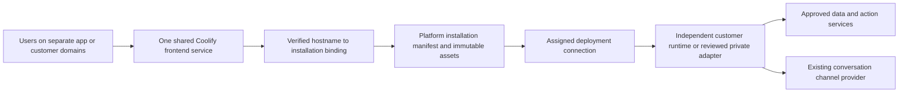

# 010.36 LoomAI Engage Standalone App Implementation Plan

- Status: implementation complete locally; immutable-image publication and hosted staging/production evidence in progress.
- Created: 2026-10-13.
- Execution priority: 2.
- Source review: Platform `db58acd9`; framework `561659dc`; source dependency AI Fabric `0.8.32`.
- Owners: generic AI Workspace, experience packs, and Platform installation/delivery.
- Product naming decision, 2026-10-13: **LoomAI Engage** is the commercial product name; **AI Workspace** remains the technical reference for its reusable interface and integration contracts.
- Authentication decision, 2026-10-13: support entry-time and action-time sign-in; login starts a new authenticated conversation. Anonymous-to-authenticated conversation transfer is excluded.
- Hosting and delivery decision, 2026-10-13: all twelve recommendations confirmed; use one shared frontend service on production Coolify with separate customer installations, domains, and assigned runtimes.
- Future mobile direction confirmed, 2026-10-14: one LoomAI Engage host app with a common AI Workspace renderer, remotely configured business experiences, reviewed bundled packs, business selection, and deep links. Build the web release to preserve this target; native implementation and publication are deferred.
- Related: [010.29](010_29_GENERIC_MAX_MODE_INJECTABLE_ACTION_UI_AND_DEALERSHIP_EXPERIENCE_PLAN.md), [010.31](010_31_PLATFORM_HOSTED_AI_WORKSPACE_INSTALLATION_AND_ASSIGNED_RUNTIME_DISCOVERY_PLAN.md), completed [010.34](010_34_TEMPORARY_HUMAN_CONVERSATION_HANDOVER_AND_LIVE_AGENT_EXTENSION_PLAN.md), [010.38](010_38_DEPLOYMENT_OWNED_WORKSPACE_STARTUP_CONTEXT_IMPLEMENTATION_PLAN.md).

## 1. Outcome And Verdict

Provide a standalone, responsive AI Workspace on a business-owned domain. It opens as the primary application surface and supports the same conversations, sources, attachments, governed actions, and human handover as the embedded workspace.

This is a delivery form of AI Workspace, not a new deployment behavior type. Templates, plugins, assigned runtimes, and reviewed experience packs remain the composition model. A customer can keep an existing website or use this workspace as a separate application address.

### 1.1 Product Name And Technical Reference

- **Commercial product:** LoomAI Engage.
- **Technical reference:** AI Workspace, including its reusable widget, installer, experience packs, connection profiles, and standalone shell.
- **Positioning:** AI experiences that connect people to a business and help them get things done using its knowledge, live systems, and permitted actions.
- **Creation command:** **Create AI App** in the Platform; each customer can give its own app a business-specific name.
- **Product boundary:** LoomAI Platform composes and operates the capabilities; LoomAI Engage delivers the user-facing experiences. Background Smart Brain execution is not renamed as Engage merely because it uses the same Platform.

Keep existing technical API paths, schemas, package identifiers, installation IDs, source directories, and related plan filenames unchanged by this naming decision. This is a commercial/technical vocabulary distinction, not an authorization change or a new execution engine.

### 1.2 Web Now, Mobile Target Later

The current implementation scope is the standalone web product on the shared Coolify frontend. A future mobile app is an explicit design target, not a current deliverable or an excuse to delay the web release.

The accepted future path is a **single LoomAI Engage host app**: its initial screen lets a user find a business, and selection or a business link opens that business's configured experience through the **common AI Workspace renderer**. Reuse the same UI code and reviewed component/pack contracts as the web delivery. A business is an installation/configuration/assigned-runtime binding, not a new renderer or native binary for each customer.

Implement now only the reusable boundaries that prevent a contradictory web design: typed configuration and data projections, host-independent core components, reviewed domain extensions, scoped identity/state, explicit mount/unmount lifecycle, and isolated host capabilities. Native business search/catalogue, store binaries, platform plugins, Universal/App Links, push, native credential persistence, and device/store verification are future work. Detailed future constraints are in section 9.

## 2. Current Code Evidence

- `max-mode-widget/src/entries/MaxModeWidget.tsx`: reusable full-workspace React entry with `isOpen`, `onClose`, API configuration, host config, features, and theme.
- `max-mode-widget/src/entries/iife.ts`: script entry with open/close, attachments, and send-message commands.
- `max-mode-widget/src/config.ts`: generic tool groups, command rail, presentation, theme, initial attachments, and host context.
- `max-mode-widget/src/installer/types.ts`: typed installation manifest and all three connection modes, including handover routes.
- `max-mode-widget/src/installer/install.ts`: immutable asset/pack loading, connection handlers, and assignment refresh.
- `experience-packs/dealership-experience/src/index.ts`: existing dealership-specific host configuration.
- `Platfrom/backend/src/main/java/com/ai/fabric/platform/backend/aiworkspace/service/AIWorkspaceExperiencePackRegistry.java`: currently accepts only `dealership@1.1.0`.
- `.../AIWorkspaceConfigurationValidator.java`: currently requires dealership configuration such as `dealer` and page kind.
- `.../AIWorkspaceConnectionProfileRegistry.java`: anonymous direct, conditionally configured authenticated broker, and Shopify private-adapter profiles.
- `max-mode-widget/src/config.ts`, `MaxModeRuntimeAuthConfig`: bearer-token supplier, anonymous bootstrap, renewal, and auth-context probing.
- `ai-infrastructure-module/ai-fabric-runtime/src/main/java/com/ai/fabric/runtime/auth/RuntimePublicTokenService.java`: separate anonymous and authenticated token issuance/validation primitives; it does not itself implement a customer identity-provider login flow.
- `max-mode-widget/src/chatResult.ts`: existing Shopify-oriented customer-account connect handling; general standalone authentication must use a domain-neutral contract.
- `Platfrom/ui/src/pages/AIWorkspacesPage.tsx`: installation management surface to extend.
- `Platfrom/backend/src/main/java/com/ai/fabric/platform/backend/productservice/model/CreatePlatformManagedProductServiceRequest.java` and `.../productservice/service/PlatformManagedProductServiceService.java`: managed-service registration, deployment targets, source/build settings, and desired replicas are foundations for the shared frontend. A reviewed standalone-workspace service binding remains implementation work.
- `.../productservice/service/PlatformManagedProductAdminService.java`: existing managed-service health and provider operations to reuse for the shared frontend lifecycle.
- `max-mode-widget/package.json` and `vite.config.ts`: React/TypeScript web library with Vite ESM/CJS output plus separate script/installer builds. These are reusable web assets, not a native mobile app project.
- `max-mode-widget/src/installer/install.ts`: browser script-element bootstrap, Platform-origin asset validation, remote script loading, and manifest-derived connection configuration. A packaged native shell needs an explicit reviewed bootstrap path rather than pretending its local origin is a customer website.
- `max-mode-widget/src/api/client.ts` and `context.ts`: browser `sessionStorage` persists session credentials/bindings and attachment state. This does not establish secure native credential storage or restoration after an app process is terminated.
- `max-mode-widget/src/hooks/useConversationHandover.ts`: foreground fetch-based event streaming and reconnect behavior. Native suspension/resume and optional background notifications need their own proof.
- `max-mode-widget/src/mount.ts` and `pageAttachment.ts`: embedded fixed-height/DOM mounting and current-page extraction. Native keyboard/safe-area behavior and the meaning of current-page context must be verified, not assumed from desktop embedding.
- `max-mode-widget/src/actionPresentation.ts`: exact action/renderer IDs, schema versions, bounded data projections, and registered React/custom-element renderers already separate generic presentation contracts from domain components. This is a common-renderer foundation, not proof of a universal component catalogue or native host.

The generic widget and manifest are implemented. A domain-neutral Platform experience pack and a supported standalone shell/lifecycle are missing. The existence of a broker handler does not prove a customer identity broker is configured. The current authenticated profile uses a Platform-configured broker URL; customer-specific authentication requires explicit reviewed customer/installation/deployment bindings, not an assumption that every customer shares one identity provider.

## 3. Proposed Architecture

Platform remains the installation/configuration and asset source; no CDN is required for this release. One shared frontend service on production Coolify serves the thin shell for registered app domains. Per-message traffic uses each customer's independently assigned runtime or configured private adapter. The shared frontend is not a chat gateway and does not hold customer provider credentials, conversations, indexes, or business effects.

### 3.1 Confirmed Decisions

The user confirmed all recommendations on 2026-10-13. These are accepted design decisions, not evidence of implemented or deployed support:

1. **Hosting:** LoomAI-managed production Coolify first. Customer-hosted frontend delivery is deferred; a full customer-hosted deployment bundle remains [010.41](010_41_CUSTOMER_HOSTED_DEPLOYMENT_BUNDLE_IMPLEMENTATION_PLAN.md).
2. **Frontend topology:** one shared, versioned frontend service; separate customer installations/configuration and domains. A dedicated frontend per customer is not required for the first release.
3. **Runtime isolation:** independent assigned runtime and tenant, identity, data, and action boundaries for each customer. Shared frontend delivery does not share customer state.
4. **Domains:** `<app-name>.apps.loomai.pro` by default, with an optional customer-owned domain such as `assistant.customer.com`. Activate only after ownership, DNS, TLS, and exact-origin checks.
5. **Creation:** a **Create AI App** workflow in the existing AI Workspace management surface. Bind an existing verified deployment or create one through the existing template workflow, then select pack, authentication policy, and domain.
6. **Authentication defaults:** public-facing templates use `PUBLIC_WITH_PROTECTED_CAPABILITIES`; private/internal templates use `LOGIN_REQUIRED`. The reviewed template declares the policy, not an LLM or browser guess.
7. **Identity integrations:** a generic customer-owned provider/adapter contract. Prove Supabase Auth first; standards-based OIDC follows. Preserve existing customer-session and Shopify private-adapter paths.
8. **Authentication broker:** deployment-local adapter by default; an existing reviewed customer backend is optional. Supported provider integration must not require a customer to author a new backend.
9. **Login transition:** start a new authenticated conversation, clear active anonymous state and pending work, and require a new user request. No anonymous conversation transfer, history merge, handover transfer, or automatic replay.
10. **Customization:** reviewed configuration and experience packs for branding, layouts, tools, prompts, and approved renderers. No arbitrary customer JavaScript upload/execution in the first release.
11. **Release ownership:** frontend, installation configuration, and runtime are separately versioned resources using existing Platform workflows. Routine frontend publication does not redeploy customer runtimes.
12. **Readiness:** verify each app's domain, installation, assignment, authentication, and representative interaction flows, including confirmation and human handover when enabled. Shared frontend health alone cannot make every app ready.

There is no arbitrary **100-app ceiling**. That number was illustrative, not a measured capacity claim. Use measured traffic, resource envelopes, routing/TLS behavior, and operational limits to establish capacity; [010.40](010_40_SMALL_PERSISTENT_LUCENE_DEPLOYMENT_PROFILE_IMPLEMENTATION_PLAN.md) covers runtime efficiency measurement separately from the shared frontend.

### 3.2 Shared Frontend And Customer Boundaries

Reuse the managed-product-service lifecycle for a reviewed shared workspace frontend service and its Coolify target. Do not create a frontend runtime role or a frontend container for every customer merely to serve installation-specific settings. Stage and verify changes on a separate staging instance before promoting the same immutable frontend artifact to production.

Customer-specific state remains bound to the installation, assigned deployment, and verified identity. Partition browser persistence and manifest caches accordingly; never share identity cookies across `.apps.loomai.pro` or cache one customer's configuration for another host. Keep secret-bearing authentication profiles server-side and expose only reviewed public metadata.

Shared delivery creates a shared frontend outage/release blast radius. Monitor the service independently, retain immutable release evidence, and test multiple installations before promotion. A frontend release changes delivery assets, not customer runtime ownership or assignment. Keep only the current supported contracts; do not introduce a parallel legacy product path.

### 3.3 Domain Binding And Activation

Bind each normalized exact hostname to one authorized installation through Platform-owned configuration, with uniqueness and customer-ownership validation. Resolve the browser hostname using this registered binding; do not accept a browser-provided runtime URL or installation override as authority. Unknown, disabled, or unverified hosts must fail closed.

Wildcard DNS for `*.apps.loomai.pro` simplifies resolution but does not authorize an app or prove proxy routing/TLS. Provision and verify the intended Coolify routes and certificate strategy explicitly. Customer-owned domains require their own DNS/ownership proof, TLS, exact-origin allowlist, and provider callback/logout bindings. Removing or moving a domain must revoke its installation/origin association safely.

### 3.4 App Creation And Resource Lifecycle

**Create AI App** composes existing resources rather than inventing a new AI execution type:

1. Select an existing verified customer deployment, or complete the existing template-based deployment workflow.
2. Create/bind its AI Workspace installation and select a reviewed generic or domain-specific experience pack.
3. Select the template's interaction policy and configure the reviewed authentication profile when needed.
4. Reserve the app slug/default hostname and optionally add a customer-owned domain.
5. Publish the installation/configuration revision, reconcile domain delivery, and run app-specific readiness checks.
6. Show the app URL and independently observable frontend, installation, domain, authentication, and runtime status.

A registered installation is not a verified runtime, and publishing a shell is not a successful app activation. Reuse existing deployment release/verification and consumer-assignment workflows. Deleting an app must not implicitly delete its independently managed runtime or customer data.

Proposed source locations:

- `workspace-apps/standalone-ai-workspace/`: thin app shell and static build.
- `experience-packs/generic-workspace-experience/`: domain-neutral default pack.
- existing widget/installer, Platform pack registry/validator, asset catalog, and installation UI.

These new locations are proposed. Do not copy the dealership demo frontend as generic product code.

## 4. Configuration And Lifecycle

Add typed installation presentation configuration for `embedded` versus `standalone`, with title, approved logo, theme, initial workspace view, and allowed host commands. Keep connection URLs and credentials outside customer-editable presentation data. Confirm the exact schema placement during implementation and use one current schema revision.

Standalone lifecycle must define:

1. Load the installation and obtain the selected auth context.
2. Open the primary workspace without a launcher or storefront dock.
3. Preserve conversation identity, messages, confirmed/pending actions, attachments, and handover state through navigation and reload within the same verified identity/session.
4. Replace widget close with an explicit supported app navigation/exit command, or omit it.
5. Keep new-conversation, sign-out, attachment removal, and navigation as separate commands.
6. Apply assignment changes to new sessions; never move an active conversation silently.
7. On anonymous-to-authenticated login, establish a new authenticated conversation and clear identity-bound anonymous state from the active workspace. Login is not a navigation or token-renewal event.

Browser context remains advisory. Host labels and attached pages cannot grant resource authority or select hidden action targets.

## 5. Authentication And Human In The Loop

### 5.1 Authentication Policy Is Separate From Transport

Support three configurable interaction policies. The names below are proposed contract values, not existing fields:

- `PUBLIC`: anonymous interaction with only the sources/actions allowed by deployment policy.
- `LOGIN_REQUIRED`: authenticate before any conversation, private evidence, startup reads, or AI interaction is available. A sign-in/loading shell may remain visible.
- `PUBLIC_WITH_PROTECTED_CAPABILITIES`: anonymous interaction is allowed; protected data or operations require sign-in at the point of use. Provide an explicit sign-in command as well.

These policies are not new runtime connection modes. A mixed installation needs approved anonymous and authenticated connection bindings to the same intended deployment; it must not swap to an arbitrary runtime after login.

Confirmed defaults: public-facing templates declare `PUBLIC_WITH_PROTECTED_CAPABILITIES`; private/internal templates declare `LOGIN_REQUIRED`. `PUBLIC` remains available only for a reviewed use case that needs no protected capability. A public template without an operational authenticated binding cannot claim mixed-mode readiness.

For example, public inventory and public policies may be anonymous, while an existing customer's reservation or account data may require authentication and resource ownership. A contact enquiry may remain anonymous when its action policy permits it. Name/email/phone intake is contact capture, not proof of a signed-in identity. A write does not automatically require login, and login does not replace action confirmation, Human Review, or domain authorization.

The runtime and authoritative action/data services enforce access. The workspace's entry screen and tool visibility improve the experience but are not the security boundary. An LLM cannot grant identity or override the declared policy.

### 5.2 Reuse Existing Connection Semantics

Support the existing declared connection modes:

- Anonymous: deployment-issued owner proof, renewal, exact-origin boundaries, and direct runtime routes.
- Authenticated: a real reviewed identity broker and deployment token validation. Do not activate from a UI toggle alone.
- Private adapter: the reviewed backend owns private credentials; the browser never receives assignment keys or private assertions.

Use a trusted deployment-local broker/authentication adapter by default. An existing reviewed customer backend is an optional integration path. Platform owns configuration/discovery; sign-in does not require a shared central per-message gateway or customer-authored backend code when a supported deployment-local adapter is selected.

The adapter validates issuer, subject, signature or verified provider session, audience/client binding, expiry, callback state, and customer/deployment membership. It derives permitted scopes and role/resource mappings server-side and supplies the supported short-lived deployment credential. Browser-supplied email, role, tenant, or scope is not authorization. Use Authorization Code with PKCE for supported browser OIDC flows; signing and confidential-client secrets stay server-side.

### 5.3 Authentication Integration Options

Implement one domain-neutral authentication adapter contract and prove customer-owned Supabase Auth first. Standards-based OIDC is the next provider integration, not a first-release compatibility claim. Preserve the existing customer-session and Shopify private-adapter paths while expanding the supported catalog:

1. Existing customer authentication: a reviewed backend/session adapter validates the customer's existing signed-in session and issues the supported deployment credential.
2. Standards-based OIDC: configure a reviewed provider/broker binding for supported customer identity systems, including Auth0 or Keycloak.
3. Supabase Auth: a provider adapter can support the customer's enabled password, passwordless, or social methods and validate the resulting identity before deployment credential issuance.
4. Shopify private path: retain the existing Bridge/customer-account flow where selected; do not put store-specific labels, URL assumptions, or account logic into the generic sign-in component.

Configuration belongs to the customer/installation's reviewed authentication profile: public provider/client information, approved redirect/logout origins, adapter reference, backend secret references, identity/scope mapping, and readiness evidence. Keep these settings separate from experience-pack presentation. Reuse connection-profile primitives; do not add a Marketplace plugin type merely to show a sign-in button.

External capability references: [Supabase Auth](https://supabase.com/docs/guides/auth), [Auth0 enterprise identity providers](https://auth0.com/docs/authenticate/identity-providers/enterprise-identity-providers), and [Keycloak OIDC](https://www.keycloak.org/securing-apps/oidc-layers). Provider compatibility is a planned integration until its configured end-to-end flow passes.

### 5.4 Login At A Protected Capability

The proposed generic flow is:

1. The runtime identifies the selected capability's authentication requirement and blocks protected access/effects before execution.
2. It returns a typed authentication requirement bound to the configured authentication profile. Distinguish missing authentication from a signed-in user lacking permission; do not interpret all access denials as invitations to log in.
3. The workspace shows a provider-neutral sign-in command using the reviewed configured integration. Do not detect login needs from answer text or model-supplied URLs.
4. On successful authentication, validate the new credential/auth context and create a new authenticated conversation.
5. Tell the user that sign-in started a new conversation. The user requests the operation again there.
6. Re-resolve trusted targets and enforce current scopes, resource ownership, confirmation/review, and domain authorization under the authenticated identity.

Do not automatically replay the anonymous query or execute its pending action after login. Do not retain anonymous extracted parameters, target/evidence handles, or confirmation receipts as authenticated authority. If a future product adds a user-reviewed task prefill, that is a separately specified capability, not implied conversation transfer.

### 5.5 Identity Transition And Session Lifecycle

Preserving an anonymous conversation after login is explicitly out of scope. Do not add an anonymous-owner claim/link/migration API, merge anonymous history into authenticated history, or relabel an anonymous subject as a user.

On successful login, clear the active anonymous conversation ID, messages, attachments, pending confirmations/actions, source/context handles, queued prompts, and client-side handover state. Namespace new state by the authenticated identity and connection binding. Failed/cancelled login leaves the anonymous session usable only where the mixed/public policy allows it and never performs the blocked operation.

Anonymous transcript retention and any active human queue remain owned by the original anonymous session under existing lifecycle rules. The new authenticated conversation cannot read or adopt them. Changing browser identity must not forge an AI-resume, human-release, or conversation-close command; existing channel work continues or terminates through its already authorized lifecycle.

Token renewal for the same verified subject/session preserves the current conversation. Logout/account switching clears the active identity-bound state and follows the entry policy: a login gate for `LOGIN_REQUIRED`, or a fresh anonymous session for the mixed policy. Revocation must prevent reuse of private context.

### 5.6 Completed Human In The Loop Baseline

Human Review and Conversation Handover are completed dependencies. Reuse existing control/event routes and Basic Inbox or a reviewed channel. Verify queue, human reply, reload, cancellation, and return to AI in the new app surface. Do not broaden handover into specialist-team or Smart Brain deployments.

These continuity checks apply within the same verified owner. They do not require transferring an anonymous handover to the newly authenticated conversation.

## 6. Implementation Phases

### W0. Separate Generic Pack And Shell Contracts

- [x] Apply LoomAI Engage commercial naming while retaining AI Workspace technical contracts and **Create AI App** terminology.
- [x] Define the shared frontend managed-service binding, installation/domain ownership, and independent app readiness contract.
- [x] Specify standalone presentation and lifecycle fields.
- [x] Define the small host capability boundary for credential/state storage, login callbacks, lifecycle, navigation, and attachments; keep native SDK imports outside the generic workspace.
- [x] Keep core UI, reviewed generic components, domain pack code, and business configuration separate so the same UI package can support future mobile delivery without business-specific forks.
- [x] Define explicit mount/unmount and identity-bound reset rules for one active installation; avoid design assumptions that prevent later safe business switching.
- [x] Define public, entry-gated, and mixed interaction policy independently from connection transport.
- [x] Define customer-scoped authentication adapter/profile, typed challenge, and new-conversation-on-login behavior.
- [x] Define the generic pack schema without vehicle, cart, dealership, or Shopify fields.
- [x] Generalize registry resolution to reviewed pack descriptors and pack-specific validators.
- [x] Preserve strict asset version/integrity checks and existing dealership validation.

### W1. Build The Standalone Shell

- [x] Build a thin shell using the existing installer/entry, shared controller, and styles.
- [x] Configure always-open layout with deliberate close/navigation behavior.
- [x] Implement loading, installation failure, expired identity, offline/reconnect, and disabled installation states.
- [x] Implement reviewed-provider sign-in, callback/cancel/failure, sign-out, and account-switch states behind the generic host capability contract.
- [x] Gate first interaction when required and show structured sign-in requests at protected capability points.
- [x] Keep tool groups, rail commands, and action renderers injected through the pack.
- [x] Reuse registered renderer/schema contracts for structured data and configuration; unsupported renderer requirements must be explicit, not arbitrary remote code execution or silent behavioral substitution.
- [x] Register/package generic and dealership packs through the same asset pipeline.
- [x] Produce a standalone static build with an `index.html` and local assets, suitable for later PWA/Capacitor packaging; do not couple the UI to a Coolify hostname.
- [x] Make the composer, tools, dialogs, and rich results usable with touch, safe areas, orientation changes, and an open software keyboard.

### W2. Add Platform Configuration And Delivery

- [x] Extend `AIWorkspacesPage` and installation APIs with the typed delivery configuration.
- [x] Add **Create AI App** using existing deployment templates, verified assignments, installation creation, and reviewed pack selection.
- [x] Expose the supported shell URL and instructions for a customer domain.
- [x] Add unique app-slug/default-hostname reservation and exact-host installation bindings; reject unknown or unverified hosts.
- [x] Reconcile and verify Coolify routes, DNS/TLS, domain ownership, and domain removal/rebinding with safe origin/callback updates.
- [x] Validate the exact origin, deployment assignment, pack/schema, asset versions, and connection readiness before activation.
- [x] Add reviewed authentication profile/broker bindings and interaction-policy controls to installation configuration.
- [x] Validate current-provider configuration and deployment-owned issuer/JWK/audience/origin/scope bindings server-side; expose only safe public login metadata.
- [x] Keep installation/connection resolution explicit and host-independent internally; web hostname lookup remains the approved web bootstrap. Native origin/client bindings are a separately verified future profile, not a wildcard web-origin exception.
- [ ] Register and deploy one shared standalone frontend service on production Coolify through the existing managed-service lifecycle.
- [ ] Prove the same immutable frontend artifact on a separate staging service before production promotion.
- [x] Keep frontend publication, installation revisions, runtime release/assignment, and app activation independently observable; do not redeploy runtimes for routine frontend updates.
- [x] Implement app-specific readiness reporting rather than inheriting success from shared frontend health.
- [x] Keep hosting configuration replaceable without changing chat/runtime ownership.

### W3. Preserve State And Security

- [x] Prove two separate app hostnames resolve only their registered installations in the shared-shell browser contract; hosted assigned-runtime evidence remains a rollout gate.
- [x] Prove browser persistence and authentication state are namespaced across apps and identities; hosted cookie/provider evidence remains a rollout gate.
- [ ] Prove page changes and reload preserve the same owned conversation and attachments.
- [ ] Prove identity renewal preserves anonymous ownership and active handover.
- [ ] Prove successful login starts a new authenticated conversation and clears active anonymous messages, attachments, pending work, and evidence handles.
- [ ] Prove failed/cancelled login cannot execute a blocked operation or silently expand access.
- [ ] Prove protected actions and private retrieval are denied server-side before authentication, even with a modified browser.
- [x] Prove login does not replay an anonymous request and resets the anonymous installation namespace; hosted confirmation/handover evidence remains a rollout gate.
- [ ] Prove sign-out/revocation prevents old private-context reuse.
- [x] Define interrupted-request recovery through authoritative readback; never automatically resend a possibly executed write after reconnect or foreground resume.
- [x] Prevent an assignment revision change from copying an active session to another deployment; hosted reassignment evidence remains a rollout gate.
- [ ] Add a real customer-owned Supabase Auth/deployment-local broker canary before claiming authenticated standalone support.
- [ ] Regress existing customer-session and Shopify private-adapter paths when shared authentication code changes; keep OIDC readiness separate until proved.

### W4. Release And External Guide

- [ ] Demonstrate generic knowledge/support and dealership packs on the same shell.
- [ ] Verify desktop, narrow mobile, keyboard, accessibility, and safe-area layout.
- [x] Document domain, installation, authentication policies/providers, the fresh-conversation login boundary, pack customization, and operator recovery.
- [ ] Record exact deployment, asset versions, browser requests, and live results.
- [ ] Verify per-app activation failures and shared frontend outage/recovery without falsely marking customer runtimes or other app checks successful.
- [ ] Measure shared frontend load/resource use and record operational limits without introducing an unmeasured 100-app cap.
- [x] Document web-first delivery and the later PWA/Capacitor path, including the work not covered by web readiness or commercial naming.
- [x] Review the web implementation against the future common-renderer host constraints; no contradictory dependency was introduced by the shared web shell or typed host-capability boundary.

### 6.1 Implementation Evidence, 2026-10-14

- Platform schema: migration `V158` adds delivery, app slug, interaction policy,
  authentication profile/configuration, and exact domain ownership records.
- Platform control plane: **Create AI App**, reviewed generic/dealership packs,
  standalone domain status, DNS instructions, route verification, app-specific
  readiness, exact-host bootstrap, and manifest v2 are implemented.
- Domain operation: customer TXT ownership precedes Coolify route activation;
  route reconciliation tracks only Platform-owned domains; TLS health uses the
  approved resolved addresses directly and follows no redirect.
- Frontend: `workspace-apps/standalone-ai-workspace` implements the shared shell,
  Supabase entry/action-time authentication, identity-scoped storage, offline and
  failure states, and immutable installer loading.
- Runtime: the deployment-local external identity broker validates provider JWT
  issuer, JWK signature, audience, expiry, verified-email policy, exact origin,
  and rate limits before issuing bounded runtime tokens.
- Publication: standalone source changes have a dedicated image workflow; core
  backend/UI publication now builds only the image affected by changed paths.
- Local evidence: the clean Platform backend gate applied all 158 migrations
  in PostgreSQL Testcontainers and passed 42/42 focused tests. The clean runtime
  broker/startup gate passed 15/15. Widget type/build and four contract smokes,
  generic-pack type/build, Platform UI build/smoke, and the full public-site
  browser integration smoke passed. The standalone shell passed type/build,
  its server contract, six browser scenarios, and a production Docker image
  health/configuration probe with the intended security headers.
- Identity hardening: password and magic-link login both remove anonymous app
  state before mounting an authenticated workspace; logout removes private and
  stale anonymous state before returning to the entry policy; expired or
  malformed provider sessions cannot restore private workspace state. The
  deployment-local broker now refuses startup without complete deployment,
  customer, and tenant ownership defaults.
- Hosted evidence still required: publish immutable images, reconcile the shared
  staging service, prove two real app hosts and a real Supabase broker, promote
  the same source revision to production, and regress dealership/Shopify paths.

## 7. Verification And Completion

Focused contract tests cover registry selection, generic/dealership schema isolation, manifest integrity, and readiness denial. Browser tests cover tools, attachments, action confirmation/rendering, source access, history, handover, and reconnection. Hosted canaries cover allowed/denied origins, direct traffic topology, identity boundaries, assignment changes, and custom-domain TLS.

Hosting verification must cover at least two separately bound app domains on the same frontend, an unknown hostname, a disabled installation, invalid DNS/TLS, and an unready assigned runtime. Prove that frontend health can remain green while an individual app is correctly blocked. Verify cache/state isolation, exact authentication redirects, and frontend promotion/recovery across both installations; record routing and capacity measurements separately from runtime health.

The authentication matrix must include entry-gated sign-in; mixed anonymous
public use followed by a protected capability; denied signed-in permissions;
cancelled/failed sign-in; expiry/renewal; logout/account switching; and a real
configured provider/broker. Prove fresh-conversation login behavior with an
anonymous conversation containing attachments and pending work. Existing
anonymous history must remain unavailable under the new authenticated owner,
and the blocked action must execute only after a new authorized request and
its required confirmation/review.

Extend the existing `AIWorkspaceConfigurationValidatorTest`,
`AIWorkspaceInstallationServiceTest`, `PublicAIWorkspaceManifestServiceTest`,
`AIWorkspaceAssetCatalogServiceTest`, and `PublicAIWorkspaceControllerTest` in
the Platform backend. Reuse `ConversationHandoverControllerTest` and
`RuntimeConversationHandoverServiceTest` as runtime regression coverage when
shared auth/routes change. New shell-specific browser tests belong with the
standalone application, not in a copied dealership-only test harness.

Complete when two distinct packs and separate customer app domains share one generic Coolify frontend, **Create AI App** can reach verified activation through existing Platform resources, the supported auth paths have real evidence, and no business logic or product-specific default controls have entered generic components. Source and capability checkboxes alone are insufficient. OIDC, customer-hosted frontend, and dedicated frontend variants are not implied first-release claims.

Web completion also requires a design/source check against section 9's portability constraints. It does **not** require a mobile business catalogue, a native app, an app-store submission, or completed M1-M3 checks. Keep these later capabilities explicitly unimplemented until they have their own execution approval and evidence.

## 8. Release Impact And Risks

No framework release is expected merely for sign-in UI or provider integration. Trace any missing reusable typed authentication-requirement contract before claiming a framework change is necessary; a generic access-denied error is not itself a complete login challenge. Widget/pack/Platform/runtime adapter contracts and asset versions may change together under the current-only policy. Keep existing embedded installation and Shopify adapter behavior verified when shared code changes. No framework owner-transfer contract is required because anonymous conversation preservation is excluded.

Principal risks are accidental dealership-only configuration, close-button semantics inherited from embedding, stale identity/session state, assignment switching across active conversations, cross-host configuration/cache leakage, and the shared frontend's release/outage blast radius. Treat those as specific implementation/verification tasks, not reasons to recreate the runtime or Human in the Loop.

## 9. Mobile Delivery Verdict And Build Constraints

### 9.1 Technical Verdict

**Confirmed future path: one LoomAI Engage iOS/Android host app using a common AI Workspace renderer and remotely configured business experiences. Implement the web product first; native delivery remains future work.** The existing React, TypeScript, DOM/CSS, and Vite stack supports substantial reuse. Capacitor remains the preferred packaging candidate for later evaluation: it accepts an existing web project with built assets and an `index.html` and supplies the native container rather than replacing the web UI. [Capacitor overview](https://capacitorjs.com/docs), [installation requirements](https://capacitorjs.com/docs/getting-started).

Do not promise "without changes." The goal is **no second workspace UI or AI engine**, with limited, explicit host integration for identity, storage, device lifecycle, routing, permissions, and packaging. Keep deployment-local chat, retrieval, actions, and human-control APIs as the data plane; any missing native-client authentication/bootstrap contract must be proved and addressed before claiming mobile support.

Delivery choices:

1. **Installable PWA:** lowest additional delivery effort, preserving the shared Coolify frontend and HTTPS business domain. Add an app-specific web manifest, icons, launch scope, and browser-tested installation behavior. It is a web app, not automatically an App Store/Play Store listing. A service worker is an optional offline/update capability, not permission to cache private responses. [MDN installability guide](https://developer.mozilla.org/en-US/docs/Web/Progressive_web_apps/Guides/Making_PWAs_installable).
2. **Common-renderer native host, with Capacitor as the preferred candidate:** bundle the reusable UI and approved pack/component implementations, fetch safe business configuration, and connect to the selected business's assigned runtime. The app does not need to load a separately hosted business web page to render each experience. The same UI code serves the browser through Coolify; Platform remains configuration/asset authority, and Coolify continues operating the backend services. Adding or hiding businesses/configuration stays dynamic; adding new executable renderers or native capabilities requires a reviewed app release.
3. **React Native or Flutter:** consider only if a later requirement demands a substantially different native interface. React Native uses native view components rather than the current DOM/CSS components; it is not a zero-rewrite conversion of this workspace. [React Native component model](https://reactnative.dev/docs/intro-react-native-components).

Ionic UI is not required merely to use Capacitor. Preserve the existing React interface and design system rather than replacing components solely for packaging.

A hosted-business-page WebView remains a technically possible alternative, but it is **not the selected primary future path**. Do not make arbitrary hosted-page execution or downloading unreviewed executable packs a requirement of the current web architecture. This distinction is an engineering decision, not a claim that Apple or Android categorically prohibits remote web experiences.

### 9.2 Constraints To Apply While Building The Web Release

1. **Reusable UI and a thin host:** mount the same generic workspace and reviewed pack in the web shell or future native shell. Common rendering means reusable components/contracts, not identical screens or one hard-coded workflow for every business. Keep credentials, lifecycle, navigation, device attachment selection, and persistence behind a small typed host capability boundary. Declare unsupported capabilities explicitly. Do not put dealership logic or Capacitor imports into generic conversation/action components, and do not invent a broad proprietary UI language solely for this future path.
2. **Reviewed bootstrap and authority:** web apps resolve exact registered hostnames. A bundled native app needs an explicit approved app/client-to-installation binding, not `window.location.hostname` as its customer identity. Validate native origin/CORS and credential issuance independently; no wildcard origins, no secret in the binary, and no authorization based only on a spoofable app ID, Origin, or deep link. Preserve assignment verification and active-conversation isolation.
3. **Native authentication:** prepare the adapter contract for externally completed sign-in and registered callbacks without hard-coding browser cookies. OAuth native clients use an external user-agent and Authorization Code with PKCE, not provider login inside the workspace WebView. Validate state, callback, audience, subject, expiry, and approved installation/deployment scope. Preserve the confirmed fresh authenticated conversation after login and no replay/anonymous transfer. [RFC 8252](https://www.rfc-editor.org/rfc/rfc8252), [Capacitor deep links](https://capacitorjs.com/docs/guides/deep-links).
4. **State versus secrets:** separate non-sensitive presentation preferences from owner proofs, tokens, attachments, and pending work. A native host must use a reviewed Keychain/Keystore-backed mechanism for persistent credentials; ordinary preferences are not the security boundary. Do not assume browser `sessionStorage` survives termination or that client state can grant conversation access. Restore only after the current identity/assignment is validated. [Capacitor preferences](https://capacitorjs.com/docs/apis/preferences).
5. **Mobile interaction:** design for narrow screens, touch targets, accessibility, font enlargement, software keyboard resizing, dynamic viewport height, safe-area insets, orientation changes, and Android back behavior. A back gesture must not execute an action, erase a conversation, or end handover accidentally. Browser screenshots alone do not prove WebView/device behavior.
6. **Suspension and interrupted work:** close/reconnect foreground streams deliberately and reconcile current control/transcript on resume, using the existing durable event cursor where supported. Do not assume a browser stream stays alive while a phone locks. Interrupted writes require status/readback and idempotency support; never resend a confirmation or treat an unknown outcome as failure/success. Notifications, if later selected, are separately scoped hints that lead to authenticated readback, not action commands. [Capacitor app lifecycle](https://capacitorjs.com/docs/apis/app).
7. **Attachments and page context:** preserve generic typed attachments and host-supplied current-screen context. A native workspace can attach its own supported screen content; it cannot silently inspect another app, an unrelated website, or the dealership page that is not loaded inside it. Add file/camera/share adapters only with declared permissions, bounded size/type rules, and reviewed storage/retention behavior.
8. **Online and offline behavior:** AI execution and authoritative business operations require connectivity in this design. An optional service worker may cache the immutable app shell; exclude credentials, manifests with identity-sensitive configuration, private transcripts/evidence, and write requests from shared/offline caches. Show offline/pending/unknown states honestly; no background queue that silently replays business writes.
9. **Reviewed code and release identity:** package a known immutable workspace/pack build for native delivery. Do not ship production as a WebView pointed at an arbitrary remote site, enable broad native bridges for external pages, or use live-reload configuration as a release shortcut. Capacitor documents `server.url` as development/live-reload configuration rather than production delivery. Native binary, workspace assets, installation configuration, and runtime remain separately identifiable; current-only contracts must fail clearly when a client requires update. [Capacitor configuration](https://capacitorjs.com/docs/config).

These are portability constraints for the first web implementation. They do not authorize installing mobile dependencies, shipping native plugins, broadening authentication origin policy, or promising push/offline/native support in the first release.

### 9.3 Later Mobile Adoption And Evidence

Native and PWA delivery are later, separately approved **implementation work**. The future architectural direction is agreed; execution has not started. The standalone web release is not blocked on a store submission or native SDK rollout. The first native direction is one Engage host app with business selection and common rendering. Dedicated customer-branded binaries are a possible subsequent delivery form, not part of the current release or a reason to fork the shared UI.

- [ ] **M1, PWA:** prove app-specific branding/start scope and installation on supported iOS/Android browsers; verify tenant-safe cache/update and offline behavior.
- [ ] **M2, common-renderer host canary:** confirm packaging technology, bundle reviewed components/packs, add approved business discovery and installation resolution, and exercise one real iOS device and one Android device against actual assigned runtimes.
- [ ] **M2, links and dynamic configuration:** prove verified links open the intended business or fall back to its web app, and published businesses/visibility/configuration can change without a binary release when supported by the bundled catalogue.
- [ ] **M2, critical checks:** prove anonymous ownership, authenticated entry/action-time login, exact callbacks, secure credential restoration, logout, account switching, foreground/background/relaunch, event replay, attachment permissions, keyboard/back behavior, confirmations, human handover, interrupted-write readback, and cross-business teardown/state isolation.
- [ ] **M3, release:** record immutable web/native identities, signed artifacts, provider/plugin versions, privacy/permission declarations, customer branding/rights, distribution ownership, store-policy assessment, and device results before any supported native-app claim.

Store approval is independent of successful packaging. Apple requires utility beyond a repackaged website and imposes specific rules for commercial template-generated and hosted experiences. Its aggregated-app and mini-app provisions are relevant, but bundling a renderer is not an automatic exemption. Assess catalogue/link metadata, privacy/consent, moderation/reporting, age controls, purchases where applicable, native API exposure, and applicable Apple/Google policies at the future submission. Do not promise approval or require enrollment in Apple's optional Mini Apps Partner Program merely to deliver this architecture. [Apple guidelines, 4.2, 4.2.6 and 4.7](https://developer.apple.com/app-store/review/guidelines/).

No framework release is expected solely for PWA or Capacitor delivery. Generic runtime/native-client contract gaps, if proved, belong to their actual owning layer; do not hide them behind a mobile-side bypass.

### 9.4 Future Shared Host And Dynamic Business Apps

This section records the 2026-10-14 future direction only; it does not authorize immediate mobile implementation.

The host may initially present only business-name search and an explicit business selector. A published business share link selects the same installation without requiring search. The resulting experience is rendered by the shared core and approved bundled generic/domain components. A full public discovery marketplace, recommendations, favorites, QR tools, and notifications are optional later capabilities, not implied current scope.

1. **Dynamic discovery/configuration:** Platform publishes safe business metadata and configuration using existing installation, pack, assignment, and readiness primitives. New businesses, supported tool configuration, branding, and visibility changes do not inherently require a native binary update. Private/unlisted visibility and authoritative access policy remain distinct from search results; hiding an entry does not revoke access by itself.
2. **Controlled executable catalogue:** native delivery contains reviewed renderer/pack code. Remote configuration selects known capabilities and binds approved data/action schemas; it does not supply arbitrary JavaScript, native plugins, provider credentials, or action authority. New executable components require an app release unless a different delivery mechanism is separately designed and approved.
3. **Scoped switching:** initially render one active business. Explicitly cancel/unmount prior streams/controllers and keep storage, owner proofs, conversations, attachments, pending actions, and handover bound to their installation/deployment/identity. Retain earlier sessions separately only when their existing lifecycle allows it; validate the same owner before restoring them. Never migrate state between businesses or between anonymous and authenticated identities.
4. **Business authentication:** anonymous access works only under the selected business's policy. A host account or installation ID is not permission for business data/actions. Keep customer-owned provider/adapter bindings, fresh authenticated conversations, and runtime authorization independent; do not introduce a central chat/auth bypass.
5. **Verified links:** a future canonical LoomAI-owned HTTPS link resolves an approved public app reference, then selects its installation. Register Universal Links/App Links and preserve web fallback. Links cannot name arbitrary runtime URLs or grant private ownership. The link domain/path and native association files are future delivery configuration, not live endpoints added by this plan.
6. **Same source, separate delivery:** the browser receives the shared web build from production Coolify; the future host packages the same core and reviewed pack code. Both obtain customer-specific configuration from Platform and use assigned deployment-local APIs. A native app has its own signed release and capability checks, without turning the Platform into a shared per-message gateway.

At the future mobile gate, prove at least two distinct business sectors on the same core and record where extra domain components were required. Do not infer universal app support from one dealership canary. Modern declarative UI and mini-app approaches inform this design; no A2UI, AG-UI, or other protocol implementation/compatibility is claimed or required by this decision.
