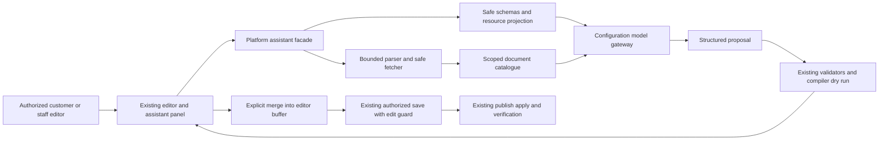

# 010.37 Platform Configuration Assistant Implementation Plan

- Status: planned; implementation not started.
- Created: 2026-10-13. Expanded: 2026-11-09.
- Source baseline: `2d4922564a707f987850ed353c13c4e9dd585d93`.
- Owner: Platform customer and staff authoring experience.
- Scope: API documentation import, guided configuration, structured proposals and integration with existing editors. This is not a deployment or framework release record.
- Related: [coding assistant skill](010_35_AI_FABRIC_CODING_ASSISTANT_SKILL_IMPLEMENTATION_PLAN.md), [semantic decisions](010_33_LLM_DRIVEN_SEMANTIC_DECISIONS_AND_EXPLICIT_RECOVERY_POLICY_PLAN.md), [UI entry points](../../../../../../../../Final_Documentation/Development_Guides/PLATFORM_UI_PROFILES.md).

## 1. Product Outcome

Help customers and authorized staff configure useful AI capabilities without manually translating every API endpoint, parameter, response field and connection setting into LoomAI JSON.

The customer describes the outcome, supplies documentation or examples, answers a small number of missing questions, and reviews a configuration proposal. Accepted changes enter the existing editor. Saving, publishing, deploying, testing connections and indexing retain their existing explicit workflows.

Example customer request:

> Here is our Swagger file. Let customers search our catalogue, see current availability and submit an enquiry after confirmation. Also index our catalogue for recommendations. Help me connect it.

The result should coordinate supported action definitions, HTTP routing, a private Data plugin and required connection inputs. Importing Swagger does not install a new connector protocol or grant API access.

### 1.1 Architecture Decision

Start with a provider-independent, schema-aware assistant using server-side OpenAI or Anthropic model APIs, structured outputs and a small scoped read/check tool surface. Do not embed a terminal, desktop application, browser automation agent or unrestricted coding workspace.

Implement this in the existing Platform backend and UI. Do not allocate a runtime, vector store or customer business database per assistant session. The older requirement in this plan for a dedicated assistant deployment is superseded for the initial release. A shared LoomAI assistant deployment can remain a later transport option if it supports the same structured contract without authoring side effects.

Full Codex or Claude Agent SDK execution is deferred to connector-code generation and testing. JSON authoring must not depend on it. No framework binary change is expected; raise an evidenced framework gap before expanding scope.

### 1.2 Governing Rules

- Preserve current plugin types and adapter contracts; this is an authoring aid, not a new plugin engine.
- Interpret user intent, operation purpose, mappings and suggestions through the LLM, not keyword/regex heuristics.
- Parse formal API structure, JSON paths, IDs, enums and types deterministically. This is contract processing, not semantic inference.
- Enforce ownership, authorization, trusted IDs, credentials, execution limits and declared confirmation independently of model output.
- Never silently publish, deploy, execute a business action, start indexing, change assignments or modify infrastructure allowances.
- Keep manual forms and JSON editing available if the assistant is unavailable.
- Preserve approved resource navigation. Do not restore the rejected 010.65 global customer redesign or duplicate existing editors.

## 2. Current Code And Implementation Gaps

### 2.1 Existing UI To Reuse

- `Platfrom/ui/src/pages/ActionsPage.tsx`: action JSON, access, webhooks, connector routing, query/body templates and draft saving.
- `Platfrom/ui/src/pluginLibrary/PluginLibraryPage.tsx`: private definition authoring, checks, reusable versions and installation return links.
- `Platfrom/ui/src/pluginLibrary/creatorDocument.ts` and `CreatorFields.tsx`: HTTP JSON/bound S3 contracts, mapping, pagination, account scope and installation fields.
- `Platfrom/ui/src/pages/PromptsPage.tsx`, `BehaviorPage.tsx` and `ProvidersPage.tsx`: prompts, behaviours and provider settings.
- `Platfrom/ui/src/pages/DocumentKnowledgePage.tsx` and `IntegrationsPage.tsx`: knowledge sources, storage and connections.
- `Platfrom/ui/src/pages/AIWorkspacesPage.tsx`: Engage configuration, preview, installation and domains.
- `Platfrom/ui/src/brain/brainNavigation.ts`: canonical Brain-scoped navigation. Account/app authoring keep their existing roots.

### 2.2 Existing Backend To Reuse

Paths below are relative to `Platfrom/backend/src/main/java/com/ai/fabric/platform/backend/`.

- `deployment/web/DeploymentController.java` and `deployment/model/UpdateDeploymentDraftRequest.java`: drafts, validation, publication and releases.
- `deployment/service/DeploymentService.java`: editor authorization, editable-draft rules, persistence and audit.
- `deployment/service/DeploymentDraftValidationService.java`, `DeploymentConfigCompiler.java` and `DeploymentMarketplaceDraftCompilerService.java`: validation/compilation.
- `marketplace/web/CustomerPluginLibraryController.java` and `marketplace/service/CustomerPluginLibraryService.java`: workspace-owned definitions, expected revisions, checks and immutable versions.
- `marketplace/service/MarketplaceManifestService.java` and `marketplace/web/MarketplaceController.java`: catalogues, contributions, installation and existing MCP discovery/import.
- `deployment/behavior/DeploymentBehaviorCatalogService.java`: supported behaviour, specialist and execution-extension contracts.
- `aiworkspace/service/AIWorkspaceConfigurationValidator.java` and related readiness/security projection services: Engage validation and connection rules.

### 2.3 New Work Required

The inspected source has no assistant facade, API-document import workflow or assistant proposal lifecycle. Runtime Swagger links are not customer API imports. Existing MCP discovery is not an OpenAPI importer.

The backend has no general model-generation gateway. Provider connectivity probes are not authoring inference calls. Add a small new `ConfigurationModelGateway`; do not assume the runtime chat route accepts arbitrary output schemas.

Concurrency needs a focused fix: the draft update DTO has no expected edit version. `revisionNumber` advances when constructing a subsequent published draft, not on every edit. The repository has `findByIdForUpdate`, but ordinary `updateDraftInternal` reads through `findById`. A browser fetch-before-save is not atomic. Reuse private plugins' existing expected-revision contract and introduce shared atomic edit protection where missing.

Some legacy action-routing fields can contain authentication values. Never send an entire raw draft to a provider. Use allowlisted, redacted projections and secure existing credential controls.

## 3. Input Heavy Areas Covered

### 3.1 Actions And Capabilities

Entry: the existing Brain AI capabilities/actions editor and capability installer.

Inputs: a desired outcome, selected OpenAPI operations, API documentation, an existing action, request/response examples or a safe cURL example.

Prepare action names/descriptions, typed required parameters, user-supplied versus trusted-context inputs, supported authentication/confirmation settings, HTTP routing, request mapping and declared response presentation. Show missing connection/secret/account references as unresolved selections. Recommend existing compatible plugins when they already solve the requirement.

Do not classify safety from HTTP verbs alone: POST can be search and a documented GET can have effects. Use documented semantics and LLM interpretation; unresolved effect/authorization questions remain visible and cannot grant execution access. READ actions need no vector space unless their declared contract actually requires one.

### 3.2 Connections And Endpoint Routing

Entry: current connection/routing forms associated with the selected Brain or plugin.

Prepare base URL suggestions, relative routes, path/query/header/body placement, supported authentication references, pagination, timeouts and response fields. Explain source-specific security requirements and staging/production server differences.

A documented auth scheme is not proof the selected connector supports it. For example, private HTTP Data forms currently expose API-key and form-token-exchange configuration, not arbitrary OAuth, browser cookies or mTLS. Report unsupported requirements instead of inventing config.

Secrets, approved hosts and authorized provider accounts use secure forms. OpenAPI `servers` and security declarations do not authorize network calls or modify bindings.

### 3.3 Private Data Plugins And Indexing Mappings

Entry: `/library/plugins`, retaining its existing return-to-Brain installation path.

From documentation/samples, propose an existing HTTP JSON Data definition: collection path, record ID, content, metadata/entity fields, supported pagination, update/deletion handling and synchronization schedule. Preserve account-resource placement and private-source isolation.

For bound S3 definitions, prepare supported document policies and connection-reference inputs. Hosted/BYO storage selection and credentials remain separate. Do not provision storage because a model suggests it.

If stable IDs, ownership fields or deletion semantics are missing, explain the exact gap. Never manufacture IDs from names, assume incomplete pagination is a full snapshot or claim deletion reconciliation without its contract. Reusable definitions and installation inputs are distinct.

Customer SQL/folder authoring, arbitrary new protocols and executable connector code are not silently enabled by generated JSON.

### 3.4 Knowledge And Search

Entry: existing Knowledge sources and Search settings tasks.

Help describe collections, select existing authorized sources, map entity/search fields and prepare supported indexing policies. Guide storage/prefix selection using real authorized bindings. Explain embedding configuration and compatibility from the actual service catalogue.

Preparation is not document approval or indexing. Retain discovery, preview, approval and reconciliation. Do not index imported API docs automatically, copy vectors during promotion or silently search every source.

### 3.5 AI Behaviour And Prompts

Entry: existing responses/prompts and supported behaviour editor.

Translate customer intent into current tone, answer-breadth, answer-length and next-step profiles, or an explicit Custom prompt proposal. Accept business guidance as reference and show exact changes in Advanced.

Do not add phrase-based output rewriting, semantic text matchers, undeclared recovery or web search. Answer breadth is not sampling temperature, permission to invent business facts or new authority.

### 3.6 Models And Vector Services

Entry: AI models and Knowledge -> Search settings.

Help choose supported, authorized services and fill their actual connection fields. Explain embeddings, dimensions and compatibility using the loaded configuration rather than generic provider defaults.

Do not promise every model ID is available, guess credentials, change funding or provision infrastructure. Explain any existing reindex/migration requirement without starting it.

### 3.7 Engage Presentation And Installation

Entry: existing branding, tools, preview, installation and domain configuration.

Prepare branding, starter questions, supported tool groups/rail items, authentication/handover presentation and registered renderer selections. Accepted changes feed the existing real preview.

Use supported configuration, not generated executable JavaScript. Distinguish website embed, Max mode and standalone app. No silent deployment reassignment, origin grant, DNS verification, domain activation or identity-provider redirect change; link to the existing explicit operation.

### 3.8 Human Support And Review

Entry: current Human support and Action reviews configuration.

Help prepare supported handover settings, contact fields and service-binding requirements using authorized existing Desk references. Keep agent invitations/assignment, operator permissions and review decisions explicit and separate.

Customers and staff use the same authoring surface with their actual permissions. There is no new assistant privilege or automatic approval authority.

### 3.9 Specialists And Plans

Entry: existing behaviour/specialist configuration wherever its contract is supported.

Guide available bundles, sequential/parallel chains, event inputs, schedules and delivery settings using the real catalogue and deployment type. Explain outcomes and missing worker/binding requirements.

Do not generate a new Java worker, executable bundle, unsupported chain node or behaviour type. Preserve useful supported configuration and identify requirements needing code. This area follows the actions/Data vertical slice but is included in full completion.

### 3.10 Kit Setup

Guide an already-created Kit through existing resource editors. Use a lightweight sequence of links to Brain, private plugin and Engage tasks, not a second Kit creator or hidden orchestration engine.

One proposal targets one resource. Actions/routing can change together within a Brain draft; a private plugin and an Engage app are separate proposals/saves. Do not imply a distributed atomic transaction across them. Preserve developer-created staging-only policy.

## 4. Customer Journey And Layout

### 4.1 One Reusable Assistant Panel

Add an icon plus `Build with AI` in complex editors and `Help configure` on relevant setup tasks. Do not put an assistant beside every simple field or create another global navigation section.

Use approved resource workspaces and light/dark themes. Desktop opens a resizable right panel beside the editor/preview; narrow screens use a dismissible full-height panel returning to the same editor. Keep primary commands fixed and content independently scrollable.

```text
Smart Brain > AI capabilities                         Build with AI
-------------------------------------------------------------------
Existing editor / preview        | Configuration assistant       [x]
                                | Outcome: Search our catalogue
Action list and selected form   | Sources: catalogue-api.yaml
                                | Understand -> Choose -> Review
Unchanged fields remain visible | 3 operations selected
                                | 2 connection details needed
                                | [Review proposed changes]
-------------------------------------------------------------------
Existing Save draft command     | No live changes
```

Use outcome language: `What should your AI help people do?`, `Share your API documentation`, `What I can configure`, `Details I still need` and `Review changes`. Keep JSON, schema details and diagnostics under Advanced.

### 4.2 Guided API Setup

1. **Describe the outcome.** Add a capability or improve the selected existing configuration.
2. **Share documentation.** Upload/paste a specification, provide a documentation URL, paste prose or add request/response examples. Allow multiple named sources with extraction status.
3. **Choose capabilities.** Show method/path, readable purpose, source reference and suggested use: live read, indexing source or proposed write. The LLM recommends a bounded subset; the user confirms it. Never select by keyword heuristics.
4. **Resolve missing details.** Reuse session answers, group related questions and keep optional inputs optional. Provide secure binding selectors rather than a wall of empty fields.
5. **Review changes.** Show added/changed/removed fields, before/after values, citations, assumptions, dependencies, unresolved bindings and validation.
6. **Use in editor.** Merge reviewed changes into the current buffer after a stale-buffer check. Update forms and preview; mark `Not saved`.
7. **Save and test.** Use the existing save command. Offer the appropriate explicit connection test, validation or indexing-preview link, separate from generation.
8. **Publish and deploy.** Continue through normal Updates; the assistant cannot perform it.

### 4.3 Avoid Repeated Inputs

Maintain one session answer sheet containing confirmed choices, discovered schema facts and unresolved questions, each with provenance and target. It is not a globally inferred customer preference.

Pre-fill only documented structural facts, current configuration, explicit answers or declared technical defaults. Label suggestions. Never fill required secrets, trusted account IDs or undocumented endpoints with invented values that appear executable.

Offer focused commands: `Use this operation`, `Add another endpoint`, `Use this response example`, `Explain this field`, `Revise` and `Discard`. Subsequent manual edits must not be overwritten by another turn without conflict review.

Closing preserves the editor buffer. Reopening restores the original resource session. Switching resources never carries credentials, proposals or authority across boundaries.

### 4.4 Worked Example

A customer uploads a specification and a sample containing `/items`, `/nextCursor`, and record fields `id`, `accountId`, `name`, `description` and `price`. Their documented API exposes:

```text
GET  /v1/catalogue/items          Search/list, with cursor pagination
GET  /v1/catalogue/items/{id}     Current item details
POST /v1/enquiries               Submit an enquiry
```

These are neutral qualification-fixture endpoints, not existing LoomAI routes. The guided result is:

1. Recommend search/details as live read capabilities and list as a possible indexing source, citing the actual imported operations. Ask whether all three are wanted instead of importing every endpoint automatically.
2. Propose search filters from documented parameters, with the account supplied by a trusted installation binding. IDs for detail requests must follow the actual action target contract, not become trusted because they appear in a model answer.
3. Propose Data mappings `/items`, `/id`, `/accountId`, declared content fields and documented cursor handling. Confirm that the list includes the authorized complete collection and how removals are detected.
4. Prepare enquiry parameters from its request schema and show the proposed confirmation policy. Do not call the endpoint, invent contact information or enable anonymous writes implicitly.
5. Ask the customer to select an existing stored credential, confirm the account/environment connection and review unresolved questions. Save action/routing changes and the reusable Data definition separately through their existing editors.

If the API lacks an ownership field or supported auth mechanism, the assistant explains that gap instead of claiming the integration is complete. The user can retain the safe partial draft and request integration assistance.

## 5. API Documentation And Large Input Handling

### 5.1 Input Formats In Scope

- OpenAPI 3.0.x and 3.1.x JSON/YAML, uploaded or pasted, with local references.
- Swagger/OpenAPI 2.0 using a maintained parser/conversion path with original-source references and diagnostics.
- Public HTTPS specification URLs.
- Markdown/plain-text reference documents and a selected static HTML documentation page.
- Text-based PDF documentation with page references and extraction errors. Image-only PDF OCR is deferred; ask for text or a spec.
- Safe cURL and JSON request/response examples, parsed without execution.
- Multiple bounded sources/APIs per session, including separate uploaded reference files.

For Swagger UI links, distinguish the HTML interface from its underlying spec. Accept the exact JSON/YAML URL or upload. A bounded static parser may expose a declared spec link, but never execute page JavaScript, crawl a whole website or run a browser agent to guess it.

Upload/paste private documentation. Private-network/authenticated crawling, browser cookies, Postman, GraphQL/gRPC and repository/archive imports are deferred, not hidden fallbacks.

### 5.2 Formal Parsing And Semantic Interpretation

Use a maintained OpenAPI parser, not handwritten YAML/Swagger parsing. Prefer the Java Swagger Parser family after dependency/security qualification. Existing Jackson YAML support is useful but does not replace OpenAPI reference/version semantics.

Normalize formal facts into an `ApiOperationCatalogue`:

```text
sourceId, sourceRevision, sourceDigest, documentVersion,
operationRef, sourcePointer, operationId, method, path,
declaredServers, parameters, requestMediaTypes, requestSchema,
responses, responseSchemas, declaredSecurityAlternatives,
examples, description, referenceDiagnostics
```

Use exact source + method + path when operation IDs are absent/duplicated. Do not fabricate provider identifiers.

Preserve inherited/per-operation security, OR alternatives/AND requirements, parameter locations, required/nullable distinctions, nested schemas and server variables. A model's structured-output schema can support a smaller dialect than the API schema: use a separate authoring envelope without silently losing the original API contract.

The LLM interprets descriptions, selects useful operations and proposes mappings. Formal field parsing is permitted; business-intent keyword matching is not.

### 5.3 Safe References And Fetching

Default to local/in-package references. External references require the same explicit fetch policy as a documentation URL, with visible origins and bounded recursion. Disable parser defaults that fetch arbitrary URLs or local files.

The first-release fetcher permits HTTPS public routable destinations only. Enforce DNS/IP policy at connection time and on every redirect; deny loopback/private/link-local/metadata destinations and non-HTTP schemes. Bound size, time, redirects and decompression. Reuse a suitable audited outbound client or add one shared narrow component.

Documentation links are data, not permission to fetch or execute. Importing makes no runtime API calls. Uploading an internal API spec remains supported; actual private-network connectivity is a separate integration requirement.

### 5.4 Large Documents And Conflicts

Catalogue before calling a model. Show counts/sections and send selected operations plus necessary referenced schemas. Selection is explicit or structured LLM output, never an ad hoc lexical ranker.

For large APIs, let users select tags/operations or run a disclosed bounded LLM selection pass over catalogue batches. Show what was considered. If coverage exceeds the allowance, ask for a smaller subset rather than silently dropping operations or claiming whole-API understanding.

Keep PDF page/prose heading anchors. An absent sample field does not prove the real response never contains it. Show conflicting document revisions and ask which is authoritative before adopting conflicting configuration.

### 5.5 Untrusted Content And Credentials

Imported descriptions/examples cannot override instructions, request privileged tools, choose tenants, read secrets or cause API execution.

Show selected material and a data-sharing notice before provider submission. Remove known secret values and structurally identified authentication/cookie/token fields. Use declared secret-detection/redaction mechanisms, not semantic keyword rules. If credentials cannot be isolated safely, require sanitized input.

API docs remain temporary private authoring material. They are not automatically customer answer knowledge, public Marketplace content, training data or a provider-hosted vector store.

## 6. Backend And Model Architecture



### 6.1 Components And Provider Choice

Implement the facade, sessions/sources/proposals, context projections, schema catalogue, parsers and gateway under `Platfrom/backend/.../assistant/`. Keep these in the existing backend; no standalone service is required.

`ConfigurationModelGateway` provides one structured authoring contract with bounded OpenAI and Anthropic adapters using official server-side APIs/clients and qualified models. Use configured model IDs. Never silently substitute a provider or present unsupported structured-output capabilities as enabled.

Provider keys remain in existing backend secret management. Users need no Claude/ChatGPT login and do not expose their runtime's provider key. Staff select the authoring provider independently of runtime settings. Record authoring usage separately; do not charge a customer's runtime allowance without an explicit supported funding choice.

Build a versioned schema catalogue from real DTOs, manifest contracts and validators. Centralize currently implicit contract descriptions and test them against the compiler. Do not maintain a divergent schema in prompts or reject valid existing fields merely because a provider supports a smaller JSON Schema dialect.

### 6.2 Scoped Read And Check Tools

Provide these logical operations, either as provider tools or facade-supplied context under identical authorization:

- Read the selected resource's safe draft and contract version.
- Read authorized catalogue entries and supported choices.
- Read selected imported sections and exact API operations.
- List permitted connection/secret reference IDs and safe labels, never values.
- Validate proposed resource configuration without saving it.
- Return structured questions, changes, assumptions and unresolved bindings.

Do not expose save, publish, apply, secret-value retrieval, invitation, provisioning, indexing, business-action execution or arbitrary HTTP tools. Documentation fetching belongs to the dedicated bounded importer, not a general agent network tool.

Because the initial gateway executes in the backend, bind context to the authenticated principal and server-resolved resource. A separate delegation service is unnecessary. If external coding agents are connected later, add short-lived resource-scoped delegation then, never administrator keys or customer bearer tokens in prompts.

### 6.3 Proposed API

These are new routes, not existing capabilities:

```text
POST   /api/configuration-assistant/sessions
GET    /api/configuration-assistant/sessions/{sessionId}
POST   /api/configuration-assistant/sessions/{sessionId}/sources
DELETE /api/configuration-assistant/sessions/{sessionId}/sources/{sourceId}
POST   /api/configuration-assistant/sessions/{sessionId}/turns
GET    /api/configuration-assistant/sessions/{sessionId}/turns/{turnId}
POST   /api/configuration-assistant/sessions/{sessionId}/proposals/{proposalId}/check
POST   /api/configuration-assistant/sessions/{sessionId}/proposals/{proposalId}/dismiss
DELETE /api/configuration-assistant/sessions/{sessionId}
```

Session creation supplies one resource kind (`DEPLOYMENT_DRAFT`, `PRIVATE_DATA_PLUGIN` or `ENGAGE_APP`), resource ID, purpose, active section and editor fingerprint. Backend access services resolve the customer and allowed paths. Request-supplied customer IDs never establish ownership.

Sources use typed upload/paste/URL requests. A turn names selected source/operation IDs and explicit answers. Return a persisted turn ID and result/progress state. Polling is sufficient initially; use bounded work execution rather than a new durable workflow engine. An interrupted turn stays interrupted, with no automatic billable replay on reload. Deduplicate logical turn requests with an idempotency key; changed content under the same key conflicts.

There is no assistant direct-save or apply-to-production route. Existing editors save. Recheck resource access on reads, generation, checks and deletion. Losing editor access invalidates further generation/adoption even if a session ID is known.

### 6.4 Proposal Contract

```json
{
  "contractVersion": "LOOMAI_CONFIGURATION_PROPOSAL_V1",
  "status": "READY_FOR_REVIEW",
  "target": { "kind": "DEPLOYMENT_DRAFT", "id": "server-bound-draft-id" },
  "baseEditVersion": 12,
  "baseEditorFingerprint": "sha256:server-checked-editor-content",
  "summary": "Add catalogue search and its HTTP route",
  "changes": [],
  "questions": [],
  "unresolvedBindings": [],
  "assumptions": [],
  "sourceReferences": [],
  "validationFindings": [],
  "verification": { "configurationChecked": false, "connectivityChecked": false }
}
```

This illustrates the envelope, not an action/routing schema. Resource identity, author, base edit version and ownership are server-attested, not model authority. The server sets validation/verification findings from actual operations, never a model's success claim.

Each change has a stable ID, allowed section/path, operation, before/after values, explanation, source pointers and dependencies. Prefer stable action/dataset/tool IDs over fragile array positions. Additions/replacements/removals are explicit; never replace unrelated root sections.

`NEEDS_INPUT` permits useful incomplete proposals. Optional hints and low confidence are warnings, not automatic rejection. Missing necessary execution fields and unsupported/unauthorized contracts cannot appear ready to execute.

Lifecycle: `NEEDS_INPUT`, `READY_FOR_REVIEW`, `INVALID`, `ADOPTED_IN_EDITOR`, `SAVED`, `STALE`, `DISMISSED`, `EXPIRED`. Validation findings are separate. `SAVED` requires the ordinary editor's successful save receipt, not an adoption click. None of these states means connectivity, indexing or deployment was verified.

### 6.5 Validation And Repair

Check allowed paths, exact IDs, required structure and the existing validators/compiler. Add nonpersisting candidate-validation facades as needed; never mutate a real draft just to see if it compiles. Redact diagnostic secrets.

Present three categories:

- Trust failures: unauthorized resource/binding, secret exposure, unsafe destination, permission or declared confirmation violation.
- Execution failures: invalid JSON/types, missing required route/parameter, unsupported adapter/schema or incompatible connection contract.
- Quality findings: uncertain wording, incomplete descriptions, optional hints and unproven assumptions.

Only the first two block affected executable changes. Existing save contracts may still allow a safe unfinished draft, but it must not look publishable or connected. Partial adoption requires a coherent dependency group and revalidation; never silently remove denied changes and report complete success.

Repair is server-configured and named. Default to no automatic semantic repair. If `STRUCTURED_AUTHORING_REPAIR_V1` is explicitly enabled, permit at most one repair using real validation findings. Retain safe original/result/repair diagnostics. No keyword substitutions, invented defaults, silent provider fallback or automatic search-all can disguise failure.

### 6.6 Unsaved Changes And Atomic Saving

The UI supplies its current unsaved redacted projection and fingerprint. Candidate input is never authorization. `Use in editor` changes only the reviewed paths through an adapter owned by that existing page.

Compare the current buffer fingerprint before adoption. If it changed, show conflicts and preserve manual work or explicitly regenerate. Do not silently rebase semantic changes or restore an old whole-document snapshot.

Add one real edit-version/optimistic concurrency contract to ordinary Brain draft saves. Checking and mutation must be atomic. All draft writers, relevant compiler updates and publication paths must cooperate with the same version/locking convention. Reuse JPA versioning or the existing repository lock, not an assistant-specific copy of the draft. Private plugins keep their existing `expectedRevision`; audit and protect Engage saves if needed.

Use the existing normal page save handler/backend service. Retain access checks, immutable published history and current resource policy. A stale proposal may remain visible but cannot overwrite newer saved work.

If saved-proposal provenance is persisted, pass an optional proposal correlation ID through the normal authorized save command. The backend must verify its customer/resource, accepted change digest and actual resulting edit version before recording `SAVED`. It must not accept a browser-only success report as an audit receipt. This metadata neither grants save access nor changes the configuration schema.

## 7. Storage Privacy And Resource Bounds

Use scoped session, source and turn/proposal tables in existing Platform PostgreSQL. No separate database or vector store. Process original uploaded binaries transiently; persist bounded normalized text/catalogue JSON and safe provenance. Provide explicit deletion.

Session data contains customer/creator, target resource, schema/catalogue versions, provider and expiry. Sources contain a digest, safe filename/URL, media type, anchors and extraction diagnostics. Proposals contain reviewed changes, base version, findings and usage. Encrypt source/turn/proposal content using an approved application-level mechanism; do not assume current generic JSON columns already provide this protection.

Proposed configurable defaults to qualify:

- Expire after 7 days of inactivity; purge source bodies, turns and proposals on expiry or deletion.
- Retain only minimal metadata under existing audit retention: actor, target, operation, digests, save receipt and usage; no full prompts/docs in general logs.
- Allow 10 files per session, 5 MiB each; text PDF up to 10 MiB, still under extraction limits.
- Bound extraction to 250,000 characters per source and 1,000,000 per session. Report exclusions instead of silently truncating.
- Bound API parsing to 2,000 operations, reference depth 16 and 20,000 resolved schema nodes; request a smaller subset when exceeded.
- Use the configured model's actual context limit and a proposed 32,000-input-token ceiling plus separate output bound. Estimate and show context selection before generation.
- Allow 2 concurrent authoring turns per workspace, with a small bounded global executor. Busy responses retain input; no unbounded queue.
- Start with 90-second provider and 15-second fetch deadlines, reporting interruption separately from invalid configuration.

These are resource bounds, not semantic validators or existing runtime defaults. Tune with fixtures and real calls. Session expiry alone must not permit unlimited lifetime spend: apply per-turn/session and workspace accounting limits through existing compatible accounting services, or a small explicit authoring allowance if none fits. Do not create another general billing/recovery engine.

Source deletion invalidates dependent proposals and removes derived source content from stored turns. Keep only nonreconstructive audit digests. Warn that accepted configuration may contain user-reviewed descriptions derived from the source and persists with the saved resource; deleting source material does not undo that legitimate configuration. Provider retention needs explicit operational review; local deletion is not a guarantee of provider deletion.

## 8. Verification

### 8.1 Parser And Boundary Fixtures

Maintain neutral API fixtures plus dealership/support reuse examples:

- OpenAPI 3.0/3.1 and Swagger 2.0 JSON/YAML; nested schemas, parameter locations and missing/duplicate operation IDs.
- Local/multi-file references, cycles, bounded external references, server variables, security inheritance and alternatives.
- Supported API-key/form-token examples, unsupported auth, nested records, JSON pointers, page-size/cursor pagination and missing ID/ownership fields.
- Text/HTML/PDF extraction, image-only PDF rejection, malformed docs, large inputs, conflicting versions and partial source failure.
- Prompt injection in documentation; forged target/source IDs; cross-customer access; credential samples; unsafe redirects/DNS rebinding; parser file reads and YAML expansion attacks.
- Provider refusal, invalid output, timeout, rate limits, allowed repair and a repeated turn after a lost response.

All imported examples remain inert. A cURL fixture must never be executed during import.

### 8.2 Configuration And Save Tests

Extend existing draft validation/compiler, private-plugin and Engage tests. Add assistant access, retention, proposal and concurrency coverage. Prove:

- Actions and routing compile together without unrelated changes.
- Data definitions retain form/JSON fidelity and install through the real installer.
- Unsupported auth/protocols remain visible, never falsely connected.
- Raw authentication fields never enter provider input or diagnostics.
- Concurrent manual/assistant saves cannot overwrite newer edits; missing edit tokens cannot silently bypass the checked customer path.
- Adoption is not saving; saving is not publication; publication is not deployment verification.
- Engage uses real preview configuration, contextual groups and registered renderers, without generated code.
- Staging-only policy, source ownership, write confirmation, permissions and accounting remain enforced.

### 8.3 Real Provider Quality

Run identical fixtures against each enabled adapter. Record structural validity, useful completion, source citation accuracy, unresolved-binding accuracy, repair rate, latency and usage/cost. A provider failing qualification remains disabled, not silently substituted.

Use reviewed structured expectations/compiler validation, not phrase-based answer matching. Target at least 90% useful correctly scoped proposals on representative supported tasks. Include incomplete/unsupported documentation where a precise question or limitation is the correct answer. Security and unintended-side-effect tests must all pass; semantic quality tolerance cannot waive them.

Maintain a focused 20-scenario set across operation selection, action/routing, HTTP Data, S3, prompts, models, Engage, human support and supported plans. Record concrete failures rather than changing expected outcomes to hide them.

The checked-in scenario manifest must include: OpenAPI 3.0 read action; OpenAPI 3.1 nested body; Swagger 2 conversion; multiple operations; existing action revision; enquiry confirmation; supported token exchange; unsupported auth; pagination; ID/ownership ambiguity; Data content mapping; S3 policy; tone/breadth; next steps; model/embedding compatibility; Engage tool groups; handover fields; supported specialist chain; conflicting prose/PDF; and unrelated/malicious input. Add security/concurrency fixture cases separately; do not dilute their all-pass boundary with the semantic quality percentage.

### 8.4 Hosted Journeys

Verify staging first, then a production canary through actual UI:

1. Import a neutral catalogue OpenAPI file, choose search/detail operations, select test credentials through secure forms, review action/routing changes and save.
2. Reuse documentation to author a private HTTP Data plugin; review mapping, pagination and ownership, create a reusable version and install through the existing Brain flow.
3. Supply prose/PDF and samples; obtain supported configuration or precise missing questions without a false connectivity claim.
4. Adjust behaviour/Engage tools, observe the real preview, discard/revise proposals and retain manual edits.
5. Assigned staff use the same surface; unassigned staff/other customers cannot read session content.
6. Follow separate explicit connection/indexing-preview/publication controls against owned mock services. Only these authorized test stages perform API calls/indexing.

Use the current dealership and support Kit as additional reuse evidence, without changing production deployments merely to test imports. Check desktop, basic phone navigation, light/dark readability, dismissal/resume, focus handling and no horizontal overflow.

## 9. Phased Implementation

Each phase has a focused commit group and verification record. Parallelize only independent parser fixtures/editor adapters after contracts stabilize. The main implementer owns shared contracts and the end-to-end journey.

### P0 Contracts And Safe Saves

- [ ] Inventory current fields, schema versions, auth strategies and catalogue IDs for each supported editor.
- [ ] Define safe projections, operation catalogue and the canonical proposal envelope.
- [ ] Add atomic edit protection shared with ordinary draft writers; retain private-plugin revision checks.
- [ ] Expose nonpersisting candidate validation using existing services/compiler.
- [ ] Define flags, provider setup, content encryption/retention and bounded authoring usage.

Exit: manual editing still works, concurrent saves are protected and validation has no live side effects.

### P1 Documentation Intake

- [ ] Qualify/pin maintained OpenAPI and text/PDF parsers.
- [ ] Implement JSON/YAML/text/example/PDF sources and bounded HTTPS fetching.
- [ ] Preserve source anchors, formal security, versions and reference diagnostics.
- [ ] Add operation/source selectors, conflict display and large-input narrowing.
- [ ] Pass parser, SSRF, isolation, injection, secret-projection and deletion tests before enabling customer URL imports.

Exit: realistic API documents can be inspected without executing any API operation.

### P2 Structured Authoring Gateway

- [ ] Implement scoped sessions, sources, turns, proposals, expiry and bounded work execution.
- [ ] Implement/qualify OpenAI and Anthropic adapters with configured model credentials.
- [ ] Add scoped read/check context and iterative collection of missing answers.
- [ ] Implement validation, explicitly configured repair and truthful error/usage reporting.
- [ ] Prove save/publish/apply/execute/secret-value tools are absent.

Exit: a real model returns a sourced valid proposal or useful questions for the selected authorized resource.

### P3 Actions And Connections

- [ ] Add the reusable panel to Actions and related connection forms.
- [ ] Support import, selected operations, grouped binding questions and action/routing proposals.
- [ ] Add readable diffs, Advanced JSON, dependency-aware selection and existing-buffer adoption.
- [ ] Connect normal save handlers/receipts, protecting manual edits and stale conflicts.
- [ ] Complete the neutral catalogue hosted flow and explicit mock-API connection test.

Exit: a customer configures a supported API-backed action without assembling the whole JSON manually. Generation executes no business action.

### P4 Data Plugins And Knowledge

- [ ] Add the same panel to private Data authoring and relevant Knowledge tasks.
- [ ] Prepare collection/ID/content/metadata/ownership/pagination/sync mappings from selected API operations and samples.
- [ ] Support bound S3 policies and secure existing connection selection.
- [ ] Reuse checks, reusable versions, installation, discovery and indexing-preview controls.
- [ ] Verify neutral, dealership and support examples with no new plugin types or business databases.

Exit: imported material produces a reusable Data definition with a truthful installation/preview result.

### P5 Other Input Heavy Configuration

- [ ] Add adapters for prompts/behaviour profiles and models/search services.
- [ ] Add Engage branding, tools, registered renderers and installation guidance with real preview.
- [ ] Add Human support/review guidance without agent or decision authority.
- [ ] Add supported specialists/chains/events using actual workers and contracts.
- [ ] Add Kit step guidance linking existing editors with separate resource saves.

Exit: each area in section 3 has a working editor integration or precise unsupported-contract finding. Informational mockups alone do not close an area.

### P6 Hosted Qualification And Delivery

- [ ] Pass focused deterministic and real-provider suites; record results/costs.
- [ ] Complete customer/staff journeys, conflicts, interrupted-turn handling and deletion.
- [ ] Deploy backend/UI and verify unchanged ordinary manual authoring.
- [ ] Enable staff canary, selected customers, then standard customer entry points.
- [ ] Capture screenshots/video, generated configuration, save and validation receipts.
- [ ] Publish guidance for imports, privacy, secure bindings, unsupported APIs and explicit testing/releases.

Exit: supported integrations work through customer UI without developer intervention for routine configuration.

## 10. Completion And Rollback

Full completion requires every P0-P6 exit, not just a panel returning plausible JSON:

- Real Swagger/OpenAPI and prose/sample imports provide source references.
- Actions, routing, private Data, knowledge and other supported input-heavy areas reuse answers and real editors.
- Both provider adapters are qualified; unavailable models/providers are disabled rather than advertised as working.
- Changes preserve unrelated/manual edits and save through atomic guards.
- No secret, tenant boundary, staging-only policy or action-safety rule is weakened.
- Publishing, deployment, indexing and business effects remain explicit separate operations.
- Retention, deletion, accounting and failure states work hosted.
- Customers and assigned staff share a coherent resource-scoped experience.

Use server-owned assistant/document-fetch flags. Disable generation/fetching without removing manual configuration or reverting legitimate saved resources. Keep schema-compatible audit/expiry cleanup. Undo accepted configuration with existing editor/version controls, not an automatic assistant rollback.

Do not make draining, capacity redesign, a new billing engine, provider-account provisioning or unrelated framework release matrices prerequisites. Focus on the listed contracts and hosted journeys.

## 11. Deferred Extensions

- Codex SDK/app-server or Claude Agent SDK for connector-code generation, repository analysis and tests in isolated workspaces.
- Unrestricted customer MCP, arbitrary shell/browser automation and autonomous production changes.
- Private/authenticated crawlers, OCR, Postman, GraphQL/gRPC and repository/ZIP import adapters.
- Customer-authored executable plugins or new plugin/behaviour types.
- Standalone assistant services, per-customer assistant databases and distributed multi-resource transactions.

If a requested capability needs one of these, preserve the useful supported proposal and show the integration requirement. Do not hide the gap behind guessed JSON.

## 12. Official Technical References

- [OpenAI structured outputs](https://developers.openai.com/api/docs/guides/structured-outputs): schema-guided responses still need semantic review and application validation.
- [Anthropic structured outputs](https://platform.claude.com/docs/en/build-with-claude/structured-outputs): the alternative model adapter's structured response contract.
- [OpenAPI 3.1 specification](https://spec.openapis.org/oas/v3.1.2.html): formal operations, references, servers and security. Supported import versions are scoped above; newer dialects require separate parser qualification.
- [Java Swagger Parser](https://github.com/swagger-api/swagger-parser): maintained parser/conversion candidate; qualify and pin reference/network behaviour before use.
- [Codex application integration](https://developers.openai.com/blog/codex-as-a-platform) and [Claude Agent SDK](https://code.claude.com/docs/en/agent-sdk/overview): later agent-hosting options, not initial release requirements.

## 13. Progress

- [x] Refresh code evidence, API-import scope and customer/staff authoring boundaries.
- [x] Define input-heavy coverage, shared panel, source/privacy handling and verification phases.
- [ ] Start P0: atomic edit/candidate-validation contracts and parser fixtures.

Implementation has not started. Preparing this plan changed no application code, deployed configuration, provider allowance or framework release.
