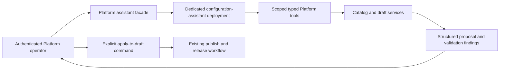

# 010.37 Platform Deployment Configuration Assistant Implementation Plan

- Status: planned; implementation not started.
- Created: 2026-10-13.
- Execution priority: 3.
- Source review: Platform `db58acd9`; framework `561659dc`; dependency AI Fabric `0.8.32`.
- Owner: Platform operator experience and scoped authoring tools; existing LoomAI runtime supplies AI execution.
- Related: [010.35 skill](010_35_AI_FABRIC_CODING_ASSISTANT_SKILL_IMPLEMENTATION_PLAN.md), [010.22 productization](010_22_AI_FABRIC_0_7_0_LOOMAI_PLATFORM_PRODUCTIZATION_IMPLEMENTATION_PLAN.md), [010.33 semantic decisions](010_33_LLM_DRIVEN_SEMANTIC_DECISIONS_AND_EXPLICIT_RECOVERY_POLICY_PLAN.md).

## 1. Outcome And Verdict

Provide an assistant inside the Platform that helps an authorized operator compose a deployment from templates, plugins, curated profiles, sources, actions, authentication, and installation settings. Its useful result is a reviewable configuration proposal and a valid saved draft with explicit unresolved bindings.

Use a LoomAI-powered assistant with scoped typed Platform tools. An external coding assistant may consume the same supported tool surface later. Do not make arbitrary repository or shell access the operator product contract.

The model interprets intent and proposes structured configuration. Platform code authorizes, validates, saves, publishes, applies, and records operational truth. Existing validation and release workflows remain authoritative.

## 2. Current Code Evidence

- `Platfrom/backend/.../deployment/web/DeploymentController.java`: existing deployment/draft operations, `PUT /api/deployment-drafts/{draftId}`, validate, publish, provisioning preview, and verification operations.
- `.../deployment/model/UpdateDeploymentDraftRequest.java`: structured actions/entity/routing/provider/security/prompt/knowledge/shell/dataset/behavior sections.
- `.../deployment/entity/DeploymentDraftEntity.java`: draft identity, revision number, state, section JSON, and update timestamp.
- `.../deployment/service/DeploymentService.java`, `updateDraftInternal`: server-owned editor access, editable-draft checks, config updates, and audit.
- `.../deployment/service/DeploymentDraftValidationService.java`: existing deterministic deployment validation.
- `.../marketplace/service/MarketplaceManifestService.java` and `DeploymentMarketplaceDraftCompilerService.java`: current contributions and compilation.
- `.../marketplace/web/MarketplaceController.java`: plugin catalog, MCP discovery/import, installation, and template-bootstrap APIs.
- `Platfrom/ui/src/pages/OverviewPage.tsx`, `BehaviorPage.tsx`, `PromptsPage.tsx`, `RevisionsPage.tsx`: current draft/configuration/publication surfaces.

There is no inspected operator-assistant tool boundary or assistant proposal lifecycle. The draft update DTO has no expected edit fingerprint. `revisionNumber` advances when constructing a subsequent published draft, not on every edit; it cannot alone prevent an AI proposal overwriting a newer save.

## 3. Product Architecture



This is control-plane authoring traffic. It does not reroute customer runtime chat through the Platform. The assistant's deployment is an internal consumer of Platform tools; selected customer deployments remain separate resources.

Proposed source directories:

- `Platfrom/backend/.../assistant/`: facade, scoped tools, proposal service/repository, projections, and audit.
- `Platfrom/ui/src/components/deployment-assistant/`: operator panel, proposal diff, and validation display.
- existing deployment access/validation/compiler services; no parallel config compiler.

## 4. Tool And Proposal Contracts

First-release tool operations:

1. Read available templates, compatible plugins, curated modules, and profile schemas.
2. Read the authorized deployment/draft and a safe secret-reference inventory.
3. Produce a structured change proposal against a captured draft fingerprint.
4. Validate the proposed result through the same server validators/compiler used by normal authoring.
5. Explain validation failures and produce a bounded model revision.

Tool identity must derive from an authenticated operator and a server-created, short-lived delegation bound to customer/deployment, allowed tool operations, expiry, and the assistant invocation. Do not forward the operator's long-lived token into a prompt or use an unrestricted Platform administrator key in the assistant runtime.

Proposed proposal record fields:

```text
proposalId, operatorId, customerId, deploymentId, draftId,
baseDraftFingerprint, catalogFingerprint, proposedSectionChanges,
explanation, unresolvedBindings, validationFindings,
status, createdAt, expiresAt, appliedAt, appliedDraftFingerprint
```

Proposed statuses: `PROPOSED`, `VALID`, `INVALID`, `APPLIED_TO_DRAFT`, `STALE`, `DISMISSED`, `EXPIRED`. These are new proposal states, not deployment readiness states.

Any proposed HTTP/tool routes under `/api/platform/deployment-assistant/` must be marked new in API docs. Publish/apply/secret-value retrieval are outside the assistant tool allowlist. The explicit apply-to-draft command atomically checks both caller access and the base fingerprint, then delegates to checked existing draft services. Do not expose `updateDraftForTrustedCaller` directly.

## 5. User Flow

The operator opens the assistant in the selected deployment workspace, describes the desired capability, and receives a structured proposal with affected sections. The panel shows the diff, source catalog references, validation state, required secrets/storage/identity bindings, and any unsupported request.

The operator can revise or dismiss the proposal. Applying it updates only the draft. Publish and release remain available through the existing explicit UI flow. A valid draft may still lack live credentials or runtime evidence; the assistant must report those distinctions accurately.

For new deployments, first choose a real reviewed template and use existing creation/bootstrap services to establish ownership and the draft. Do not invent template IDs or create a hidden deployment from a generated config file.

## 6. Implementation Phases

### A0. Define Read Models And Authorization

- [ ] Inventory exact catalog/schema and draft read contracts.
- [ ] Create safe assistant projections with real IDs, source versions, and no secret values.
- [ ] Define short-lived delegation and invocation audit under existing Platform security.
- [ ] Define rate, context, token, proposal-size, and bounded repair limits.

### A1. Implement Proposal And Atomic Draft Safety

- [ ] Persist proposals and canonical draft/catalog fingerprints.
- [ ] Validate proposed configuration without saving it to the active draft.
- [ ] Add an atomic stale-edit guard coordinated with ordinary editor saves.
- [ ] Ensure a rejected proposal leaves the draft unchanged and reports typed findings.
- [ ] Make apply idempotent; changed content under a reused key conflicts.

### A2. Bind The Assistant Deployment And Tools

- [ ] Install real approved catalog/configuration tools through existing ACTION/MCP primitives.
- [ ] Bind a dedicated assistant consumer/deployment and supported provider configuration.
- [ ] Guide the model with current schemas and structured output; use curated prompts appropriately.
- [ ] Reject invented catalog entries, unsafe URLs, unsupported plugin combinations, and excessive changes.
- [ ] Preserve original model output and declared repair policy in safe diagnostics.

### A3. Build The Operator UI

- [ ] Add an assistant panel to the current deployment workspace.
- [ ] Show diff, validation findings, unresolved bindings, and proposal expiry/state.
- [ ] Provide explicit apply-to-draft and dismiss commands with access-aware controls.
- [ ] Keep saved draft, proposed changes, published version, and applied version visibly distinct.
- [ ] Preserve unsaved editor changes; require refresh/rebase after an actual conflict.

### A4. Verify And Release

- [ ] Test new and existing deployment authoring against real templates/plugins.
- [ ] Prove tenant/editor isolation, expiry, replay, stale-save conflicts, and no secret disclosure.
- [ ] Include unsupported requests and malicious document/plugin text that tries to request privileged tools.
- [ ] Measure structured-output quality with real provider calls across conversational, agentic, and Smart Brain config examples that the catalog actually supports.
- [ ] Prove publish/apply cannot occur through the first-release tool set.
- [ ] Record hosted operator flows and generated draft validation evidence.

## 7. Human In The Loop And Framework Impact

Human Review and Conversation Handover are already implemented. Applying a configuration proposal is a Platform authoring transaction; do not pretend it is automatically a framework `ACTION_PROPOSAL` review task. If a future assistant action intentionally uses Human Review, it must satisfy that existing receipt/policy contract.

No framework binary change is expected for the initial assistant. Reuse the existing execution/action/MCP and conversation contracts. A missing reusable tool or provenance capability requires an evidenced framework request; no guessed HTTP endpoint, internal-handler shortcut, or keyword-based config generation is allowed.

## 8. Completion Criteria

Extend the existing Platform `DeploymentDraftValidationServiceTest`,
`DeploymentConfigCompilerTest`, `DeploymentMarketplaceDraftCompilerServiceTest`,
and `DeploymentWorkspaceIntegrationTest`. Add focused proposal/delegation and
concurrent-save integration tests for the new assistant services. Browser
verification must exercise a real selected workspace, unsaved editor changes,
proposal conflict, successful draft application, and the unchanged explicit
publication flow.

Complete when an authorized operator can produce, inspect, validate, and explicitly apply a useful draft through the assistant; concurrent edits are protected; secrets and unrelated deployments remain inaccessible; unsupported requests are honest; and release truth remains in existing Platform services.

The initial plan excludes autonomous production apply, arbitrary shell/file edits, generated plugin executable code, and user-supplied unrestricted MCP servers. Track those as separate reviewed extensions rather than partially exposing them in this UI.
