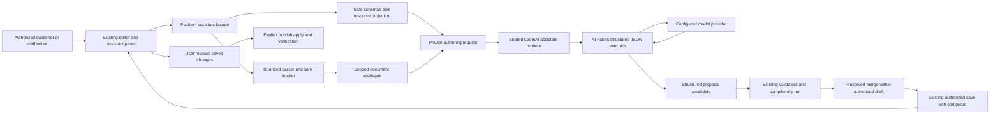

# 010.37 LoomAI Configuration Assistant - Detailed Solution And Implementation Plan

- Status: implemented, deployed and qualified on staging/production, 2026-11-10. Supported first-release contracts are complete; accepted model-quality and import limits remain explicit below and in the verification record.
- Created: 2026-10-13. Expanded: 2026-11-09.
- Initial Platform inspection: `52f71995410260a743bae67fd2a9cf59b821ee8b`, 2026-11-09. This historical source inspection was not deployment evidence.
- Initial capability reassessment: `171010aed53d305ba7643ea8b7d076eb1aeba641`, 2026-11-10; released framework 0.8.46, 27 scoped scenarios assessed and 17 offline binary-contract probes passed. Section 18 retains that assessment; section 13 records subsequent implementation and hosted proof.
- Owner: Platform customer and staff authoring experience.
- Scope: API documentation import, guided configuration, structured proposals and integration with existing editors. This is not a deployment or framework release record.
- Related: [coding assistant skill](010_35_AI_FABRIC_CODING_ASSISTANT_SKILL_IMPLEMENTATION_PLAN.md), [semantic decisions](010_33_LLM_DRIVEN_SEMANTIC_DECISIONS_AND_EXPLICIT_RECOVERY_POLICY_PLAN.md), [UI entry points](../../../../../../../../Final_Documentation/Development_Guides/PLATFORM_UI_PROFILES.md).

## Review Summary

- **Recommendation:** LoomAI owns the assistant UX/workflow; a shared private LoomAI runtime uses the existing framework and a qualified model. No full coding agent is required.
- **Framework verdict:** no upgrade/release is currently required by the inspected `0.8.46` contracts. New Platform, private runtime and generic chat-UI integration work is required; this is not configuration-only.
- **First result:** describe an API-backed capability and share its documentation; the assistant updates the authorized draft through the existing save service, then shows the saved diff in the editor. Work on one action at a time while preserving the whole catalogue.
- **Authority:** owner decision, 2026-11-10: the assistant may save changes to any editable draft within the user's authorized task/resource scope, without per-turn acceptance. Review remains available before explicit user publication. Testing, indexing, publishing and deployment remain separate explicit actions. The inference runtime itself receives no save credentials.
- **Read first:** [customer walkthrough](#14-detailed-customer-and-developer-walkthrough), [framework assessment](#15-framework-assessment-and-required-product-extensions), [flow/data ownership](#16-end-to-end-contract-and-data-flow) and [first release boundary](#17-first-release-boundary-and-review-decisions).
- **Implementation status:** shared private runtime, Platform endpoints, full per-action form and all scoped editor integrations are live on both control planes. Actual customer/staff, provider, import, save/undo, privacy and desktop/phone evidence is recorded in [hosted qualification](../../../../../../../../verification-support/configuration-assistant-01037/2026-11-10-hosted-qualification.md). This is not a claim of perfect first-turn model output or qualification of every external customer API.

## 1. Product Outcome

Help customers and authorized staff configure useful AI capabilities without manually translating every API endpoint, parameter, response field and connection setting into LoomAI JSON.

The customer describes the outcome, supplies documentation or examples and answers consequential missing questions. The assistant may save supported changes directly into the authorized editable draft through Platform's existing save service. The editor shows what changed and lets the user review, edit or undo it before publication. The user does not have to accept each proposal and then press Save after every turn. Publishing, deployment, connection tests and indexing retain their existing explicit workflows.

### Owner Decision: Draft Editing Is Allowed

The 10 November 2026 decision supersedes the earlier proposal-only/manual-save
restriction. A request to configure the selected resource authorizes draft edits,
not live changes. Explanations and document import alone do not mutate drafts.
An optional preview-only request remains supported. No new staff approval or
mandatory per-turn review gate is introduced.

`Any draft` means an editable resource the caller can configure within the task's
server-bound scope, not every customer draft or another user's resource. Brain
and private-plugin drafts can use their normal save APIs. An active Engage app
is not a draft: retain its existing explicit lifecycle rather than secretly
disabling it. Do not silently publish a plugin version or enable/install a
capability merely because a definition draft was saved.

Latest owner clarification: **AI first, manual refinement afterward.** When the
user requests configuration changes, the assistant may replace existing manual
values in that requested scope, including unsaved values shown in the editor.
Do not require a conflict-approval dialog or protect those manual values from
the requested AI edit. Show the saved result so the user can refine it afterward.

Preserve configuration outside the requested scope. While AI is updating the
selected resource, pause its manual editing and additional modifying turns;
restore editing from the saved result when complete. Use ordinary database
transactions and existing resource save checks, not a new cross-editor conflict
or recovery system. A changed manual value is not itself a reason to reject an
otherwise authorized AI edit. Cancelled/superseded turns cannot write afterward.

Example customer request:

> Here is our Swagger file. Let customers search our catalogue, see current availability and submit an enquiry after confirmation. Also index our catalogue for recommendations. Help me connect it.

The result should coordinate supported action definitions, HTTP routing, a private Data plugin and required connection inputs. Importing Swagger does not install a new connector protocol or grant API access.

### 1.1 Architecture Decision

Build a **LoomAI-owned configuration assistant**, with the existing generic chat UI in a resource-scoped editor panel, Platform-owned authoring workflows, and one shared LoomAI-managed inference runtime per environment. The runtime uses released AI Fabric structured-generation primitives. Its model provider can be OpenAI, Anthropic or another qualified framework provider; product ownership and model-provider choice are different decisions.

This supersedes the earlier direct-provider gateway recommendation. Platform should not build a second set of provider SDK adapters when the released framework already provides generation and structured JSON calls. A small private runtime authoring capability is new product work, not an existing Support-chat endpoint and not a new framework behavior/plugin type.

Platform owns authorization, documents, schemas, sessions, proposals, candidate checks and authorized draft persistence through existing resource services. The shared runtime owns bounded inference and provider credentials. Do not allocate a runtime, vector store or customer business database per assistant session. No additional customer deployment slot is required for using this shared authoring service; its actual service capacity and usage remain LoomAI-operated and accounted.

Start with one qualified provider/model. Keep the integration provider-independent, but do not make a second provider, multi-agent team or a full coding SDK a first-release prerequisite. No framework binary change is evidenced as necessary: section 15 records the released APIs and exact qualification boundary. Any newly discovered framework gap must be raised for owner review before a framework change/release.

### 1.2 Governing Rules

- Preserve current plugin types and adapter contracts; this is an authoring aid, not a new plugin engine.
- Interpret user intent, operation purpose, mappings and suggestions through the LLM, not keyword/regex heuristics.
- Parse formal API structure, JSON paths, IDs, enums and types deterministically. This is contract processing, not semantic inference.
- Enforce ownership, authorization, trusted IDs, credentials, execution limits and declared confirmation independently of model output.
- Never silently publish, deploy, execute a business action, start indexing, change assignments or modify infrastructure allowances.
- Keep manual forms and JSON editing available if the assistant is unavailable.
- Preserve approved resource navigation. Do not restore the rejected 010.65 global customer redesign or duplicate existing editors.

## 2. Current Code And Implementation Gaps

### 2.1 Existing UI To Reuse

- `Platfrom/ui/src/pages/ActionsPage.tsx`: action JSON, access, webhooks, connector routing, query/body templates and draft saving.
- `Platfrom/ui/src/pluginLibrary/PluginLibraryPage.tsx`: private definition authoring, checks, reusable versions and installation return links.
- `Platfrom/ui/src/pluginLibrary/creatorDocument.ts` and `CreatorFields.tsx`: HTTP JSON/bound S3 contracts, mapping, pagination, account scope and installation fields.
- `Platfrom/ui/src/pages/PromptsPage.tsx`, `BehaviorPage.tsx` and `ProvidersPage.tsx`: prompts, behaviours and provider settings.
- `Platfrom/ui/src/pages/DocumentKnowledgePage.tsx` and `IntegrationsPage.tsx`: knowledge sources, storage and connections.
- `Platfrom/ui/src/pages/AIWorkspacesPage.tsx`: Engage configuration, preview, installation and domains.
- `Platfrom/ui/src/brain/brainNavigation.ts`: canonical Brain-scoped navigation. Account/app authoring keep their existing roots.

The generic widget has route overrides in `max-mode-widget/src/config.ts` and
`src/api/chat.ts`, and registered action presentation, but these still assume a
runtime chat response/session contract. `src/entries/react.ts` does not export a
controlled configuration-assistant conversation surface. Changing a query URL is
not sufficient to install the proposed authoring protocol. Add a small generic
controlled conversation/message-rendering adapter or export the relevant shared
presentation surface; keep schema/proposal and resource-editing logic in Console.
Do not fork the whole widget, fake a business-action result, or pull ticket/case
behavior into the assistant merely to reuse its styling.

### 2.2 Existing Backend To Reuse

Paths below are relative to `Platfrom/backend/src/main/java/com/ai/fabric/platform/backend/`.

- `deployment/web/DeploymentController.java` and `deployment/model/UpdateDeploymentDraftRequest.java`: drafts, validation, publication and releases.
- `deployment/service/DeploymentService.java`: editor authorization, editable-draft rules, persistence and audit.
- `deployment/service/DeploymentDraftValidationService.java`, `DeploymentConfigCompiler.java` and `DeploymentMarketplaceDraftCompilerService.java`: validation/compilation.
- `marketplace/web/CustomerPluginLibraryController.java` and `marketplace/service/CustomerPluginLibraryService.java`: workspace-owned definitions, expected revisions, checks and immutable versions.
- `marketplace/service/MarketplaceManifestService.java` and `marketplace/web/MarketplaceController.java`: catalogues, contributions, installation and existing MCP discovery/import.
- `deployment/behavior/DeploymentBehaviorCatalogService.java`: supported behaviour, specialist and execution-extension contracts.
- `aiworkspace/service/AIWorkspaceConfigurationValidator.java` and related readiness/security projection services: Engage validation and connection rules.

### 2.3 New Work Required

The inspected source has no assistant facade, API-document import workflow or assistant proposal lifecycle. Runtime Swagger links are not customer API imports. Existing MCP discovery is not an OpenAPI importer.

The backend has no general model-generation gateway. Provider connectivity probes are not authoring inference calls. Add a small `ConfigurationModelGateway` client/facade backed by the private assistant runtime capability, not provider SDKs in the control plane. The runtime chat request has no arbitrary output-schema field; do not assume normal chat accepts this new authoring contract.

Existing `support/runtime/SupportRuntimeClient.java` permits only `/api/chat/...`, while `SupportWorkspaceService` binds routes to owned Support cases/episodes. Reuse suitable low-level transport/authority patterns, not those case-specific controllers, identities or permissions. Configuration sessions must be authorized against the selected draft/plugin/app. Existing Support remains a separate working product.

Observed save contract: the Brain draft update DTO has no expected edit version;
`revisionNumber` advances for the next published draft, not every edit. The
repository has `findByIdForUpdate`, while ordinary update reads through
`findById`. Under the latest owner decision, a new universal optimistic-version
contract across all writers is **not an assistant launch prerequisite**. Use a
fresh draft and the ordinary transaction/save service for the scoped update.
Keep existing plugin/app version checks without turning manual changes into a
user approval gate.

Engage already has JPA `rowVersion` and an update-request field, although the explicit stale-version comparison is conditional when the request omits it. Reuse this mechanism with the current version when saving the assistant result; do not deliberately omit it to bypass the service contract. Its ordinary update service rejects edits to an active installation: the assistant must not disable an app to get around that rule. It may prepare a preview and explain the existing explicit disable/edit/activate path.

Some legacy action-routing fields can contain authentication values. Never send an entire raw draft to a provider. Use allowlisted, redacted projections and secure existing credential controls.

## 3. Input Heavy Areas Covered

### 3.1 Actions And Capabilities

Entry: the existing Brain AI capabilities/actions editor and capability installer.

Inputs: a desired outcome, selected OpenAPI operations, API documentation, an existing action, request/response examples or a safe cURL example.

Prepare action names/descriptions, typed required parameters, user-supplied versus trusted-context inputs, supported authentication/confirmation settings, HTTP routing, request mapping and declared response presentation. Show missing connection/secret/account references as unresolved selections. Recommend existing compatible plugins when they already solve the requirement.

Do not classify safety from HTTP verbs alone: POST can be search and a documented GET can have effects. Use documented semantics and LLM interpretation; unresolved effect/authorization questions remain visible and cannot grant execution access. READ actions need no vector space unless their declared contract actually requires one.

### 3.2 Connections And Endpoint Routing

Entry: current connection/routing forms associated with the selected Brain or plugin.

Prepare base URL suggestions, relative routes, path/query/header/body placement, supported authentication references, pagination, timeouts and response fields. Explain source-specific security requirements and staging/production server differences.

A documented auth scheme is not proof the selected connector supports it. For example, private HTTP Data forms currently expose API-key and form-token-exchange configuration, not arbitrary OAuth, browser cookies or mTLS. Report unsupported requirements instead of inventing config.

Secrets, approved hosts and authorized provider accounts use secure forms. OpenAPI `servers` and security declarations do not authorize network calls or modify bindings.

### 3.3 Private Data Plugins And Indexing Mappings

Entry: `/library/plugins`, retaining its existing return-to-Brain installation path.

From documentation/samples, propose an existing HTTP JSON Data definition: collection path, record ID, content, metadata/entity fields, supported pagination, update/deletion handling and synchronization schedule. Preserve account-resource placement and private-source isolation.

For bound S3 definitions, prepare supported document policies and connection-reference inputs. Hosted/BYO storage selection and credentials remain separate. Do not provision storage because a model suggests it.

If stable IDs, ownership fields or deletion semantics are missing, explain the exact gap. Never manufacture IDs from names, assume incomplete pagination is a full snapshot or claim deletion reconciliation without its contract. Reusable definitions and installation inputs are distinct.

Customer SQL/folder authoring, arbitrary new protocols and executable connector code are not silently enabled by generated JSON.

### 3.4 Knowledge And Search

Entry: existing Knowledge sources and Search settings tasks.

Help describe collections, select existing authorized sources, map entity/search fields and prepare supported indexing policies. Guide storage/prefix selection using real authorized bindings. Explain embedding configuration and compatibility from the actual service catalogue.

Preparation is not document approval or indexing. Retain discovery, preview, approval and reconciliation. Do not index imported API docs automatically, copy vectors during promotion or silently search every source.

### 3.5 AI Behaviour And Prompts

Entry: existing responses/prompts and supported behaviour editor.

Translate customer intent into current tone, answer-breadth, answer-length and next-step profiles, or an explicit Custom prompt proposal. Accept business guidance as reference and show exact changes in Advanced.

Do not add phrase-based output rewriting, semantic text matchers, undeclared recovery or web search. Answer breadth is not sampling temperature, permission to invent business facts or new authority.

### 3.6 Models And Vector Services

Entry: AI models and Knowledge -> Search settings.

Help choose supported, authorized services and fill their actual connection fields. Explain embeddings, dimensions and compatibility using the loaded configuration rather than generic provider defaults.

Do not promise every model ID is available, guess credentials, change funding or provision infrastructure. Explain any existing reindex/migration requirement without starting it.

### 3.7 Engage Presentation And Installation

Entry: existing branding, tools, preview, installation and domain configuration.

Prepare branding, starter questions, supported tool groups/rail items, authentication/handover presentation and registered renderer selections. Draft edits or preview-only candidates feed the existing real preview.

Use supported configuration, not generated executable JavaScript. Distinguish website embed, Max mode and standalone app. No silent deployment reassignment, origin grant, DNS verification, domain activation or identity-provider redirect change; link to the existing explicit operation.

### 3.8 Human Support And Review

Entry: current Human support and Action reviews configuration.

Help prepare supported handover settings, contact fields and service-binding requirements using authorized existing Desk references. Keep agent invitations/assignment, operator permissions and review decisions explicit and separate.

Customers and staff use the same authoring surface with their actual permissions. There is no new assistant privilege or automatic approval authority.

### 3.9 Specialists And Plans

Entry: existing behaviour/specialist configuration wherever its contract is supported.

Guide available bundles, sequential/parallel chains, event inputs, schedules and delivery settings using the real catalogue and deployment type. Explain outcomes and missing worker/binding requirements.

Do not generate a new Java worker, executable bundle, unsupported chain node or behaviour type. Preserve useful supported configuration and identify requirements needing code. This area follows the actions/Data vertical slice but is included in full completion.

### 3.10 Kit Setup

Guide an already-created Kit through existing resource editors. Use a lightweight sequence of links to Brain, private plugin and Engage tasks, not a second Kit creator or hidden orchestration engine.

One proposal targets one resource. Actions/routing can change together within a Brain draft; a private plugin and an Engage app are separate proposals/saves. Do not imply a distributed atomic transaction across them. Preserve developer-created staging-only policy.

## 4. Customer Journey And Layout

### 4.1 One Reusable Assistant Panel

Add an icon plus `Build with AI` in complex editors and `Help configure` on relevant setup tasks. Do not put an assistant beside every simple field or create another global navigation section.

Use approved resource workspaces and light/dark themes. Desktop opens a resizable right panel beside the editor/preview; narrow screens use a dismissible full-height panel returning to the same editor. Keep primary commands fixed and content independently scrollable.

```text
Smart Brain > AI capabilities                         Build with AI
-------------------------------------------------------------------
Existing editor / preview        | Configuration assistant       [x]
                                | Outcome: Search our catalogue
Action list and selected form   | Sources: catalogue-api.yaml
                                | Understand -> Choose -> Review
Unchanged fields remain visible | 3 operations selected
                                | 2 connection details needed
                                | Saved to draft [View changes]
-------------------------------------------------------------------
Existing manual editor controls | Not published; live unchanged
```

Use outcome language: `What should your AI help people do?`, `Share your API documentation`, `What I can configure`, `Details I still need` and `Review changes`. Keep JSON, schema details and diagnostics under Advanced.

### 4.2 Guided API Setup

1. **Describe the outcome.** Add a capability or improve the selected existing configuration.
2. **Share documentation.** Upload/paste a specification, provide a documentation URL, paste prose or add request/response examples. Allow multiple named sources with extraction status.
3. **Choose capabilities.** Show method/path, readable purpose, source reference and suggested use: live read, indexing source or proposed write. The LLM selects a bounded subset consistent with the user's configuration request; ask if the intended scope is ambiguous. Selection grants no execution permission. Never select by keyword heuristics.
4. **Resolve missing details.** Reuse session answers, group related questions and keep optional inputs optional. Provide secure binding selectors rather than a wall of empty fields.
5. **Prepare changes.** Build the bounded candidate with before/after values, source references, dependencies, unresolved bindings and actual validation findings.
6. **Update the draft.** Platform checks the current edit version, preserves unrelated configuration and saves through the existing authorized resource service. Synchronize the editor/preview from its real receipt; show `Saved to draft`, not `Published`. Preview-only requests do not persist.
7. **Review and test.** The user can inspect the diff, edit or undo the draft now or later before publication. Offer the existing explicit connection test or indexing-preview link, separate from inference and draft saving.
8. **Publish and deploy.** Continue through normal Updates with explicit user intent; draft-writing authority does not grant publication/apply authority.

### 4.3 Avoid Repeated Inputs

Maintain one session answer sheet containing confirmed choices, discovered schema facts and unresolved questions, each with provenance and target. It is not a globally inferred customer preference.

Pre-fill only documented structural facts, current configuration, explicit answers or declared technical defaults. Label suggestions. Never fill required secrets, trusted account IDs or undocumented endpoints with invented values that appear executable.

Offer focused commands: `Use this operation`, `Add another endpoint`, `Use this response example`, `Explain this field`, `Revise` and `Discard`. A later user request to change configuration allows the assistant to replace manual values in that scope. Manual refinement follows completion, without a conflict-review ceremony.

Closing preserves the editor buffer. Reopening restores the original resource session. Switching resources never carries credentials, proposals or authority across boundaries.

### 4.4 Worked Example

A customer uploads a specification and a sample containing `/items`, `/nextCursor`, and record fields `id`, `accountId`, `name`, `description` and `price`. Their documented API exposes:

```text
GET  /v1/catalogue/items          Search/list, with cursor pagination
GET  /v1/catalogue/items/{id}     Current item details
POST /v1/enquiries               Submit an enquiry
```

These are neutral qualification-fixture endpoints, not existing LoomAI routes. The guided result is:

1. Recommend search/details as live read capabilities and list as a possible indexing source, citing the actual imported operations. Ask whether all three are wanted instead of importing every endpoint automatically.
2. Propose search filters from documented parameters, with the account supplied by a trusted installation binding. IDs for detail requests must follow the actual action target contract, not become trusted because they appear in a model answer.
3. Propose Data mappings `/items`, `/id`, `/accountId`, declared content fields and documented cursor handling. Confirm that the list includes the authorized complete collection and how removals are detected.
4. Prepare enquiry parameters from its request schema and show the proposed confirmation policy. Do not call the endpoint, invent contact information or enable anonymous writes implicitly.
5. Ask the customer to select an existing stored credential, confirm the account/environment connection and review unresolved questions. The assistant may save action/routing and private Data drafts separately through their existing authorized services; the normal editors display each receipt and diff.

If the API lacks an ownership field or supported auth mechanism, the assistant explains that gap instead of claiming the integration is complete. The user can retain the safe partial draft and request integration assistance.

## 5. API Documentation And Large Input Handling

### 5.1 Input Formats In Scope

- OpenAPI 3.0.x and 3.1.x JSON/YAML, uploaded or pasted, with local references.
- Swagger/OpenAPI 2.0 using a maintained parser/conversion path with original-source references and diagnostics.
- Public HTTPS specification URLs.
- Markdown/plain-text reference documents and a selected static HTML documentation page.
- Text-based PDF documentation with page references and extraction errors. Image-only PDF OCR is deferred; ask for text or a spec.
- Safe cURL and JSON request/response examples, parsed without execution.
- Multiple bounded sources/APIs per session, including separate uploaded reference files.

For Swagger UI links, distinguish the HTML interface from its underlying spec. Accept the exact JSON/YAML URL or upload. A bounded static parser may expose a declared spec link, but never execute page JavaScript, crawl a whole website or run a browser agent to guess it.

Upload/paste private documentation. Private-network/authenticated crawling, browser cookies, Postman, GraphQL/gRPC and repository/archive imports are deferred, not hidden fallbacks.

### 5.2 Formal Parsing And Semantic Interpretation

Use a maintained OpenAPI parser, not handwritten YAML/Swagger parsing. Prefer the Java Swagger Parser family after dependency/security qualification. Existing Jackson YAML support is useful but does not replace OpenAPI reference/version semantics.

Normalize formal facts into an `ApiOperationCatalogue`:

```text
sourceId, sourceRevision, sourceDigest, documentVersion,
operationRef, sourcePointer, operationId, method, path,
declaredServers, parameters, requestMediaTypes, requestSchema,
responses, responseSchemas, declaredSecurityAlternatives,
examples, description, referenceDiagnostics
```

Use exact source + method + path when operation IDs are absent/duplicated. Do not fabricate provider identifiers.

Preserve inherited/per-operation security, OR alternatives/AND requirements, parameter locations, required/nullable distinctions, nested schemas and server variables. A model's structured-output schema can support a smaller dialect than the API schema: use a separate authoring envelope without silently losing the original API contract.

The LLM interprets descriptions, selects useful operations and proposes mappings. Formal field parsing is permitted; business-intent keyword matching is not.

### 5.3 Safe References And Fetching

Default to local/in-package references. External references require the same explicit fetch policy as a documentation URL, with visible origins and bounded recursion. Disable parser defaults that fetch arbitrary URLs or local files.

The first-release fetcher permits HTTPS public routable destinations only. Enforce DNS/IP policy at connection time and on every redirect; deny loopback/private/link-local/metadata destinations and non-HTTP schemes. Bound size, time, redirects and decompression. Reuse a suitable audited outbound client or add one shared narrow component.

Documentation links are data, not permission to fetch or execute. Importing makes no runtime API calls. Uploading an internal API spec remains supported; actual private-network connectivity is a separate integration requirement.

### 5.4 Large Documents And Conflicts

Catalogue before calling a model. Show counts/sections and send selected operations plus necessary referenced schemas. Selection is explicit or structured LLM output, never an ad hoc lexical ranker.

For large APIs, let users select tags/operations or run a disclosed bounded LLM selection pass over catalogue batches. Show what was considered. If coverage exceeds the allowance, ask for a smaller subset rather than silently dropping operations or claiming whole-API understanding.

Keep PDF page/prose heading anchors. An absent sample field does not prove the real response never contains it. Show conflicting document revisions and ask which is authoritative before adopting conflicting configuration.

### 5.5 Untrusted Content And Credentials

Imported descriptions/examples cannot override instructions, request privileged tools, choose tenants, read secrets or cause API execution.

Show selected material and a data-sharing notice before provider submission. Remove known secret values and structurally identified authentication/cookie/token fields. Use declared secret-detection/redaction mechanisms, not semantic keyword rules. If credentials cannot be isolated safely, require sanitized input.

API docs remain temporary private authoring material. They are not automatically customer answer knowledge, public Marketplace content, training data or a provider-hosted vector store.

## 6. Backend And Model Architecture



### 6.1 Components And Provider Choice

Implement the facade, sessions/sources/proposals, context projections, schema catalogue, parsers and runtime client under `Platfrom/backend/.../assistant/`. Keep this product state in the existing backend, not a new orchestration service.

The private inference adapter lives under `ai-infrastructure-module/ai-fabric-runtime/.../authoring/`. Implementation qualification established that this is an internal shared inference service, not a customer conversational deployment. Its versioned `configuration-authoring` operator profile selects explicit minimal imports, private ingress, managed prompts, the reviewed provider and internal accounting state. Do not expose the earlier proposed `mkp-template-configuration-assistant` as a customer-installable Marketplace template: the ordinary customer template would advertise chat/vector/execution contracts this service intentionally does not provide. This corrects that planning assumption without adding a behavior/plugin type or changing the existing customer template system.

`ConfigurationModelGateway` sends a fixed, versioned authoring request to that assigned shared runtime. Use `StructuredJsonCallExecutor` with `AICoreService.generateContent`, `AIGenerationRequest` and the configured framework provider. Platform supplies only its registered contract IDs and safe resource/input projections; the runtime resolves the approved schema/prompt version. A customer cannot select arbitrary system instructions, provider URLs or tool permissions.

Provider keys remain in the assistant runtime's existing managed secret/budget integration, not browser bundles or uploaded API documents. Users need no Claude/ChatGPT login and do not expose their customer runtime's provider key. Staff select the authoring model independently of the Brain being edited. Record authoring usage separately; do not silently charge a customer's runtime allowance. Qualification must prove the authoring path actually traverses the intended accounting/deadline controls rather than assuming chat-budget checks apply automatically.

Build a versioned schema catalogue from real DTOs, manifest contracts and validators. Centralize currently implicit contract descriptions and test them against the compiler. Do not maintain a divergent schema in prompts or reject valid existing fields merely because a provider supports a smaller JSON Schema dialect.

### 6.2 Scoped Context And Draft-Write Authority

Provide these logical operations, either as provider tools or facade-supplied context under identical authorization:

- Read the selected resource's safe draft and contract version.
- Read authorized catalogue entries and supported choices.
- Read selected imported sections and exact API operations.
- List permitted connection/secret reference IDs and safe labels, never values.
- Validate proposed resource configuration without saving it.
- Return structured questions, changes, assumptions and unresolved bindings.

The inference runtime has no save credentials or unrestricted mutation tools.
Platform may apply returned draft edits through the existing authorized resource
save service, as part of the caller's configuration turn, without a separate
acceptance click. Recheck current permissions and load the current draft before
that write. Do not expose publish, apply, secret-value retrieval, invitation,
provisioning, indexing, business-action execution or arbitrary HTTP tools.
Documentation fetching belongs to the dedicated bounded importer.

Platform binds context to the authenticated principal and server-resolved resource. Reuse the existing reviewed Platform-to-runtime authority/signing pattern, with a separately checked authoring purpose/audience, short expiry and a request/session binding. These authoring claims and route authorization are new product integration work, not current Support permissions. Never forward a customer bearer token or a Platform administrator key as model input.

The private capability should initially receive the minimal complete projection for the selected task rather than a broad callback toolset. If a later turn requires another source/binding, Platform resolves it after the same authorization checks. No separate delegation service is needed. External coding agents remain deferred.

### 6.3 Proposed API

These are new routes, not existing capabilities:

```text
POST   /api/configuration-assistant/sessions
GET    /api/configuration-assistant/sessions/{sessionId}
POST   /api/configuration-assistant/sessions/{sessionId}/sources
DELETE /api/configuration-assistant/sessions/{sessionId}/sources/{sourceId}
POST   /api/configuration-assistant/sessions/{sessionId}/turns
GET    /api/configuration-assistant/sessions/{sessionId}/turns/{turnId}
POST   /api/configuration-assistant/sessions/{sessionId}/proposals/{proposalId}/check
POST   /api/configuration-assistant/sessions/{sessionId}/proposals/{proposalId}/dismiss
DELETE /api/configuration-assistant/sessions/{sessionId}
```

Session creation supplies one resource kind (`DEPLOYMENT_DRAFT`, `PRIVATE_DATA_PLUGIN` or `ENGAGE_APP`), resource ID, purpose and active section. Backend access services resolve the customer and allowed paths. Request-supplied customer IDs never establish ownership. An editor snapshot can inform the requested edit, but a fingerprint match is not a mandatory permission gate.

Sources use typed upload/paste/URL requests. A turn names selected source/operation IDs and explicit answers. Return a persisted turn ID and result/progress state. Polling is sufficient initially; use bounded work execution rather than a new durable workflow engine. An interrupted turn stays interrupted, with no automatic billable replay on reload. Deduplicate logical turn requests with an idempotency key; changed content under the same key conflicts.

No duplicate deployment-save or apply-to-production API is needed. A configuration
turn may invoke the existing resource save service in Platform and return its real
receipt plus diff. Sessions expose whether the turn edits the draft or is
preview-only; a plain explanation/import request is not a write request. Recheck
resource access on reads, generation, checks, draft saves and deletion. Losing
editor access prevents further edits even if a session ID is known. Turn replay
returns its existing outcome/receipt; it never reapplies an already saved edit.

### 6.4 Proposal Contract

```json
{
  "contractVersion": "LOOMAI_CONFIGURATION_PROPOSAL_V1",
  "status": "READY_FOR_REVIEW",
  "target": { "kind": "DEPLOYMENT_DRAFT", "id": "server-bound-draft-id" },
  "baseEditVersion": 12,
  "summary": "Add catalogue search and its HTTP route",
  "changes": [],
  "questions": [],
  "unresolvedBindings": [],
  "assumptions": [],
  "sourceReferences": [],
  "validationFindings": [],
  "verification": { "configurationChecked": false, "connectivityChecked": false }
}
```

This illustrates the envelope, not an action/routing schema. Resource identity, author, base edit version and ownership are server-attested, not model authority. The server sets validation/verification findings from actual operations, never a model's success claim.

Each change has a stable ID, allowed section/path, operation, before/after values, explanation, source pointers and dependencies. Prefer stable action/dataset/tool IDs over fragile array positions. Additions/replacements/removals are explicit; never replace unrelated root sections.

`NEEDS_INPUT` permits useful incomplete proposals. Optional hints and low confidence are warnings, not automatic rejection. Missing necessary execution fields and unsupported/unauthorized contracts cannot appear ready to execute.

Lifecycle: `NEEDS_INPUT`, `READY_FOR_REVIEW`, `INVALID`, `ADOPTED_IN_EDITOR`,
`SAVED`, `STALE`, `DISMISSED`, `EXPIRED`. Validation findings are separate. Normal
draft-edit turns may proceed to `SAVED` through the existing authorized resource
service without passing through a manual acceptance state. Preview-only output
can remain `READY_FOR_REVIEW` or be adopted into the editor. `SAVED` requires the
actual backend save receipt, never a model or browser success claim. None of
these states means connectivity, indexing or deployment was verified.

### 6.5 Validation And Repair

Check allowed paths, exact IDs, required structure and the existing validators/compiler. Add nonpersisting candidate-validation facades as needed; never mutate a real draft just to see if it compiles. Redact diagnostic secrets.

Present three categories:

- Trust failures: unauthorized resource/binding, secret exposure, unsafe destination, permission or declared confirmation violation.
- Execution failures: invalid JSON/types, missing required route/parameter, unsupported adapter/schema or incompatible connection contract.
- Quality findings: uncertain wording, incomplete descriptions, optional hints and unproven assumptions.

Only the first two block affected executable changes. Existing save contracts may still allow a safe unfinished draft, but it must not look publishable or connected. Partial adoption requires a coherent dependency group and revalidation; never silently remove denied changes and report complete success.

The owner approved bounded validation feedback on 10 November 2026, superseding
the earlier one-repair proposal. Each turn explicitly supplies
`validationFeedback: {enabled, maxCorrections}`. Omitted/disabled policy makes
one inference; enabled policy permits one or two corrections after the first
inference, within the same 140-second overall turn deadline. The UI defaults to
the capability advertised by Platform, shows an off switch and the correction
limit, and always sends the selected policy explicitly. Operator configuration
may disable this capability or lower its ceiling; it cannot raise the product
limit above two corrections.

Only actual candidate-configuration errors or the typed
`AUTHORING_INVALID_OUTPUT` whole-response category can request another accounted
LLM inference. Feed safe structured findings and the cumulative in-memory
candidate back with the original user intent. Warnings alone do not trigger
correction. Missing information, explanation/unsupported decisions, trust
failures, cancellation, deadline, provider/network and budget failures stop the
turn. Never weaken checks to obtain a pass or silently change providers.

Retain each attempt's proposal, findings, status and runtime receipt, including
paid invalid output received after cancellation. Intermediate candidates are
not separately saved. Save the final scoped changes once through the existing
resource service, or keep preview-only output. An enabled-feedback NEEDS_INPUT
result retains its proposal without saving it. Exhaustion is visible; an invalid
draft can remain editable only where the existing save contract allows it. One
undo restores the pre-turn configuration. No publication, provisioning, indexing
or business execution is included.

Platform owns this resource-validation loop; the private authoring runtime makes
one inference per HTTP request. Released AI Fabric 0.8.46 already provides
structured-generation capabilities, so no framework change/release is required
and no nested autonomous retry loop is added. No keyword substitutions, invented
defaults, silent provider fallback or automatic search-all can disguise failure.
See the dated feedback-loop verification record for implementation/deployment
status; this contract is not itself a hosted success claim.

### 6.6 AI First, Then Manual Refinement

The default configuration flow saves the assistant's scoped changes to the
editable draft through the existing Platform service, then refreshes the normal
editor and shows a reviewable before/after diff and real save receipt. No
per-turn approval is required. `Use in editor` remains an optional preview-only
path, not the mandatory route for every change.

Use this simple sequence:

1. Capture the current safe editor/resource context and the user's requested
   change. Pause manual edits to that selected resource while AI is working.
2. Generate the scoped change. Platform loads the current draft and applies it
   through the existing authorized transaction/save service. Requested values
   may replace earlier manual values; unrelated settings remain intact.
3. Show the actual saved result and diff, refresh the editor, and restore manual
   editing. The user can refine or undo it before publication.

No unsaved-buffer fingerprint gate, three-way merge, global writer-version
redesign or per-change conflict acceptance is required. Existing private-plugin
`expectedRevision` and Engage `rowVersion` checks remain normal service details:
use current state when applying the scoped edit rather than bypassing checks.
Ordinary save errors stay visible; do not build a new recovery engine.

Use the existing backend save service for assistant edits and page save handler
for manual refinement; share schemas and audit. Keep ownership, secret/trusted-ID
boundaries, immutable published history and existing resource policy. A cancelled
or superseded AI turn cannot apply later. Review before publication uses Updates,
not a second staff/approval mechanism.

If saved-proposal provenance is persisted, pass an optional proposal correlation ID through the normal authorized save command. The backend must verify its customer/resource, accepted change digest and actual resulting edit version before recording `SAVED`. It must not accept a browser-only success report as an audit receipt. This metadata neither grants save access nor changes the configuration schema.

## 7. Storage Privacy And Resource Bounds

Use scoped session, source and turn/proposal tables in existing Platform PostgreSQL. No separate customer database or vector store. The assistant runtime performs transient authoring inference; it must not retain another independent copy of the authoring transcript/source catalogue. Process original uploaded binaries transiently; persist bounded normalized text/catalogue JSON and safe provenance in Platform. Provide explicit deletion.

Session data contains customer/creator, target resource, schema/catalogue versions, provider and expiry. Sources contain a digest, safe filename/URL, media type, anchors and extraction diagnostics. Proposals contain generated changes, base version, findings, usage and actual save/review state; do not label an automatic draft save as a completed human review. Encrypt source/turn/proposal content using an approved application-level mechanism; do not assume current generic JSON columns already provide this protection.

Proposed configurable defaults to qualify:

- Expire after 7 days of inactivity; purge source bodies, turns and proposals on expiry or deletion.
- Retain only minimal metadata under existing audit retention: actor, target, operation, digests, save receipt and usage; no full prompts/docs in general logs.
- Allow 10 files per session, 5 MiB each; text PDF up to 10 MiB, still under extraction limits.
- Bound extraction to 250,000 characters per source and 1,000,000 per session. Report exclusions instead of silently truncating.
- Bound API parsing to 2,000 operations, reference depth 16 and 20,000 resolved schema nodes; request a smaller subset when exceeded.
- Use the configured model's actual context limit and a proposed 32,000-input-token ceiling plus separate output bound. Estimate and show context selection before generation.
- Allow 2 concurrent authoring turns per workspace, with a small bounded global executor. Busy responses retain input; no unbounded queue.
- Start with 90-second provider and 15-second fetch deadlines, reporting interruption separately from invalid configuration.

These are resource bounds, not semantic validators or existing runtime defaults. Tune with fixtures and real calls. Session expiry alone must not permit unlimited lifetime spend: apply per-turn/session and workspace accounting limits through existing compatible accounting services, or a small explicit authoring allowance if none fits. Do not create another general billing/recovery engine.

Source deletion invalidates unsaved dependent proposals and removes derived source content from stored turns. Keep only nonreconstructive audit digests. Warn that already saved configuration may contain descriptions derived from the source and persists with the resource; deleting source material does not undo that legitimate draft edit. Provider retention needs explicit operational review; local deletion is not a guarantee of provider deletion.

## 8. Verification

### 8.1 Parser And Boundary Fixtures

Maintain neutral API fixtures plus dealership/support reuse examples:

- OpenAPI 3.0/3.1 and Swagger 2.0 JSON/YAML; nested schemas, parameter locations and missing/duplicate operation IDs.
- Local/multi-file references, cycles, bounded external references, server variables, security inheritance and alternatives.
- Supported API-key/form-token examples, unsupported auth, nested records, JSON pointers, page-size/cursor pagination and missing ID/ownership fields.
- Text/HTML/PDF extraction, image-only PDF rejection, malformed docs, large inputs, conflicting versions and partial source failure.
- Prompt injection in documentation; forged target/source IDs; cross-customer access; credential samples; unsafe redirects/DNS rebinding; parser file reads and YAML expansion attacks.
- Provider refusal, invalid output, timeout, rate limits, allowed repair and a repeated turn after a lost response.

All imported examples remain inert. A cURL fixture must never be executed during import.

### 8.2 Configuration And Save Tests

Extend existing draft validation/compiler, private-plugin and Engage tests. Add assistant access, retention, proposal and concurrency coverage. Prove:

- Actions and routing compile together without unrelated changes.
- Data definitions retain form/JSON fidelity and install through the real installer.
- Unsupported auth/protocols remain visible, never falsely connected.
- Raw authentication fields never enter provider input or diagnostics.
- A requested AI edit can replace earlier saved/unsaved manual values in scope without a conflict dialog. Unrelated settings remain intact; manual refinement works after AI completes. Existing resource save contracts still apply, and cancelled/superseded turns cannot write.
- Preview/adoption is not saving; automatic draft editing requires a real save receipt. Saving is not publication; publication is not deployment verification.
- Engage uses real preview configuration, contextual groups and registered renderers, without generated code.
- Staging-only policy, source ownership, write confirmation, permissions and accounting remain enforced.

### 8.3 Real Provider Quality

Start with the selected existing framework provider/model. Run identical fixtures against any additional provider before enabling it. Record structural validity, useful completion, source citation accuracy, unresolved-binding accuracy, repair rate, latency and usage/cost. A provider failing qualification remains disabled, not silently substituted. A second provider is not a prerequisite to launch the first qualified one.

Use reviewed structured expectations/compiler validation, not phrase-based answer matching. Target at least 90% useful correctly scoped proposals on representative supported tasks. Include incomplete/unsupported documentation where a precise question or limitation is the correct answer. Security and unintended-side-effect tests must all pass; semantic quality tolerance cannot waive them.

Maintain a focused 20-scenario set across operation selection, action/routing, HTTP Data, S3, prompts, models, Engage, human support and supported plans. Record concrete failures rather than changing expected outcomes to hide them.

The checked-in scenario manifest must include: OpenAPI 3.0 read action; OpenAPI 3.1 nested body; Swagger 2 conversion; multiple operations; existing action revision; enquiry confirmation; supported token exchange; unsupported auth; pagination; ID/ownership ambiguity; Data content mapping; S3 policy; tone/breadth; next steps; model/embedding compatibility; Engage tool groups; handover fields; supported specialist chain; conflicting prose/PDF; and unrelated/malicious input. Add security/concurrency fixture cases separately; do not dilute their all-pass boundary with the semantic quality percentage.

### 8.4 Hosted Journeys

Verify staging first, then a production canary through actual UI:

1. Import a neutral catalogue OpenAPI file, request search/detail capabilities and select test credentials through secure forms. Verify the assistant saves the authorized action/routing draft without per-turn acceptance; inspect/edit/undo its diff before explicit publication. Separately verify preview-only mode.
2. Reuse documentation to author a private HTTP Data plugin; review mapping, pagination and ownership, create a reusable version and install through the existing Brain flow.
3. Supply prose/PDF and samples; obtain supported configuration or precise missing questions without a false connectivity claim.
4. Adjust behaviour/Engage tools, observe the real preview and refine/undo the resulting draft. Verify an explicit AI request replaces earlier manual values in scope without extra approval. Do not silently deactivate an active app to save a candidate.
5. Assigned staff use the same surface; unassigned staff/other customers cannot read session content.
6. Follow separate explicit connection/indexing-preview/publication controls against owned mock services. Only these authorized test stages perform API calls/indexing.

Use the current dealership and support Kit as additional reuse evidence, without changing production deployments merely to test imports. Check desktop, basic phone navigation, light/dark readability, dismissal/resume, focus handling and no horizontal overflow.

## 9. Phased Implementation

Each phase has a focused commit group and verification record. Parallelize only independent parser fixtures/editor adapters after contracts stabilize. The main implementer owns shared contracts and the end-to-end journey.

### P0 Contracts And Safe Saves

- [x] Inventory current fields, schema versions, auth strategies and catalogue IDs for each supported editor.
- [x] Define safe projections, operation catalogue and the canonical proposal envelope.
- [x] Use existing transactional resource saves and current plugin/app revisions; serialize AI then manual editing in the selected editor. No new universal writer-version contract or manual-edit conflict gate.
- [x] Expose nonpersisting candidate validation using existing services/compiler.
- [x] Define flags, provider setup, content encryption/retention and bounded authoring usage.

Exit: the AI-first/manual-after flow uses ordinary saves, preserves unrelated configuration and keeps validation free of live side effects.

### P1 Documentation Intake

- [x] Qualify/pin maintained OpenAPI and text/PDF parsers.
- [x] Implement JSON/YAML/text/example/PDF sources and bounded HTTPS fetching.
- [x] Preserve source anchors, formal security, versions and reference diagnostics.
- [x] Add operation/source selectors, reference/identity diagnostics and explicit large-input narrowing.
- [x] Pass parser, SSRF, isolation, injection, secret-projection and deletion tests before enabling customer URL imports. Staging's 26 actual import checks pass; production repeat is tracked in P6.

Exit: realistic API documents can be inspected without executing any API operation.

### P2 Structured Authoring Gateway

- [x] Implement scoped sessions, sources, turns, proposals, expiry and bounded work execution.
- [x] Add the shared runtime's fixed private authoring capability, reviewed service identity and versioned internal service profile; reuse released structured-generation/provider APIs.
- [x] Implement the Platform runtime client and qualify OpenAI GPT-5.4-mini. Additional providers are separately qualified, not silently substituted.
- [x] Add scoped read/check context and iterative collection of missing answers, including actual current validation findings.
- [x] Implement validation, an explicit no-automatic-repair/no-retry policy and truthful error/usage reporting. User follow-up turns can correct visible findings.
- [x] Prove the inference runtime has no mutation credentials and Platform can save authorized draft edits through existing services. Publish/apply/execute/secret-value tools remain absent.

Exit: a real model returns a sourced valid proposal or useful questions for the selected authorized resource.

### P3 Actions And Connections

- [x] Add/qualify the generic chat presentation/host seam without coupling it to Platform schemas, Support cases or business actions.
- [x] Complete the per-action form: purpose/access, typed inputs and trusted/internal sources, confirmation, connector request/response mappings and supported presentation. Retain Advanced JSON and preserve the rest of the catalogue. Assistant and manual editing use the same form/serialization, not parallel action systems.
- [x] Add the reusable panel to Actions and related connection forms.
- [x] Support import, selected operations, grouped binding questions and action/routing proposals.
- [x] Add readable saved diffs, Advanced JSON, preserved dependency-aware merging and optional preview-only/editor adoption.
- [x] Connect assistant draft editing to existing backend save services and real receipts; allow requested replacement of manual values, preserve unrelated fields and restore manual editing afterward. No per-turn acceptance or manual-conflict gate.
- [x] Complete the neutral catalogue hosted flow and explicit mock-API connection test. Actual staging/production model drafts load with the released 0.8.46 action contract; only their READ route was exercised against a temporary localhost mock. No external business API or write was executed.

Exit: a customer configures a supported API-backed action without assembling the whole JSON manually. Generation executes no business action.

### P4 Data Plugins And Knowledge

- [x] Add the same panel to private Data authoring and relevant Knowledge tasks.
- [x] Prepare collection/ID/content/metadata/ownership/pagination/sync mappings from selected API operations and samples.
- [x] Support bound S3 policies and secure existing connection selection. The current existing indexing contract accepts TXT/JSON; assistant PDF import does not add PDF indexing.
- [x] Reuse checks, reusable versions, installation, discovery and indexing-preview controls.
- [x] Verify neutral, dealership and support examples with no new plugin types or business databases. Neutral HTTP/S3 candidates passed existing checks; existing dealership knowledge guidance and Support specialist/active-Engage previews preserved real configuration. Actual indexing/external API integration stays in its separate explicit workflow, not an inferred assistant success.

Exit: imported material produces a reusable Data definition with a truthful installation/preview result.

### P5 Other Input Heavy Configuration

- [x] Add adapters for prompts/behaviour profiles and models/search services.
- [x] Add Engage branding, tools, registered renderers and installation guidance with real preview. Hosted Max preview reflects the generated configuration; active production Engage stays preview-only even after a direct apply request.
- [x] Add Human support/review guidance without agent or decision authority. Missing binding is a real NEEDS_INPUT response, not a fabricated Desk connection.
- [x] Add supported specialists/chains/events using actual workers and contracts. Existing Support specialists qualified a preview limit change with zero validation errors and an unchanged draft; empty-authority resources ask for input.
- [x] Add Kit step guidance linking existing editors with separate resource saves.

Exit: each area in section 3 has a working editor integration or precise unsupported-contract finding. Informational mockups alone do not close an area.

### P6 Hosted Qualification And Delivery

- [x] Pass focused deterministic and real-provider suites; record results/costs, including retained semantic failures and successful explicit follow-ups.
- [x] Complete customer/staff journeys, requested replacement of manual values, interrupted-turn handling and deletion.
- [x] Deploy backend/UI and verify unchanged ordinary manual authoring.
- [x] Enable staff/customer canaries and standard authorized customer entry points.
- [x] Capture screenshots, generated configuration, save and validation receipts.
- [x] Publish guidance for imports, privacy, secure bindings, unsupported APIs and explicit testing/releases.

Exit: supported integrations work through customer UI without developer intervention for routine configuration.

## 10. Completion And Rollback

Full completion requires every P0-P6 exit, not just a panel returning plausible JSON:

- Real Swagger/OpenAPI and prose/sample imports provide source references.
- Actions, routing, private Data, knowledge and other supported input-heavy areas reuse answers and real editors.
- The selected authoring provider/model and output mode are qualified; other models/providers are disabled until separately verified.
- Changes preserve unrelated configuration, may replace requested manual values, and save through existing resource transactions. Manual refinement follows AI completion.
- No secret, tenant boundary, staging-only policy or action-safety rule is weakened.
- Publishing, deployment, indexing and business effects remain explicit separate operations.
- Retention, deletion, accounting and failure states work hosted.
- Customers and assigned staff share a coherent resource-scoped experience.

Use server-owned assistant/document-fetch flags. Disable generation/fetching without removing manual configuration or reverting legitimate saved resources. Keep schema-compatible audit/expiry cleanup. Undo accepted configuration with existing editor/version controls, not an automatic assistant rollback.

Do not make draining, capacity redesign, a new billing engine, provider-account provisioning or unrelated framework release matrices prerequisites. Focus on the listed contracts and hosted journeys.

## 11. Deferred Extensions

- Codex SDK/app-server or Claude Agent SDK for connector-code generation, repository analysis and tests in isolated workspaces.
- Unrestricted customer MCP, arbitrary shell/browser automation and autonomous production changes.
- Private/authenticated crawlers, OCR, Postman, GraphQL/gRPC and repository/ZIP import adapters.
- Customer-authored executable plugins or new plugin/behaviour types.
- Bespoke standalone authoring/orchestration services, per-customer assistant runtimes/databases and distributed multi-resource transactions. The shared managed inference runtime described above is the initial integration, not a per-customer service.

If a requested capability needs one of these, preserve the useful supported proposal and show the integration requirement. Do not hide the gap behind guessed JSON.

## 12. Official Technical References

- [OpenAI structured outputs](https://developers.openai.com/api/docs/guides/structured-outputs): schema-guided responses still need semantic review and application validation.
- [Anthropic structured outputs](https://platform.claude.com/docs/en/build-with-claude/structured-outputs): the alternative model adapter's structured response contract.
- [OpenAPI 3.1 specification](https://spec.openapis.org/oas/v3.1.2.html): formal operations, references, servers and security. Supported import versions are scoped above; newer dialects require separate parser qualification.
- [Java Swagger Parser](https://github.com/swagger-api/swagger-parser): maintained parser/conversion candidate; qualify and pin reference/network behaviour before use.
- [Codex application integration](https://developers.openai.com/blog/codex-as-a-platform) and [Claude Agent SDK](https://code.claude.com/docs/en/agent-sdk/overview): later agent-hosting options, not initial release requirements.

## 13. Progress

- [x] Refresh code evidence, API-import scope and customer/staff authoring boundaries.
- [x] Define input-heavy coverage, shared panel, source/privacy handling and verification phases.
- [x] Assess released framework contracts and refine the LoomAI-owned shared-runtime architecture, customer flow and generic UI integration gaps.
- [x] Start P0: existing save-service integration, candidate-validation contracts and parser fixtures.

### 2026-11-10 Implementation Checkpoint

- Added encrypted, actor/resource-scoped authoring sessions in the existing Platform database, bounded sources/turns, cancellation, idempotent turn submission, seven-day expiry, real saved diffs and undo.
- Brain/private-plugin/inactive-Engage adapters use their existing save services. Active Engage remains preview-only. No authoring endpoint publishes, applies infrastructure, indexes, executes business actions or changes assignments.
- Added opt-in private runtime inference with existing assertions, structured generation and provider accounting. Local runtime verification: 75 focused tests, then 719 full runtime tests passed with zero skips. No framework source/release change.
- Added structured per-action editing with Advanced JSON and unknown-field preservation. Local action-model checks: 32 passed; six browser scenario groups passed.
- Shared assistant panel, source selectors and remaining editor adapters are being integrated. Import parser/public-URL qualification and Platform transaction tests are in progress.
- First Platform lifecycle run: encrypted sessions, direct save/undo, retry deduplication, preview/apply, source redaction, actor isolation, cancellation and deletion passed. One case-sensitive assertion in the separate patch unit suite was corrected and is being rerun; no product failure was hidden.
- Remaining before completion: qualified dedicated service boot, actual-provider generation/save quality, complete UI build/browser checks, rollout, customer/staff hosted evidence and external usage guidance. Local fixture results are not live-provider proof.
- Subsequent local integration: 151 Platform assistant tests pass, including actual resource-service adapters; 106 parser/fetcher cases are included. The UI full build, 68 model/scope checks and 16 browser scenario groups pass. The dedicated runtime profile boots with PostgreSQL internal state and no business/vector/indexing services. Later advisory-metadata and form refinements require their own final rerun before delivery.
- Prepared one isolated `loomai_authoring_v1` schema on each existing Platform PostgreSQL service and one private, not-yet-started authoring app per host. Credentials remain private; authoring is not enabled on the live control planes. These are shared internal service resources, not per-customer infrastructure.

### 2026-11-10 Hosted Qualification Closeout

- The previous checkpoint above is historical. Both private authoring services
  are now healthy at runtime source `1db306265558042b3566a485b84014345c075f22`,
  digest `sha256:532927ca9a685a924736c76eec1e9339b082453313c90e8b5f5d4b8957cd3ced`.
  Existing allocation/schema/accounting identities survived the upgrade; no
  budget reset or customer business database was introduced.
- Platform source `5d94e3e59f1c3e64d739f4f0d75ed22a75617bba` and Console source
  `669250d6224373b8deed777264357ee6196b189d` are deployed on both control planes
  with authoring and public-document import enabled. Six native core/UI/private
  authoring containers were verified against their expected immutable images
  and are healthy. Existing customer-serving runtime images were not changed.
- Latest focused Platform suite: 182 tests, zero failures/errors/skips. Final
  runtime CI `42743386211`: 748 tests, zero failures/errors/skips, image published.
  Document storage regression `42740706173` passed after the React harness fix.
- Actual importer qualification: 26/26 staging and 26/26 production. Both used
  isolated configuration-only fixtures, no model calls or operation execution.
- Genuine customer model turns saved multiple actions/routes, behaviour profiles,
  model selection, private Data definitions and Engage presentation. The real
  action form reflects saves and resumes manual editing; UI undo restored the
  previous manual label and retained unknown fields. Publication remained false.
- Final UI verification distinguished two actual saved-invalid Data attempts from
  the later valid correction, showed changed fields rather than full unchanged
  objects, and retained raw Advanced evidence. Production's 390px composer stayed
  within the viewport and unobstructed; phone undo restored the original label.
  The floating Support launcher returns when authoring closes, with Support state
  untouched. Forty focused UI tests, 18 assistant groups and 13 real-Support
  fixture groups passed; the final immutable UI build passed CI.
- Preserved failures include an invalid early action presentation hint, an
  earlier request answered instead of the current request, and a Data correction
  that failed to remove old mapping fields. Exact catalogue guidance/latest-query
  clarity and a subsequent explicit user removal turn qualified useful results.
  There is no hidden retry, normalization, semantic text matcher or claim of
  perfect first-turn quality. Valid Data definitions were checked, not indexed.
- Full receipts and failed attempts remain private; reproducible sources and
  public evidence are in `verification-support/configuration-assistant-01037/`.
- Final hosted ledger: 23 staging and 5 production attempts, 168,965 total tokens,
  USD0.160050000 actual cost. These are attempt totals, not 28 semantic passes.
  Each shared service has a finite initial USD5/100-attempt/2M-token allocation
  expiring 10 December 2026; renew through normal audited accounting, never reset
  it on restart. Initial local-provider qualification is recorded separately.
- Disposable assistant sessions and the test app/consumer were removed; three
  private definitions and the configuration-only Brain fixtures were archived.
  No fixture infrastructure was provisioned. Test sign-in/browser state and
  temporary viewport overrides were cleaned up. Raw evidence remains private.

### 2026-11-10 Bounded Validation Feedback Hosted Closeout

- Section 6.5's explicitly configured feedback extension is implemented and
  qualified on both hosts. Backend/private authoring source is `546da001a`;
  Console source is `44c5aee15`. Exact immutable digests, CI/deployment jobs and
  qualification boundaries are recorded in
  `verification-support/configuration-assistant-01037/2026-11-10-validation-feedback-loop.md`.
  The serving identities above are historical, not the current images.
- Final local checks: 230 focused backend tests, 69 focused runtime tests,
  45 UI unit tests, 30 assistant browser groups, 13 Support fixture groups and
  full UI build pass. Runtime/core/UI image CI passed. AI Fabric stays 0.8.46;
  no framework release or unrelated customer-runtime update was required.
- Real customer UI journeys on staging and production imported the demo API,
  saved three documented READ actions/routes with zero errors, showed attempt
  history, proved off-policy single inference, undo, cancellation and basic
  mobile layout. Both enabled cases passed on attempt one; multi-attempt
  correction/exhaustion is proven by controlled tests, not falsely claimed as
  an observed real-provider failure/recovery.
- Resizing retains unsent text, selected documents/operations and preview/
  correction settings. The staging control-only recheck created no AI turn and
  consumed no additional provider usage. No automatic publication, apply,
  provision, index, assignment or business call occurred.
- Shared authoring allocation/store identities and prior counters survived
  upgrades. Test sessions were deleted, configuration-only Brains archived and
  customer fixture accounts signed out. Raw evidence remains private.
- Section 19's page-aware welcome and document-first commands are proposed
  next, not implemented by this extension. Existing page/task/configuration
  context already exists; the current UI still requires a typed request.

## 14. Detailed Customer And Developer Walkthrough

### 14.1 What The Product Is

**LoomAI Assistant is a configuration partner inside the existing Console, not another customer-support chatbot and not a general coding agent.** It helps a customer, developer or assigned integrator translate an outcome into supported configuration, explains missing information, and prepares a reviewable change.

The same product serves business and developer entry points. Developer discovery does not change assistant authority: a developer Brain remains staging-only according to its persisted policy. The assistant cannot turn a developer resource into a production entitlement.

Support and configuration may use the same generic chat components and underlying framework. They have different sessions, permissions, tools and results. Asking for help does not create a support ticket, and asking a configuration assistant to edit a Brain does not authorize the general Support conversation to do so.

### 14.2 Entry Points And Visible Outcomes

Keep `Build with AI` beside complex configuration tasks, not as a replacement for normal navigation:

- **Brain -> AI capabilities:** turn an API operation into an action, update an existing action, or prepare its route. Outcome: a named capability ready for review in the current draft.
- **Private plugin library -> source editor:** turn a documented HTTP collection or existing document connection into a supported private Data definition. Outcome: a checked reusable definition, then a separate explicit installation.
- **Brain -> Knowledge:** explain source selection, prepare supported field/indexing settings, or guide an approved storage connection. Outcome: clear source configuration and the next preview/approval task, not a claim that indexing happened.
- **Brain -> Responses/AI behaviour:** describe the desired voice, answer breadth, length and next steps. Outcome: visible preset/custom-prompt changes with before/after examples labelled as previews.
- **Brain -> AI models/Search settings:** choose among authorized compatible services and prepare non-secret fields. Outcome: a selected service configuration with any credential/reindex requirement still visible.
- **Engage app -> Branding/Tools/Installation:** describe the visitor experience. Outcome: supported branding, starters and tools in the actual existing preview, plus installation guidance.
- **Brain -> Human support/Action reviews:** describe when to hand over and what information to collect. Outcome: supported settings and explicit links for Desk/agent assignment; no assignment or approval performed by the model.
- **Brain -> supported specialists/plans:** describe the desired analysis and order. Outcome: a proposal using only registered workers and supported execution contracts, never invented specialists.
- **Kit details/setup:** ask what remains to make the Kit useful. Outcome: a short ordered checklist linking to the real Brain/plugin/Engage tasks. Each resource still has its own review/save.

An unavailable capability is labelled unavailable with the actual missing contract. A plausible-looking preview is not completion evidence.

### 14.3 First Open And Context Selection

The assistant initially shows the resource name, active task and a concise scope statement:

> Helping configure Catalogue Brain / AI capabilities. I can update this draft. You can review or undo changes before publishing; your live Brain stays unchanged.

The customer does not re-enter the Brain ID, workspace, environment or account. Platform resolves ownership from the authenticated request and the opened resource. The server, not the model or URL text, binds the authoring scope. A target environment is shown only where a connection/binding actually depends on it; definitions do not acquire an unnecessary environment selector.

Suggested starting requests are task-specific and come from reviewed UI configuration, for example `Build from API documentation`, `Improve this action`, or `Explain the missing settings`. The assistant may interpret a free request, but deterministic UI code does not keyword-classify it.

### 14.4 Action Setup From Swagger - Complete Interaction

1. Customer opens AI capabilities and selects `Build with AI`.
2. Customer says: `Use this API so visitors can search items and request a callback after confirmation` and uploads a specification.
3. Importer parses the file without running an endpoint. The UI shows the real operations, document version, parsing warnings and a provider-sharing summary.
4. The LLM selects supported operations within the requested configuration scope and explains reads, possible indexing sources and side effects. It asks if the intended scope is ambiguous, not for mandatory approval of every draft change. Descriptions and schemas, not a GET/POST heuristic, guide meaning.
5. The assistant reuses known answers and asks only consequential missing questions, such as which existing account binding to use or which returned field is the stable item ID. It does not ask the customer to choose an internal vector-space domain unnecessarily.
6. Credential selection happens in the secure connection form. The model can reference an authorized credential label/ID, never its value. Undocumented authorization or missing account scope stays unresolved.
7. The assistant prepares `Add search items`, `Add callback request`, `Configure two routes`, with source-operation references and declared confirmation rules. No external business endpoint has been called.
8. Platform checks permission/current edit version, merges the task's changes without losing other actions and saves through the normal draft service. The editor shows `Saved to draft` and a readable diff. No separate proposal-acceptance click is required. A preview-only request stops before this save.
9. The customer can review/edit/undo the saved changes now or later before publication. The real save receipt does not imply connection success. Requested AI values may replace prior manual values; unrelated settings are preserved. Manual refinement resumes after this AI turn.
10. Customer explicitly tests the connection against an authorized fixture/staging API. A write test is a separate deliberate action; the assistant cannot submit a callback as part of setup generation.
11. Customer continues through normal Updates to publish/apply and verify. Existing production identity and app URL remain intact.

If the model needs another detail, the useful proposal stays visible. `NEEDS_INPUT` is not replaced with invented defaults. If a service is unavailable, manual editing remains usable.

### 14.5 Individual Editing And Bounded Multi-Action Proposals

The current API stores a complete `actionsConfig` document, but the user should work with one capability at a time. No new per-action persistence API is required just to enable this assistant journey.

Example starting state: four existing actions, their route map and shared webhook/confirmation settings. User requests a fifth action. The assistant produces an **add-one-action** proposal, not a replacement catalogue containing only the new action.

The editor adapter must:

1. Resolve the named action against the exact current catalogue, preserving action names as stable identities.
2. Show `Add`, `Change`, `Rename` or `Remove` explicitly. Renaming must include the actual dependent route/reference changes; a rename is not a broad string replacement.
3. Merge only task-scoped authorized changes into the matching draft, preserving the other actions, global configuration, route defaults and unknown-but-supported fields. A separate approval for each change is not required.
4. Apply requested values against the current draft, allowing replacement of earlier manual values in scope. Do not restore an old unrelated whole-document snapshot or apply a cancelled/superseded turn.
5. Save the complete resulting catalogue through the ordinary authorized draft update, then return the editor for manual refinement.

The user can repeat this for another action. Bulk operation selection remains optional. Importing an entire API does not automatically enable every operation or grant anonymous access.

This is an editor convenience over the existing versioned catalogue, not a new action type, runtime executor or duplicated publishing mechanism.

The one-action form is a UX choice, not a framework inference limit. A deliberate
request such as `configure search, details and a confirmed enquiry` may produce
several proposed definitions and routes in one bounded `changes[]` envelope for
the same Brain draft. Review related dependencies together and edit one selected
action at a time. The adapter still preserves the complete existing catalogue.
No separate specialist or generation call per action is required. The first
vertical slice remains a single READ action; batch authoring is not an excuse to
delay that proof or execute any generated business action.

### 14.6 Data Source And Knowledge Setup

A separate request such as `Keep the approved catalogue indexed for recommendations` creates a **private Data plugin** proposal from the selected list operation and sample records. It needs record identity, account ownership, content/entity/metadata mappings, supported pagination, change/deletion semantics and sync cadence.

The assistant explains the separation:

- Live actions request current facts from the authorized external system.
- Data source synchronization produces derived searchable evidence; it is not the customer's inventory database.
- Document files remain in the selected hosted/BYO S3-compatible source with the approved prefix.
- An approved definition/version is installed into the Brain separately. Discovery, preview, approval and indexing still follow the existing flow.

A shared bucket may be used for staging and production with approved prefixes. The assistant does not copy vectors on promotion, automatically publish staging-only documents or create a second customer business database.

If the source cannot provide a complete snapshot, the assistant must not invent deletion reconciliation. If a response example lacks an ownership field, ask about the real contract instead of inferring tenant access from a display name.

### 14.7 Behaviour And Engage Setup

Customer says: `Be warm and concise. Recommend suitable alternatives, but never invent a price. Give users a useful next step.` The assistant proposes the existing tone, answer-breadth, length and next-step profiles, or a Custom proposal where needed. It shows the exact managed instructions under Advanced.

Customer then says: `Call the workspace Oak & Co AI, use our green branding, and offer Search, Compare and Talk to the team.` This opens a separate Engage-scoped proposal. Tool names, configured queries, default/contextual groups and registered renderers use the current pack's actual contract. The renderer preview must show only controls that are really supported; no generated React/JavaScript is executed.

The assistant distinguishes website embed, Max workspace and standalone app, and links to the existing installation page. It cannot claim that DNS, HTTPS, runtime origins, authentication redirects or a Desk assignment are ready merely because it generated settings.

### 14.8 Review Layout And Exit Behaviour

```text
Catalogue Brain / AI capabilities
-----------------------------------------------------------------------
Existing action list/editor       | LoomAI Assistant                 [x]
                                  | Configuring: Search items
Search items                      | Sources: catalogue-v2.yaml
View item                         | Need: account connection
Request callback                  |
                                  | Proposal
                                  | + Search items + route
                                  | ~ Callback confirmation
                                  |   4 existing actions unchanged
                                  | [Review changes] [Ask a question]
-----------------------------------------------------------------------
Manual editor controls            | Saved to draft [View changes] [Undo]
```

Review shows a concise outcome first, source links and missing details second, and exact JSON/diff in Advanced. No duplicate full editor lives inside the panel. For a visual setting, the existing preview is the authority; for an endpoint mapping, show request/response structure, not a fabricated successful call.

Closing the panel does not trigger another save or discard already saved changes.
Reopening restores the resource session and real outcome/receipt. Navigation must
not cause an old turn to write again. Moving to another Brain/app uses that
resource's authorized session, with no cross-resource authority leakage.

`Discard proposal` affects unsaved/preview material only; it cannot pretend a saved
edit disappeared. Undo a saved assistant change through the ordinary authorized
draft save, replacing the requested values and preserving unrelated settings.
After publication, use normal version controls. No auto-rollback engine is needed.

### 14.9 What The Assistant Will Not Do

- It will not retrieve secret values, choose a different customer identity, expand staff access, waive confirmation or invent trusted resource IDs.
- It may save authorized editable drafts through Platform. It will not publish, apply, provision, approve documents, start indexing, assign agents or execute business actions as a side effect of generation/draft saving.
- It will not remove useful response text through phrase matching, infer business intent with keywords, or silently route to all knowledge sources.
- It will not browse the public internet for business recommendations. A bounded document importer is not web search.
- It will not change funding, customer quotas, production entitlement or the original template's recorded reset behaviour.
- It will not generate connector code and pretend unsupported protocols are now installed.

These limits keep the first release an authoring product. They are not a claim that all future agentic operational automation is prohibited; that would be a separately authorized product contract.

## 15. Framework Assessment And Required Product Extensions

### 15.1 Verdict

**Use the released AI Fabric `0.8.46` generation contracts. Do not plan a framework upgrade/release merely to implement this assistant.** The missing functionality is the LoomAI authoring product: scope, imports, schema catalogue, private generation adapter, proposals, validation and editor integration.

The sibling framework checkout was not assumed current: the inspection compared the relevant contracts with local tag `ai-fabric-framework-v0.8.46` (`218730e5b18343576655fbd7108d63b4135f0cfc`). Its checked-out branch/dirty state was not changed. Platform's product-services parent already imports `0.8.46`. This is a source-level compatibility assessment, not a new binary build, live authoring test or assertion that every deployed image contains that version.

### 15.2 Existing Framework Functionality To Reuse

- **Generation:** `AIProvider.generateContent(AIGenerationRequest)` and `AICoreService.generateContent(request, LlmPurpose.GENERATION)`. The exact DTO is `AIGenerationRequest`, not a proposed `AIRequest`. Use the normal configured provider path, not a hand-built provider HTTP client.
- **Structured parsing/execution:** `StructuredJsonCallExecutor.execute(StructuredJsonCallSpec<T>)`. The call specification accepts a generation callback, typed parsing/custom conversion and a validator. Its default is one total attempt, with provider-error retry disabled. It does not itself prove an arbitrary JSON document matches an arbitrary supplied JSON Schema; caller validation remains necessary.
- **Output hints:** `StructuredJsonProviderHints.jsonSchemaResponseParameters(schema)` for a qualified native-schema envelope, or `schemaGuidedJsonObjectResponseParameters(schema)` for a schema-guided JSON object with dynamic maps. The latter is an explicit choice before inference, not a hidden failure fallback.
- **Provider resolution:** existing Spring AI provider resolution maps supported hints into provider-specific options. Native schema enforcement is not universal across every provider/model. Qualify the selected adapter and schema dialect rather than making a blanket capability claim.
- **Conversation input:** `AIGenerationRequest` supports messages, so the private adapter can include bounded prior authoring turns and confirmed answers. Platform retains the authoring workflow state; this does not require inventing another full customer chat/session engine.
- **Optional specialists:** existing registered specialists can have JSON-schema output adapters. Existing sequential/parallel execution can coordinate actual registered workers later. Neither a multi-specialist team nor a new execution-plan engine is needed to propose an action or complete a form.

Relevant framework paths under `ai-infrastructure-module/` at that tag:

```text
ai-fabric-core/src/main/java/ai/fabric/provider/AIProvider.java
ai-fabric-core/src/main/java/ai/fabric/core/AICoreService.java
ai-fabric-core/src/main/java/ai/fabric/llm/structured/StructuredJsonCallSpec.java
ai-fabric-core/src/main/java/ai/fabric/llm/structured/StructuredJsonCallExecutor.java
ai-fabric-core/src/main/java/ai/fabric/llm/structured/StructuredJsonProviderHints.java
providers/ai-fabric-provider-spring-ai/src/main/java/ai/fabric/provider/springai/SpringAiModelResolver.java
providers/ai-fabric-provider-spring-ai/src/main/java/ai/fabric/provider/springai/SpringAiPromptMapper.java
ai-fabric-execution/src/main/java/ai/fabric/execution/specialist/manifest/JsonSchemaSpecialistOutputAdapter.java
ai-fabric-execution/src/main/java/ai/fabric/execution/gateway/DefaultStructuredSpecialistOutputFinalizer.java
```

### 15.3 Native Schema Versus Dynamic Configuration

LoomAI configuration contains dynamic action names, entity fields, route maps and customer-defined metadata. Do not drop valid keys or flatten the real contract just to satisfy a provider's stricter subset of JSON Schema.

Use a small stable proposal envelope and a registered resource-specific candidate contract. Select the output mode deliberately for that contract/provider pair. If JSON-object mode is selected, parse the response as JSON and run real schema/resource validation. If native-schema mode is selected, still run that same validation: provider formatting is not authorization or correct LoomAI configuration.

Bad JSON produces an honest generation/validation finding. No extraction of a guessed configuration from ordinary narrative, keyword-based field filling, unknown-field deletion or silent switch of provider/output mode may make it appear successful. A named, enabled repair policy may authorize one additional attempt using the actual findings.

### 15.4 Critical Prompt-Trust Detail

The current Spring AI mapper converts `AIGenerationRequest.context` into a **system message**. Therefore:

- Put only server-owned policy/instructions there or in `systemPrompt`.
- Put customer text, imported descriptions, API examples, existing user-written prompts and prior authoring turns in clearly delimited user input/messages.
- Treat existing configuration text as untrusted reference material, not privileged instructions for the assistant.
- Keep contract selection, provider parameters, allowed paths and identity independent of that text.

Delimiters help the model; actual authorization, field allowlists and tool absence enforce the boundary. A document that says `ignore the policy and publish` must have no path to a publish operation.

This does not require changing framework prompt mapping. It requires using the released API correctly in the new adapter.

### 15.5 Why Not Reuse The Support Query As The Proposal Transport

`ChatQueryRequest` has no per-request authoring-schema contract. The runtime's `ChatQueryResponse` and controller deliberately project/sanitize orchestration results; compound results include summaries and the raw orchestration object is not a public JSON payload. A READ action can return structured data, but that alone does not prove a lossless, versioned configuration-artifact round trip.

Do not parse configuration out of `answer`, disable sanitization or expose raw debug/orchestration state to solve this. A separate private authoring request/response is a smaller and clearer extension. It still uses LoomAI runtime, the framework and our generic UI components, without changing public customer chat behavior.

The Support experience remains useful for explanation, integration-team requests and optional explicit escalation. It does not inherit draft-writing authority from sharing the same underlying model or frontend component.

### 15.6 Minimum Platform And Runtime Changes

**Platform backend:** authorized assistant sessions/sources/turns/proposals; bounded document intake; safe configuration projections; contract catalogue; private runtime client; nonpersisting candidate-validation facades; audit/retention/usage; and scoped writes through existing resource save services. These are new or extended product capabilities, not existing assistant endpoints. A universal concurrency redesign is not required.

**Private runtime:** a fixed private authoring capability with release-declared availability, reviewed service authentication, request limits, registered prompt/schema versions, one-attempt structured generation, real usage/deadline propagation and a typed response. It has no save/publish/provision/execute tools. No public caller supplies arbitrary schemas or unrestricted context.

**Console:** a reusable panel over generic chat UI, structured questions,
source/operation selectors, saved-diff presentation and existing-editor adapters.
Refresh forms/preview from assistant save receipts, allowing requested values to
replace manual values and restoring manual editing afterward. Existing forms,
JSON, manual Save and Updates remain the authoring/release
homes; do not require manual Save after a successful assistant draft save.

**Generic chat app:** the current full widget is not automatically an authoring panel. Add a narrowly scoped controlled conversation surface/host adapter for messages, busy/error state, submit/cancel and a trusted custom-message render seam. Console supplies the authoring transport and proposal component; the generic layer must know nothing about deployment drafts, actions JSON, schema imports or customer permissions. Disable unrelated cart/business controls, runtime auth probes and handover/history assumptions in this controlled surface by construction, not hidden mock endpoints. Reuse existing theme/input/message primitives and leave the normal website/Max/standalone controller unchanged. Verify that those existing modes still work.

**Template/configuration:** one LoomAI-owned assistant deployment template using the existing template/plugin primitives and supported image. Initially configure one shared staging and one shared production service, not one per customer. Use existing managed model credentials and explicit authoring accounting; do not create customer inventories, business databases or per-session vector stores.

**No required framework work identified:** Platform must not put its customer accounts, draft DTOs, OpenAPI import workflow, marketplace manifests, Desk assignments or UI proposal lifecycle into the public framework.

### 15.7 What Could Justify A Later Framework Request

- A reproducible released-provider defect that drops required structured fields or fails to propagate a supported output hint.
- A reusable need for native-schema propagation in registered specialist finalization. The inspected finalizer uses prompt guidance plus schema validation; it does not currently establish identical native-schema-hint propagation for every specialist/provider.
- A genuinely reusable typed artifact channel for conversational output, if later product demand justifies it across applications.
- A demonstrated absence in generic structured-call usage/cancellation diagnostics that the private adapter cannot address at its proper boundary.

None is an approved fix, release prerequisite or excuse to alter the framework now. First prove the focused candidate on the released contracts; report exact reproduction and proposed generic scope before requesting a framework change.

The 10 November binary probes also reproduce two important adapter constraints:
the generic structured extractor accepts prose wrappers and selects the first
JSON payload. Strictly parse the complete raw authoring response, including
trailing-token checks, before feeding it to the helper or using an equivalent
strict path. This is syntax/integrity enforcement, not semantic text matching.
The generic executor is not a replacement for real resource/schema validation.

## 16. End-To-End Contract And Data Flow

### 16.1 Normal Turn And Draft Save

```mermaid
sequenceDiagram
  actor User
  participant UI as Existing editor + assistant panel
  participant P as Platform authoring facade
  participant DB as Existing Platform PostgreSQL
  participant R as Shared private assistant runtime
  participant F as AI Fabric structured generation
  participant M as Qualified model provider
  User->>UI: Outcome + selected documentation
  UI->>P: Create/continue resource-bound session
  P->>P: Authorize resource, import safely, redact projection
  P->>DB: Store scoped source/turn state
  P->>R: Versioned authoring request + reviewed service assertion
  R->>R: Check purpose, limits, contract and prompt/schema versions
  R->>F: StructuredJsonCallSpec, one attempt
  F->>M: Bounded generation with selected output mode
  M-->>F: JSON candidate or explicit failure
  F-->>R: Parsed candidate + generation diagnostics/usage
  R-->>P: Candidate/questions; no saved-state claims
  P->>P: Attest identity and run nonpersisting checks
  P->>DB: Store reviewable proposal and actual findings
  alt Authorized configuration turn
    P->>P: Recheck access, merge scoped changes, preserve unrelated fields
    P->>DB: Existing transaction/save checks + draft save + audit
    P-->>UI: Saved diff, real receipt, questions/unresolved bindings
    UI->>UI: Refresh result; allow manual refinement afterward
  else Preview-only, missing authority or failed save
    P-->>UI: Candidate/questions/actual error; no claimed save
  end
  User->>UI: Review, edit or undo before publishing
  Note over UI,P: A draft save does not change the live deployment
  Note over User,UI: Test, index, publish and apply remain separate explicit flows
```

Using a shared authoring service is not a change to customer-serving topology. Customer website chat, actions and indexing still go to the customer's assigned deployment. Console configuration is a control-plane task; a temporary assistant outage must not stop existing deployed customer traffic or manual editing.

### 16.2 Private Runtime Request

Proposed internal route, **not implemented and not a browser API**:

```text
POST /api/private/configuration-authoring/generate
```

The request contains a correlation/turn ID, registered authoring kind and contract version, safe current configuration projection, chosen API operations/document excerpts, bounded prior turns/confirmed answers and source references. Platform binds its session/resource before sending it. The runtime selects the corresponding registered schema/prompt; unsupported/mismatched contract versions produce a clear error, not an assumed nearest version.

Keep a single versioned authoring contract/schema source packaged for both producer and consumer, with digest/version compatibility tests. Do not independently maintain a prompt schema and a different UI schema. The runtime inference envelope and Platform's persisted proposal can differ deliberately: Platform adds attested identity, saved-version references and actual check results.

The request excludes provider credentials, raw API credentials, customer session tokens, live-save commands and unrestricted HTTP tools. The runtime service identity permits inference only. It cannot call the ordinary customer save API as an administrator.

### 16.3 Result And Authority

The runtime returns one of: a structured candidate, structured questions, a model refusal, an interrupted/failed call, or invalid output with safe diagnostics. Its result may include proposed field values, source pointers, assumptions and missing bindings. It cannot declare `SAVED`, `INDEXED`, `CONNECTED` or `DEPLOYED`.

Platform supplies `target`, creator/customer binding, base edit version, editor digest and validation results from its own observed state. If a model echoes a different resource ID, that value cannot redirect the operation. A forged or expired session reference is an authorization error, not something to repair through the LLM.

API-operation facts come from the parsed document catalogue. Connection/secret references come from authorized existing selectors. Customer-written descriptions can inform the proposal but do not prove that a connection or operation was approved.

### 16.4 Where Each Kind Of Data Lives

- **Existing Platform PostgreSQL:** authoring sessions, normalized source/catalogue content, turns, proposals, expiry, usage correlation and saved-proposal audit receipts. Sensitive bodies require the declared application-level protection and deletion policy.
- **Browser:** the existing editor buffer/preview and panel state, without provider credentials. Reload restores the authorized session and any completed save receipt; it never replays a billable turn or reapplies a saved edit. Unsaved preview-only material stays unsaved.
- **Shared assistant runtime:** transient bounded inference inputs/results and normal minimal operational metrics. No independent retained customer source/transcript database for this workflow.
- **Model provider:** receives only the disclosed selected/redacted material under the configured provider's data-handling contract. Provider retention is a separate operational review, not negated by deleting Platform rows.
- **Existing secret services:** actual API/provider credentials. The assistant only handles approved labels/references.
- **Customer knowledge storage/vector services:** unchanged by assistant intake. Imported API documentation is not uploaded into the answer knowledge index unless a separate explicit existing knowledge workflow is chosen.

### 16.5 Simple Draft Replacement Boundaries

The user's requested change permits replacement of prior manual values in scope.
Do not require an unchanged browser fingerprint or manual-conflict approval. Use
current resource state and ordinary save transactions, and keep the UI sequential:
AI work first, manual refinement afterward. Source/base versions can be retained
for explanation/audit; they are not a new blanket veto on requested draft edits.

Brain updates currently replace supplied root configuration sections. The Platform
merge adapter must create a complete preserved candidate section from the task's
authorized stable-ID changes, then use the ordinary save transaction. Do not send
a one-action root expecting the server to merge it. The same mapping/contract is
shared with manual forms and optional preview adoption, not a second action model.

Private Data definitions retain their existing `expectedRevision`. Engage retains
`rowVersion` and its active-app restrictions. Load the current version when
applying the scoped edit; do not omit it to bypass the existing service. Report
actual failed saves plainly rather than adding a user approval gate or a new
recovery system. Unrelated configuration and resource authority remain protected.

## 17. First Release Boundary And Review Decisions

The plan covers all section-3 areas, but delivery should prove one useful path before expanding:

1. **First vertical slice:** existing Brain -> one pasted/uploaded OpenAPI document -> one READ capability + HTTP route -> preserved merge and authorized assistant draft save -> user reviews/edits/undoes the saved diff -> explicit fixture connection test. One model, one output contract, one runtime adapter. No per-turn acceptance or autonomous business/live execution.
2. **Second slice:** reuse the source catalogue for a private HTTP Data definition, including pagination/ownership, then use the existing installer and indexing preview. Add S3 guidance without provisioning during generation.
3. **Third slice:** behaviour and Engage adapters with actual preview and preserved configuration. Then add the remaining supported models/knowledge/human-support/plan tasks in P5.
4. **Broaden only after evidence:** additional providers, more document formats and optional specialists follow representative quality/security tests. They do not delay the first proven path unnecessarily.

The initial generation runtime is not a public general-agent service. No full coding SDK, shell, repo sandbox, arbitrary tools, new plugin type, per-customer assistant infrastructure, distributed save transaction or recovery/draining redesign is required.

Before implementation, the owner should review the shared-runtime choice, first authoring provider/model and usage allowance, and document-sharing/retention defaults. The owner has already approved scoped draft writes and requested AI-first/manual-after editing without extra manual-conflict gates. These decisions do not authorize any future framework change automatically.

### Focused Acceptance Evidence

For the first slice, retain actual imported operation references, proposed configuration, accepted diff, unchanged-action fingerprints, save version/receipt and an explicit fixture test result. Include:

- A natural-language request plus API docs produces a useful candidate or the correct missing question.
- A one-action addition preserves the existing action catalogue, routes and unrelated fields.
- An AI configuration request replaces prior manual values in its scope without a conflict dialog; the user can then refine them. Unrelated fields remain intact and cancelled/superseded turns cannot write.
- Cross-customer/unassigned staff and forged binding attempts are denied.
- Documentation containing prompt-injection instructions cannot publish or execute anything; credentials never reach provider inputs/logs.
- Provider refusal, timeout, invalid JSON and disabled assistant leave normal editing available, with no silent model retry/substitution.
- The selected output mode preserves arbitrary supported mapping keys and exact IDs/numbers.
- A normal configuration turn saves through the real resource service without a per-change acceptance click; preview-only and explanation turns do not save. Review/edit/undo remain available before publication. Connection testing, indexing and release operations remain separate.

Measure semantic usefulness with the existing tolerance policy and reviewed structured expectations; do not require perfect phrasing or mask failures with text matching. All trust-boundary and unintended-side-effect cases must pass. No broad framework release matrix is required when no framework code changes.

## 18. Validated Capability Coverage - 10 November 2026

Full scenario/source assessment and reproducible probe:
[framework/runtime capability evidence](../../../../../../../../verification-support/configuration-assistant-01037/2026-11-10-framework-runtime-capability-assessment.md).

This covers all ten section 3 authoring areas, the existing 20-case quality
manifest requirements and their lifecycle/security scenarios (S01-S27). It is a
compatibility assessment, not a claim that those customer journeys are live.

### 18.1 Decisions

- **No specialist team needed for the assistant initially.** Reuse generation,
  native history and structured contracts. Platform owns sources, confirmed
  answers, scope, proposal state and UI review.
- **Multiple action definitions are supported as data.** One model response can
  propose several definitions/routes. A selected action form and optional bounded
  batch review share the same saved catalogue.
- **Existing multi-action execution is a different facility.** Multiple intents
  and bounded read planning already select registered actions. They do not
  create handlers or offer arbitrary atomic execution; terminal/confirmation
  rules still apply.
- **Customer specialist configuration remains in scope.** Use actual installed
  workers and supported contracts. The current support-oriented specialist
  output is not automatically a lossless authoring envelope. Fixed event plans
  reject interactive input; do not use them as the authoring dialogue engine.
- **No framework upgrade/release currently justified.** New private runtime,
  Platform and generic UI wiring is required; existing chat alone is insufficient.

### 18.2 Product Work Confirmed

Retain the P0-P6 work: document import, registered schema catalogue, safe context,
private generation route and service authority, authoring accounting/deadlines,
typed proposals, complete action form, dependency-aware preserved merging,
existing transactional saves, candidate checks and adapters for every existing
editor. Owner clarification on 10 November permits Platform to save scoped draft
changes without per-turn acceptance; review/edit/undo remain available before
publication. Do not duplicate save/publish/apply or give mutation credentials to
the inference service. Active Engage editing retains its explicit lifecycle.

### 18.3 Historical Feasibility Verification Boundary

The Java 21 probe passed **17 offline checks against the 20 packaged 0.8.46
framework libraries**: single/multiple definitions, dynamic fields, missing-input
output, explicit validation/repair/failure behavior, strict-parser feasibility,
native history, context trust, OpenAI output modes, multiple-intent DTO and
specialist JSON schema arrays. Mocked provider content is deliberate and labelled.
At that assessment checkpoint no real inference or hosted authoring had been
performed. Later implementation and live evidence are recorded in section 13
and `verification-support/configuration-assistant-01037/`; do not interpret this
historical assessment as current deployment status.

**Outcome of the original assessment:** proceed using released framework contracts, with new Platform/runtime/UI authoring integration. No framework release was made or requested by the assessment.

## 19. Next Enhancement: Page-Aware, Document-First Assistance

**Status (10 November 2026): proposed after the bounded validation-feedback loop;
not implemented by this assessment.** This improves how customers start a task,
not the assistant's authority or the underlying save/release mechanism.

### 19.1 Existing Foundation And Remaining Gap

The assistant already receives the registered page/task, selected resource,
current configuration, supported contracts/catalogues, actual validation findings
and selected documentation/operations. File, pasted text and policy-enabled
public documentation URL import already exist. Customers should not have to
restate these technical instructions in their own message.

The missing experience is page-specific introductory guidance and a clear,
document-first command that works without a mandatory free-text prompt. The
current generic conversation still expects a typed request after source import.
Completing the feedback loop alone does not close this usability gap.

### 19.2 Customer Flow

1. Open Build with AI from a supported editor. Show a concise task-specific
   welcome, what it can prepare, and which resource it will change. Keep the
   assistant dismissible; navigation must not force it open.
2. Supply documentation as text, an attachment or an allowed public URL. On
   Actions, say: "Share your API documentation. I'll prepare actions, parameters
   and endpoint routing for this Smart Brain. Add a hint if you only want part
   of the API." Source review and optional operation selection remain available.
3. Offer **Prepare actions** and an optional "What should I focus on?" hint.
   This explicit command supplies the registered task intent; it does not require
   customers to write schemas, JSON instructions, route syntax or repair prompts.
4. Assemble the authorized current configuration, exact contracts, selected
   documents/operations and the user's unmodified hint automatically. Let the
   LLM interpret the documentation, select relevant supported definitions and
   ask only for essential missing facts or genuinely ambiguous scope.
5. Run the selected bounded validation-feedback policy, then show saved draft
   changes, unresolved findings and review/edit/undo. Publishing and all external
   side effects remain separate explicit operations.

Apply the same generic pattern to other supported tasks: connection setup,
Data-plugin mappings, knowledge sources, behaviour, models, Engage and human
support. Each uses its existing task adapter and outcomes, not a new assistant
implementation per page. Guide-only and preview-only resources retain those
limits; the welcome must not promise unavailable editing capabilities.

### 19.3 Implementation Boundaries And Acceptance

- Register presentation copy and task commands by existing typed task identity;
  do not infer page purpose or user intent through URL/text keyword matching.
- Include a typed active editor section and selected definition IDs where useful.
  Two pages may share a task (for example, response models and embedding/search
  settings) without sharing the same introduction or focus. These are guidance
  hints, not new resource/path authority. Refresh them on subpage navigation.
- Offer authorized document reuse for the same Brain so related setup pages do
  not require another upload. Keep the selected material visible; do not silently
  attach documentation from a different resource or workspace.
- Reuse the current source importer, scoped assistant session and turn API.
  No new framework release, specialist engine or independent chat service is
  currently required. Add a narrowly typed command only if the existing turn
  contract cannot express the chosen UI action clearly.
- The welcome is product-owned guidance, not a fabricated model response or a
  paid inference. Page navigation, assistant opening and source import alone
  must not start billable generation or save configuration. The explicit
  preparation command is the customer's configuration request.
- Keep documentation, examples and user hints as untrusted evidence, separate
  from server-owned policy. Importing a URL is not permission to execute its
  endpoints, crawl a site or transmit credentials.
- Refresh scope and configuration on page/resource changes. Never save a late
  result into a different resource or reuse a previous task's command silently.
- Qualify Actions using file, text and URL input with no hint, a short hint and
  selected operations. Check useful multi-action/routes output or a focused
  missing-information question, retained unrelated configuration, visible
  corrections, cancellation and no paid call merely from navigation.
