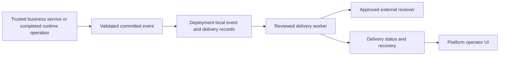

# 010.39 Deployment Local Outbound Event Integrations Implementation Plan

- Status: planned; implementation not started.
- Created: 2026-10-13.
- Execution priority: 5.
- Source review: Platform `db58acd9`; framework `561659dc`; dependency AI Fabric `0.8.32`.
- Owners: Platform INTEGRATION contribution/compiler, deployment-local delivery, and reviewed provider adapters.
- Related: completed [010.34 conversation channels](010_34_TEMPORARY_HUMAN_CONVERSATION_HANDOVER_AND_LIVE_AGENT_EXTENSION_PLAN.md), [010.22 behavior productization](010_22_AI_FABRIC_0_7_0_LOOMAI_PLATFORM_PRODUCTIZATION_IMPLEMENTATION_PLAN.md), [010.41 customer hosting](010_41_CUSTOMER_HOSTED_DEPLOYMENT_BUNDLE_IMPLEMENTATION_PLAN.md).

## 1. Outcome And Verdict

Let installed integrations deliver approved deployment outcomes to external applications. A business can receive a webhook after a committed operation or notification-worthy system event; reviewed messaging adapters can follow over the same contract.

Separate two capabilities:

1. A user/model-requested send is an ACTION with its usual authorization, confirmation, and optional review policy.
2. An automatic notification is a configured subscription to a trusted committed event. It does not need an LLM to infer that a send should happen.

The first delivery adapter is a signed outbound webhook. Specific messaging providers require separate reviewed adapter/credential/API evidence. This plan does not assert that Auto Trader permits a particular write or supplies a particular notification grant.

## 2. Current Code Evidence

- `ai-infrastructure-module/ai-fabric-runtime/.../smartbrain/SmartBrainDeliveryService.java`: persistent per-operation delivery, CloudEvents body, HMAC signature, timestamp, idempotency header, bounded retries, and dead-letter state already exist.
- `.../smartbrain/SmartBrainDeliveryRepository.java`, `SmartBrainDeliveryEntity.java`, and `SmartBrainDeliveryWorker.java`: delivery storage and worker foundation.
- `.../smartbrain/SmartBrainOperationService.java`: enqueues terminal operation delivery; do not treat every orchestration answer as a committed business event.
- `Platfrom/backend/.../marketplace/service/MarketplaceManifestService.java`: `INTEGRATION` currently requires `contributions.conversationChannel`.
- `.../marketplace/service/DeploymentMarketplaceDraftCompilerService.java`: validates/compiles the handover channel and requires one enabled channel for that extension.
- `ai-infrastructure-module/ai-infrastructure-generic-rest-connector/.../service/ConversationChannelDispatchWorker.java`: installed channel dispatch mechanics.
- `.../persistence/IntegrationStateRepository.java`: connector integration persistence.
- `product-services/basic-loomai-inbox-service/`: completed channel provider with its own callbacks and operator UX.

General outbound subscriptions, adapter configuration, and notification operations UI are not implemented. Existing signed delivery is a concrete foundation; conversation channels are already complete and retain their existing semantics.

## 3. Composition And Contract Extension

Use the existing `INTEGRATION` plugin type. Add a typed outbound-delivery contribution alongside the current conversation-channel contribution. A plugin version initially declares one reviewed contribution kind; the compiler can compose multiple distinct outbound bindings while retaining the existing one-channel handover rule.

Proposed outbound contribution concepts:

```text
contractVersion, bindingId, adapterImplementationId, adapterVersion,
compatibleBehaviorTypes, acceptedEventTypes,
destinationConfigurationFields, secretReferenceFields,
payloadProjectionRef, deliveryPolicyRef, verificationPackId
```

Those concepts are proposed schema fields, not existing supported manifest syntax. Reuse current compatibility, permissions, entitlement, install, secret binding, publish, and draft compilation machinery. Do not encode arbitrary script, SQL, URLs, or executable code in a manifest.

A TEMPLATE can recommend an outbound integration and subscribe a declared event/profile. Installed ACTION plugins remain responsible for model-visible operations. DATA plugins remain responsible for source reconciliation/indexing; successful indexing is not automatically permission to disclose its records externally.

## 4. Event Authority And Local Delivery



The customer's application remains authoritative for business state, such as a completed reservation. Inbound business events require signature/authentication, tenant/deployment/source binding, replay protection, and a declared event schema. A text answer saying an action succeeded cannot substitute for an effect receipt or authoritative application event.

For runtime-owned execution outcomes, enqueue from persisted terminal state. For remote effects, preserve the source receipt/event ID and transactional outbox at the source where possible. If the remote transaction and local enqueue cannot be atomic, document the reconciliation/recovery mechanism; do not claim exactly-once delivery.

The new generalized delivery record must retain:

- immutable event identity, occurrence time, source, scoped subject, and safe payload;
- tenant/deployment/binding, immutable configuration/projection hash, and destination binding;
- lease/concurrency state, attempt count, next attempt, last safe failure, and receipt;
- stable idempotency key across retries and recovery;
- explicit authorization and destination-revalidation policy after config/secret changes.

Delivery is at least once. Receivers must deduplicate stable event/delivery IDs. Never route all customer events through a shared Platform gateway.

## 5. Reuse And Migration Of Existing Delivery

Compare the Smart Brain and conversation-channel workers before extracting shared mechanics. Share only transport, leasing, retry, signing, or safe projection behavior that actually has the same contract. Keep operation completion and conversation-control state ownership separate.

Generalizing Smart Brain delivery must preserve its existing callback identity, terminal-state semantics, isolation, and operator visibility. A migration must retain pending/delivered/dead records or explicitly drain them. Do not silently discard a pending callback when replacing the implementation.

The current Basic Inbox callback path and acknowledged return to AI are not notification subscriptions. They remain part of the completed conversation-channel contract.

## 6. Implementation Phases

### N0. Define Events And Adapter Scope

- [ ] Inventory terminal operation, action receipt, and verified source-event producers.
- [ ] Select one supported event and a reviewed webhook receiver for the first proof.
- [ ] Define source authority, schema, safe projection, recipient/destination binding, and delivery policy.
- [ ] Define the `INTEGRATION` contribution extension without changing channel semantics.

### N1. Extend Marketplace And Compilation

- [ ] Add typed outbound contribution models and exact-kind validation.
- [ ] Extend compiler, secret/config binding, compatibility, entitlement, and readiness.
- [ ] Reject duplicate binding IDs, unreviewed adapters, unsafe destinations, and missing source authority.
- [ ] Emit immutable deployment-local delivery configuration through existing artifacts.

### N2. Implement Durable Local Delivery

- [ ] Reuse/refactor existing signed delivery under proved shared semantics.
- [ ] Persist events and deliveries with exact payload/idempotency handling.
- [ ] Add worker leases, bounded attempts/backoff, dead-letter state, and authorized recovery.
- [ ] Validate destinations and redirects against the declared allowlist to prevent unauthorized network access.
- [ ] Keep safe projection and recipient permission before enqueue; no credential or raw private-record serialization.
- [ ] Preserve current Smart Brain and conversation-channel records through any migration.

### N3. Add Provider And Operator Experience

- [ ] Ship one signed webhook adapter and its external receiver guide.
- [ ] Add integration configuration, safe preview/test delivery, and status in Platform UI.
- [ ] Expose owner-scoped pending/delivered/dead counts, failure summaries, and explicit retry commands.
- [ ] Distinguish a test event from a real customer business event.
- [ ] Add messaging providers only after their actual contracts and credentials are available.

### N4. Verify And Release

- [ ] Test exact replay, changed payload conflict, forged events, expiry, tenant isolation, and unsafe destinations.
- [ ] Test receiver timeout, 429/5xx, secret rotation, worker restart, concurrent claims, and dead-letter recovery.
- [ ] Prove a real committed event causes delivery and receiver deduplication works.
- [ ] Prove an uncommitted/denied action and an unsupported event do not emit success notifications.
- [ ] Repeat affected Smart Brain callback and Basic Inbox/handover regression paths.
- [ ] Record actual adapter, compiled binding, event/receipt, and live delivery evidence.

## 7. Framework Impact And Completion

Extend existing `DeploymentMarketplaceDraftCompilerServiceTest`,
`DeploymentConfigCompilerTest`, `SmartBrainConfigurationServiceTest`, and
`SmartBrainOperationServiceTest`. Add dedicated transactional-outbox,
worker-lease, safe-projection, retry, and receiver-deduplication tests for the
new delivery contract; the presence of the current Smart Brain service is
not proof that those generalized cases are already covered.

Generic notification delivery and Marketplace packaging are LoomAI product responsibilities. No framework release is required merely to send a webhook. If a reusable committed-effect/receipt hook is absent, trace its correct framework owner and raise a narrow request with transactional and replay evidence before adding an orchestrator workaround.

Complete when an installed integration consumes authorized committed events, delivers safely with visible/recoverable outcomes, preserves existing channel/Smart Brain behavior, and operates from the customer's deployment. The initial scope excludes unrestricted destinations, customer-authored executable adapters, and unverified provider-specific promises.
