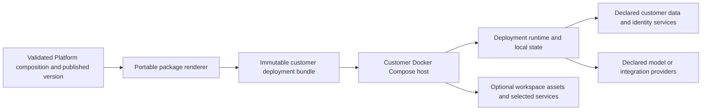

# 010.41 Customer Hosted Deployment Bundle Implementation Plan

- Status: planned; runnable bundle implementation not started.
- Created: 2026-10-13.
- Execution priority: 7.
- Source review: Platform `db58acd9`; framework `561659dc`; dependency AI Fabric `0.8.32`.
- Owners: Platform portable delivery, private deployment images, customer installation, and operations guides.
- Related: [010.13 export/import](010_13_DEPLOYMENT_EXPORT_IMPORT_SEALED_BACKUP_RESTORE_PLAN.md), [010.31 installation](010_31_PLATFORM_HOSTED_AI_WORKSPACE_INSTALLATION_AND_ASSIGNED_RUNTIME_DISCOVERY_PLAN.md), completed [010.34 handover](010_34_TEMPORARY_HUMAN_CONVERSATION_HANDOVER_AND_LIVE_AGENT_EXTENSION_PLAN.md), [010.36 standalone](010_36_STANDALONE_AI_WORKSPACE_IMPLEMENTATION_PLAN.md), [010.40 small profile](010_40_SMALL_PERSISTENT_LUCENE_DEPLOYMENT_PROFILE_IMPLEMENTATION_PLAN.md).

## 1. Outcome And Verdict

Allow an authorized customer to download a complete, immutable deployment package and run it in their own environment. The initial supported target is Docker Compose on one supported host, with services selected from the existing deployment composition.

Package the customer's deployment, not the whole Platform. The same templates, installed plugins, compiled configuration, profiles, and runtime contracts remain in use. Existing configuration export is useful evidence but is not a runnable distribution.

Define the first package as independently runnable after installation: it must not need the Platform to serve compiled configuration or workspace assets on every restart. External model APIs, customer source storage, identity providers, or selected channel providers may still be required and must be declared. Full air-gapped operation is a separate capability claim.

## 2. Current Code Evidence

- `Platfrom/backend/.../deployment/model/DeploymentBundleModels.java`: current config/sealed export schema is `loomai.deployment-export.v2`.
- `.../deployment/service/DeploymentBundleExportImportService.java`: ownership-checked configuration export, classified secret inventory, sealed envelope, and draft import.
- `.../deployment/service/DeploymentConfigCompiler.java`: compiles runtime entity/actions/routing and configuration manifests from the canonical draft/composition.
- `.../deployment/service/DeploymentArtifactService.java`: retrieves immutable version artifacts using server authorization or expiring signatures.
- `.../deployment/web/DeploymentArtifactsController.java`: YAML/JSON artifacts for actions, entity, routing, prompt, knowledge, shell, dataset, and manifest.
- `.../deployment/model/DeploymentArtifactBundleSummary.java`: artifact URLs describe the current delivery, not a portable image/config archive.
- `ai-infrastructure-module/ai-fabric-runtime/deployment-entrypoint.sh`: runtime, connector, and vectorization-runner roles.
- `.../docker-entrypoint.sh`: local/classpath/file entity configuration support and mounted data preparation.
- `.../config/RuntimeDeploymentResolvedConfigSupport.java`: local file resource support reused by knowledge/shell config loaders.
- `max-mode-widget/src/installer/install.ts`: hosted Platform manifest discovery and assets.
- `product-services/basic-loomai-inbox-service/`: optional completed provider to package when selected.

No reviewed source provides a complete customer-hosted archive/rendered Compose topology, local installation manifest/asset delivery, or independently runnable setup/verification contract. Local file support is already present in several loaders and should be reused; remaining startup/config paths must be traced individually.

## 3. Portable Delivery Architecture



Add a portable delivery renderer over canonical compiled artifacts and target/profile metadata. Do not duplicate Marketplace compilation or represent a downloaded archive as a Coolify application that is running.

Package status is distinct from runtime status. Proposed package states are `BUILDING`, `READY`, `FAILED`, and `EXPIRED`. `READY` means package validation passed. Exporting it must not set a deployment to `APPLIED_VERIFIED` or mark a consumer assignment externally ready without actual target verification.

An optional future registered customer operator/agent may report verified health to Platform. A customer host that has no management connection must remain accurately described as externally operated, with the last received evidence date. This first package does not require implementing a new remote fleet manager.

## 4. Package Contents And Integrity

Proposed bundle layout:

```text
bundle-manifest.json
compose.yaml
config/
  deployment-manifest.json
  ai-actions.yml
  ai-entity-config.yml
  actions-routing.yml
  ai-prompt-config.json
  ai-knowledge-source-config.json
  ai-shell-config.json
  ai-marketplace-dataset-config.json
  selected-capability-configs/
workspace/
  reviewed installation configuration and immutable assets, if selected
secrets/
  README.md and empty/reference-only input examples
operations/
  preflight, start, verify, backup, restore, and update commands
checksums.json
README.md
```

Include only files/services required by the selected template and enabled capabilities. The manifest records deployment/tenant identity, composition/config hashes, service roles, exact image digests, supported architecture, framework artifact version, schema/migration identities, volumes, ports, external dependencies, and verification expectations.

Materialize current compiled artifacts inside the package. Do not store expiring Platform artifact URLs as required boot dependencies. Translate host-specific URLs, service names, callback addresses, and mounts through an explicit target binding step and validate the resulting configuration.

Use one current runtime/framework version per bundle. Historical downloaded bundles are retained evidence; they do not introduce simultaneous supported-version branches in the product.

## 5. Images, Secrets, And State Ownership

Deliver immutable private-product image references through an authorized pull path. If image archives are needed for the supported environment, produce verified OCI/Docker image archives from the same digests. Do not expose the private product source repository or embed registry credentials in Compose, logs, or the downloaded manifest.

Default secret handling is customer-supplied secrets or references. Optional sealed transfer must reuse the existing envelope/classification rules and remain separate from a browser-visible config bundle. Environment-bound credentials and identities require explicit rebinding; shopper sessions, raw chat history, customer OAuth tokens, or document originals are not silently included.

The customer owns the host, network, TLS, volumes, operational database, and source-document storage. Platform supplies compiled configuration and the runtime product contract. Runtime, connector, workers, and Basic Inbox have explicit separate state/volume/JDBC needs. Selecting the small Lucene profile does not erase required review/handover/queue persistence.

Define backup consistency, reindex/rebuild inputs, database migration/update sequence, and old pending-work handling. Preserve stable identities and signing/encryption secrets needed for owned conversations and existing records across restart/update.

## 6. Authentication And Workspace Installation

Use the current anonymous, authenticated-broker, and private-adapter semantics. Backend/private assertions remain server-side; anonymous owner tokens and renewal remain deployment-owned. Customer identity and authorization endpoints must be supplied and verified when the selected profile requires them.

For an included standalone workspace, provide a reviewed local installation configuration/asset source bound to the packaged deployment, exact origin, and pack integrity. This is a customer-hosted delivery of the same typed connection contract, not permission to introduce an arbitrary browser-authored runtime descriptor.

Managed/embedded hosted installations continue to use the Platform as their main script/config source. The portable package's local source is an explicit delivery option. No third-party CDN is required.

Trace each startup component for hidden Platform dependencies: entity/action/routing/prompt/knowledge/shell/dataset config, behavior/specialist manifests, origin/identity services, storage secret resolution, workspace assets, and optional channel/provider operations. A disconnected Platform check must fail visibly if any dependency remains required; do not advertise independent operation while a signed URL is still needed to restart.

## 7. Implementation Phases

### P0. Define Target And Supported Composition

- [ ] Select one host/Compose/CPU-architecture support contract and a reference template.
- [ ] Inventory every required service, capability, config file, volume, port, secret, and external dependency.
- [ ] Distinguish exportable configuration, environment-bound values, supplied secrets, and excluded data.
- [ ] Reuse measured `010.40` limits where adopted; a normal larger profile can be packaged without waiting for small-profile promotion.

### P1. Build The Portable Renderer

- [ ] Generate bundle files from existing version artifacts and target bindings.
- [ ] Pin images by digest and record package/config integrity.
- [ ] Render selected Compose services with health checks, resource limits, durable storage, and network boundaries.
- [ ] Validate local artifact loading and prevent incomplete/mixed-schema bundles.
- [ ] Produce an installation preflight and dependency inventory.

### P2. Add Local Identity And Installation Delivery

- [ ] Configure actual customer domains, callback addresses, authorization, and token issuers/audiences.
- [ ] Materialize workspace/experience assets and safe local installation configuration when selected.
- [ ] Prove exact-origin, asset integrity, anonymous renewal, and private credential boundaries.
- [ ] Package Basic Inbox or a reviewed external channel only if selected, preserving completed `010.34` state and callback requirements.

### P3. Add Platform Download UX

- [ ] Add authorized package preview/build/download under existing deployment/version ownership.
- [ ] Show package status, required customer bindings, image-pull needs, and dependency/verification summary.
- [ ] Keep config backup/export and runnable deployment download distinct.
- [ ] Audit package creation/download and enforce bounded expiry/access.
- [ ] Report external operating status honestly; do not manufacture live deployment readiness.

### P4. Prove Installation And Recovery

- [ ] Install on a clean supported host using only the package and declared prerequisites.
- [ ] Run chat, structured/document indexing, source freshness, read action, governed write, and owner-isolation checks for selected capabilities.
- [ ] Verify restart, backup/restore, signed callbacks, and pending-work recovery.
- [ ] Verify Human Review and Conversation Handover with existing messages, attachment/context, and explicit AI resume when enabled.
- [ ] Block Platform connectivity and prove startup/operation according to the declared independent-running contract.
- [ ] Verify model/storage/identity outages are visible without fallback success.

### P5. Document And Release

- [ ] Publish customer install, domain/TLS, secret binding, state ownership, verification, backup/restore, and update guides.
- [ ] Record exact image/config/package hashes and clean-host evidence.
- [ ] Define current-version updates with drain/snapshot/migration/readiness order.
- [ ] Provide tested recovery to a known-good snapshot/image when a rollout fails, without introducing compatibility branches.
- [ ] Deliver an actual verified downloadable archive through Platform.

## 8. Framework Impact And Completion

Extend `DeploymentBundleExportImportServiceTest`,
`DeploymentBundleSealingServiceTest`, `DeploymentConfigCompilerTest`, and
`DeploymentBundleRestoreInPlaceIntegrationTest` where packaging touches those
contracts. Add portable-renderer/integrity tests and a clean-host Compose
installation suite; existing import tests do not prove image distribution or
independent runtime operation. Add a disconnected-Platform browser/runtime
test for the local workspace installation path.

No framework release is expected merely for image/archive delivery. Private loader, compiler, adapter, and installation changes remain LoomAI responsibilities. A genuine generic resource/state contract gap must be evidenced and fixed in its public owner before packaging; never copy framework code into the private product.

Complete when the customer can install, verify, operate, restart, back up, restore, and update the selected deployment with all remaining dependencies explicit. The delivered archive must be usable, immutable, scoped, and verified. The first release excludes distributing the entire control plane, unrestricted custom executables, automatic external-fleet management, and an unverified air-gapped claim.
