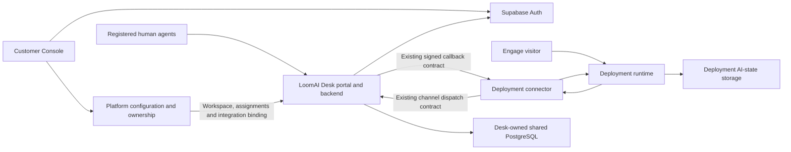

# 010.48 LoomAI Desk Managed Human Support And Review Service Implementation Plan

- **Status:** Desk implementation and hosted core journeys qualified, including branded HTTPS, native signup confirmation, browser password recovery and corrected one-click owner sign-in (2026-10-27). Recovery email reached Gmail Spam, so sender/inbox-placement qualification remains the external launch follow-up; not a fully closed public-release claim. Both Consoles run `4eafcd08f`; Northfield remains on the same verified production app assignment, revision 11. Legacy per-deployment Inbox resources remain retired. Additional unqualified paths and historical failures are explicitly distinguished in the latest execution record below.
- **Created:** 2026-10-26
- **Proposed product name:** **LoomAI Desk**, alongside **LoomAI Engage** and the **LoomAI Platform**.
- **Primary outcome:** A customer enables human support on an existing deployment, opens its Desk workspace without another login, and assigns registered human agents to handle conversations or action reviews.
- **First integration:** The existing dealership deployment and Engage workspace, followed by a domain-neutral deployment.

## 1. Agreed Scope And Constraints

LoomAI Desk becomes our formal, LoomAI-managed human-support service. It serves multiple customers through one shared service and one Desk-owned PostgreSQL store per hosting environment. It has a separate operator portal, but uses the same Supabase identity system as the customer Console.

The first release includes:

- Customer Console authentication moved to Supabase, preserving existing customer ownership and permissions.
- A separate Desk portal with Supabase-backed sign-in and one-click access from an authenticated customer Console.
- Multiple isolated customers, deployments and registered human agents.
- **Deployment-scoped agent assignments**, independently scoped to staging or production targets.
- Live conversation handover through the existing conversation-channel integration contract.
- A separate action-review queue using the existing Human Review APIs and framework decision gateway.
- One-click enablement on compatible deployments, implemented through the existing configuration, publish, apply and verification lifecycle.
- Integration into the current dealership deployment without changing its public Engage address.
- Removal of the per-deployment Basic Inbox service and its dedicated databases after the replacement passes live verification.

The first release does **not** include:

- Application-specific agent authorization. An Engage app opens its deployment's Desk workspace and inherits that deployment's support team.
- AI Fabric framework changes/releases or a new handover/review engine. The original no-runtime-edit scope has the separately owner-authorized, narrowly bounded application-proposal adapter and dispatch-attempt configuration exceptions recorded in section 15; no other runtime redesign is included.
- A CRM, lead database, workforce-management platform, skills routing, omnichannel messaging or an enterprise notification system.
- A new database, service deployment or Supabase project for every customer, agent or deployment.
- Capacity/admission redesign, generalized draining, disaster-recovery orchestration or an exhaustive unrelated release matrix.
- Moving ordinary AI chat traffic through Desk or the Platform control plane.

The name is a product proposal, not a trademark claim. Production now uses
`https://desk.loomai.pro`, with normally verified TLS; staging uses its separate
address. Hosting and identity qualifications are recorded by date below.

## 2. Current Implementation And Reuse

### 2.1 Pre-implementation baseline

This subsection records the starting point, not the current supported product.
The standalone Basic Inbox module/provisioner and its live per-deployment
resources were removed during the qualified Desk cutover below.

Basic Inbox implements queue, claim, participant replies, explicit return to AI, close, callback retries and operator delivery status. Its README explicitly requires one trusted tenant/deployment pair per instance. Tenant/deployment configuration, provider credentials, callback destination and operator credentials are currently process-global.

Its current PostgreSQL-backed managed dependency allocates a separate database service. Sharing that binary across customers without changing its scope resolution and persistence is not safe.

The generic connector already sends:

```text
POST {providerBaseUrl}/api/conversation-channel/v1/dispatches
X-LoomAI-Inbox-Key: <binding-specific provider credential>
```

It already accepts signed provider events at:

```text
POST {connectorBaseUrl}/integrations/conversation-channel/events
X-LoomAI-Provider-Timestamp
X-LoomAI-Provider-Nonce
X-LoomAI-Provider-Signature
```

Desk must implement this existing wire contract. Existing protocol/header names do not need to change just because the product has a new name. The Marketplace contract remains `INTEGRATION / CONVERSATION_CHANNEL`, using `LOOMAI_CONVERSATION_CHANNEL_V1`; there is no new plugin type.

Human Review already exposes runtime APIs under `/api/reviews/v1` for listing tasks, reading a task and submitting `APPROVE` or `REJECT`. The current Platform proxy authenticates a customer administrator and signs private-runtime reviewer requests. Its authorization is not a ready-made agent-access contract; adapt the product-side authorization without impersonating that administrator.

### 2.2 Authentication is not already unified

The customer Console currently uses Platform password/session authentication. Its frontend calls the Platform login API, and multiple customer views explicitly require authentication mode `SESSION`.

There is a separate Supabase integration for Partner authentication. That does not mean customer Console users or Desk operators already use Supabase. Do not copy its email-fallback account lookup into the new customer identity mapping.

This plan deliberately moves **customer** Console authentication to Supabase. It does not require moving internal Platform administrator/operator login at the same time.

### 2.3 Source anchors

Relevant current files, relative to the repository root:

- `product-services/loomai-desk-service/README.md`
- `product-services/loomai-desk-service/src/main/java/com/loomai/desk/service/DeskDirectory.java`
- `product-services/loomai-desk-service/src/main/java/com/loomai/desk/service/DeskChannelService.java`
- `product-services/loomai-desk-service/src/main/java/com/loomai/desk/service/DeskReviewService.java`
- `Platfrom/backend/src/main/java/com/ai/fabric/platform/backend/desk/DeskActivationService.java`
- `Platfrom/backend/src/main/java/com/ai/fabric/platform/backend/desk/DeskBindingProvisioner.java`
- `Platfrom/backend/src/test/resources/dependency/retired-basic-inbox-spec.json` (historical decoding/test fixture, not an active provisioning path)
- `Platfrom/ui/src/auth/PlatformAuthProvider.tsx`
- `Platfrom/ui/src/pages/CustomerKnowledgeConnectionsPage.tsx`
- `Platfrom/backend/src/main/java/com/ai/fabric/platform/backend/security/service/PlatformIdentityService.java`
- `Platfrom/backend/src/main/java/com/ai/fabric/platform/backend/partner/security/PartnerSupabaseAuthenticationFilter.java`
- `Platfrom/backend/src/main/java/com/ai/fabric/platform/backend/deployment/service/DeploymentHumanReviewService.java`
- `ai-infrastructure-module/ai-fabric-runtime/src/main/java/com/ai/fabric/runtime/web/HumanReviewController.java`
- `ai-infrastructure-module/ai-fabric-runtime/src/main/java/com/ai/fabric/runtime/review/HumanReviewService.java`
- `ai-infrastructure-module/ai-infrastructure-generic-rest-connector/src/main/java/com/ai/infrastructure/connector/rest/service/ConversationChannelDispatchWorker.java`
- `ai-infrastructure-module/ai-infrastructure-generic-rest-connector/src/main/java/com/ai/infrastructure/connector/rest/controller/ConversationChannelWebhookController.java`

The runtime files are contract references, **not planned edit targets**.

## 3. Customer And Agent Journeys

### 3.1 Enable Desk

1. A signed-in customer opens an owned deployment's **Human support** panel and selects its staging or production target.
2. The customer clicks **Enable LoomAI Desk**. The panel explains that this installs/configures the existing support integration and may apply an updated configuration.
3. Platform creates the customer's Desk workspace and a target-scoped channel binding, generates its credentials server-side, and installs the reviewed Desk integration.
4. Platform uses the existing draft -> publish -> apply -> verify services. It does not create another versioning mechanism, require a new Engage app, or request separate manual approval.
5. The panel shows progress, then **Enabled** only after the actual target passes verification. Repeating the request returns the same activation operation rather than another workspace or binding.
6. **Open LoomAI Desk** opens the deployment's authorized support workspace. No pasted operator key, separate Desk registration or second password is required.

One click means one authorized user operation with visible progress, not an instantaneous configuration flag. If the deployment has an unrelated unsaved draft, show that conflict and require the customer to review it; do not silently publish unrelated edits.

For a deployment that already has compatible handover enabled, reuse that configuration and replace only the provider binding through the normal release lifecycle. A missing runtime capability is a visible incompatibility, not permission to change runtime/framework code under this plan.

### 3.2 Customer account continuity

After the customer Console's Supabase cutover, the same authenticated person is recognized in Console and Desk. Desk creates its local profile/workspace membership automatically from trusted Platform ownership. This is a service profile, not a second set of credentials.

Console links identify the selected deployment/target as navigation context only. Desk independently authorizes access; changing a URL cannot reveal another customer's queue.

An Engage app's **Human support** link opens its bound deployment/target. Multiple apps using the same deployment share its support assignments in this release. An agent assigned there can handle that deployment's conversations regardless of which of its apps originated them. The UI must say this clearly.

### 3.3 Register and assign human agents

1. A human agent creates a Desk account using Supabase and verifies their email. Registration alone grants no customer or conversation access.
2. The customer selects **Assign agent** and identifies an already registered agent using an exact verified email or a shareable agent reference. Do not expose a searchable global directory.
3. Desk resolves the registered account to an immutable identity and the customer selects a deployment, target and role.
4. The assignment becomes active and the agent sees that workspace on their next authorized refresh.
5. Removing the assignment immediately stops new reads, claims, replies and review decisions for that scope. It does not delete conversation history or silently return an active human conversation to AI.

Do not create placeholder agent accounts, copy an owner's credentials, or grant customer Console administration just to let a person reply. One agent may have separately authorized assignments for several customers.

Keep roles small:

- **Customer owner:** manages their Desk workspace and assignments; may explicitly assign themselves support/review access.
- **Support agent:** views, claims, replies, returns a conversation to AI and closes conversations within assigned targets.
- **Action reviewer:** views and approves/rejects assigned deployment action-review tasks.

Support-agent and action-reviewer permissions are separate and may both be assigned to one person. Internal LoomAI support access is explicit and audited, not automatic access to all customer transcripts.

### 3.4 Handle a conversation

The visitor searches or asks a normal AI question in Engage, then requests a human through the existing AI action or UI button. A registered, assigned Desk agent sees the queue item, claims it, reads the approved transcript projection, replies, and explicitly returns it to AI or closes it.

The visitor receives human messages through the current deployment-owned chat/event path. Desk does not add a second browser-to-runtime contract. Any agent contact details requested from the visitor remain controlled by the existing handover intake configuration.

### 3.5 Review an action

A separately authorized reviewer opens **Action reviews** in the same Desk portal. They see the runtime's safe action proposal, inspect it, and approve or reject using the existing task version and decision ID contract.

This is not a conversation handover. Approving an action does not claim the chat or switch its response authority. Claiming/replying to a chat does not approve an action.

## 4. Architecture And Ownership



**Platform** owns customer/deployment ownership, configuration, plugin installation, secrets, versioning and integration enablement. It stores binding metadata and operational summaries, not a duplicate support transcript store.

**Supabase Auth** owns user credentials, authentication, verification and identity sessions. It does not decide which dealership/deployment a person may operate.

**Desk** owns operator profiles, registered-agent assignments, queues, claims, bounded transcript copies, delivery tracking and its portal. It checks its resource permissions on every request.

**The deployment runtime** remains authoritative for AI/human conversation control, canonical safe messages, review tasks, review policy and action continuation. Its AI-state database remains deployment-owned or customer-provided.

**The connector** retains dispatch/callback validation, retries and delivery to the runtime using the current integration contract.

**Customer systems** retain inventory, leads, bookings and other business effects. Desk must not become a dealership inventory or CRM database.

### 4.1 Hosting and database count

Deploy one Desk application service, including its portal and backend, per hosting environment. Start with a single instance; horizontal replicas are a later hosting choice, not a customer provisioning requirement.

Use one Desk-owned PostgreSQL store per environment with shared, scope-keyed tables. Do not create per-customer databases or schemas. Do not store Desk data inside each runtime database or inside Platform control-plane tables.

Supabase Auth can use the existing appropriate Supabase project. That choice does not require storing Desk application data in the Auth project's database. Confirm environment/client separation before reusing an existing project; never grant an Engage visitor operator rights merely because that visitor authenticates through the same project.

The resulting topology has deployment AI-state storage per deployment, plus a shared Desk store per environment. The extra Inbox PostgreSQL service per deployment disappears after cutover.

## 5. Multi Customer Persistence And Channel Isolation

Evolve the Basic Inbox implementation into `product-services/loomai-desk-service`, reusing its tested channel lifecycle, repository/outbox behavior and UI operations. Move/refactor rather than maintaining two permanent production implementations.

The minimum persistent model is:

- Desk workspace linked to a Platform customer.
- Operator profile with unique authentication issuer/subject links.
- Deployment/target channel binding with its trusted customer, tenant, deployment, connector callback destination and credential references.
- Agent assignment linking a registered person to a deployment/target and explicit support/review permissions.
- Conversation, message, dispatch receipt and callback outbox scoped to the trusted binding.
- Review references/decision receipts and audit records; runtime review tasks remain canonical.

Every queue query, detail lookup, mutation, stream/poll subscription, receipt lookup and callback retry must enforce the binding and customer scope. Include that scope in database keys, foreign keys and idempotency uniqueness where identifiers are currently assumed process-global. No tenant-per-process assumption may survive in a shared worker.

Resolve a dispatch's binding from its authenticated, binding-specific provider credential. Check its payload scope against the registered binding. Never select a customer from an untrusted `customerId`, an operator's query parameter or a browser attachment.

Callback destinations and signing credentials come from the registered binding, never from incoming transcript fields. Each binding has its own provider/signing credentials. The current one-process callback URL, operator list and encryption settings must become appropriately scoped service configuration/data. Do not substitute a shared all-customer operator key.

Retain the existing durable callback outbox and per-conversation ordering. Callback workers select each row's binding configuration. Reuse existing bounded retries and show delivery pending/failed honestly; do not build another recovery framework.

Staging and production have distinct bindings and queue labels, even for the same logical deployment. A production app link resolves its actual verified production assignment rather than the latest-created staging release.

Keep reasonable transcript retention and protected intake/secret storage. Deleting one workspace or disabling one binding must never drop the shared database or another customer's records.

## 6. Supabase Authentication And One Click Desk Access

### 6.1 Customer Console cutover

Replace customer Console password login with Supabase authentication. Preserve the Platform user/customer identifiers and existing resource authorization services. Add a server-owned link from the verified Supabase issuer/subject to that Platform customer identity.

For an existing local customer account, require a one-time verified linking/enrolment process: prove the existing account and the new Supabase identity, or use an explicitly authorized administrative enrolment. Do not match accounts solely by email and do not copy or share local password hashes. The initial migration is not a requirement to register again every time Desk is opened.

Update customer-only `SESSION` guards to accept the verified customer Supabase principal through one shared authorization contract. Do not simply remove the guards. Internal administrator/operator session login remains unchanged. Retire local password authentication for migrated customer accounts at cutover rather than shipping indefinite dual customer login paths.

All registered Supabase users are not customer administrators. Platform membership and active customer ownership still determine Console permissions. Desk-only agents can authenticate without acquiring any customer Console permissions.

### 6.2 Use the identity provider for cross app sign in

Use Supabase's supported OAuth/OIDC authorization-code flow with PKCE for Desk as a registered first-party application, with the Console providing the authorization UI against the same identity project. Prefer standard OAuth client/server libraries; do not build a custom identity provider or token-exchange protocol.

```text
Authenticated customer clicks Open LoomAI Desk
  -> Desk starts an authorization request with state and PKCE
  -> Supabase routes authorization to the Console authorization page
  -> Existing Console Supabase session identifies the same person
  -> Approved first-party authorization returns a one-use code to Desk
  -> Desk backend exchanges the code and creates its own protected session
  -> Desk authorizes membership and opens the requested deployment queue
```

The reviewed first-party Desk client should not require a second credential prompt or manual Desk signup. Configure the supported first-party authorization experience explicitly and prove it live, including a first-ever launch, rather than assuming same-project authentication shares browser storage. Any provider-required consent must be identified during qualification; repeated consent/login prompts do not satisfy the intended normal one-click journey.

Use exact client IDs and registered redirect URLs, PKCE/state validation, verified issuer/signature/expiry and supported audience/client checks. Store Desk's refresh credentials server-side and expose a secure, host-only HttpOnly session cookie to its portal. Do not put access/refresh tokens, runtime keys or permanent launch secrets in URLs; do not share a wildcard `.loomai.pro` authentication cookie across customer app subdomains.

Use `(issuer, subject)` as identity, not email or editable user metadata. Customer ownership and agent permissions are server-owned records. A Supabase email-confirmed agent can have zero assignments.

Document and test session refresh, local logout, expiry and membership revocation. Supabase sign-out does not instantly invalidate an already issued access token, so do not promise that signature verification alone provides immediate global logout. Check current Desk assignments before commands and stop a revoked agent's live subscriptions. Define a bounded identity-session expiry/revalidation policy using the supported Supabase mechanisms.

### 6.3 Authentication material and setup check

The private handover contains a Supabase project URL and public authentication configuration. This planning session has **not** verified live key validity, administrative access, OAuth Server enablement or registered OAuth clients. No private values belong in this plan, Marketplace manifests, audit bodies or Git.

Before authentication implementation is called ready, confirm:

- The intended active Supabase project and verified issuer/signing-key configuration.
- Existing Console/Engage authentication consumers and effects of any project-wide setting change.
- OAuth Server availability/enablement and administrative permission to register Console/Desk client configuration.
- Exact staging and production callback/authorization URLs and allowed redirect configuration.
- Public client configuration, server-only client credentials where applicable, and server-only administrative credentials only if enrolment requires them.
- Working verification/recovery email delivery for customer and agent registration.

Ask the owner only for a specific missing permission or configuration after checking the existing private material. Missing auth setup must not silently turn into a custom SSO system or an insecure session-sharing workaround.

Official references: [Supabase OAuth Server](https://supabase.com/docs/guides/auth/oauth-server), [OAuth configuration](https://supabase.com/docs/guides/auth/oauth-server/getting-started), [authorization-code and PKCE flow](https://supabase.com/docs/guides/auth/oauth-server/oauth-flows), and [session lifecycle](https://supabase.com/docs/guides/auth/sessions).

## 7. Platform And Marketplace Integration

Publish a reviewed **LoomAI Desk** Marketplace integration using the current conversation-channel contribution. Reuse the current HTTP adapter contract and existing behavior compatibility checks. Do not invent a new runtime adapter just to replace Basic Inbox branding.

Platform supplies safe defaults and server-generated binding credentials. The customer should not enter provider base URLs, callback signing secrets, operator API keys or a managed Inbox database profile. Existing advanced configuration remains available through shared editors where appropriate.

One-click enablement should coordinate these existing capabilities:

1. Authorize the actual customer, deployment and selected target.
2. Upsert the workspace and target binding through an authenticated service-to-service Desk administration API.
3. Install/configure the integration and the existing handover behavior, retaining the customer's current intake and AI/UI transition choices.
4. Publish/apply the resulting version through the normal deployment services and verify it.
5. Expose a safe Desk portal link and current status to the customer UI and Engage app inspector.

Use an idempotent activation record with progress and retry of that operation, not a new general workflow engine. An unsuccessful apply must not be shown as enabled or leave a second operator inbox advertised as active.

Update the dealership template's bootstrap defaults to Desk. Existing deployments are changed through a new configuration version, not by rewriting immutable template/release records or reimposing template defaults continuously.

The integration is generic. Dealership labels and branding may be configured in its workspace; inventory, Auto Trader logic and dealership business actions do not enter Desk's generic components. The same activation path must work on a compatible non-dealership deployment.

Disabling Desk stops new handovers after the corresponding configuration update. Existing active conversations require an explicit authorized return/close or deliberate retention of the binding until they finish. Do not silently transfer authority because a provider was disabled. Do not expand this into runtime draining or infrastructure retirement machinery.

## 8. Action Review In The Same Service

### 8.1 Reuse existing review authority

Add **Action reviews** beside **Conversations** in Desk. Continue to use the `HUMAN_REVIEW` execution extension and current action-proposal review policy. Do not send approvals as conversation-channel messages or treat a chat reply saying "approved" as a decision.

The supported current runtime contract is:

```text
GET  /api/reviews/v1/tasks
GET  /api/reviews/v1/tasks/{taskId}
POST /api/reviews/v1/tasks/{taskId}/decisions

{
  "decisionId": "<unique decision identifier>",
  "decision": "APPROVE",
  "expectedVersion": 3
}
```

`REJECT` is the other supported decision for the current policy. The existing task-creation API is `POST /api/reviews/v1/action-proposals/{receiptId}` with its existing trusted identity and idempotency requirements. Task creation remains part of the originating action workflow. Enabling Desk does not automatically turn every action into a review or create fake review tasks inside Desk.

For initial delivery, Desk refreshes the existing review inbox through a small Platform-side integration adapter that reuses private-runtime request signing and the existing review service transport. The adapter authorizes the actual registered reviewer and selected target; it must not call the current administrator-only endpoint as a shared administrator.

```text
Desk reviewer
  -> Desk verifies active deployment/target review assignment
  -> Authorized Platform integration adapter preserves that reviewer's identity
  -> Existing deployment-local /api/reviews/v1 contract
  -> Framework ReviewDecisionGateway
  -> Existing action continuation and customer-system authorization
```

This deliberately reuses the current low-volume review bridge. It does not put normal AI chat or human conversation messages through the control plane, and does not require distributing a Platform signing private key to Desk. Direct delegated review access can be considered later only if demonstrated traffic warrants it.

### 8.2 Permissions and outcomes

Keep `review:tasks:view` and `review:tasks:decide` distinct from channel operations. A support-only agent cannot approve. Carry the real reviewer subject to the runtime so its separation-of-duty, expiry, version and replay checks remain effective. Changing roles must not allow somebody to approve their own action proposal when the configured policy forbids it.

Show the exact returned outcome. `APPROVE` may advance execution through the framework's existing action gateway; it is not necessarily a harmless annotation or an unconditional guarantee that the business action succeeded. Rejection must not execute that action. Desk records the receipt and displays the actual continuation status rather than executing the business write itself.

Use the existing review semantics and target APIs only. If a proposed capability is not supported by those APIs, record it as a separate limitation, not an implicit runtime/framework work item. Correction, arbitrary document approval, answer moderation and multi-step approval design are deferred.

Enabling Desk conversation support does not automatically enable Human Review or grant reviewers. Review can be enabled separately using the existing configuration lifecycle. The first-release dealership qualification must demonstrate both capabilities, using existing compatible APIs and a bounded demo-system action proposal.

## 9. Portal And Console UI

Desk is a separate service UI, not an embedded operator screen in the customer Console. A person may be a customer owner, an agent, a reviewer, or more than one of these.

Keep the first portal compact:

- Header: current customer/workspace, deployment and clearly labeled environment.
- Navigation: **Conversations**, **Action reviews**, and **Agents & access** for authorized owners.
- Conversations: waiting/active/closed queue, transcript, current assignee, reply composer, explicit return-to-AI and close controls, delivery status.
- Action reviews: pending tasks, safe proposal details, separate approve/reject controls and the actual decision/execution receipt.
- Agents: registered-agent assignment, deployment/target selection, support/reviewer permissions and revoke.

The conversation queue contains transferred human-support conversations and their permitted transcript projection. It is not a promise to mirror every AI-only conversation into a second database. A complete AI conversation-history product is outside this plan.

Console keeps only product configuration/status, **Enable LoomAI Desk**, **Open LoomAI Desk**, and the safe assignment summary. Engage app inspectors link to the corresponding deployment workspace; they must not suggest independent app-level agent permissions.

Use existing product styling, light/dark themes, a desktop-first queue/detail layout and basic mobile navigation. Reuse tested UI patterns and safe content rendering. Do not create a design-system extraction or a new dashboard framework as a dependency.

Use bounded polling for Desk queue updates initially, reusing the Basic Inbox approach. The visitor continues using existing deployment event delivery. Advanced push notifications and workforce features remain in the enterprise integration roadmap rather than blocking this service.

## 10. Availability And Minimal Operational Boundaries

Desk is an optional integration. Its outage must not make an otherwise healthy deployment's ordinary AI chat, indexing or read actions unavailable. Handover can report provider unavailability/pending delivery through the existing contract.

An active human conversation must not silently revert to AI during a Desk outage. Use the existing configured, authorized transition rules and visible delivery states. Do not add a lexical or automatic semantic fallback to hide provider failure.

Use the existing PostgreSQL outbox, scoped idempotency, current callback retries, service health probes, standard backups, bounded retention and practical logs. Measure resource usage during the real two-customer journey. Do not build capacity admission, billing tiers, multi-region failover or a new recovery subsystem for this release.

The shared service introduces a shared human-support dependency. Accept and document that hosting trade-off; ordinary deployment AI remains self-contained. Review operations using the existing Platform adapter also depend on that adapter's availability and must show an honest failure if it is unavailable.

## 11. Phased Delivery And Verification

Each phase should be a focused implementation commit with its own verification evidence. Checked source/offline items are distinguished below from hosted exit gates; passing an offline test does not close a live journey.

### P1 Shared service foundation

- [x] Refactor Basic Inbox into the Desk service and include it in the appropriate build/image path.
- [x] Replace single-process tenant/binding/operator assumptions with shared, scoped persistence and registered bindings.
- [x] Reuse the current dispatch/callback contract, callback outbox, claim/reply/return/close behavior and secret handling.
- [x] Run focused PostgreSQL and HTTP integration tests with two customers and multiple targets, including colliding local identifiers and wrong-binding credentials.

**Exit:** One shared instance safely serves two independent deployment bindings without a runtime/framework edit.

### P2 Shared customer authentication and registered agents

- [x] Confirm private Supabase configuration and configure the required first-party OAuth clients/redirects.
- [x] Move customer Console sign-in to Supabase, preserving stable customer/resource ownership and internal staff login (deployed; actual existing-owner dual-proof UI linking passed).
- [x] Implement immutable subject linking, automatic owner Desk membership and standard first-party Console-to-Desk authentication (actual first owner launch passed on staging).
- [x] Add agent registration/verification, deployment/target assignment and independent support/review permissions (real native signup confirmation and password recovery passed on 2026-10-27; recovery inbox placement remains open).
- [x] Verify first-ever Desk launch, returning launch, cancelled login, logout, revoked assignment, unassigned registered user and unchanged staff administration (existing live/contract evidence; native email and corrected branded owner launch requalified on 2026-10-27).
- [ ] Additional live qualification: active-page session-expiry journey. Explicitly deferred; focused expiry handling, logout and revocation are not represented as this live timeout case. No session-timeout or identity checks were weakened.

**Exit:** A real customer signs in once, opens Desk through one link, and a separately registered agent can access only assigned deployment targets.

### P3 One click activation and conversation portal

- [x] Publish/configure the reviewed Desk conversation-channel integration and its server-side binding administration.
- [x] Add Console enable/open/status controls and app links using existing editors and release services (live staging enable/apply/recheck/open passed).
- [x] Implement the separate Desk queue/detail/agents UI using the existing channel operations.
- [x] Switch the current dealership target to Desk using a normal new configuration version, keeping its deployment identity and Engage URL (both environments; existing app activated on production).
- [x] Verify AI search -> AI-requested handover -> agent claim/reply -> explicit return to AI -> UI-requested handover -> close, through actual public routes (staging and production; public embedded demo rechecked after legacy removal).

**Exit:** Current dealership visitors and assigned registered agents complete the real conversation journey on the shared service. No per-deployment Inbox is used for that qualified target.

### P4 Action review portal

- [x] Add the bounded Platform review integration adapter using actual Desk reviewer identity, existing request signing and target authorization (focused offline tests passed).
- [x] Configure Human Review through existing deployment settings; consume real runtime tasks rather than Desk-only fixtures (real staging and production tasks and decisions qualified).
- [x] Add pending-task detail, approve/reject and receipt views in Desk.
- [x] Prove a reviewer can approve one real demo proposal and reject another, a support-only agent cannot decide, and stale/replayed decisions do not duplicate execution (actual UI/API decisions and read-only business counts on both environments; permission checks through actual APIs).
- [x] Check configured separation of duty and that the returned business-action outcome is shown honestly (actual distinct application source and assigned reviewer; actual completed outcome, not a fabricated receipt).

**Exit:** Conversation support and action review both work in Desk with separate permissions. The framework remains published 0.8.41. The initial no-runtime-change constraint has the explicit owner-authorized, generic opt-in application-adapter exception recorded below; ordinary chat behavior is unchanged.

### P5 Hosted customer journey and removal of old Inbox

- [x] Run the full dealership journey with a customer owner and a different registered agent/reviewer on staging, then the current production deployment.
- [x] Enable Desk on one compatible domain-neutral deployment through the same customer control, without dealership branches (fresh generic customer, actual UI enablement, normal verified release and human lifecycle passed).
- [x] Verify cross-customer, staging/production target and support/reviewer isolation through the actual APIs, not only hidden UI elements (known-real same-service cross-customer conversation/review denials in both directions, plus the earlier target and independent-role checks).
- [x] Verify Desk interruption leaves ordinary AI chat healthy and does not silently transfer human authority (fresh staging and production proofs after the bounded retry correction, including exactly-once queued-message delivery).
- [x] Record actual service/database inventory and basic resource usage; show that adding a customer creates a binding, not another Inbox service/database (actual second hosted generic customer reused shared Desk/frontend; only its approved runtime, connector and optional AI-state PostgreSQL were provisioned and subsequently removed).
- [x] Remove all remaining per-deployment Basic Inbox services/databases and active provisioning paths after the retirement checks below (three scoped pairs, containers and owned volumes verified absent; archived demo history retained privately).
- [x] Update operator/customer guides, Marketplace/template defaults, cleanup ownership and a real customer/agent demonstration recording (redacted live production technical clip delivered; known answer-quality caveat retained).

Guides, Desk-ready template defaults and cleanup ownership are updated. The
redacted live customer/agent technical demonstration is delivered in
`Final_Documentation/Demo_Videos/LOOMAI_DESK_DEALERSHIP_CUSTOMER_AGENT_DEMO.mp4`.
The known-second-customer isolation gate is now qualified and its temporary
resources are removed. The earlier active-human outage cases remain failed
historical evidence. Fresh staging and production cases after the bounded retry
correction both passed; their exact release and message-delivery evidence is
recorded below. Public email delivery and branded Desk DNS are not closed by
these fixture-based proofs.

**Exit:** The formal support service is Desk, old per-deployment Inbox resources are gone, and no supported template/provisioner recreates them.

## 12. Cutover And Complete Retirement

After the shared service passes dealership conversation **and** review verification:

1. Inventory the actual old Inbox services/databases and their deployment bindings. Do not infer ownership from an application name alone.
2. Stop new handovers to old bindings through the normal configuration path. Complete or explicitly return/close active demo conversations using current APIs; record any retained support data before deletion.
3. Activate verified Desk configuration on the existing deployment/app. Refresh the Console link and remove browser-visible operator keys and old Inbox URLs.
4. Confirm no current runtime/connector release or active customer binding still uses an old Inbox endpoint. Verify Desk callbacks and review access again.
5. Remove the old per-deployment Inbox application and its **owned** dedicated database resources. Do not remove runtime AI-state storage, Platform PostgreSQL, the shared Desk store, customer systems or Supabase Auth.
6. Remove the Basic Inbox managed-dependency provisioning defaults/spec builders from active product paths and remove its obsolete standalone production build/deployment entry. Reuse/move useful tests rather than maintaining a second supported service.
7. Preserve immutable historical release/audit records as history, but do not preserve a functioning old product path as a compatibility requirement. Mark historical rollback targets that require retired resources as unavailable rather than claiming they remain operational.

The user has previously allowed fresh fictional dealership data. No automatic transcript/data migration is required for this demo cutover. Do not silently generalize that permission to unrelated customer support history: obtain a retention/export/deletion decision for any non-demo data discovered.

Before the retirement step, a failed canary may revert to the still-existing old binding using the normal configuration path. After retirement, use a previously verified Desk release or temporarily disable new handovers; do not automatically recreate a per-deployment Inbox/database.

## 13. Definition Of Done

- A customer can enable support on an owned compatible deployment through one Console operation, with actual publish/apply/verify progress.
- Console customer authentication and Desk use Supabase-backed identity; an authenticated owner opens Desk without a separate account/password.
- A human agent registers first, then receives deployment/target support or review access without becoming a Console administrator.
- Engage apps link to deployment-scoped support; no application-specific security is advertised.
- One shared Desk service/store serves multiple isolated customers in each hosting environment.
- The dealership's existing public Engage URL completes AI -> human -> AI journeys with real operator replies.
- The same portal handles real action-review tasks through the existing runtime decision APIs, with distinct reviewer permissions and real actor attribution.
- Existing visitor authentication, attachments, conversation continuity and ordinary AI queries still work.
- The framework and existing conversation-channel contract are unchanged. The narrowly owner-authorized opt-in runtime application-proposal adapter is separately versioned, tested and qualified; it does not silently change ordinary chat confirmation.
- Per-deployment Basic Inbox services, dedicated databases, active provisioners, operator-key UI and obsolete deployment instructions are removed.
- No business inventory/lead database, hidden LLM fallback, duplicate review engine or unrelated operational redesign was added.

## 14. Related Plans

- [010.34 Conversation handover and the original Basic Inbox](010_34_TEMPORARY_HUMAN_CONVERSATION_HANDOVER_AND_LIVE_AGENT_EXTENSION_PLAN.md)
- [010.42 Enterprise conversation-channel integrations](010_42_ENTERPRISE_CONVERSATION_CHANNEL_AND_OPERATOR_INTEGRATION_PRODUCTIZATION_PLAN.md)
- [010.44 Customer system ownership boundaries](010_44_CUSTOMER_SYSTEM_INTEGRATION_BOUNDARY_CORRECTION_PLAN.md)
- [010.45 Customer-focused resource console](010_45_CUSTOMER_RESOURCE_CONSOLE_PROGRESSIVE_UI_PLAN.md)
- [010.47 Template bootstrap and normal deployment upgrades](010_47_TEMPLATE_BOOTSTRAP_AND_NORMAL_DEPLOYMENT_UPGRADES_EXECUTION.md)

This plan replaces the single-deployment Basic Inbox hosting decision for the managed product. It retains the provider-neutral integration boundary from 010.34/010.42 and does not make enterprise workforce features prerequisites for the first Desk release.

## 15. Execution Record

### 2026-10-26 Shared Service And Portal

- Commit `ec20cb3fe3c572c35fb98ca8ee00cd08dc397514` publishes the shared service,
  generic portal, contract and image workflow. GitHub run `40260746672` passed.
  The pipeline requires real PostgreSQL and runs portal browser tests.
- Service verification: 11 tests passed, including five real PostgreSQL cases,
  protocol-level dispatch/callback tests, two-customer collision isolation,
  authenticated role checks, encrypted OAuth credentials and CSRF/PKCE behavior.
  Portal verification: 23 browser scenarios passed, with inspected light/dark
  and basic mobile screenshots. Fixtures are test-only, not production data.
- Staging Desk is HTTPS healthy at
  `https://loomai-desk.46.224.145.148.sslip.io/`; app
  `zyivu69wblt4alx2zevffghj`, shared PostgreSQL `e4fqe4817eaeoam1ys7ev5rv`.
  The native authorization redirect carries the exact callback, state, nonce and
  PKCE S256. A logged-in authorization-code exchange is not yet qualified.
- Production service container and shared database are healthy: app
  `i13lxkspuql9qkjzbf2eha4q`, database `gwp0no7b84h6egbh9hq6hr4y`.
  `desk.loomai.pro` DNS/certificate qualification remains pending; internal
  container health is not public HTTPS readiness.
- Platform's initial 13 Desk tests passed, including real PostgreSQL migration
  through V215. Customer auth passed 30 HTTP tests, 28 signature/authorization
  tests, 87 frontend checks and 11 offline browser scenarios. Integration review
  found a target-local binding gap: shared published versions must not contain
  staging Desk addresses or credentials. That correction is in progress before
  the control-plane rollout; no runtime/framework changes are involved.
- Two confidential Supabase OAuth clients, the central authorization page and
  exact callbacks/signup/recovery redirects were configured, preserving existing
  redirects and email-verification policy. Credentials stay in ignored private
  material; no service credential is published in this plan.
- A single coordinated native agent signup at 02:54 UTC failed with HTTP 500.
  The matching Supabase auth log identifies SMTP `525 5.7.1 Unauthorized IP
  address`. No identity was created, no automatic retry or admin-confirmation
  shortcut was used, and new signup-email delivery is not qualified. The owner
  action is tracked in **Required for production** alongside the DNS action.
  Earlier testing of an opaque masked password was not proof of an invalid SMTP
  password. No IP-security disabling or signing-key rotation was performed.
- All existing customer runtimes, Engage assignments and old Inbox services are
  retained. No shared Desk conversation/review cutover or retirement is claimed.
- Customer and agent usage guide:
  [LoomAI Desk guide](../../../../../../../../Final_Documentation/External_User_Guides/LOOMAI_DESK_CUSTOMER_AND_AGENT_GUIDE.md).

### 2026-10-26 Hosted Control Plane, Identity And Staging Cutover

- Platform backend commit `34fb995e5d7691877a86687af1242c24807e7364`
  is deployed on both hosts, with native schema V215 successful. GitHub core
  image run `40265720257` passed. Focused Platform tests: 170 affected tests,
  another 31 metadata/access regressions and the separately run auth slice passed.
- Desk commit `5b55f9e4ce1b6fdc6988332b6e9493d6737b838e` is healthy on both
  hosts; GitHub Desk run `40265781695` passed. Its review contract follows the
  published 0.8.41 `WAITING_FOR_REVIEW`, typed decision-failure and action-outcome
  records. Portal production-bundle browser checks: 36 passed. No invented
  `PENDING` review status or fabricated proposal fields remain.
- Production Desk is publicly HTTPS healthy at the temporary address
  `https://loomai-desk.46.225.162.106.sslip.io/`, using the SAME application and
  shared database listed above. The branded `desk.loomai.pro` DNS action remains
  open. Both exact production OAuth callbacks are registered; no TLS exception,
  wildcard authentication cookie or second service was introduced.
- The owner explicitly approved two synthetic admin-confirmed native Supabase
  accounts for testing. They use distinct credentials, ordinary native roles,
  and no application-permission metadata. This is not public-signup/email proof.
  Actual customer Console UI linking preserved `usr-dc2c2ed0`, customer
  `cus-9fd67f55`, deployment `dep-3c4dbe4f` and existing resource ownership.
  A distinct agent completed native OAuth and registration with zero bindings.
- Staging activation created `ver-28c18fd1` / `rel-c5e8d054` and target binding
  `desk-e389ad83fd75b19d9f697936086d1639` through the normal publish/apply path.
  Runtime and connector source binaries remain unchanged: framework 0.8.41,
  source `c2e886f804b473d5efc20d52beb8f15df7423228`.
- Initial verification honestly failed only on missing active document-source
  registrations. The retained runtime scopes those registrations to the release.
  The customer UI discovered, publicly approved, registered, indexed and reconciled
  the same three fictional S3 policies. Recheck `vrf-91efa90b` passed:
  **29 passed, 0 failed, 4 not-applicable skips**. No SQL registration rewrite,
  forced verification result or runtime/framework fix was used.
- A real first owner Desk launch exposed a duplicate native OAuth-details read
  during Console identity refresh. Commit `2d14f299ab65e13c407d1415cd067d61564a94db`
  deduplicates the complete one-use authorization exchange, not just consent.
  Seven auth unit tests, 12 browser scenarios and the UI production build passed;
  UI-only image run `40269725285` published and the two Console deployments
  completed. Actual Console -> Desk owner launch then passed without a second
  password. Owner initially had no Support/Reviewer permission, as intended.
- Through actual Desk UI, the owner assigned the separately registered agent
  Support and Reviewer access to staging only. Through the existing customer
  **Roll back assignment** control, the SAME Engage app was temporarily switched
  to the verified staging target for qualification. Its public URL remains
  `https://northfield-console-live.apps.loomai.pro/`.
- Private test evidence is under
  `/Users/mahmoudashraf/.codex/private/loomai-desk-01048/ui-proof/`.
  Do not publish browser storage, tokens, passwords or raw authorization URLs.

### Action Review Qualification: Discovered Application Gap

The original expectation that the unchanged conversational runtime could
produce the review source was incorrect. Published AI Fabric 0.8.41 already
supports governed write receipts and their review; no missing framework
primitive or framework release has been identified.

However, the deployed LoomAI runtime's ordinary chat calls `RAGOrchestrator`
and uses pending conversation-action confirmation, not durable
`ActionProposalReceipt` creation. The fixed deployment-knowledge specialist is
read-only. There is no exposed registered write-specialist workflow that
produces the required governed receipt in this dealership deployment.

`POST /api/reviews/v1/action-proposals/{receiptId}` consumes an existing,
unexpired, correctly owned `PROPOSED` receipt. It is not a proposal factory.
Enabling `HUMAN_REVIEW` or opening an empty review inbox cannot prove an actual
approve/reject lifecycle. Desk must not insert receipts/tasks into runtime SQL,
fabricate tasks, impersonate a source principal, or label ordinary chat
confirmation as human review.

Main has requested an owner scope decision through **Required for production**:
defer live Action Review qualification explicitly, or separately authorize the
small application integration connecting an existing registered write
specialist -> governed receipt -> existing review creation API. Conversation
and identity qualification continue. Runtime/framework source changes remain
excluded until that separate scope is agreed. Full P4 and the combined
retirement gate remain OPEN, not passed by the implemented UI/bridge alone.

### 2026-10-26 Live Conversation And Permission Evidence

- The actual visitor and separately assigned agent completed the full staging
  conversation flow. Two live inventory results were returned before the AI
  handover; Desk received the real dispatch and transcript. Agent claim,
  asynchronous reply visible to the visitor, visitor reply visible in Desk,
  explicit AI return, resumed stock/policy question, a second UI-button handover
  and explicit close all passed. No operator key was used in either browser.
- Evidence directory `conversation-staging-1792989794167` contains videos,
  actual response receipts and light/dark/basic-mobile screenshots. That runner
  deliberately ends FAILED at its separate review-inbox transport check, not
  because any of those conversation checks failed. The earlier runner
  `conversation-staging-1792989570102` looked for the wrong provider identifier;
  its synthetic waiting episode was explicitly claimed and closed in the next
  run, not hidden or blindly replayed.
- Actual API checks passed for owner-without-Support denial, support-without-
  owner denial, unknown binding/nonexistent staging copy of a production binding,
  Support-only review denial, Reviewer-only conversation denial, and immediate
  conversation/review denial using the SAME cookie after UI revocation. Explicit
  UI reassignment restored scope. Native revocation was not inferred from a
  hidden button or a refreshed token.
- That permission runner found an independent real logout race: clearing cached
  state while the old binding deep link is still present can restart SSO.
  The bounded UI correction retains a signing-out screen until navigation and
  returns to an explicit signed-out landing. An expired deep link also waits
  for an explicit sign-in. Portal checks now pass 38 scenarios and the build;
  hosted logout requalification is still pending the corrected service image.
- The review-inbox transport check found that Desk's Boot 4/Jackson 3 converter
  treated its Jackson 2 tree response as Java bean flags, rather than the actual
  JSON array. This is a Desk HTTP serialization defect, separate from the missing
  receipt producer. The bounded fix serializes validated, size-bounded JSON with
  an explicit JSON content type and preserves typed decision failures. Native
  MVC/HTTP converter tests and hosted recheck are required before claiming it
  fixed; an empty valid inbox still does not qualify an approval lifecycle.
- Existing customer UI production promotion submitted `rel-29f1fa74`, using
  the SAME `ver-28c18fd1`, unchanged runtime image, target-local Desk credentials
  and callback configuration. As of this record, normal cold replacement is
  provisioning; the Engage app remains on the verified staging release.

### 2026-10-26 Production Activation And Focused Corrections

- After normal customer UI registration/indexing of the three production S3
  policies, `rel-29f1fa74` reached `APPLIED_VERIFIED`. Recheck `vrf-4496e8a0`:
  **29 passed, 0 failed, 4 not-applicable skips**.
- Production owner Console -> Desk SSO passed. The SAME native Supabase agent
  registered a profile in the separate production Desk store, initially with
  no assignments, then received Support and Reviewer through the real owner UI.
- At 05:11 UTC the customer selected **Activate production**. The SAME consumer
  and installation now resolve `rel-29f1fa74` / `ver-28c18fd1`, binding revision 6.
  Public app URL remains `https://northfield-console-live.apps.loomai.pro/`.
  Activation did not copy vector records, alter the customer business backend,
  create another Engage app, or change runtime/framework binaries.
- Focused Desk correction commit `3b9909cd10989344b86f344b8dcd455a5ec15731`
  passed two real Boot HTTP/converter regression tests, 38 browser scenarios and
  the portal build. GitHub run `40272106154` passed its required PostgreSQL,
  backend, browser and image steps. Both existing Desk applications now run that
  immutable image; no control-plane or runtime rebuild was needed for this fix.
- The native tests check real HTTP JSON arrays, task/detail objects, typed 409
  failures, returned outcomes, sanitization, real reviewer forwarding and role
  denial. They are not a hosted business-action execution proof. Hosted final
  production conversations, corrected review transport and logout checks follow
  this activation; the separate receipt-producing integration remains gated.

### Legacy Inbox Inventory Before Retirement

Read-only native snapshot, 26 October 04:33 UTC:

- Customer staging old Inbox app `uf8e89g08fokzp5kk2fmeq27`, dedicated PG
  `q7gc5jrr1mzh5tlmpcppo0qw`. Both healthy; connector has switched to Desk.
  One returned synthetic conversation and three completed callbacks remain.
- Customer production old Inbox app `sscwmjlivwe6ag7buffll8vq`, dedicated PG
  `tyobr77as149sarjjn649r0s`. Still required by production `rel-ccf9fb9d`
  until its verified Desk cutover. Two returned conversations, six callbacks.
- Original Northfield demo Inbox app `i9mwzvct2ttrfabo6t2u0ebx` is stopped;
  PG `kmxefnvl9rajltyvxkmxc483` is healthy. Two WAITING conversations require
  explicit disposition before deletion. The public site still points to that
  stopped deployment `dep-f023c863` and its old staff inbox.
- Current entitled offers still reference historical Basic Inbox templates and
  `INBOX_OPERATOR`; 9 staging and 12 production dependency specs containing
  `BASIC_INBOX_KEYS_V1` remain active. New Desk-ready template revisions alone
  do not retire these executable paths. Publish new offers/deactivate old specs
  after qualification; preserve immutable history and ordinary deployment upgrades.
- Delete none of these three app/PG pairs yet. Runtime AI-state databases,
  customer business systems, Platform databases and the shared Desk stores are
  not retirement targets. Desk's reused internal channel classes and
  `X-LoomAI-Inbox-Key` are still the supported protocol, not obsolete resources.

### Final Hosted Checkpoint: 26 October 05:28 UTC

- Production visitor/agent runner `conversation-production-1792991540201`
  PASSED: grounded inventory search, AI-requested handover, agent claim,
  asynchronous human reply, visitor human reply, explicit AI return, a second
  UI-requested handover and close. The real review queue also returned HTTP 200
  with JSON `[]`, confirming the serialization correction, not an approval flow.
- Follow-up read-only inspection `visual-production-1792991882424` confirmed the
  actual committed provider states `RETURNED_TO_AI` and `CLOSED`; no synthetic
  episode remained WAITING/ACTIVE/pending. Desktop light/dark and 390px mobile
  screenshots were inspected. Dark-mode text/background computed colours pass
  after transitions settle; an earlier screenshot captured the transition and
  was not evidence of a persistent theme defect.
- Native access runner `access-staging-1792992099315` PASSED 11 checks: owner
  without Support, Support without owner, unknown binding, wrong environment,
  Support-only review read AND decision denial, Reviewer-only conversation
  denial, immediate same-cookie read denial after revocation, explicit
  reassignment, and actual CSRF-protected local logout ending unauthenticated.
  No protected task was created by the denied synthetic decision request.
- Returning owner SSO passed again on the corrected service image, without a
  second password (`owner-desk-staging-1792992003990`). One earlier post-rollout
  reauthorization attempt reached the honest cancelled-login page; its cause
  was not established. The fresh launch passed. Do not erase that observation
  or claim provider-wide authentication reliability from these bounded tests.
- Outage runner `outage-production-1792992392126` PASSED: after verifying no
  active human conversations, stopped ONLY the shared production Desk app,
  confirmed it out of service, opened the unchanged Engage app and obtained a
  grounded stock answer (HTTP 200). Restored the SAME Desk app/image, health UP.
  This proves ordinary AI availability during a Desk outage. Active human
  authority during an outage was not separately exercised live; existing
  protocol/durable-state tests cover that contract, not this hosted experiment.
- Point-in-time idle snapshot: staging Desk 309.6 MiB / 768 MiB, PG 42.61 MiB /
  512 MiB; production Desk 310.4 MiB / 768 MiB, PG 42.03 MiB / 512 MiB. Both app
  and shared database pairs healthy. These are observed samples, not capacity
  admission guarantees or a load benchmark.
- **Answer-quality follow-up, not a Desk lifecycle failure:** after the human
  returned the chat to AI, the request "We are back with AI. Summarize the
  delivery policy and the electric vehicles you found." ran successfully but
  answered that no relevant indexed context was available. Initial live stock
  search and release document-retrieval proof passed. This compound follow-up
  answer is not qualified as correct; no keyword workaround, forced search-all,
  hidden fallback, deployment-prompt patch or framework/runtime edit was added.

### Remaining Closure Gates

1. Owner scope decision for the missing originating governed-receipt workflow,
   then real distinct-reviewer approval/rejection, separation of duty and
   no-duplicate execution proof. The question is in **Required for production**.
2. Native signup/verification/recovery email delivery after the Brevo IP action.
   Approved admin-confirmed fixtures do not close public registration readiness.
3. Branded `desk.loomai.pro` DNS/certificate qualification. Temporary production
   HTTPS works; it is not a claim that the branded name resolves.
4. Compatible domain-neutral hosted activation and a known second-customer
   hosted isolation proof. Generic source and real PostgreSQL multi-scope tests
   passed; these additional hosted journeys have not been run.
5. Original public dealership site's stopped assignment/staff inbox cutover,
   explicit disposition of its two waiting conversations, new Desk-ready offer
   defaults, and full legacy provisioner/UI/module/app/database retirement AFTER
   the agreed combined qualification gate. No deletion has been performed.

The implementation is committed and working for the qualified conversation
journey. The overall plan is deliberately **not marked complete**.

### 2026-10-26 Owner-Authorized Narrow Review Integration

At 08:56 UTC the owner selected **Authorize the narrow dealership integration**
in Required for production (human message
`01a1776b-885e-7cb2-8ccb-b2280300bfa6`). This is a dated exception to the
original no-runtime-edit scope, not a claim that its missing producer existed.

- Add only the originating application's governed-proposal wiring needed for
  genuine Action Review. Reuse published AI Fabric **0.8.41** receipt, policy,
  reviewer authorization and execution APIs; no framework change or release.
- Keep dealership business execution in its external integration. Shared
  runtime/Desk code must remain domain-neutral, with explicit opt-in capability
  configuration and backend-owned authority, not client-selected identity.
- Prove actual approve/reject, source/reviewer separation, stale decision and
  replay behavior against the external action system before Inbox retirement.
- Do not fabricate SQL receipts, impersonate an administrator, replace normal
  chat confirmation silently, or expand into capacity/drain/recovery work.
- Branded DNS and Brevo email delivery remain separate external gates. This
  approval does not authorize an email retry or make those checks pass.

Execution: contract inspection in progress; no new runtime implementation or
rollout claimed yet. The first remaining gate above now has owner authorization;
its actual review qualification is still pending.

09:28 UTC source progress: the generic opt-in application-proposal endpoint,
real registered write specialist, same-source review submission, preserved
verified caller identity and safe outcome projector are implemented against
published 0.8.41. Versioned `humanReview.actionProposals` config supplies an
explicit allowed-action list. Ordinary chat confirmation is unchanged.
Eighteen focused runtime and 45 Platform tests pass. Independent contract review
caught provider-accounting scope and anonymous-classification issues; both were
corrected before rollout. Existing native confirmation templates supply actual
candidate facts in Desk's summary; no receipt decryption/private binding-format
dependency, duplicate proposal store, raw handler projection or receiver-auth
change remains. Image publication, live approve/reject and retirement are still
pending; these source checks do not close them.

10:00 UTC hosted progress: source `befdf1b78521c0ec72d037facd48214a4fbec0cc`
is published. Runtime CI `40299794581` and backend CI `40299794571` passed;
both control planes run the new backend, with unchanged Console and Desk images.
New runtime artifact `dsa-332b1a2c`, version `ver-8d1df30d`, enables only the
registered test-drive proposal action. No framework release was made.

The first staging release `rel-1a7ceaab` was healthy but failed its final
document-source gate. Its new image also includes the pre-existing committed
document ownership change `cde62f78c`, absent from the retained `c2e886f804`
image. That change rejects historical registrations without a physical storage
identity; opening an empty source list does not make them safe to adopt.

Using the owner's existing fresh-canary-data authorization, the operator used
normal binding removal/configuration APIs to create a fresh **staging-only**
owned binding for the SAME S3 bucket, prefix and read-only credentials. No S3
files, legacy source ownership, SQL registrations or vector records were
rewritten. The SAME deployment/version/image is being reapplied as
`rel-ca818c8e`, after which the normal customer registration/indexing flow must
qualify fresh sources. This is not a general migration claim or a storage
ownership-check bypass. Production runtime/app assignment is unchanged.

Real approval/rejection and legacy retirement remain pending. The private
runner now checks actual Desk UI decisions and read-only external business
counts, without extracting contact payloads or requiring them in Desk's safe
outcome projection. Native email delivery and branded DNS remain independent
open gates.

10:52 UTC continuation: staging `rel-ca818c8e` is now **APPLIED_VERIFIED**,
`vrf-28daa1db` has 29 PASS, 0 FAIL and 4 not-applicable checks. The actual
customer UI registered/indexed/reconciled the three policy files through the
fresh owned binding; no source objects or historical ownership were rewritten.

Real proposal checks found two distinct gates. Published framework 0.8.41
incorrectly treats substrings such as `example` as missing required values.
The owner explicitly directed **keep the framework, provide real values**;
this defect remains documented and unfixed, not hidden by input rewriting.
Qualification will use the already authorized owner-controlled contact mailbox.
Separately, the action correctly requires a trusted vehicle rather than a
name supplied in text. The narrow runtime integration now supports an optional,
deployment-configured authorized READ lookup. Its single canonical safe target
projection becomes internal specialist context, with caller authority preserved.
No domain terms, raw handler payloads, automatic broad search or hidden-target
bypass enter the generic adapter. Independent audit required checking the actual
governed invocation's EXECUTED status, not merely its handler result; fixed before
rollout with a focused rejection regression. The new lookup source is not yet
deployed. Genuine approve/reject and business-write counts remain the next gate.

11:13 UTC: source `0d4095a7c` passed both CI image workflows and both backends
are native-healthy. The v5 staging attempt `rel-ebdbddc4` exposed a runtime
startup mistake: the proposal specialist requested `dealer-vehicle` vector
retrieval although this workflow only invokes an authorized READ and proposes
a write. Framework startup validation correctly rejected its unregistered
specialist retrieval declaration. Corrected the runtime capability profile to
request no vector retrieval. The optional target projection label is still
checked, and action/resource authorization is unchanged. A focused regression
now validates that exact profile against a distinct registered vector catalogue;
all 24 focused runtime tests pass. This is a LoomAI integration correction, not
a framework change or a validation bypass. Production assignment is unchanged.

### 2026-10-26 Genuine Staging Review And Production Upgrade

Runtime-only correction `c0265e8d89c8d7ab0d6075bd2b6cd2db7886e6e6` passed
CI `40313425336`. Staging version `ver-6b73cd40`, artifact `dsa-32658297`,
release `rel-416f6ea9` is **APPLIED_VERIFIED**. Verification `vrf-af0c072b`
records 29 PASS, 0 FAIL and 4 not-applicable checks. Native runtime source and
health match that immutable artifact; the three registered S3 policies remain
indexed under the fresh owned staging binding.

Real staging tasks `review-task-234f9760-c6ec-4459-9bce-92097b1cbe32` and
`review-task-ea5ee443-38b5-4629-8eef-7d2df662a757` were created through the
private application endpoint, then approved/rejected in actual Desk UI by the
separately assigned reviewer. Read-only external receiver counts prove approval
created exactly one request and rejection none. Exact decision replay returns
the original result without another write; a new decision with the stale version
returns 409. The actual current READ authorized the candidate target; no SQL
receipt fixture or untrusted vehicle identifier bypass was used.

The published framework's substring validator remains unfixed under the owner's
explicit keep-framework decision. Owner-authorized real contact values are test
inputs, not a framework correction. The first harness count read failed before
any decision because it assumed a shared route rather than the actual compiled
per-action URL/header; that failed run is retained, not relabelled as a pass.

After staging proof, the artifact was promoted to the production channel.
The same customer-owned production S3 binding was renewed through normal APIs
using the same bucket, prefix and read-only keys; no source objects were written.
The first-time promotion screen correctly rejected an already production-bound
consumer, before an apply. The existing-deployment direct upgrade path was then
used: production `rel-c24e897e` is cold-applying the same v5/artifact. The app URL
and consumer identity remain unchanged. Production approval/rejection, fresh
policy registration and explicit verified assignment activation are still due.

Source cleanup has passed 378 focused backend tests, 12 customer UI scope
scenarios, 14 API contract checks and the staff-page browser regression. The
obsolete standalone Inbox module/build entry is removed in source; its historical
specification fixture moved into backend test resources. Old native Inbox apps
and databases are not yet removed. Their scoped configuration/SQL exports exist;
restore testing is not claimed.

The public embedded site has no sign-in host for protected actions. Its anonymous
journey may be qualified independently; protected workflows remain on the
existing standalone Engage app. Native public verification email delivery and
branded Desk DNS remain external open gates.

### 2026-10-26 Production Qualification And Legacy Retirement Complete

Current observation: **12:58 UTC**. This entry supersedes earlier in-progress
entries; those failures and checkpoints remain historical evidence.

- Both control-plane backends and Consoles, the public site and the same
  external dealership API run source
  `7bf91b1f419103bd7b474b0b986f4fe93b948ff0`. Native source, immutable image,
  platform and health readbacks passed. Core CI `40319293535` and dependency CI
  `40319293608` passed. Both Platform schemas are 216; no obsolete Inbox
  dependency specification remains active, and four Desk-ready template versions
  are available. The shared Desk remains `3b9909cd1`; both runtimes remain
  `c0265e8d8`, using published AI Fabric **0.8.41**.
- The existing deployment `dep-3c4dbe4f`, version `ver-6b73cd40` and runtime
  artifact `dsa-32658297` are verified on staging `rel-416f6ea9` and production
  `rel-c24e897e`. Checks `vrf-af0c072b` and `vrf-e038063f` each record 29 PASS,
  0 FAIL and 4 not applicable. The customer UI discovered, registered, publicly
  approved and indexed the three existing customer-owned S3 policies in each
  fresh binding; no source-object writes or new storage service were needed.
- Production review tasks were genuinely created by the authorized application
  endpoint and decided by a different registered reviewer in Desk. Actual
  external receipt counts prove approval wrote exactly once, rejection did not
  write, and identical decision replay did not repeat a write. A different
  decision against the stale version returns 409. Both staging and production
  review journey reports pass; this is not an empty-queue or SQL-fixture proof.
- Normal **Versions & updates -> Use verified release** assigned the same
  consumer/app to production release `rel-c24e897e`, revision 7. The existing
  `northfield-console-live.apps.loomai.pro` address did not change. Rejected
  first-time promotion/activation attempts occurred before assignment and remain
  failed harness-path evidence; no extra publishing mechanism or safety bypass
  was added to force them through.
- The public dealership site uses new active installation
  `awi_pub_53199a05a3e82c788c2dc84f8009925f` for that same consumer. The actual
  browser journey **passed again after all old Inbox resources were deleted**:
  AI inventory search, AI-requested handover, agent claim/reply, visitor reply,
  explicit return to AI, another AI query, button-requested handover and explicit
  close. Latest proof: `conversation-production-embedded-1793018725024`.
- The staff page exposes only the shared Desk link before independent dealership
  staff login. Final read-only desktop/native OAuth/basic-mobile proof
  `final-staff-readback-1793019285711` passed with zero old Inbox requests and zero
  page errors. The signed-out link correctly redirects automatically to Console
  authorization. Earlier harness assumptions about an intermediate link and a
  unique Sign in button failed; those reports remain failed, and only the
  read-only harness was corrected.
- All three old Inbox application/database pairs are verified absent through
  native API/container/owned-volume checks: staging
  `uf8e89g08fokzp5kk2fmeq27` / `q7gc5jrr1mzh5tlmpcppo0qw`, production
  `sscwmjlivwe6ag7buffll8vq` / `tyobr77as149sarjjn649r0s`, and original demo
  `i9mwzvct2ttrfabo6t2u0ebx` / `kmxefnvl9rajltyvxkmxc483`. Scoped SQL and
  configuration archives with hashes were retained privately before deletion;
  restore testing is not claimed. The original demo's two historical waiting
  episodes were archived, not falsely closed or migrated. The old demo's four
  installations and two consumers are disabled through normal APIs.
- Source retirement commits `50bc2861e` and `7bf91b1f4` remove the obsolete
  module/build path, provisioner, old operator UI/API and external demo Inbox
  client. Historical payload/hash/graph/audit records remain intact. V216 marks
  obsolete specifications inactive and old template versions deprecated; it does
  not rewrite immutable history or claim native deletion through historical
  graph status. The external business database and shared Desk, Platform,
  runtime AI-state and vector services were not deleted.
- Both connectors' desired unused `MANAGED_INBOX_*` environment records are
  removed. Existing processes retain dead variable strings until the next normal
  restart. The actual loaded, signed v5 routing matches immutable SHA-256
  `bd8d484fe287f3bf4449a5c9abf9a4e081ff1360a2efb51201ec974bda0c8f8c` and
  references none of them; no connector restart was performed for this cleanup.
- The customer guide now explicitly separates deployment/target-to-Desk binding
  from agent-role assignment, explains verified app assignment and target-local
  promotion, and records that upgrades reuse bindings without allocating another
  Inbox service/database.

**Remaining, not represented as passed:** native public signup/recovery email
delivery, branded `desk.loomai.pro` DNS/certificate, domain-neutral activation,
known second-customer hosted isolation and active-human authority during a Desk
outage. A redacted shareable recording has not been delivered; actual customer
and agent browser recordings are retained with the private passing reports.
The public embedded demo's protected sign-in host is also not implemented;
its qualified anonymous journey is distinct from standalone Engage sign-in.
The earlier compound inventory/policy answer-quality observation remains a
separate product-quality issue, not a failed handover or a silently fixed one.

Structured, secret-free evidence is recorded in
`verification-support/loomai-desk-01048/hosted-qualification-20261026.json`.
Raw proof, credentials, SQL exports and browser state remain outside Git.

### 2026-10-26 Active-Human Outage Qualification Follow-Up

The bounded production test at 13:08 UTC proved the existing claimed conversation
remained `HUMAN_ACTIVE` while Desk was stopped: the visitor's message was accepted
for human delivery, no AI message was generated and no silent return to AI
occurred. The same Desk application restarted healthy. The full report remains
**FAILED**, however, because the queued visitor message did not reach Desk within
120 seconds after restoration. Its exact test episode was explicitly closed
through the Desk UI; native records confirm it is closed, not abandoned.

Read-only runtime evidence identifies a single-attempt `USER_MESSAGE` dispatch
with `DEAD / PROVIDER_HTTP_404`. Coolify removes the application's route during
stop, so the reverse proxy returns 404, not 503. The connector currently retries
5xx/429 but correctly treats other unconfigured statuses as permanent. This is a
transport policy mismatch for this managed integration, not an authentication,
LLM, framework or conversation-authority defect.

Bounded correction in progress:

1. Add an explicit, optional set of additional retryable provider 4xx statuses to
   the generic connector; empty by default. Credential denials 401/403 cannot be
   reclassified, and no successful status can become a failure retry.
2. The existing managed Desk provisioning plan opts in only 404. Other providers
   and ordinary business actions are unchanged. Retain existing finite attempts,
   exponential backoff, idempotency, FIFO ordering and visible terminal failure;
   a genuinely wrong route will still fail rather than retry forever.
3. Verify actual HTTP 404 -> accepted delivery with the same dispatch identity,
   unchanged default permanent responses, credential-denial behavior and plan
   generation for both targets. Build a new LoomAI service image, not a framework
   release; keep AI Fabric 0.8.41 and the existing runtime logic.
4. Qualify through the normal same-deployment release lifecycle on staging and
   production, then rerun a fresh bounded outage episode. Do not replay or rewrite
   the closed failed test's dispatch or claim that source tests prove hosted
   delivery. No new recovery/draining subsystem or automatic AI transition.

The earlier two preflight harness failures were HTTP/2 pseudo-header and copied
compression-header issues; neither stopped Desk. Both exact fixture episodes
were explicitly closed through the UI. All failed raw reports are retained.

### 2026-10-26 Transport Fix Staged; Retry Window Approval Pending

- Source `37e7717cb08911ccc519875400aa2fd4a050c3c4` implements the optional
  retry-code policy and the managed Desk 404 opt-in. The existing runtime attempt
  limit was not changed. Backend CI `40357792666` and combined service-image CI
  `40357792569` passed; native backends on both hosts now match that source and
  schema 216. Console, public site and external receiver remain `7bf91b1f4`;
  Desk remains `3b9909cd1`, and the framework remains **0.8.41**.
- Source tests: the connector's full suite passed 87 tests including PostgreSQL
  cases, then the final focused suite passed 14 tests after adding positive/empty
  configuration binding. Forty provisioning-plan tests passed. Independent
  read-only review found no blocker; queue exhaustion and provider deduplication
  were not falsely claimed as new coverage from the stub-runtime test.
- Normal same-version apply uses `ver-6b73cd40` with new artifact `dsa-50f6d8ca`.
  Staging `rel-79d4a1d9` is **APPLIED_VERIFIED**, `vrf-33e91d73`: 29 PASS, 0 FAIL,
  4 not applicable. Runtime and connector native source/image/health checks pass;
  the actual connector has the explicit 404 retry setting. No storage renewal,
  vector transfer, business database or new published configuration was needed.
- The initial attempt to use the Versions assignment widget on staging found
  no app, correctly: it only lists assignments already on that target. The
  older go-live screen then had no selectable production target and its rollback
  button was disabled. Neither failed harness attempt changed assignment. The
  cause of that screen's target availability is under read-only review; no UI
  workaround or unrelated editor change is presented as a fix.
- For the temporary staging qualification, the actual Supabase-authenticated
  customer owner used the existing normal binding API with the expected revision.
  The same app moved from production revision 7 to verified staging revision 8.
  This was an explicit API operation, not a claimed UI pass or direct SQL write.
- First staging outage attempt stopped before queuing a message because the
  harness expected 404 but the actual gateway returned 502. Desk was restored
  and the fixture explicitly closed. A fresh case records the native response
  rather than assuming identical proxy behavior across hosts.
- Fresh staging case `active-human-outage-staging-1793033286466` proves active
  human authority remains intact and no AI response is generated while Desk is
  down. The same Desk service restores healthy. However the report remains
  **FAILED**: the visitor message became `DEAD / PROVIDER_HTTP_503` after five
  attempts before Desk finished restarting. The exact test episode was explicitly
  closed; it was not left active or relabelled as delivered.
- Source inspection found the second cause: `RuntimeConversationHandoverService`
  passes a literal `5` to `completeDispatch`. It is **not currently configurable**.
  The exponential delays before attempt five total about 30 seconds, excluding
  request/scheduling time. Eight attempts would allow about 254 seconds of
  scheduled retry delay. A separate owner question requests exposing this one
  bounded setting, keeping default five for other integrations and selecting
  eight only for managed Desk. No runtime edit for that change has been made;
  the prior application-proposal adapter approval is not treated as permission.
- While that decision is pending, the actual owner restored the same app to
  existing verified production `rel-c24e897e`, revision **9**, using the normal
  assignment API. Public embedded smoke
  `restored-production-smoke-1793033881295` passes actual production manifest
  discovery and a grounded AI stock query. Production runtime remains `c0265e8d8`;
  the new artifact has **not** been promoted or applied there. Existing normal
  production conversation/review proof remains valid for that unchanged runtime.

Do not shorten the outage merely to make this check green, reset dispatch state
with SQL, replay a closed conversation, or add a recovery/draining engine. The
remaining change is a small delivery configuration contract, subject to the
explicit runtime-scope decision. Native email/DNS and the separately requested
third-identity/domain-neutral customer proof remain independent open gates.

### 2026-10-26 Existing-Deployment UI Regression And Operating Snapshot

Read-only follow-up confirms the go-live target issue is a regression exposed by
V216 retirement, not missing production infrastructure. The accepted old offer
still exists, but its obsolete Basic Inbox composition fails catalogue validation
with `REVIEWED_COMPOSITION_CHANGED`, producing `targets: []`. The customer console
still derives an existing deployment's target choices from that bootstrap data.
It consequently shows the false state "Production not deployed" and disables
rollback, although the normal owned-deployment target API returns active staging
and production profiles and `rel-c24e897e` remains verified/active.

The bounded UI-only correction in progress uses the existing
`fetchDeploymentTargetOptions(deploymentId)` contract for an existing deployment,
preferring its authorized bound target. New deployment bootstrap keeps catalogue
validation. No backend contract, old offer, immutable history or retired Inbox
resource is changed. The same-target release widget's exclusion of an app on a
different environment remains correct and must not be weakened.

A single native operating snapshot at 17:06 UTC records shared Desk plus its own
PostgreSQL, not per-customer replicas:

- Staging: Desk 304.8 MiB / 768 MiB, 0.38% CPU; Desk PostgreSQL 42.89 MiB /
  512 MiB, 0.12% CPU. Host load averages: 1.37 / 1.16 / 1.15.
- Production: Desk 320.1 MiB / 768 MiB, 0.19% CPU; Desk PostgreSQL 43.86 MiB /
  512 MiB, 0.11% CPU. Host load averages: 0.24 / 0.30 / 0.33.

This is an idle/low-traffic snapshot after the real journeys, **not** a capacity
benchmark or evidence of the cause of earlier periodic host-load incidents. No
admission sampling, resource redesign or new hosting resource was introduced.

### 2026-10-26 Existing Target UI Correction Deployed And Verified

The narrow UI correction is committed and pushed as
`2a550d2b306b47b49939992fc786c28f5b07977b`. Existing deployment targets come from
the existing authorized `/api/deployments/{deploymentId}/target-profiles` API.
Selection is scoped to customer, actor, deployment and assignment, and prefers
the authorized bound production target. New bootstrap retains the catalogue's
readiness checks. No old offer or retired Inbox resource was reactivated, and no
backend authorization contract was changed.

- Fifteen local browser scope scenarios, fourteen API contract tests, both
  TypeScript checks and the Vite production build passed. The cases include
  retired bootstrap composition, stale deployment selections, unauthorized
  targets and unchanged new-deployment restrictions.
- UI-only image CI `40367588134` passed; backend publishing correctly skipped.
  The verified OCI root is
  `sha256:703a3eca43d3a2228865dabbbc37add31be2fa383bac217497447bdf8bd39580`.
  Staging job `arbzhokdsln5fmu8tr3aup12` and production job
  `u70z8gu1672tgp4tsmtjs2q4` finished successfully; exact native image, public
  HTML and health checks passed. Neither Desk nor the runtimes were restarted.
- Actual Supabase customer UI proof
  `existing-target-ui-production-1793036066008` passed: owned target API 200,
  production selected, `APPLIED_VERIFIED` visible and rollback control enabled.
  No deployment, release, assignment, agent or conversation command was issued.
  Normal navigation saved one user-preference PUT. This is readback evidence,
  **not** a claim that rollback or cross-environment assignment was executed.
- The initial report `existing-target-ui-production-1793035940110` remains
  failed: its text locator selected a hidden copy of the label. Only the private
  test locator and its handling of ordinary preference saves were corrected;
  no further product change was required to obtain the passing readback.
- Fresh native cancellation proof `cancelled-login-production-1793035642057`
  passed: Desk redirects to the actual Console sign-in, Cancel creates no Desk
  session, and the known conversation API still returns 401. No account, email
  or permission was changed. This closes that cancellation case, not public
  signup/recovery email or every identity-expiry case.

The go-live page also shows expired activation evidence. The actual backend
policy is `PLATFORM_PROMOTION_EVIDENCE_MAX_AGE_SECONDS=3600`, while the existing
production verification completed at 12:01 UTC. The release is still
`APPLIED_VERIFIED` with its recorded passing run; the stale readiness projection
is not a new native health failure. No policy was relaxed, activation attempted,
or broad runtime verification repeated merely to clear the display.

The app remains production `rel-c24e897e`, assignment revision **9**. Both shared
Desk probes returned 200/UP at 17:32 UTC. After its normal 37e restart, the staging
connector has no `MANAGED_INBOX_*` process variables. Production's older running
process still has six unused historical values, with no desired configuration
or loaded routing reference; no cleanup-only restart was introduced.

Full closure is still open. The bounded retry-runtime change and temporary
second-customer identity/canary await separate actual owner decisions in
**Required for production**. Native email, branded DNS and hosted neutral/customer
isolation proof remain unqualified. The framework remains **0.8.41**; no framework
edit or release was made.

### 2026-10-26 Redacted Live Customer And Desk Recording

The independent recording item is complete, without waiting on either pending
scope decision. The actual public production journey
`conversation-production-embedded-shareable-1793036502767` passed inventory
search, model-selected handover, agent claim/reply, visitor-to-agent message,
explicit return to AI, a fresh AI answer and a second UI-button handover.
The initial close command was accepted, not immediately completed. A separate
read-only capture confirms the exact episode is `CLOSED` in the actual Desk UI
and authenticated API after the runtime callback acknowledgement. The video
labels this later cut explicitly rather than presenting queued close as success.

The final artifact is
`Final_Documentation/Demo_Videos/LOOMAI_DESK_DEALERSHIP_CUSTOMER_AGENT_DEMO.mp4`:
66.24 seconds, 2560 x 1160, H.264/yuv420p, no audio, 5,625,932 bytes. SHA-256:
`28ace21e02bb2fe3db4a4427dac5d01cf494dbbe9b163457db2a64654cfa601f`.
Full decode and seven keyframe visual/redaction checks passed. The exact
verification metadata and poster are tracked under
`verification-support/loomai-desk-01048/`.

Only test-account display labels were redacted in the browser rendering. No
network request, API response, model decision or human reply was replaced. Raw
recordings, browser storage, reports and an unreleased preview remain private.
The public app still references production `rel-c24e897e`, revision **9**; both
Desk services returned 200/UP at the final 17:53 UTC readback. No new deployment,
identity, role assignment, business booking or framework release was required.

This is a handover lifecycle proof, **not** a broad answer-quality claim. The
post-return compound delivery-policy question again reported missing policy
evidence; the limitation is retained visibly, not hidden by a different prompt,
synthetic answer or silent fallback. It remains a separate quality follow-up.
The video does not claim outage recovery or demonstrate Action Review, whose
real approve/reject/replay qualification is recorded separately above.

### 2026-10-26 20:20 UTC Owner-Approved Bounded Dispatch Configuration

The owner explicitly approved **Approve bounded Desk retry change** in Required
for production, human message `01a179de-34ca-7522-90f0-c8264a382096`. This is a
separate dated exception to the original runtime scope, not inferred from the
earlier application-proposal approval or from a general instruction to continue.
The separate temporary second-customer/third-identity question is still pending.

The narrow implementation adds server-owned
`loomai.conversation-handover.dispatch-max-attempts`, exposed as
`LOOMAI_CONVERSATION_HANDOVER_DISPATCH_MAX_ATTEMPTS`. It defaults to **5**,
accepts only **1 through 8**, and is set to **8 only by normal generated managed
Desk plans**. Other channel providers retain their original default. This hard
configuration bound protects finite transport work; it does not validate or
reject an LLM's semantic decisions.

Only the existing dispatch failure-completion path consumes the setting. Existing
backoff, per-conversation FIFO, stable dispatch/message identity, stale-attempt
fencing, explicit control transitions, callback signing and permission checks are
unchanged. Permanent failures still stop immediately. Lease-expiry redelivery
semantics are unchanged, not presented as a new global delivery-attempt limit.
There is no new recovery engine, service, business write or automatic AI return.
AI Fabric remains **0.8.41**, with no framework edit or release.

At the initial source checkpoint the focused runtime suite passed 26 tests and
the provisioning suite passed 40. Review requested two additional focused cases:
permanent failure under the eight-attempt setting, and a later message blocked
behind the retrying original. Those tests are being qualified before the normal
same-version image rollout. The old failed outage reports remain failed; source
changes or passing unit tests do not close the live recovery gate.

The final focused rerun passed **27 runtime tests and 40 provisioning tests**, with
no failures or skips. A second independent read-only review found no blocker in
the added permanent-failure and FIFO cases. Source rollout and exact new-image
outage verification remain the next steps; no broader release matrix was added.

### 2026-10-26 20:45 UTC Temporary Neutral Customer And Cleanup Approved

The owner separately approved the previously specified temporary second-customer
test and cleanup in Required for production, human message
`01a179f4-a59b-7ff3-990f-5b0b8365067f`. This approval does not depend on or expand
the earlier retry-runtime approval. Main owns all external effects; parallel
work is limited to preparing the private execution helper while retry rollout
and its real outage proof continue sequentially with main.

The exact bounded scope is one additional admin-confirmed fixture identity,
one fresh temporary production-Console customer with its own local credentials,
and normal dual-proof identity linking. Before creation, verify the exact
approved alias is unused; never reset or adopt an existing identity. Deploy a
domain-neutral conversational composition only on the existing customer-staging
server: at most one runtime, connector and AI-state PostgreSQL with their owned
state/cache volumes, reusing shared Desk and the frontend. Do not borrow another
customer's owned S3/vector bindings or create a business/inventory database,
per-deployment Inbox, vector-cloud service, VM, S3 bucket or paid subscription.

AI qualification is limited to **6 queries, 12,000 total tokens and $1 of the
existing prepaid allowance**. No email, global authentication-policy change or
framework change is authorized. Use actual customer and agent API/UI boundaries,
not hidden controls or synthetic receipts, to prove neutral activation and
customer isolation.

Cleanup is included in the approval: disable the temporary consumer/installation,
revoke temporary grants and identity link through normal APIs, delete the third
Supabase fixture, deactivate the temporary local account/customer, and retire
only the exact canary-owned services/volumes. Preserve audit/immutable history,
shared Desk/frontend and all Northfield resources/identities. Neither actual
neutral qualification nor cleanup is claimed complete at this approval record.

### 2026-10-26 21:24 UTC Staging Retry And Customer Assignment Qualified

Source `63888284e1fa36dfe9fe013578f026bd2d9e9ea0` passed backend CI
`40397367228` and runtime CI `40397367280`. Both control-plane backends now
run that exact source with schema 216. Staging release `rel-ad4245f0` uses
artifact `dsa-9302c94d` and the unchanged published configuration
`ver-6b73cd40`; final verification `vrf-4ef8bf3a` passed. Native checks confirm
the exact runtime/connector image, eight runtime dispatch attempts and the
managed Desk connector's explicit gateway-404 retry policy.

The actual customer owner used **Roll back assignment** in the Console to
switch the same app to verified staging, binding revision 10. This qualifies
the cross-environment UI mutation after the target-selector correction; no
direct SQL assignment or new app was used.

Fresh live proof `active-human-outage-staging-1793049609857` passed. Desk's
actual stopped-route response was 503, not a fabricated 404. The claimed
conversation stayed HUMAN_ACTIVE without AI generation; a different ordinary
AI conversation still answered while Desk was down. After restarting the same
Desk service, the queued visitor message arrived exactly once, the human reply
reached the visitor and the agent explicitly returned control to AI. The old
failed cases remain failed; no dispatch rows were reset or replayed.

That proof authorized promotion of the same immutable artifact to production.
Normal production apply `rel-73d5288d` is requested but is not yet qualified or
assigned at this checkpoint. The app remains on verified staging revision 10.
No framework change, new configuration version, business database or recovery
engine was introduced.

Neutral-customer read-only preflight confirms the approved alias is unused and
a published generic conversational template exists. No third identity,
customer or service has been created. A normal cleanup-contract gap is now
explicit: identity-link revocation also blocks local password login, but no
customer deactivation API exists and the sole-admin guard blocks disabling its
only local owner. A narrow owner choice was requested to retain only those
non-authenticating historical audit records after all owned infrastructure,
bindings, grants and the temporary Supabase identity are removed. This does
not block production retry qualification and is not a request for lifecycle
or recovery redesign.

### 2026-10-26 21:49 UTC Production Runtime Verified; Assignment UI Correction

Production release `rel-73d5288d` passed final verification `vrf-589bd24d`:
29 passed, zero failed and four not applicable. Native runtime and connector
checks confirm source `63888284e1fa36dfe9fe013578f026bd2d9e9ea0`, OCI root
`sha256:902a5d00e47d34078907ecfbc3aedb3df3f8c33a5134096ddfbbae765474598d`,
eight managed Desk attempts and the connector's explicit 404 opt-in. No extra
configuration publish or framework release was needed.

The actual Console **Activate production** attempt returned 400 because that
command requires a frozen staging-promotion candidate. This normal direct-apply
release has no such candidate. Failed proof
`activate-production-production-1793050655053` remains failed; app assignment
was not changed. The existing **Use verified release** picker also excluded apps
currently assigned to a different target, leaving this supported upgrade path
inaccessible in the customer UI.

The narrowly scoped correction lists only this customer's apps bound to the
same deployment, regardless of current target. It shows the current and selected
target and warns before a cross-environment switch. The explicit command still
uses the existing verified-release binding API, revision check, operation key,
ownership rules and exact result readback. It does not weaken the promotion
command, auto-switch an app or migrate an existing conversation. Local focused
upgrade/browser regression, 15 customer-scope scenarios, TypeScript and Vite
build passed. Console image rollout and actual customer reassignment remain to
be verified before production outage proof; the app still uses staging revision
10 at this checkpoint.

The approved temporary neutral customer `cus-7651b8b6` and one confirmed fixture
have now been created through normal APIs. Actual local and Supabase dual-proof
linking returned 200. The first recorder lost its response body during browser
navigation; it was not resubmitted. Fresh native Supabase sign-in independently
proved the correct linked customer and CUSTOMER_ADMIN role. No neutral hosted
service, app, grant or AI query exists yet. Private execution receipts track
the exact identity IDs and mandatory cleanup.

The existing approval includes access removal while preserving audit history.
Normal identity-link revocation denies Supabase, local password and old local
session access; the link cannot be reassigned. Cleanup will delete the temporary
Supabase identity and remove its grants, enabled bindings/apps and exact owned
infrastructure, while retaining inaccessible historical local-user/customer
rows. Their lifecycle status flags will be reported truthfully, not claimed
disabled. No new owner approval, SQL bypass or customer-lifecycle feature is
implied by this implementation interpretation.

### 2026-10-26 21:59 UTC Both Outage Gates And Same-App UI Cutover Passed

The Console correction is committed and pushed as
`31531340253f1590c96f86d33d7a6669a991d47b`. CI `40407467213` passed; exact
OCI/source and normal deployment completion are verified on both hosts.
Local focused upgrade/browser regression, 15 customer-scope scenarios, seven
authentication contract tests, TypeScript and Vite build passed. Two initial
local harness failures (missing new auth/Desk fixtures and a duplicate-label
locator) were corrected. One concurrent local run also failed before rendering;
its cause was not established. The isolated final run passed, without changing
product auth rules.

Actual customer UI proof `assign-verified-release-production-1793051673890`
explicitly switched the same app from staging to verified production release
`rel-73d5288d`, binding revision **11**. The customer, consumer, installation
and public URL are unchanged. This uses the existing verified binding API,
not an invented promotion record or a weakened activation validator.

Fresh production proof `active-human-outage-production-1793051720419` passed
all checks, including a real stopped-route **404**, separate ordinary AI
availability while Desk was down, preserved HUMAN_ACTIVE authority, exactly one
queued-message receipt after restoration, human reply delivery and explicit
return to AI. It complements staging's actual 503 proof. Both services were
restored healthy and both own test episodes returned to AI normally. No SQL
dispatch reset, closed-case replay or automatic AI fallback was used. Bounded
delivery is qualified for these restarts, not indefinitely long outages.

The remaining generic proof has progressed through normal owner linking,
offer invitation/acceptance and configuration-only bootstrap:
`cus-7651b8b6`, `dep-49db48eb`, `ten-14736798`. It uses the generic
conversational template with local Lucene and empty entities, actions and
knowledge sources. There is no dealership or business-system dependency.
Its hosted activation, scoped permissions and exact cleanup are not yet
claimed complete. Native email and branded Desk DNS also remain separate open
gates. AI Fabric is still **0.8.41**.

The neutral first release `rel-015d1f85` / `ver-d184be50` is now applying on
customer staging with the same qualified artifact. Its draft validation passed
with only the expected warnings for empty actions, entities and routes. The plan
contains the runtime and connector, no separate embedding/vectorization worker,
local Lucene and managed AI-state PostgreSQL. Inference startup validation is
off and answer tokens are bounded at 256 for the small qualification. No AI
query has been submitted. The actual customer will enable shared Desk through
the ordinary UI after this first target verifies; this does not provision a
per-customer Inbox or business database.

### 2026-10-26 22:27 UTC Fresh Generic Activation Ordering Defect

The neutral first release passed normal verification (`rel-015d1f85`,
`vrf-6e600a4a`). Actual customer UI enablement, with reviews off, then returned
400: `conversationHandover.contractVersion must be
LOOMAI_CONVERSATION_HANDOVER_CONFIG_V1`. Failed proof
`enable-ui-1793052861259` and its submitted operation are retained, not replayed.
Northfield did not expose this defect because its draft already contained a
valid handover configuration.

Root cause: Desk activation wrote the execution-extension flag before the
Marketplace compiler built the corresponding reviewed plugin-owned section.
The ordinary behavior validator correctly rejected that incomplete intermediate
draft. The fix passes the server-selected extensions into the trusted compiler
and merges them deterministically inside its existing complete, validated draft
update. No validator, permission, confirmation, binding rule or LLM decision is
weakened, and no duplicate handover-default generator is introduced. Existing
one-argument compiler callers are unchanged.

Focused tests passed **55/55**, including fresh activation with reviews off/on,
preservation of existing extension choices, real behavior-contract validation,
and rejection before any draft write when the reviewed channel or canonical
action plugin is absent. This requires a Platform backend image only: no runtime,
connector, shared Desk or framework release. Hosted qualification remains open
until the ordinary customer control succeeds with the fix.

The failed activation's local transaction rolled back, but its earlier external
workspace/binding registration may remain. Inspect that exact scope, use normal
activation to reconcile it, and include it in cleanup. Do not claim the failed
request had no effects or erase its receipt. The temporary fixture still has
zero AI queries and only its approved runtime, connector and AI-state storage.

At 22:38 UTC the correction is committed/pushed as
`b54ba9bbbbd49c1e3600e2951ade35f3f338385f`, CI `40412486452` passed, and both
control-plane backends are native-verified at that source. Independent read-only
review found no blocker. The actual neutral customer repeated the normal UI
operation with a new operation key after the fix, not a replay of the failed
command. Proof `enable-fixed-atomic-ui-1793054107638` passed and queued ordinary
Desk-enabled staging release `rel-28774f7a`. Verification, the neutral agent
journey, cross-customer isolation and exact cleanup remain to finish. Runtime,
connector, shared Desk and AI Fabric binaries were not rebuilt for this fix.

### 2026-10-26 Generic Customer, Isolation And Exact Cleanup Qualified

The normal Desk-enabled generic release `rel-28774f7a` passed as
`vrf-64b28e55`: 26 checks passed, none failed, seven were not applicable.
The customer used the actual **Enable LoomAI Desk** control with reviews off.
The deployment uses the generic conversational template, empty domain entities,
actions and knowledge sources, local Lucene and optional managed AI-state
PostgreSQL. It has no dealership backend or business database dependency.

Actual owner launch `owner-desk-ui-1793054906706` reused Console Supabase sign-in
and exposed only the owned staging binding. Owner membership initially did not
grant Support. The customer explicitly assigned their registered account Support
through **Agents & access**; Reviewer was not selected. The generic Engage app
was created through the normal customer API, not claimed as a Create AI App UI
test: this deliberately minimal qualification offer has no reviewed workspace
profile choices. Domain verification and activation used the existing contracts.

Live proof `generic-human-ui-1793055507703` passed button-requested anonymous
handover, agent claim, human reply visible in the visitor app, visitor reply
visible in Desk and explicit return to AI. Canonical runtime state became
`AI_ACTIVE`; a later normal Desk read confirmed `RETURNED_TO_AI`, rather than
treating the accepted `RETURN_PENDING` command as completion. This neutral proof
made **zero AI submissions**. It qualifies the generic support integration,
not generic AI answer quality or an actual provider token/cost ledger. The
dealership's AI-selected handover and resumed AI answers are separate live proofs.

On the **same shared staging Desk**, both customers' own conversation queues
returned 200. The neutral customer's requests for Northfield conversations and
reviews returned 403; the real Northfield agent's requests for the neutral
binding's conversations and reviews also returned 403. Both bindings were known
to exist through their authorized owners. No guessed nonexistent ID, expired
authentication, empty queue or service outage was substituted for isolation.

Cleanup completed with native absence proof at **23:08:07 UTC**:

- Disabled the temporary app, unbound and disabled its consumer, revoked its
  scoped Support grant and disabled its exact Desk binding.
- Logged out the known fixture Desk session; protected access returned 401.
  Before logout, that same real session had no accessible bindings and its
  protected queue returned 403. This is scoped access removal, not a claim of
  administrative global session revocation.
- Revoked the bootstrap-created deployment assignment, customer entitlement
  and immutable Console identity link through normal APIs. The actual former
  Supabase Console token returned 403 `CUSTOMER_IDENTITY_NOT_LINKED`; the old
  local cookie was unauthenticated and the original local password returned
  401 `CUSTOMER_USE_SUPABASE`.
- Deleted only temporary Supabase subject
  `fbfb75ea-86f7-4ecc-aa11-1bb751758a08` after exact identity readback. Admin GET
  then returned 404 and its original Supabase password returned
  `invalid_credentials`. No verification/recovery email was sent.
- Archived `dep-49db48eb`. Fresh ownership checks preceded exact native deletion
  of connector `y3jpf8gmppfph92wrjzkeviv`, runtime
  `bzwl5hjtbj6vsrtsimla775s`, AI-state PostgreSQL
  `sgfw9znh3fajm57v57y3m97w` and their two owned volumes. API resource,
  container and volume absence were verified independently. No global prune,
  forced volume removal, shared-service deletion or business database deletion.

Historical local-user/customer rows, revoked links, published configuration and
provider-handle history remain as audit evidence. Their lifecycle flags are not
falsely labelled disabled, and archived provider metadata is not native resource
presence. No sole-admin guard bypass or SQL data mutation was used. The retained
test offer has no active entitlement; no new retirement feature was added.

Private execution metadata and real response receipts are under
`~/.codex/private/loomai-desk-01048/neutral-second-customer/`.
The offline cleanup-helper guard suite passed 15 tests. The main execution also
used fresh normal API reads and explicit scoped native-maintenance actions;
these tests are not represented as a provider or customer-delete UI proof.

Recorder errors are retained honestly: the first app readiness read used the
row ID instead of the public installation ID; one cleanup read assumed an
unsupported single-consumer GET; the terminal conversation status is nested
under `conversation`; native logout followed an HTML redirect. These were
verification-script assumptions, not product failures. Completed side effects
were reconciled by actual readback, never blindly replayed. No missing receipt
was fabricated. The earlier fresh-activation 400 remains a real product defect
fixed by `b54ba9bbb`, with its 55 focused tests and both backend rollouts.

**Still not qualified:** native public signup/verification/recovery email and
branded `desk.loomai.pro` DNS/certificate. Confirmed fixtures do not close those
gates. The public embedded dealership site's protected-capability sign-in host
also remains a separately unqualified path. No new live expired-SSO lifecycle
case or broader compound stock/policy answer-quality pass is claimed. The
framework remains **0.8.41**; no semantic matching or hidden fallback was added.

Final read-only proof `final-qualification-1793056564788` passed at
**23:16:43 UTC**. Both backends match the immutable `b54ba9bbb` OCI source and
digest; both shared Desk application/database pairs and Engage frontends are
healthy. The unchanged Northfield app is active on production revision 11;
its public manifest assignment hash matches the owned installation and routes
to the expected production runtime. Composer and human-support controls render.
The disabled neutral app's public manifest returns 403. The original agent's
normal sign-in still reaches their owned staging queue with 200 after cleanup.
The branded Desk DNS read remains `ENOTFOUND`.

Point samples, not a load/capacity benchmark: staging load 1.09 on eight CPUs,
9,374 MiB available RAM and 25% root-disk use; production load 0.14 on four
CPUs, 10,315 MiB available RAM and 15% root-disk use. Desk uses approximately
310 MiB per environment; its shared PostgreSQL uses 41-47 MiB. Coolify catalogue
counts are 41 applications/eight databases on staging and 21/five on production;
these include stopped resources, not a claim that all are active or disposable.
The staging control-plane `APP_BUILD_COMMIT` environment value is stale
(`18ac7b5f`); native immutable-image metadata proves the actual source. It was
recorded separately, not used to justify another product rollout.

### 2026-10-27 Branded HTTPS And Native Email Verification

The owner completed the Namecheap record and Brevo IP authorization. Main then
qualified `https://desk.loomai.pro` on the existing production Desk application,
retaining the old HTTPS alias for existing integrations. DNS resolves to
`46.225.162.106`; normal certificate-chain and hostname validation passed.
The Let's Encrypt certificate is valid through 2027-01-25, HTTP redirects to
HTTPS and `/actuator/health` returns 200/UP. No TLS-verification bypass was used.
Both control planes' production Desk URL setting now points to the branded
address; their immutable backend image remains `b54ba9bbb`.

Real native email qualification used one fresh, unassigned test identity:

- Exactly one signup request returned 200 without issuing a session. Its actual
  confirmation email arrived in Gmail Inbox at 16:44 UTC; following that email
  confirmed the account, and normal branded Desk sign-in showed no bindings.
- Exactly one recovery request returned 200. The real recovery email arrived at
  16:53 UTC. Its link completed the Console PKCE exchange; the actual password
  form updated only this new identity, and its new password signed in to Desk.
- Gmail placed the recovery message in **Spam**. Functional delivery/recovery is
  qualified, but reliable inbox placement is not. Reuse an already authenticated
  LoomAI sender domain if available; otherwise complete Brevo's account-provided
  domain/sender setup, then requalify placement. Do not invent DNS records or
  replace an existing DMARC policy. This follow-up is surfaced in **Required for
  production**; no additional sends or sender changes were made there.
- The exact temporary identity was subsequently signed out/revoked and deleted.
  Native readback returned 404 and the recovered password returned
  `invalid_credentials`. Existing owner/agent passwords, grants, deployments and
  customer data were not changed. No administrator confirmation was substituted
  for the received signup link.

Initial recorder failures involved absent-versus-null optional JSON fields,
required-field label matching and Supabase's legacy error-field shape. Actual
completed effects were reconciled through readback, not replayed; no extra
signup/recovery email or repeated deletion was needed. Raw receipts remain
private under `loomai-desk-01048/external-closeout-20261027/`.

### 2026-10-27 Branded Owner Launch: Duplicate Callback Correction

Actual **Open LoomAI Desk** clicks used the correct branded link but reproduced
a cancelled OAuth callback. A successful isolated attempt was not treated as
closure. Bounded private tracing showed `authorization_request_not_found`, with
two navigations to the same one-use callback: one request had already consumed
the authorization request while the other failed. Temporary diagnostic logging
was removed after capture, restoring the same `3b9909cd` Desk image and normal
logging. Each diagnostic enablement first checked for zero active human
conversations; the probes did not create a visitor handover.

Root cause: customer-role resolution switched `PlatformRouting` from its initial
router to the customer router. That remounted the identity page. Existing
`authorizeDeskOnce` correctly deduplicated the Supabase exchange, but the new
page reused its result and navigated to the callback again. This is a Console
lifecycle race, not a missing credential, permissive identity fallback or a
framework defect.

Console-only commit `4eafcd08fddce6ac2cb3c54a52e08ecce8f4a5d6` keeps identity
protocol routes mounted across role resolution. The new offline browser case
failed before the correction with **two callbacks instead of one**. Afterward,
all 14 authentication scenarios passed, including delayed role resolution for
both first consent and returning consent. Six customer Desk UI checks and the
TypeScript/Vite production build passed. CI `40549535165` succeeded and built
only the Console image; the backend image job was skipped. Hosted staging and
production rollout/qualification is recorded in the follow-up below.

No runtime, connector, Desk binary, framework, model setting or deployment/app
assignment changed for this correction. Existing Northfield production remains
`rel-73d5288d`, binding revision 11. The later read-only proof
`final-qualification-1793120981274` passed both service/database health checks,
native backend identity, unchanged public app assignment and normal existing
agent access. It does not by itself qualify the new Console image.

### 2026-10-27 Console Correction Deployed And Branded Owner Journey Qualified

Both Consoles now natively verify source
`4eafcd08fddce6ac2cb3c54a52e08ecce8f4a5d6`, healthy container status and native
image/digest `sha256:b44c9158592d06098674230a34302dbdb5bff267ec9eb16171bc9f613358d894`.
Staging job `n25u1wsq91nydryoby2nfguc` and production job
`v142uoihg0pe9in3v783rqc3` finished successfully; both public roots returned
HTTPS 200. No unrelated dirty Console source was included in the two-file commit.

Actual production customer UI checks passed after the correction:

- `branded-owner-fixed-fresh`: normal Console sign-in, actual **Open LoomAI
  Desk** click, one native OAuth callback, branded Desk authenticated and the
  existing owned production binding visible.
- `branded-owner-fixed-returning`: the same customer opens Desk again through
  the actual Console link; the valid session is reused without another callback
  or password prompt.
- `branded-owner-fixed-repeat`: a second fresh browser repeats normal customer
  sign-in and the real link, again with exactly one native callback and the
  correct owned binding. No arbitrary retry-to-success policy was added.

Final read-only proof `final-qualification-1793122159183` passed shared Desk and
database health on both environments, native backend source, the unchanged
production app/release/revision, public composer/human-support controls, and
normal access by the existing agent. All diagnostic logging was already removed.
No AI queries or human/business actions were submitted during this closeout.

The current redacted evidence is
`verification-support/loomai-desk-01048/external-auth-closeout-20261027.json`;
the 2026-10-26 aggregate remains dated historical evidence. The implementation
and core Desk flows are live and qualified. **Reliable recovery-email inbox
placement remains open** before a fully closed public launch. Explicit live
active-page session expiry and the embedded dealership's separate protected-
capability sign-in host are additional unqualified paths, not hidden passes or
reasons to rebuild the framework. Existing bounded expiry/authorization checks
remain enabled; this session did not extend into a broader recovery matrix.

### 2026-10-27 Chat-Style Transcript Layout Deployed

User-requested presentation correction `4569aad991b857e6165138a38a72426867fc4a03`
places customer/AI bubbles on the left and human-agent replies/avatars on the
right. System events remain centered; message order, attachments and timestamps
on every message, including consecutive replies, are preserved. Existing human
role aliases are unchanged. This changes only portal rendering/styles and tests,
not backend Java, permissions, message delivery or conversation authority.

Local production build and all 43 browser tests passed. New layout cases cover
both themes, desktop/mobile geometry, long text/identities, grouped timestamps,
safe attachment presentation and chronological role alignment. CI `40557075498`
passed shared-service/PostgreSQL verification, portal build/browser tests and
immutable publication. Both shared Desk instances now natively verify this
source, healthy application/database status and public health 200, with image
`sha256:24500f760ef0e15e355084589cfe8d3fa98f664a85cbbcbea25131fdec35dc50`.
Staging job `nxi2ag84on11h5b4nkj3uai8` and production job
`qwzwd8nea2e2wukjufuttuja` finished successfully. Each update first confirmed
zero active human conversations; existing history and bindings were retained.

Normal agent sign-in and actual existing terminal conversations passed live
layout checks at 1440, 1920 and 390 pixels in light and dark on **both** targets.
Each transcript included real customer, AI and human messages; alignment and
timestamp counts passed with no horizontal overflow. Screenshots were visually
inspected. No new chat message, claim, business action, AI query or email was
submitted for this cosmetic verification. Redacted evidence:
`verification-support/loomai-desk-01048/chat-layout-20261027.json`.
Console `4eafcd08f`, runtime/framework, customer app assignments and the separate
recovery-email inbox-placement follow-up are unchanged.
