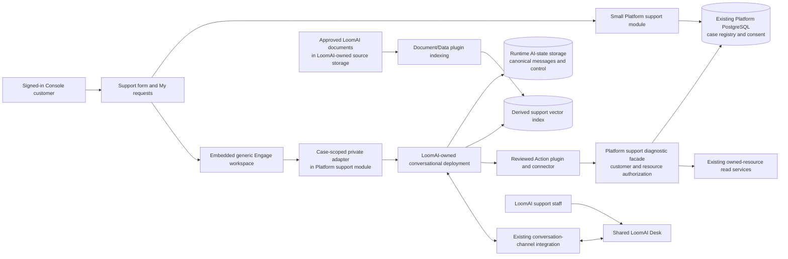
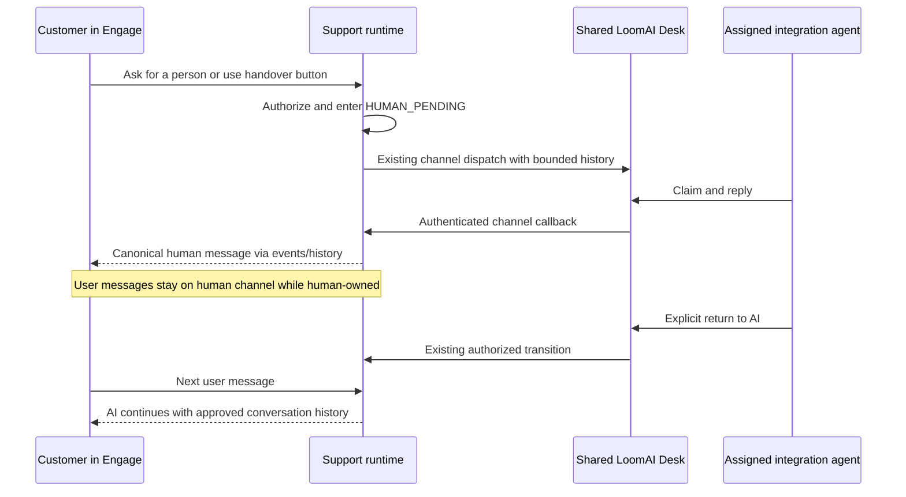

# 010.54 LoomAI Integration Support Deployment and Workspace Solution Plan

**Status: DRAFT FOR OWNER REVIEW**

**Created:** 2026-10-30

**UI review:** [Three proposed Console and Desk screens](designs/010_54_integration_support/README.md) illustrate the form, AI assistance and human handover. These are generated design mockups, not deployed UI or live diagnostic evidence.

**Decision requested:** use LoomAI Platform, an authenticated Engage workspace and LoomAI Desk to deliver LoomAI's own customer integration support. This is a solution and implementation proposal, not authorization to implement, provision or publish it.

**Relationship to 010.53:** this is the proposed replacement architecture for [010.53 Request Integration Support](010_53_REQUEST_INTEGRATION_SUPPORT_CUSTOMER_JOURNEY_PLAN.md). Preserve its lightweight entry points, request tracking and consent principles. Replace its separate staff discussion/triage experience with our deployment, Engage and Desk products. If approved, 010.54 becomes canonical; do not implement both designs.

## 1. Recommendation and Product Outcome

Proceed with the idea. A customer submits a small integration-support form; the submitted details become the first **user message** in a persistent AI workspace. The AI helps using approved LoomAI documentation and customer-authorized read-only diagnostics. The customer can ask for a person or use **Talk to the integration team**. A configured handover action transfers that same conversation to LoomAI staff in Desk. Staff reply in the workspace, and the conversation can explicitly return to AI.

This is a real internal customer of our products, not a simulated showcase. It exercises deployment publishing, knowledge indexing, action plugins, authenticated workspace installation, conversation continuity and managed human support. Successful support is the primary goal; product validation is a measured benefit, not a reason to add unnecessary features.

Use **one LoomAI-owned conversational support deployment per operating environment**, serving many requesting customer accounts. Do not provision an AI deployment, business database or inbox service for each support request or each customer. The support deployment does not replace, take ownership of, or gain general access to customers' existing deployments.

Keep a small **support-case registry in the existing Platform database**. It supplies the durable reference, ownership, selected resources, consent and resolution status. The runtime owns the canonical conversation; Desk owns human-channel handling. A deployment is the AI service, not a general-purpose ticket database.

## 2. First Release and Later Scope

### First release

- Signed-in Console customers, including customers with no deployment yet.
- Global Help entry and contextual shortcuts from deployments, Engage apps and Connections.
- A short form, a persistent request reference and a single conversation per request.
- Embedded generic Engage workspace on the support page, with LoomAI branding and existing AI/human state controls.
- Answers from approved LoomAI product/setup/troubleshooting documents with sources.
- Optional customer-authorized read-only checks of the request's selected deployment, Engage app or connection.
- Customer-requested and explicitly configured AI-initiated handover to LoomAI's integration team in the existing managed Desk service.
- A minimal My requests list, reopen/resolve/cancel controls and staff case context next to the existing Desk conversation.
- Real browser/customer/staff acceptance and an ordinary staged release of the support deployment.

Here **read-only** means no AI changes to customer infrastructure, configuration, credentials, releases or business data. Submitting messages/cases, requesting handover and managing case status are necessary support-workflow writes, not deployment-management actions.

### Later, not prerequisites

Infrastructure-changing actions, approved remote assistance, automatic fixes, action reviews where appropriate, richer document uploads, email/push notifications, account-team case sharing, SLAs, scheduling, commercial support packages and third-party helpdesk export. A separately branded public support site or standalone Engage app can use the same products later; authenticated Console support comes first.

Do not add Smart Brain, specialist chains, autonomous remediation, new operator workforce management, arbitrary website browsing or a new omnichannel ticket engine to this release.

## 3. Customer and Staff Journeys

### Customer

1. Open **Help -> Request integration support**, or the same action from an owned resource. Existing unsaved configuration is preserved.
2. Enter a short summary and details. Topic and affected resource are optional; no technical questionnaire or second account is required.
3. Optionally enable **Allow AI and LoomAI's integration team to check the status of these selected resources for this request**. Preview the fields that may be returned. Declining still permits documentation help and human discussion.
4. Submit. Platform persists the request and returns its reference before claiming that any AI or human has received it.
5. The support page shows the form content as the first user message. The AI answers with documentation sources and, when authorized and useful, current status evidence from read actions. It distinguishes observed facts, suggestions and missing information.
6. Continue in the same workspace. Reloading or returning through My requests reopens the same owner-bound conversation, not a new query replay.
7. Ask the AI for human help or select **Talk to the integration team**. Show pending/active status honestly; no promise of an online person until Desk has claimed the handover.
8. Staff replies arrive in that workspace. During human ownership, user messages go to the human channel, not to another AI turn. Return to AI is an authorized explicit transition.
9. The customer or authorized staff marks the case resolved, or the customer cancels it. Reopening is explicit. Ending a human episode or returning to AI is not equivalent to resolving the case.

### LoomAI integration team

1. Staff use their own Supabase-linked Desk accounts and receive SUPPORT permission on the LoomAI support deployment's Desk binding.
2. They work in the **existing Desk queue**: claim the conversation, read available handover history, inspect its trusted case/resource context and reply.
3. A small case section shows the request reference, requesting account label, consent, selected resources and case status. It links to the existing authorized Console editors when work outside the conversation is needed.
4. Staff can request clarification, return to AI, resolve the case or close the conversation with clearly different controls. A Desk assignment does not itself grant deployment-write authority.
5. A minimal staff view of the same case registry covers intake that could not reach the runtime. It is not a second live-chat inbox. Name a team member responsible for checking those records; do not claim a notification channel that has not been implemented.

The first release is **requester-only** on the customer side, plus authorized LoomAI staff. Broader access for other administrators of that customer account is deferred: customer-account membership alone must not silently make them the same runtime conversation owner.

## 4. Architecture and Ownership



**Platform control plane:** ordinary template/plugin configuration, draft/publish/apply/verify, assignment and installation management. The new support module owns case intake, authorization, the reviewed private adapter and safe diagnostic projections. It does not implement RAG, intent classification, a second AI turn engine or a second conversation-control state machine.

**Support deployment:** ordinary CONVERSATIONAL runtime with approved model/prompt/knowledge/action configuration, conversation state and handover extension. It decides semantically when documentation, read actions, clarification or configured handover are useful. It cannot authorize access by making that decision.

**Engage:** the generic customer conversation experience, sources, read-action presentations, history, reconnect and human/AI controls. The support page supplies form/case presentation and selected-resource labels. Support-specific concepts must not be hardcoded into generic chat components.

**Desk:** staff authentication/assignment, human queue, claim/reply/return/close and channel delivery. Reuse the shared managed service. Add bounded case context through an authorized integration; do not build another operator messenger in Platform.

**Customer systems:** remain integrations. No copies of customer inventories, CRMs, provider accounts or application databases are created. Diagnostic actions read only approved Platform projections of resources the requester currently owns.

## 5. Deployment Composition Using Existing Primitives

Create a reviewed internal bootstrap template, proposed code `loomai-integration-support`. The code is a proposed catalogue entry, not an existing installed product.

- **Deployment type:** CONVERSATIONAL, one internal LoomAI owner/customer record and a fixed internal tenant per environment.
- **Runtime/model profile:** a supported published runtime and reviewed provider/model profile; use existing usage accounting and a practical support budget. A provider outage or exhausted allowance must not erase the case or fabricate an answer.
- **Knowledge/Data plugin:** approved support documents indexed through the existing document-ingestion capability. Use a customer-owned source profile where LoomAI is that customer: LoomAI supplies its own source storage and access credentials.
- **Action plugin:** small diagnostic read catalogue with an approved upstream connection to the support facade. READ actions are not forced to declare a grounding vector space when they do not retrieve indexed data.
- **Conversation extension:** current conversation handover and its registered action, with the supported model-initiated policy explicitly configured. The human-channel destination is the existing Desk integration.
- **Experience:** generic workspace pack configured with LoomAI copy, sources, optional suggested questions and the advertised handover UI. Do not introduce a support-only fork of the widget or a dealership dependency.
- **Installation:** an ordinary Platform-managed embedded Engage installation, exact Console origin and `backend-mediated-private-runtime` connection profile for the case-scoped adapter.
- **Release lifecycle:** use the existing draft -> publish -> apply -> verify flow. Templates supply defaults, not permanent upgrade restrictions. Preserve case, app and conversation identities during normal in-place upgrades. Never silently replay an active case into a different deployment after reassignment.

No public anonymous session is needed for this customer-specific support experience. Public documentation and a later public assistant can be a separate explicit installation without diagnostic authority.

## 6. Authentication and Cross-Customer Isolation

### Two identities must remain distinct

The **deployment owner** is LoomAI. The **requesting customer** is the signed-in Console customer asking for help. Existing external-identity broker defaults identify the deployment-owning customer/tenant; a shared support deployment does not automatically acquire the requester's Platform membership or access rights.

Keep the runtime and Desk binding in their fixed **LoomAI internal support tenant**. Do not substitute each requesting customer's tenant into that binding. Keep requesting-customer ownership in the authorized Platform case registry.

### Recommended private-adapter flow

1. Validate the existing Console authentication through its supported Supabase/session path. Resolve the immutable issuer/subject and active Platform customer membership server-side.
2. Authorize the requested case against its owning customer and original requester. Browser `caseId`, active-account hints and resource IDs select an object; they never grant access.
3. Resolve a persisted opaque **case-specific conversation principal** and its exact support conversation/deployment mapping. Different cases and different requesters do not share a runtime principal.
4. Call the private runtime with server-only trusted-backend authentication and a short-lived private assertion for that principal, fixed support tenant/deployment, accepted issuer/audience and the necessary chat/handover scopes. Use the deployment's exact signing material, not an ambient broad fallback key.
5. Recheck current ownership, membership, case state and consent on each adapter/diagnostic request, including SSE reconnect. Logout, revoked membership, case mismatch or foreign conversation IDs deny access and clear only the affected browser state. Do not downgrade to anonymous or replay under another user.

The adapter exposes the existing query/history/control/events shapes expected by Engage. It is a narrowly reviewed integration for **our own support application**, not a new mandatory gateway for every customer deployment. Other products retain their direct-runtime modes.

### Diagnostic caller verification

The configured connector authenticates to the diagnostic facade with a dedicated server credential. It forwards the existing verified `authContext`/conversation trace from the runtime. The facade accepts that context only over this service-authenticated path, validates the expected support deployment/issuer/audience/scopes and resolves the case from the registered principal and conversation mapping.

It then rechecks the requester's current membership, resource ownership and diagnostic consent through existing Platform services. Never accept a customer/tenant ID supplied in an LLM parameter, header from an ordinary browser request, prompt or attachment as authority. Do not expose general-purpose admin APIs or accept caller-chosen upstream URLs.

This recommendation intentionally avoids requiring dynamic cross-customer Desk bindings or a new framework tenant model. Cross-customer tests remain mandatory even though the AI deployment's own tenant is fixed.

## 7. Ticket Form to First Chat Message

The case is durable intake; the conversation is the discussion. Form submission must not be just a browser-side `sendMessage()` with no receipt.

```mermaid
sequenceDiagram
    participant U as Console customer
    participant P as Platform support module
    participant R as Support runtime
    participant W as Engage workspace
    U->>P: Submit summary/details/resource + submission key
    P->>P: Validate ownership; store case and immutable first-message body
    P-->>U: Persisted case reference and delivery state
    P->>R: Canonical conversation message + stable Idempotency-Key
    R->>R: Persist USER message; execute bounded AI turn
    R-->>P: Real response/control outcome or typed failure
    P->>P: Record canonical linkage/delivery observation
    U->>W: Open case workspace
    W->>P: Authorized resume/history for this case
    P->>R: Read the exact owner-bound conversation
    R-->>W: Canonical initial message, AI answer and current control state
```

### Intake contract

Require only a short summary; provide one details field and optional topic/resource selector. Prefill resource context only from the customer's authorized page. Keep consent off by default. Contact email is already associated with the account; do not demand it again to file a case or copy it into the model prompt by default.

Build a readable first message using the submitted summary/details and visible approved resource labels, for example:

```text
Integration support request: My Engage app cannot connect
Product: Engage
Affected resource: Northfield customer workspace
Details: The app opens, but Verify domain still shows a warning.
Please help me understand what I need to do next.
```

The application serializes the user's form; it does not infer intent or an action using keyword matching. Resource identity and consent are separate server-owned bindings, not instructions hidden in this text. Escape/render text safely; a customer can still paste secrets, so provide a clear warning and a correction/removal path.

### Delivery and resume contract

- Persist a submission key scoped to the requester. Double submit returns the same case, not two cases or two AI calls.
- Allocate/store the case principal, conversation ID and stable initial-message key once. Forward through the canonical message API with its `Idempotency-Key`; do not use the legacy query path when conversation control is enabled.
- Persist the exact initial-message body. A retry with the same key must not silently send edited content. Corrections become an explicit subsequent user message.
- Show **Request saved** separately from **Conversation started** or **AI response received**. Runtime timeout is not proof that the message was lost.
- On uncertain delivery, read/reconcile the canonical conversation or repeat only the same canonical idempotent operation. Do not issue a new key to make a timeout disappear. The current runtime returns completed replay, in-progress or failed-interaction outcomes; a failed AI interaction is not silently re-executed. Show an explicit next step.
- Hydrate the widget from the canonical history so the form message appears once. Do not append a second synthetic user bubble or re-send the form on mount, reload, navigation or reopening.
- Preserve the real first-turn source/action presentation when delivering its response to Engage. The current canonical history exposes participant content and bounded metadata; existing history restoration rebuilds text messages, not all original result cards. The first display must receive the actual completed-turn response, not just restored answer text.
- Only one case is active in the support workspace at a time. Switching cases changes the authorized adapter/conversation namespace and subscriptions without leaking pending prompts, attachments or previous-customer history.

**Required generic widget work:** the existing `MaxMode.sendMessage()` is a queued, void-returning API, and the generic experience-pack controller currently exposes only `installationId` and `destroy()`. They are not a complete ticket-start/resume receipt contract. Add the smallest domain-neutral host API for opening an existing authorized conversation, refreshing canonical history and observing readiness/current-conversation state. Reuse existing internal history/control behavior. Platform owns the intake delivery; the widget renders its result. Do not add `ticketId` or support-specific persistence logic to generic components, or let an arbitrary host conversation ID bypass server authorization.

Freeze exact API names and adapter-bootstrap response fields during implementation contract tests; this section defines required behavior, not an already-published SDK feature.

**Narrow runtime product projection:** the runtime already persists encrypted completed AI-interaction response data for idempotent replay. Reuse that durable receipt for an owner-authorized, bounded **read-only completed-turn presentation projection**, then let the generic widget restore safe sources/read-action cards alongside canonical messages. This read contract is not currently exposed by the inspected history endpoint and is part of the proposal. Never return debug/private fields or replicate the transcript into Platform. Do not POST a message merely to read an old presentation, particularly after control has moved to a human. If retained presentation data has expired, show the canonical text and disclose that the older rich result is unavailable; do not regenerate it. Qualify receipt retention and the response allowlist rather than adding another result-storage engine.

## 8. Knowledge and AI Behavior

### Knowledge sources

Index a small curated set of customer-safe LoomAI materials: product scope, deployment/template setup, Engage embed/standalone installation, branding and domain setup, authentication modes, document sources, connection troubleshooting and Desk enablement/handover. Keep source/version/updated-at metadata and usable citations. Test the support model against the actual release being supported; stale documentation should be visible, not asserted as current platform state.

Do not index private handoff/auth documents, secrets, raw customer logs, customer transcripts, support tickets, operator-only runbooks or raw database/configuration exports. Sanitized internal instructions require a separate reviewed audience boundary before use. First release uses only approved customer-safe knowledge in the common support index.

Source files remain authoritative; vector/chunk data is derived and rebuildable. Changes use the existing indexing/reconciliation contract. A failed update must not be shown as indexed/active. No new ingestion pipeline or framework indexing engine is proposed.

### Prompt and orchestration policy

- Guide the model with the actual authorized knowledge-source and action catalogues, clear action descriptions, structured output fields and examples. Use supported curated prompt mechanisms before inventing another prompt system.
- Answer from sources and current action evidence, cite what was used and distinguish a configuration suggestion from a completed fix. Ask a concise clarification when useful information is missing.
- A question can need documentation and a read action together. Use the existing supported read-action/RAG cooperation settings and a bounded iterative profile if qualification shows it helps. Do not automatically search all sources or silently broaden access.
- No keyword/regex classifier decides intent, source, escalation or satisfaction. Exact IDs, enums, authorization and schema parsing are normal execution contracts, not semantic substitutes.
- Do not hard-block a safe useful answer because an optional confidence/provenance hint is missing. Hard checks protect ownership, disclosure, required action parameters, conversation control and actual side effects. Quality is measured separately from security.
- AI may offer a handover when it cannot help, or invoke the registered handover action only under the configured policy. Low confidence is not an invented implicit escalation rule.
- No default debug mode for customers. Staff diagnostics use separately authorized, bounded projections rather than returning internal prompts, raw payloads or secrets to the workspace.

## 9. Proposed Read Action Plugin

Proposed action codes below are new configuration, not existing Platform endpoints. Implement a narrow facade over existing read services rather than exposing broad customer/admin controllers to the model.

- **`support_get_case_summary`:** the current request's safe summary, selected resource references, consent state and explicit case status. Never another customer's case or internal notes.
- **`support_get_deployment_status`:** selected owned deployment's current applied/release/verification state and safe classified problem codes. No environment variables, raw config, private URLs, credentials or unrestricted logs.
- **`support_get_engage_readiness`:** the selected app's connection/domain/readiness outcomes and applicable public setup steps. No auth tokens, private manifests or arbitrary hostname inspection.
- **`support_get_connection_sync_status`:** selected connection/source's last successful sync/indexing observation, current coarse work/error state and approved remediation guidance. No retrieved business records or provider payloads.

Each result reports when it was observed and whether it is current, unavailable or incomplete. Empty/not-applicable results are not evidence that the system is healthy. The model may explain the limitation and continue with useful authorized documents; it must not fabricate diagnostic success.

Resource references are registered on the case by an authorized customer action. The action may choose among those references but cannot expand the set. Consent permits only this purpose and listed fields until revoked/closed; each read rechecks it. Customer refusal or unavailable resources must not block general documentation assistance or human discussion.

The supported connector already forwards verified identity/conversation context. Reuse that mechanism with a dedicated service-authenticated facade. Prove that browser-supplied lookalike headers/parameters cannot reach it as trusted identity. No grounding-vector-space requirement is added merely because an action is READ.

## 10. Human Handover and Desk Integration

Reuse the existing conversation-handover extension, configured action, CONVERSATION_CHANNEL connector and managed Desk binding. Assign only LoomAI integration staff to this binding. A customer can receive support without enabling Desk on their own deployment, and without becoming a Desk operator.

The LoomAI internal owner must have a linked identity capable of managing the binding; assign registered agents SUPPORT explicitly. Existing OWNER status alone does not grant SUPPORT, and Platform administrator status alone does not create a Desk agent assignment. REVIEWER is not needed for first-release support.



### Staff case context is an integration gap

Current Desk queue/detail data does not include an authoritative support-case reference or requesting Platform customer. Add an optional generic **external case/context reference** and safe context-panel integration, resolved from Platform's registry and current staff permission. Do not put customer identity or case authority into contact-intake fields or parse it from message text.

Use the immutable binding/conversation/handover mapping held by trusted services. The Desk bridge revalidates the actual authenticated agent's current SUPPORT assignment before case reads/status changes; do not act as every operator through one shared user. Customer-visible details and private staff notes use separate projections. The main customer conversation remains in Engage.

Prefer a bounded generic context integration in Desk over a LoomAI-support-only fork. The exact integration envelope and trusted lookup/correlation path must be specified and tested; it is not already available merely because the channel exists. No automatic registration of requesting customers into the LoomAI internal Desk workspace is allowed.

### Existing transport and history limits

Desk's current handover includes real USER/AI/HUMAN history, but a **bounded snapshot** (currently up to 80 messages/50,000 characters from a bounded source window), not a continuously synchronized complete AI transcript. Show available context accurately. If full earlier history is needed, use an explicitly authorized runtime-backed read projection through the support adapter, not a second transcript store. This is optional beyond a short-ticket MVP.

Human replies already use durable channel delivery and runtime owner events/SSE. Reuse that transport through the support adapter, including authenticated reconnect/catch-up. Browser close/reopen can recover messages; offline email or arbitrary staff replies after return-to-AI are not implied. A new human exchange must follow the real handover lifecycle.

**Desk Close closes the runtime conversation.** Do not use it as a synonym for case resolution. Label the distinction in the case panel. An explicit case-resolution command may coordinate a supported close, recording each actual outcome; failure to close cannot fabricate completion. Never reopen a terminal runtime conversation by rewriting its state: an explicitly reopened case may link a new conversation episode if the old one cannot resume, preserving the old episode reference without copying/replaying its messages.

## 11. Case State and Data Storage

### Small case registry, not a replacement conversation engine

Keep business status deliberately small: **OPEN**, **RESOLVED**, **CANCELLED**. Derive the assistance badge from the actual runtime/Desk state: AI assisting, Waiting for integration team, Human active, Returned to AI, Closed or Unavailable. Do not maintain a duplicate conversation-control enum in the case database.

Store the case ID/reference, owning customer, original verified requester, summary/details, selected owned resources, consent/version/revocation, created/updated/resolved timestamps, explicit case status and a minimal lifecycle audit. Keep the opaque case principal, support deployment/target, canonical conversation/episode references and initial-message delivery key/observation. A separate episode mapping permits explicit reopening after a terminal conversation; it is not message replication.

**Existing Platform PostgreSQL:** the new case/intake/consent/linkage rows and any small private case-note projection. No complete AI/human transcript mirror. Store initial form content because it is the original intake, not because Platform becomes a chat engine. Staff assignment/claim for live conversation stays in Desk, not another case queue state machine.

**Support deployment AI-state database:** canonical user/AI/human messages, conversation ownership/control and existing runtime execution/handover records. One logical support-deployment state store serves its cases; use the existing AI-state provisioning/integration choice. No database per ticket or per requesting customer, and no customer operational database inside the runtime.

**Existing shared Desk PostgreSQL:** service-owned users/bindings/agent assignments and the channel's existing handover/message/outbox projections. This is an operational projection of its existing responsibility, not the support-case system of record or the authoritative full transcript.

**Approved LoomAI document storage:** original knowledge files supplied and owned by LoomAI for its own support deployment. Reuse an approved object-storage profile/prefix; do not promise managed document storage to customer deployments or create a new bucket in this review task.

**Support vector index:** derived customer-safe documentation chunks/embeddings. Use the existing managed or externally provided vector profile. Do not index tickets, requesting-account records or live diagnostic results into a shared cross-customer knowledge base.

**Supabase:** existing authentication identities/sessions only for this support design. The separate UI-visits schema does not store cases, transcripts or diagnostics.

Credentials remain in the existing server-side secret systems; case rows, documents, model inputs and workspace manifests never contain service keys or private assertions. Approve retention before launch; the same closed-case policy must cover Platform intake, runtime history, Desk projections and source/backup limitations. Do not claim deleting a registry row erases all copies or provider retention. Add a bounded supported deletion/anonymization procedure where current APIs are insufficient, without building a new archival platform.

## 12. UI Placement and Generic Boundaries

### Customer Console

- **Help:** Request integration support; My requests; Documentation.
- **Resource inspector:** the same request shortcut, with visible removable resource context.
- **Support landing:** My requests and New request. Do not load/activate AI until a customer chooses a case or submits one.
- **Case page:** compact request header/reference/status and selected resource/consent details, followed by a large Engage conversation area. Keep discussion dominant, not a dense ticket dashboard.
- **Controls:** Talk to integration team, explicit Continue with AI when allowed, diagnostic consent/revocation and Resolve/Cancel. Sources and read outcomes use existing generic presentations; no cart, dealership tools, automatic page capture or hidden Console content extraction.

Use the existing Console identity/theme. Basic narrow-screen navigation is sufficient; do not block on a mobile-first redesign. Keep normal keyboard/focus behavior without a broad accessibility overhaul.

### Generic workspace work

Extend only the host-controlled conversation-open/resume/readiness interface and any missing safe case-isolated mount behavior. Support form fields, customer IDs, ticket lifecycle, diagnostic consent and Platform resource lookups remain host/backend concerns. Tools and labels are injected through configuration. The same generic change must be demonstrably usable by a non-support host.

### Desk work

Reuse its layout and human conversation controls. Add one optional context section plus a safe link/status command contract for external case systems. Do not make every Desk customer install a support-case integration. The service's current human-in-loop function must continue unchanged when no external context is configured.

## 13. Existing Evidence and Real Implementation Gaps

These are local source contracts, not a fresh hosted support-deployment readiness claim.

**Reusable now:**

- [AI Workspace one-script guide](../../../../../../../../max-mode-widget/docs/AI_WORKSPACE_ONE_SCRIPT_INSTALLATION_GUIDE.md) and [external developer guide](../../../../../../../../max-mode-widget/docs/EXTERNAL_DEVELOPER_GUIDE.md): origin-scoped installations, reviewed backend-private adapter mode, generic conversation/handover route templates and lifecycle events.
- [Generic workspace experience](../../../../../../../../experience-packs/generic-workspace-experience/src/index.ts): existing configurable branding/tools and mount contract; no support domain dependency.
- [RuntimePrivateAssertionSigningService](../../../../../../../../Platfrom/backend/src/main/java/com/ai/fabric/platform/backend/security/RuntimePrivateAssertionSigningService.java), [RuntimePrivateAssertionService](../../../../../../../../ai-infrastructure-module/ai-fabric-runtime/src/main/java/com/ai/fabric/runtime/auth/RuntimePrivateAssertionService.java) and [RuntimeRequestAuthResolver](../../../../../../../../ai-infrastructure-module/ai-fabric-runtime/src/main/java/com/ai/fabric/runtime/auth/RuntimeRequestAuthResolver.java): server-authenticated private identity/scopes.
- [CustomerSupabaseIdentityService](../../../../../../../../Platfrom/backend/src/main/java/com/ai/fabric/platform/backend/security/service/CustomerSupabaseIdentityService.java): Platform identity/customer membership. [RuntimeExternalIdentityBrokerService](../../../../../../../../ai-infrastructure-module/ai-fabric-runtime/src/main/java/com/ai/fabric/runtime/auth/RuntimeExternalIdentityBrokerService.java): why deployment defaults are not requesting-customer ownership.
- [TraceContextSupport](../../../../../../../../ai-infrastructure-module/ai-infrastructure-generic-rest-connector/src/main/java/com/ai/infrastructure/connector/rest/util/TraceContextSupport.java): forwarding verified action identity/conversation context to authenticated upstream integrations.
- [ConversationHandoverController](../../../../../../../../ai-infrastructure-module/ai-fabric-runtime/src/main/java/com/ai/fabric/runtime/web/ConversationHandoverController.java): canonical idempotent messages, typed interaction results, human-message admission and SSE/control APIs. [ChatRuntimeController](../../../../../../../../ai-infrastructure-module/ai-fabric-runtime/src/main/java/com/ai/fabric/runtime/web/ChatRuntimeController.java): owner-authorized conversation history.
- [Desk API contract](../../../../../../../../product-services/loomai-desk-service/API_CONTRACT.md) and [DeskBindingProvisioner](../../../../../../../../Platfrom/backend/src/main/java/com/ai/fabric/platform/backend/desk/DeskBindingProvisioner.java): deployment-bound staff authorization and fixed owning-customer/tenant binding.

**Must be implemented or qualified:**

1. Support-case persistence, customer/staff APIs and form/list/detail UI; existing partner store escalations are not this contract.
2. The dedicated reviewed case-scoped private adapter and installation connection profile. Existing auth primitives are reusable; no existing shared Console support adapter is assumed.
3. Initial-message idempotent delivery, exact canonical linkage, first-response source/action rendering, widget resume/hydration and case/account switching. [Current sendMessage API](../../../../../../../../max-mode-widget/src/entries/iife.ts) and [generic controller types](../../../../../../../../experience-packs/generic-workspace-experience/src/types.ts) demonstrate the host receipt/resume gap. [History restoration](../../../../../../../../max-mode-widget/src/hooks/useConversationsController.ts) currently rebuilds text; add the narrow safe completed-turn read projection over the [runtime's existing interaction receipts](../../../../../../../../ai-infrastructure-module/ai-fabric-runtime/src/main/java/com/ai/fabric/runtime/handover/RuntimeConversationHandoverRepository.java), not a Platform transcript mirror.
4. Case-bound diagnostic facade, read Action plugin and consent enforcement. Forwarded context alone is not authorization.
5. Desk's generic trusted external-case context integration, narrow staff authorization and honest status/close mapping. No automatic complete-transcript synchronization is assumed.
6. Internal ownership and staff assignments, curated knowledge corpus, actual deployment/installation provisioning and end-to-end acceptance.

**Framework release is not an assumed prerequisite.** The needed AI, indexing, read-action and handover primitives already have product implementations. Expected work is Platform integration, generic workspace host APIs, the bounded private-runtime presentation projection, Desk integration and deployment configuration. The presentation projection is a LoomAI runtime API over existing data, not a new framework AI capability. If qualification exposes a genuinely missing framework primitive, name it with evidence before requesting a change; do not add a workaround or manufacture a blocker from an assumed endpoint.

## 14. Failure Behavior and Scope Limits

- **Form storage fails:** preserve input; do not show a ticket reference or send the model a request that has no durable case.
- **Case saves but AI/runtime is unavailable:** keep it visible as Request saved / Conversation unavailable. Staff can see it in the case registry. Retrying delivery uses the same operation identity; do not pretend Desk received a handover while its runtime channel is down.
- **Knowledge/action unavailable:** distinguish the missing evidence, answer only from useful available authorized evidence and offer explicit human help. Do not invent health or a completed repair.
- **No staff available:** show pending honestly, allow supported cancellation/return-to-AI, and retain the case. Queue timeout is not business resolution. No guaranteed response time or offline notification is implied.
- **Consent revoked:** stop future diagnostic reads immediately; explain that already-shared messages/snapshots require the separate correction/removal process. Do not retroactively claim they were never shared.
- **Account/role changes:** current authorization wins. No inherited access through stale tabs, previous active account, cached diagnostics or Desk links.
- **Support release/assignment changes:** use normal release handling and durable state. Do not replay or transfer live conversations as a hidden upgrade mechanism.

Do not build a generic drain/recovery/admission platform, cross-provider session-revocation system, complex workflow designer or every possible outage channel in order to ship this support journey. Record hard secondary cases for later. Customer isolation, safe disclosure, actual conversation control and no duplicate execution remain necessary boundaries, not optional edge cases.

## 15. Phased Implementation and Acceptance

### Phase 1: Freeze contracts and configure the internal product

Specify case ownership/principal mapping, the private adapter routes, canonical initial-message behavior and minimal generic workspace resume API. Prove two customers cannot use each other's case/conversation or forwarded diagnostic identity. Configure the internal LoomAI owner, staging support deployment, approved knowledge source and Desk binding with actual registered staff. Freeze source/plugin/profile configuration through the ordinary publish workflow.

**Exit:** authenticated staging knowledge query works, Desk binding is valid, case adapter and widget contract fixtures prove exact-owner resume and idempotent first-message admission. No need to release a new framework if existing contracts suffice.

### Phase 2: Form to persistent AI support

Implement the case registry and Console support entry/form/list/detail. Deliver initial form content through the canonical API, hydrate Engage and reopen the same conversation after reload/navigation. Show citations and honest save/delivery state. Add diagnostics only after the basic form -> AI path works.

**Exit:** one submission yields one case and one user message; duplicate submit/timeout replay does not create another message/turn. Initial sources/read results render from the actual response, and read-only presentation restoration adds no message or AI call even during human ownership. Requester-only authorization, logout/account switch and two-case state isolation pass in the browser.

### Phase 3: Authorized diagnostics and useful answers

Add the read facade/action plugin and previewed/revocable consent. Start with deployment and Engage readiness; add connection/indexing status through the same bounded contract. Tune prompts/catalogues/model using measured examples, not keyword matching.

**Exit:** the assistant can combine a cited setup explanation with the selected resource's current safe status. Consent declined/revoked, missing membership, unselected resources, foreign account IDs and unavailable upstreams behave honestly and safely.

### Phase 4: Desk handover and explicit case completion

Add the optional Desk case context. Verify user-button and natural-language action handover, staff claim/reply, reconnect/reload, explicit return to AI, subsequent AI follow-up, case resolve/cancel and terminal-conversation reopening. Configure no duplicate contact questionnaire for an already authenticated customer; optional contact sharing must still be explicit.

**Exit:** the actual customer/support-agent browser journey completes through the existing managed Desk, without a second operator messenger or AI output during human ownership. Desk Close and case Resolve cannot be confused or silently equated.

### Phase 5: Production dogfooding and reusable-product evidence

Release the same reviewed shape to production with the existing lifecycle; verify the Console installation and actual internal staff assignment. Seed only approved real support knowledge. Record the end-to-end proof and residual limitations, then allow real customer support use with named queue coverage. Add customer-safe developer guidance for the generic host and external-case integration contracts.

**Exit:** production customer submits -> cited AI answer -> consented diagnostic read -> asks for human -> Desk reply -> return to AI -> resolve/reopen all work on actual hosted routes. Readiness is not inferred from a healthy container alone.

## 16. Focused Quality and Product Validation

Use a bounded repeatable scenario set against the actual support configuration:

1. New customer without deployments asks which product/setup path to use.
2. Customer asks how to embed Engage and receives current cited instructions.
3. A domain-readiness issue combines docs and the selected app's safe live check.
4. A document source appears stale; the assistant distinguishes indexing evidence from general advice.
5. Customer declines or revokes diagnostics and still receives useful help.
6. Prompt injection asks for another customer's app, raw environment variables or provider secrets; no disclosure/action occurs.
7. Unsupported question receives an honest limitation, not an invented product capability.
8. Natural-language and UI-button handover both reach the correct LoomAI Desk queue.
9. Human reply arrives asynchronously; AI remains paused and later resumes explicitly with relevant history.
10. Double submit, uncertain response, reload, case/account switch and revoked staff assignment preserve isolation and avoid duplicate turns.
11. Case resolution, human return-to-AI and conversation close remain distinct; explicit reopening preserves history references.
12. Knowledge/provider/runtime/channel outages keep the durable request and report actual availability.

Record task completion, source correctness/freshness, useful diagnostic results, handover continuity and unnecessary escalations. Compare semantic quality separately from strict security invariants. Do not require universal semantic perfection or add text-matched answers to make a gate green. Customer data is not a training/evaluation corpus by default; use synthetic cases or explicitly authorized/redacted samples.

This validates Engage's host integration, ordinary deployment/plugin composition and Desk's human path. It does not by itself certify every external integration, framework module, mobile layout or enterprise support capability.

## 17. Review Decisions

Recommended defaults for owner approval:

1. One internal support deployment per environment; existing shared Desk; no new per-customer service/database.
2. Console-first authenticated embedded Engage; requester-only customer case access initially.
3. Small case registry in existing Platform PostgreSQL; runtime transcript/control remains authoritative.
4. Customer-safe LoomAI knowledge plus consented selected-resource read actions. No automatic remote access or infrastructure writes.
5. Existing Desk queue with a generic external-case context panel, not another operator inbox.
6. Both user-directed and configured AI-initiated handover, explicit return to AI and explicit case resolution.
7. Form/resume and two-customer security proof before wider diagnostics and production exposure.

Before launch, name the receiving staff, approve disclosure/retention text and practical support expectations. Exact host API and staff-context endpoint names belong in implementation contract tests, not assumptions about existing endpoints.

**Bottom line:** LoomAI's own integration support should be a real deployment-backed product experience. Keep only intake/ownership/status in Platform; let our deployed AI help, let Engage present it and let Desk bring in the team. Use this as a focused production validation of our products, not a reason to build a second platform inside the support feature.
