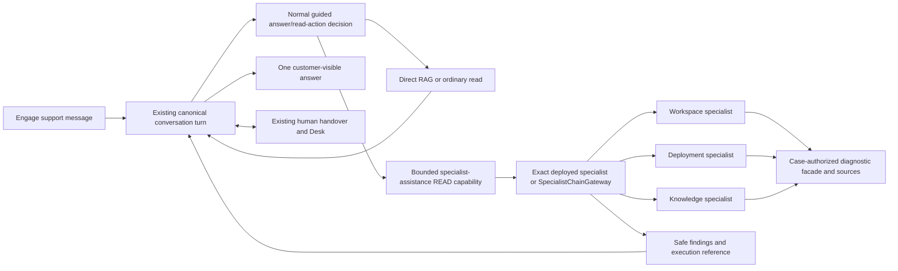

# 010.54 Support Template Specialists and Resolution Capability Specification

**Status: DRAFT FOR OWNER REVIEW**

**Updated:** 2026-10-30

**Parent and implementation authority:** [010.54 Integration Support Solution Plan](010_54_LOOMAI_INTEGRATION_SUPPORT_DEPLOYMENT_AI_WORKSPACE_AND_DESK_SOLUTION_PLAN.md). This is its normative capability/productization appendix, not another independently implemented plan.

## 1. Verdict and Revised Scope

Create a reusable Marketplace **AI Support Workspace** solution template. It defines the initial support areas, specialist capabilities, resolution procedures, knowledge/action bindings, Engage experience, human-support integration and relevant verification. LoomAI uses this template for its own integration support; another customer can select the same template, customize it and deploy a support workspace for their own users.

This is more than renaming a knowledge chatbot. A specialist has a bounded purpose, approved sources/tools, structured input/result, authority limits and measured usefulness. A resolution capability coordinates selected specialists when the question genuinely spans domains or needs several checks. Simple documentation questions should still take the inexpensive direct path.

**Do not add a fourth deployment behavior type, a SUPPORT plugin type, a separate Product Profile, or a new orchestration engine.** Reuse TEMPLATE, SPECIALIST, ACTION, DATA/knowledge contributions, inference/runtime profiles, Engage installations, managed Desk and the existing draft/version/release lifecycle. Support is a reusable customer solution composed from those primitives.

Keep **CONVERSATIONAL as the customer-facing behavior**, with an explicitly implemented optional specialist-assistance composition capability. The conceptual name `SPECIALIST_ASSISTANCE` in this appendix is proposed, not an existing extension ID. Its purpose is to allow reviewed specialist bundles and bounded specialist/chain invocation inside a normal owner-controlled conversation, while retaining current Conversation Handover.

Do not change the widget to call the existing `/api/agentic/v1` endpoint and claim equivalent support behavior. That endpoint is fixed-purpose today and does not supply the canonical support conversation or Desk handover lifecycle.

## 2. What Exists and What Does Not

### Source baseline

Platform's current runtime parent POM declares AI Fabric **0.8.41**. This analysis inspected its published [execution sources from Maven Central](https://repo.maven.apache.org/maven2/io/github/loom-ai-labs/ai-fabric-execution/0.8.41/ai-fabric-execution-0.8.41-sources.jar), not only the older sibling framework checkout. Artifact SHA256: `43cb3cb19ff776c97e28670b34af3571dea5558f6605720bf8e685690cb9b323`.

This is a source/API assessment, not a new claim about hosted framework versions or publication of this support template. Recheck the actual adopted artifact during implementation without maintaining a multi-version compatibility layer.

### Available framework primitives

- Declarative **Specialist**, **SpecialistSchema**, **SpecialistPromptProfile** and **SpecialistChain** resources, loaded at startup through the official loader. Declarative specialists can bind approved retrieval and read-action catalogues; they do not all require customer-specific Java worker code.
- Exact specialist/chain IDs, input/output contracts, allowlisted capability scopes, bounded evidence projections and execution limits.
- **SpecialistChainGateway** with manager-selected sequential delegation, independent parallel delegation, clarification/completion and explicit terminal specialist handoff. The targets are specialists, not arbitrary nested chains/plans.
- A separate **ConversationManagerGateway**, whose team topology is Java-defined and whose turn selects one specialist or clarification/completion. Do not treat it as a declarative multi-stage plan builder.
- **ExecutionPlanDefinition / AIExecutionCoordinator** for application-selected fixed sequential/parallel read plans with registered Java mapping/aggregation. `PlanExecutionRequest` in the adopted sources explicitly rejects `INTERACTIVE`; it is not the first-release user-chat resolution-plan API.
- Read-action/RAG cooperation and ordinary canonical conversation control/human handover. Specialist-to-specialist `HANDOFF` is not a handover to a human.

Important chain constraints: managers do not themselves retrieve or execute actions; workers are read-only, non-interactive and conversation-isolated. Independent parallel fan-in is `ALL_REQUIRED`, not best effort. Declarative worker input mapping supports chain input and manager objective, not arbitrary structured prior-worker-output mappings. Earlier results can inform the bounded manager decision; do not promise a general dataflow/DAG language.

### Current LoomAI restrictions

- [DeploymentBehaviorCatalogService](../../../../../../../../Platfrom/backend/src/main/java/com/ai/fabric/platform/backend/deployment/behavior/DeploymentBehaviorCatalogService.java) gives Conversational zero required specialist bundles and currently rejects additional bundles. Agentic requires the specific deployment-intelligence bundle rather than any customer-defined team.
- [DeploymentIntelligenceTeamService](../../../../../../../../ai-infrastructure-module/ai-fabric-runtime/src/main/java/com/ai/fabric/runtime/agentic/DeploymentIntelligenceTeamService.java) invokes the hard-coded `deployment-intelligence-team@1`. Its sample runtime-state worker describes the AI runtime itself, not the requesting customer's selected deployment. It is not a substitute for the authorized support diagnostic facade.
- Marketplace specialist contributions carry reviewed bundle IDs, hashes and resource references. [Manifest validation](../../../../../../../../Platfrom/backend/src/main/java/com/ai/fabric/platform/backend/marketplace/service/MarketplaceManifestService.java), [draft compilation](../../../../../../../../Platfrom/backend/src/main/java/com/ai/fabric/platform/backend/marketplace/service/DeploymentMarketplaceDraftCompilerService.java) and [runtime capability verification](../../../../../../../../ai-infrastructure-module/ai-fabric-runtime/src/main/java/com/ai/fabric/runtime/config/RuntimeCapabilityManifestService.java) currently bind packaged resources, not customer-edited specialist prompts/topology materialized at publication.
- [RailwayProvisioningPlanService](../../../../../../../../Platfrom/backend/src/main/java/com/ai/fabric/platform/backend/deployment/service/RailwayProvisioningPlanService.java) currently enables chains and selects manifest locations from behavior-specific packaged assumptions. No generic support-resource generation is implemented on this path; the service also generates Coolify provisioning and is not evidence that a separate Railway deployment is needed.
- Conversation Handover is currently compatible with Conversational, not Agentic Specialist Team. Human Review on Agentic is a different feature.
- [BehaviorPage](../../../../../../../../Platfrom/ui/src/pages/BehaviorPage.tsx), Marketplace and deployment-wide Prompts editors are reusable surfaces, but do not yet provide support-area, per-specialist instruction or resolution-capability configuration.

**Consequence:** this is genuine generic productization work. Existing framework primitives make it plausible without a new engine, but publishing a template alone cannot enable it. Do not label it configuration-only or already available.

## 3. Template and Instance Separation

### Reusable template

Proposed catalogue code `ai-support-workspace`, human name **AI Support Workspace**. Record a normal Marketplace TEMPLATE version and its dependency versions. This code is not yet registered.

The template contributes:

1. Conversational front door, supported specialist-assistance capability and human-handover compatibility.
2. A small generic support-specialist configuration schema and reviewed examples.
3. Resolution-capability defaults referencing official specialist/chain resources.
4. Knowledge and read-tool binding slots, not real customer credentials or fixed vector-space names.
5. A generic branded Engage experience, optional host intake integration and safe result/check presentations.
6. Desk or another reviewed conversation-channel binding slot.
7. An inference profile/default execution bounds and focused verification scenario definitions.

Deployment topology presets remain separate from this solution template. Source hashes and compiled definitions belong to the ordinary immutable deployment version; the initial template does not permanently restrict later customer configuration or upgrades.

### LoomAI's internal installation

Bind the reusable template to LoomAI documentation, the proposed Platform support-case registry/private adapter, selected-resource diagnostic facade, internal staff and existing Desk service. The installed instance is the proposed `loomai-integration-support` deployment, not a different hard-coded support engine.

The Platform-specific specialists described below are **LoomAI installation defaults**. They are not compulsory domain areas for an unrelated business installing the generic template.

### Another customer's installation

The customer binds their own identity, approved knowledge, API/MCP read tools, resource context and human-support team. They can rename areas, replace instructions/source bindings and use different resolution configurations. Their deployment remains separate from LoomAI's internal support deployment.

**Business-system ownership:** a customer's tickets/orders/accounts remain in their existing helpdesk/backend through integrations. Do not silently turn Platform's own integration-support case registry into a universal hosted customer-ticket database. For a form-based customer installation, require a reviewed host/case-system adapter. Without one, the template may explicitly provide conversation-first support, but must not claim that a business ticket was created.

The adapter can be supplied by a reviewed standard integration; a customer need not write a bespoke backend when an existing case-system/identity profile supports the required contract. Form intake is a deterministic user-requested submission to that integration, not permission for the LLM to execute arbitrary business writes. Missing integration support is an explicit product gap, not a reason to create a customer business database inside the AI deployment.

Likewise, Desk keeps its managed human-channel state; it is not an unrestricted business-ticket store. The AI-state and vector profiles remain existing choices, including customer-provided services where supported. No customer inventory, billing or operational database is created by this template.

## 4. Recommended Capability Set

### Required support core

- **Knowledge assistance:** approved indexed sources, source metadata/citations and visible missing evidence.
- **Selected-resource context:** server-authorized resource references and minimal request context. Never infer authority from the chosen form topic or a natural-language identifier.
- **Read tools:** explicit typed outputs and current observation timestamps; operations remain read-only.
- **Conversation continuity:** a canonical owner-authorized Engage conversation in every installation, plus a case binding only when a case-system integration is configured. LoomAI's own form-based installation uses the main plan's case binding; conversation-first customers must not invent one.
- **Human help:** existing button and configured model-requested handover to the selected provider/team.
- **Result/check presentation:** clear findings, unavailable/incomplete states and suggested next steps, not chain-of-thought.

### Specialist assistance

Each configured area specifies its customer-facing name, purpose, bounded objective/instructions, approved knowledge sources, permitted read actions, typed input/result references and model/execution profile. It can contain several relevant tools. Do not create a separate specialist for every endpoint or multiply identical personas for a demo.

The initial LoomAI instance should aim for **three meaningful areas**, with two sufficient to qualify genuine cross-area coordination before the third is enabled:

1. **Workspace and integration setup.** Embed/standalone setup, branding, custom domains and supported connection/authentication modes. Binds Engage/setup documentation plus `support_get_engage_readiness`. Produces observed app/setup facts, documented guidance and remaining questions.
2. **Deployment and release health.** Applied version, release verification, connection between an app and its assigned deployment. Binds release/deployment documentation plus `support_get_deployment_status`. It cannot deploy, restart, promote or change an assignment. This worker reads the selected customer resource, not ambient runtime/container state.
3. **Knowledge and data freshness.** Document ingestion, indexing visibility and source synchronization. Binds knowledge/source documentation plus `support_get_connection_sync_status`. It cannot read raw private documents/business records, rebuild an index, delete a source or alter credentials without a separately authorized later contract.

General getting-started/product questions use the ordinary knowledge path. Identity/security investigation beyond safe setup/readiness summaries is a later area: do not add broad user-directory, token inspection or permission-changing tools merely to increase the specialist count. Human escalation is a control action, not an invented fourth expert persona.

Specialist outputs distinguish **observed facts**, **cited guidance**, **missing information** and **suggested next steps**. A structured `complete` outcome means the bounded diagnostic task completed; it does not mean the support case is resolved or an infrastructure fix occurred.

## 5. Resolution Guidance Versus Executable Resolution Capabilities

### Guidance

An indexed runbook can explain steps such as “update the CNAME, then verify the domain.” It is guidance for a person. Listing a step does not execute it or mark it complete. Customer-authored documentation remains evidence, not a privileged workflow definition.

### Executable diagnostic resolution

The customer-visible label **Resolution plan** means a reviewed diagnostic capability backed by one exact specialist or one official SpecialistChain. It declares an objective, allowed worker references, trusted input mapping, bounded result projection, execution limits and a public presentation label.

This is **not** a new framework resource kind named `ResolutionPlan`. It is product metadata/reference configuration in the existing composition, compiled into supported specialist/chain resources and invocation bindings. Do not invent another YAML workflow engine.

The parent conversation chooses between answering directly, calling a direct domain specialist and invoking a reviewed multi-specialist capability using guided structured model output and the actual available catalogue. Configuration constrains that choice; there is no keyword/regex router. A user choosing an explicit “Check this app” tool is also a valid structured request, not a reason to bypass authorization.

### Recommended starting capabilities for LoomAI

- **Engage connectivity check:** selected app readiness plus its assigned deployment status. Independent app and deployment specialists may run in parallel only when both inputs are already authorized/available; the result combines routing, assignment and runtime evidence. A simple domain-only question should invoke only the workspace specialist, not force the whole team.
- **Knowledge-answer freshness investigation:** knowledge/sync checks and, when needed, deployment verification. A manager may first obtain source status and then ask the deployment specialist a focused objective informed by that result. In declarative mode, use supported chain input/manager-objective mapping, not an imaginary prior-result JSON binding.
- **Cross-area support assessment:** a bounded manager chooses relevant specialists from the enabled areas, may ask one concise clarification and returns a customer-readable answer with evidence/limitations. It is not “run every expert on every question.”

Do not force these into three separate runtime services. They are reusable definitions and invocations inside the same support deployment.

### Parallel and sequential semantics

- Start with one-worker delegation and sequential execution; add parallelism for genuinely independent required reads after measuring equivalent answers and latency.
- Respect the framework's `ALL_REQUIRED` fan-in. A failed branch makes that parallel group fail; do not relabel it successful using the other branch or silently rerun sequentially.
- The parent may still give an honest documentation-based answer when its declared cooperation policy permits it, explicitly showing the failed diagnostic capability. That is not successful plan completion. No unapproved recovery, silent search-all or hidden specialist substitution.
- When one optional check is not applicable, choose a smaller capability up front or return a declared not-applicable result. Do not put unrelated optional workers into an all-required group and then bypass its contract.
- Fixed `ExecutionPlanDefinition` jobs remain available for separately scoped application/event-driven checks. Do not relabel a user's chat as `APPLICATION` merely to bypass their current `INTERACTIVE` restriction. This support release uses the specialist/chain route for conversation-driven investigation, not Smart Brain.

## 6. Conversational Invocation and Human Control

Implement a generic reviewed READ invocation boundary using the framework's public specialist/chain APIs and the runtime's supported action-handler extension points. The Action contribution defines a model-visible capability; SPECIALIST contributes its supported definitions. The model cannot supply an arbitrary chain ID, executable class, URL, tenant or scope.

Resolve the exact invocation from the published deployment catalogue. Build authority from the original verified requester/session, selected approved resources and, only where configured, its authorized external case. LoomAI's installation revalidates its case registry; a conversation-first installation uses its reviewed identity/resource integration without a fabricated case. Each worker's read facade revalidates current permission and consent. Never copy the existing demo service's unconditional internal scope augmentation as a generic customer-authorization design.

The **outer runtime conversation stays the sole message/control owner**. Child diagnostic workers do not create user-visible conversations, append extra assistant messages or become Desk owners. Prefer conversation-disabled child execution with bounded, owner-approved question/context input. Preserve genuine execution source/principal; do not impersonate SYSTEM or create another independently authoritative dialogue.

A bound chain has its own interactive coordination/recording semantics. Do not blindly bind it to the already-active parent conversation and double-record/compete for turn ownership. Phase 1 must qualify the chosen child invocation mode, context projection and cancellation/control checks against the adopted SDK.

Before starting work and before exposing results, enforce the parent's current human/AI control and request authorization. Handover can cancel child work through supported cancellation APIs where possible. An already-sent external read may finish; a bounded read completion must not emit another AI answer or trigger an unauthorized action after human ownership changes. Do not implement a new global drain/fencing service for this. If the current handler boundary cannot preserve these checks, record the precise missing contract before implementation rather than weakening handover.

**Completion acceptance is a concrete qualification item, not just two status reads.** Current [ConversationHandoverController](../../../../../../../../ai-infrastructure-module/ai-fabric-runtime/src/main/java/com/ai/fabric/runtime/web/ConversationHandoverController.java) can reuse the generated answer in a handover response after canonical AI append is refused. A delegated result must not escape through that response or its replay receipt. Revalidate current control and accept the canonical append, presentation/receipt and outbound answer under a single authoritative completion boundary relative to handover; an unlocked check before/after work alone does not prove this. Keep an intentional typed handover acknowledgement distinct from stale generated diagnostic prose. Prove the race with focused tests. Reuse the existing transactional/control facilities; request a bounded framework change only if the host cannot express the required atomic boundary through the adopted public contracts.

The adopted specialist/chain request DTOs do not carry an inherited parent human-control guard. In-process worker orchestration context can be supplied through existing Java extension points, but no automatic declarative/remote propagation should be claimed. Children need only bounded approved task data, not independently owned dialogue. Parent result acceptance remains necessary even when a worker guard or cancellation is available.

`ASK_USER`/missing facts become an ordinary parent clarification. Specialist handoff remains AI-to-AI within allowed scope; human transfer always uses the existing registered handover action/control API. A plan must not resolve the case or return from human to AI by setting a result field.

## 7. Generic Authoring and Publication Work Required

### Capability composition

Extend behavior/extension compatibility so Conversational can explicitly opt into reviewed specialist assistance and the required durable execution capability. Replace the current exact behavior-to-single-bundle assumption for this composition with authorized installed bundle references and actual artifact compatibility. This is not permission to accept arbitrary resources or disable validation.

Retain Agentic Specialist Team as its existing behavior. Do not rewrite every behavior or remove its validation just to ship this template. A new optional capability in the existing extension catalogue is preferable to adding SUPPORT as a behavior.

### Definition generation and delivery

Support customer configuration through the existing installation/draft pipeline, then compile it to the official resource schemas at publication. This needs a generic published-definition contract: source template/plugin references, content hashes, exact specialist/chain IDs, registered component references, schema/prompt resources and the resulting manifest locations. Do not place executable plan instructions in entity V04 indexing extensions.

Use the ordinary immutable configuration artifact/version delivery and runtime startup path. The current packaged-classpath-only specialist catalogue must be extended honestly for published configuration bundles. Load only the server-delivered, hash-verified bundle through the official resource loader. No arbitrary remote URL, filesystem path, uploaded Java/JAR, script or runtime mutation endpoint is exposed to customers.

A change to area instructions/source bindings/topology is a deployment draft edit, then normal validation/publish/apply; it is not a database-row hot edit that silently changes a running specialist. Templates are bootstrap defaults: customers may later edit or reset defaults into a draft without erasing credentials, external systems, conversation history or runtime state.

Do not require a distinct Docker image rebuild for every customer's textual specialist configuration when the same reviewed runtime can consume supported immutable configuration resources. Runtime Java changes may be needed once for the generic composition/invocation/projection capability, not once per customer or support area.

### Validation boundaries

Validate exact references, supported schemas, source/tool ownership, input/output structure, allowed model/provider profiles, bounded resource sizes and actual execution requirements. Disallow worker writes in this read-only composition. Reject invalid topology/reference bindings rather than silently choosing replacements.

Do not hard-validate whether a prompt is “intelligent enough,” demand high semantic confidence on every answer, add lexical domain routing, or infer an alternative plan when a model selects an invalid one. Use named bounded LLM repair only when the configured policy allows it; keep uncertainty visible.

### No speculative framework release

The adopted artifact already supplies the core definition/chain primitives. First implement and test the product binding using them. A framework request is justified only by an exact missing reusable contract, for example genuinely required interactive fixed-plan support or parent-turn propagation that the public API cannot express. Neither is assumed necessary for the recommended child-chain design. Do not release a framework change just to register a LoomAI template or add an editor.

## 8. Customer Customization and Product Journey

1. **Select template:** Deployments -> Create -> AI Support Workspace, through existing customer template/bootstrap selection. Show the actual capabilities: indexed knowledge, specialist help, resolution checks, Engage and optional human handover. No broad “autonomous fixes” claim.
2. **Connect knowledge:** use existing Knowledge & data/Connections editors; select approved source storage, ingestion sources and vector profile. Customer storage remains an integration.
3. **Choose support areas:** add/rename a small area, edit its purpose/instructions and select approved sources/read tools. A generic customer might define Product setup and Account help; they should not inherit Deployments/Engage as compulsory areas.
4. **Choose resolution capabilities:** start with a single specialist; optionally compose an allowed manager/worker chain. Show the required inputs and execution shape. Provide reviewed defaults, not a mandatory workflow canvas.
5. **Connect human support:** use existing Desk enablement/agent assignment or another compatible channel integration. The customer's own binding/staff are used, never LoomAI's internal integration team by inheritance.
6. **Choose experience:** create branded Engage embedded, standalone or both using the existing installation/assignment flow. Configure public/private identity to match the customer's real authority. Internal diagnostic access remains authenticated; a public customer assistant may use public-safe knowledge/reads only.
7. **Bind case system if required:** integrate the customer's existing case/backend through a reviewed adapter for form intake. Missing case integration is explicit and does not create a hidden customer-ticket database in Platform.
8. **Test and publish:** use existing draft previews/validation, customer-staging qualification and normal production release/promotion choices. Edit and upgrade through the same mechanisms later; original-template pins do not become lifetime restrictions.

A reusable product claim requires a **second, non-LoomAI installation** with different area labels, knowledge/tool bindings, identity and Desk staff. A second copy of LoomAI's private support adapter with new branding is not sufficient evidence.

## 9. UI Integration Without Crowding the Conversation

### Existing three support mockups remain the baseline

Keep the [request form, AI conversation and Desk layouts](designs/010_54_integration_support/README.md). Do not ask the requester to choose internal specialists or run IDs. The optional form Product/Topic provides user-supplied context, not an authority grant or forced semantic route.

For an executed diagnostic capability, add a compact expandable **Resolution checks** block to the AI answer. Display only real public execution facts, for example: “App setup: checked”, “Deployment: unavailable”, observed time, source references and useful next steps. Start collapsed when a short answer suffices. An optional label such as “Workspace setup + Deployment checks” identifies what actually ran, not an invented human personality.

Do not show manager chain-of-thought, hidden prompts, raw worker output, fabricated progress, execution jargon or a permanent agent topology panel in Engage. Pure illustrative thinking animations may remain clearly illustrative; completed check claims require actual result/receipt data. Parent clarification and Desk human transfer remain ordinary conversation states.

Desk's optional case context can include **AI checks so far** with the same safe findings/execution reference. It must disclose missing/failed checks; it does not continuously mirror every internal worker conversation. Return to AI and case resolution stay separate.

### Deployment configuration layout

Reuse the customer resource inspector and Configuration/Advanced depth model. Proposed placement: **Deployments -> selected support deployment -> Configure -> Support capabilities**. This is configuration for a deployment the customer owns, not a new global operator portal.

The configuration surface has a compact summary row for Knowledge, Read tools, Support areas, Resolution plans and Human support, each showing Ready/Missing setup/Disabled. Selecting a row opens an editor panel. A split preview shows a synthetic customer answer/check block using the saved/draft configuration, leveraging the existing Engage preview pattern; it never executes a real diagnostic read automatically.

**Support areas editor:** rows show name, purpose, source count and read-tool count. Selecting an area opens a sliding panel for instructions and source/tool binding. Simple users see those business concepts; Advanced shows exact specialist/schema/profile references and execution bounds. Do not duplicate the underlying Prompts/Connections/Plugins editors or require a new page for every specialist.

**Resolution plans editor:** rows show customer-facing name, objective, participating areas and “Single area” or “Adaptive specialist chain.” A details panel shows eligible worker relationships, parallel permission where supported and required input/result mapping. A manager may choose workers/order within that closed set; do not label it a fixed step-by-step sequence. Exact immutable references and official resource preview belong in Advanced. Fixed application plans, if later exposed, must be clearly separate and compatible with their execution source.

**Appearance preview:** customer voice, welcome message, action/check presentation and human controls remain part of Engage configuration. No backend authority is granted by enabling a visual element. Dark mode remains the current Console default; support content uses the selected theme, with basic narrow-screen navigation.

These are proposed shared-editor extensions. The current Behavior/Prompts screens do not already provide them. Preserve the existing internal admin/operator shell and use the same publication APIs.

## 10. Delivery Order and Completion Evidence

Extend the main plan, rather than replacing its customer journey with an orchestration project:

1. Prove a single real specialist invocation inside a canonical Conversational turn with handover control intact. Freeze generic composition/publication/authority contracts before building a full editor.
2. Complete form -> persistent Engage -> useful knowledge/read answer and Desk human handover. These remain the product spine.
3. Add two genuinely different configured area specialists and one real cross-area SpecialistChain capability. Qualify a sequential control; enable independent parallel calls only where useful and within the existing bounds.
4. Add the shared configuration/preview surfaces and publish the reusable template. Prove edits publish a new exact configuration and do not affect an existing running version before apply.
5. Create a second customer-owned installation using different knowledge/tools/staff, with no private LoomAI routes or credentials. Complete chat and handover through its own Engage connection.
6. Release LoomAI's own production support using the same template contract and record the exact composition and owner/staff evidence.

Focused tests must cover:

- Simple documentation query does not invoke a whole team unnecessarily; broad questions can use more than one enabled area through model-driven selection.
- Direct specialist and chain outcomes retain sources/read facts through the parent answer, stored presentation receipt and reload, without additional transcript messages.
- Two-customer and two-case isolation, action consent, disabled area, invalid references and provider/tool unavailability remain honest and secure.
- Human handover during a slow diagnostic prevents late AI output; subsequent human reply/return to AI and case resolution still work. No broad runtime drain redesign is required.
- Parallel `ALL_REQUIRED` failure remains visible; no hidden best-effort/sequential retry. Missing branch data is not silently fabricated or called complete.
- Editing a specialist or plan changes the draft/configuration hash and runtime readback only after normal apply; a new template revision does not overwrite a customer's customization.
- The non-LoomAI template installation works with its own external case system, or explicitly declares conversation-first intake. Platform does not become its business database.

Benchmark latency, token use, diagnostic usefulness, source accuracy and escalation quality on a small representative scenario set before adding more specialists. Measure semantic quality separately from strict trust/execution boundaries. No full unrelated framework release matrix or platform-wide refactor is part of this documentation change.

## 11. Review Decision

**Approve:** the reusable AI Support Workspace template direction, real domain specialists, bounded adaptive diagnostic resolution and the existing simple support UI with optional check details.

**Do not assume:** that these capabilities are already configurable in LoomAI, that fixed ExecutionPlan is a chat API, that Specialist HANDOFF means Desk, that every customer needs LoomAI's areas, or that template installation grants access to their systems.

**The implementation target is not complete** until both LoomAI's own support journey and a differently configured customer installation work through the same template, definition/publication, Engage and human-support contracts. Basic support delivery comes first in execution order, but generic specialist/template productization is now part of this plan's completion scope, not silently deferred after the demo.
