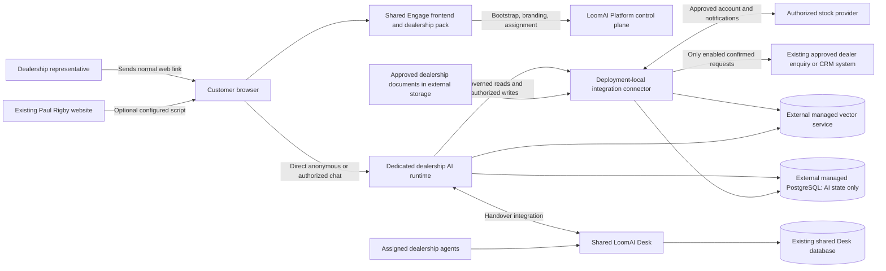

# 010.55 Paul Rigby First Dealership Client Readiness And Pilot Plan

Date: 1 November 2026
Owner: LoomAI Labs / Mahmoud Ashraf
Status: Existing demo enquiry/cancellation/receipt and assigned-agent Desk journey verified; remaining knowledge/customer-setup gates open; real-client integration not started
Prospective customer: Paul Rigby Limited, company 07129638

## 1. Decision And Offer

Approach Paul Rigby with a **branded AI buying workspace**, not an AI deployment platform pitch and not a replacement for its website, CRM or sales team.

The first useful journey is deliberately simple: a sales representative sends a customer an Engage web address; the customer explores the dealership's approved stock, compares options, asks practical and policy questions, and continues with a human representative when needed. Add an embedded workspace to an agreed website section after the staff-led pilot is useful. Both delivery methods use the same dealership deployment and reusable experience pack.

Offer **free integration for an explicitly agreed pilot scope**. Agree a discounted LoomAI subscription, usage allowance, external-service costs and discount duration in writing before live customer use. Do not imply unlimited bespoke development, unlimited AI usage or a permanently free service.

**Current verdict:** ready to request a discovery meeting using the clearly labelled fictional demo. Not yet ready to promise a production-connected Paul Rigby service or to send its customers into our current Northfield demo. Real data rights, external AI-state storage, current answer quality and dealership-approved operating processes are launch prerequisites.

### Latest Checkpoint: 2 November Enquiry Intake And Cancellation

Owner-approved AI Fabric `0.8.45` is published and qualified by 1,026 affected-module tests, 84 focused tests, six real-OpenAI cases and an initially empty Central-only product consumer (225 tests; packaged JAR identity verified). It removes keyword rejection of supplied action values and adds explicit LLM-driven cancellation of stored incomplete drafts. Required types, trusted IDs, ownership and final confirmation remain enforced. The separate inherited Incident Room integration failure keeps broad framework CI non-green.

Both existing Northfield apps use v11 / `ver-1ff0cc54`: staging `rel-ce54abe2` and production `rel-d587186a`, each `APPLIED_VERIFIED/PASSED`. Actual UI required-field intake, cancellation with no receiver write, example-domain form submission, final confirmation and matching receipts passed. v11 corrects deployment guidance that previously sent missing contact fields into general clarification instead of the framework draft form. Assigned-agent Desk claim/two-way delivery/explicit AI return and the next pinned-context AI answer passed on production. The website embed resolves the same release and its anonymous query passed. No app identity, business database or vector index was replaced. See the [dated enquiry and Desk evidence](../../../../../../../../verification-support/paul-rigby-first-client/2026-11-02-enquiry-and-desk-acceptance.md) for retained failures, exact side effects and remaining scope.

The external-systems read-only template `1.2.0` is published in both hosted catalogues. It omits simulated business writes and Basic Inbox, retains external stock/document/vector integrations and optional shared Desk. The customer existing-vector binding UI/API is implemented in `b244195d4`, with final environment labels in `a36c069b2`, both tested and deployed. Actual customer Console production/v11 binding readback passed without changing storage. Fresh client provider/storage binding and the complete customer setup walkthrough remain separate gates. Full L1-L9 completion and real-client readiness are not claimed.

### Previous Checkpoint: 2 November Return From Support Optimization

The owner accepted the remaining Support semantic limitations. The separate production LoomAI Support installation now uses AI Fabric `0.8.44`, `ver-23e915cb` / `rel-b25e08d3`, verified with the same identity, 13 active guides, real AI questions and actual Desk reply/AI return. This does not upgrade or qualify Northfield or a real dealership integration. See the [current first-customer status and dependencies](../../../../../../../../verification-support/paul-rigby-first-client/2026-11-02-return-to-integration-status.md).

**Not complete and not waiting only on Mahmoud:** our next bounded work remains the complete protected simulated-request and assigned-Desk-operator demo journey, the client-ready profile/customer setup qualification, and concise provider/operating acceptance preparation. Reference-bound details, structured source display and installed sign-in entry/cancel were already delivered; do not treat those as wholly unimplemented. Current Desk-era external-systems template compositions already omit the per-deployment Basic Inbox dependency; qualify the existing profile rather than rebuilding that separation.

**Immediate owner dependency for the demo:** upload the prepared three-file fictional policy pack to the existing dealership staging/production prefixes, or provide a prefix-scoped uploader. The Support bucket uploader is not a dealership credential. Real-client source credentials, written data-use approval, approved policies, staff/enquiry choices and external-service bindings are separate dealer dependencies. Outreach and discovery can start before those credentials arrive.

### Previous Checkpoint: Focused Follow-Up Correction

This checkpoint supersedes the initial v6/v7 deployment and unresolved follow-up statements below; those entries remain dated investigation history, not the current deployed state. Source: [focused evidence-handoff qualification](../../../../../../../../verification-support/paul-rigby-first-client/2026-11-01-framework-evidence-handoff.md).

- **Completed:** the existing Northfield deployment now uses AI Fabric `0.8.43`, version `v9`, on both targets. Staging `rel-fca6e53a` and production `rel-69662734` reached `APPLIED_VERIFIED/PASSED`. Existing app identities and URLs were retained; standalone and embedded production installations resolve the same assignment.
- **Verified within the narrow correction:** 22 live AI questions across both targets, including four actual browser questions, exercised comparisons, follow-ups, changed selections and missing-history clarification. The tested follow-ups no longer ask the visitor to select an internal knowledge domain. Separate cross-owner denial checks passed; no business writes were executed.
- **Not closed by that correction:** compound delivery/handover-policy coverage, test-drive duration/requirements accuracy, sign-in, detail navigation, buyer-friendly source presentation, protected simulated requests and the complete Desk/operator/customer setup journey. Earlier failures or omissions require focused rechecks, not automatic PASS from the framework upgrade. Historical conversational facts are not fresh stock revalidation.
- **Separate issue, not the pilot's critical path:** broad framework main CI has an inherited incident-demo authorization incompatibility. Its diagnosis and bounded correction are tracked in the evidence report; the full framework CI must not be described as green. Do not expand this pilot into unrelated recovery, capacity or framework-matrix work.
- **Still fictional:** Northfield proves the product flow against the simulator and approved canary documents. It does not prove Paul Rigby access, data rights, current policies, real enquiry delivery or dealership staffing.

Next work on our side, in order:

1. **Finish one bounded buyer-demo acceptance run.** Recheck stock plus policy in both orders, policy-only and post-handover questions, test-drive requirements and absent-fact handling. Inspect remaining failures before proposing another code change; use existing versioned settings where appropriate.
2. **Finish visible buyer interactions.** Qualify and, where necessary, correct sign-in, card-to-detail navigation and readable source presentation. Exercise one isolated simulated request through inputs, cancel/confirm and receipt, then the actual Desk operator UI and explicit AI return. Recheck reload, attachments and basic phone layout. No new permanent canary stack is needed.
3. **Prepare the reusable client setup while access is pending.** Finish one existing Desk-compatible external-systems template/profile, explicit storage choices and disabled/unbound integrations, thin customer-Console gaps, provider setup instructions and the short operating/acceptance checklist. Reuse current editors, plugins and release/promotion mechanisms; do not build a new business database or configuration application.
4. **Qualify the real client only after owner inputs arrive.** Bind the approved stock/account, documents, external stores, agents and optional enquiry destination. Prove matching staging/production setup, fresh indexing and the same app's normal promotion. Do not copy staging vectors/conversations or use simulator success to close real-provider acceptance.

Mahmoud can start O1-O3 and O5-O7 below now: approve/send the proposal, arrange discovery, obtain the technical/data-permission package, request current policies and identify enquiry/human-support owners. Choose/fund service bindings and finalize outward/commercial details after the scope is agreed. No API credentials, custom domain or customer database purchase is required merely to arrange the first meeting.

## 2. What The Public Evidence Actually Shows

### Paul Rigby Context

- The group markets Volvo, Hyundai, MG and Polestar, with an explicit electric/hybrid focus. Its website describes around 200 used cars and multiple showrooms. This makes cross-vehicle discovery and practical EV questions relevant hypotheses, not demonstrated unmet needs. [Website](https://www.paulrigbygroup.co.uk/)
- A sampled Polestar listing provides images, a named showroom, an enquiry path and a separate buy/reserve destination. We should preserve those existing journeys, not create a competing checkout. [Sample listing](https://www.paulrigbygroup.co.uk/used-cars/21537775-polestar-2-long-range-single-motor/)
- The website credits Keyloop NetDirector. Confirm the actual site/feed administrator and script/CSP approval process; the footer does not prove access to any Keyloop API. [Website footer](https://www.paulrigbygroup.co.uk/)
- Paul Rigby Limited is active, company 07129638. The copyright year is not part of its legal name. [Companies House](https://find-and-update.company-information.service.gov.uk/company/07129638)
- Its published privacy notice describes enquiry/contact processing. The retrieved notice is dated 2018, so request the current policy owner and approved wording rather than treating it as approval for a new AI service. [Privacy notice](https://www.paulrigbygroup.co.uk/site/privacy-and-legal/)

The earlier screenshots of its assistant are discovery prompts, not a current benchmark. No current Paul Rigby conversation was submitted during this assessment. Do not tell the prospect that its existing assistant is broken or that we have measured lost sales.

### LoomAI Evidence Register

Evidence levels: **fresh read-only observation**, **recorded hosted proof**, **source support**, and **unverified for this customer** are different claims.

**E1. Existing production deployment and app: initial read-only observation, superseded by the latest checkpoint.**

On 1 November, production metadata showed Northfield release `rel-4163ea35`, version `v6`, `APPLIED_VERIFIED/PASSED`, AI Fabric `0.8.41`, vector strategy `milvus`, vector mode `EXTERNAL_EXISTING`, and AI-state mode `MANAGED_POSTGRES`. The active standalone app uses `dealership@1.1.0`. Therefore the current vector store is already external, but the deployment's AI-state PostgreSQL is not. The draft-facing deployment status alone is not proof of the active app assignment.

Four HTTPS entry pages returned HTTP 200: Console, current Northfield standalone app, dealership demo and Desk. This proves page delivery only, not AI quality, authenticated user journeys or customer readiness. Sanitized observations are in [the assessment receipt](../../../../../../../../verification-support/paul-rigby-first-client/2026-11-01-readiness-assessment.json).

**E2. Embedding and standalone delivery: source support and recorded hosted proof.**

The reusable [dealership pack](../../../../../../../../experience-packs/dealership-experience/README.md) is installed using the Platform script. No dealership backend is needed for the browser's anonymous AI connection. The [standalone shell](../../../../../../../../workspace-apps/standalone-ai-workspace/README.md) resolves the app by origin and initializes the same pack. Configuration and assignment come from Platform; ordinary AI traffic goes directly to the assigned runtime.

**E3. Representative-sent links: basic path available; personalized sharing is not established.**

The existing app address can be copied into an existing email or messaging conversation. The inspected standalone entry point has authentication callback handling, but no dedicated stock-shortlist/share-link bootstrap contract was found. Do not claim that a representative can currently generate a personalized persistent shortlist or share a visitor's private conversation. Neither is needed for the first pilot.

**E4. AI-state PostgreSQL outside Coolify: source support, client hosted qualification required.**

`DeploymentAiStateStorageBindingService` implements `CUSTOMER_POSTGRES`, retained external ownership, dedicated runtime/connector schemas and version-scoped credentials. `DeploymentAiStateStorageProbe` requires a narrowly privileged role and schema authority. Real PostgreSQL integration tests exist, including `CustomerAiStateStorageBindingPersistenceIntegrationTest`. These are not proof that a newly chosen managed database, its TLS chain or its pooler is compatible. See [binding service](../../../../../../../../Platfrom/backend/src/main/java/com/ai/fabric/platform/backend/deployment/service/DeploymentAiStateStorageBindingService.java) and [probe](../../../../../../../../Platfrom/backend/src/main/java/com/ai/fabric/platform/backend/deployment/service/DeploymentAiStateStorageProbe.java).

**E5. External vectors: supported, but onboarding paths are not interchangeable.**

`ManagedDeploymentProfileCatalog` supports external-existing Milvus, Qdrant, Weaviate and Pinecone. The specifically reviewed `DeploymentExistingVectorBindingService` uses Zilliz management readback, the default database and cluster/collection checks. Do not generalize that binding to any arbitrary vector endpoint. Prefer the already used Milvus/Zilliz path if procurement and isolation fit; otherwise qualify an existing external provider route before committing to it. Do not add a new vector driver for this pilot. [Profile catalogue](../../../../../../../../Platfrom/backend/src/main/java/com/ai/fabric/platform/backend/deployment/service/ManagedDeploymentProfileCatalog.java), [reviewed binding](../../../../../../../../Platfrom/backend/src/main/java/com/ai/fabric/platform/backend/deployment/service/DeploymentExistingVectorBindingService.java).

**E6. AI-only dealership composition: source support, real upstream integration missing.**

V196 defines external stock, discovery and engagement plugins without provisioning a dealership inventory or lead database. The three discovery actions use a synchronized source projection with a 1,800-second freshness bound. The external engagement action expects a particular authenticated, idempotent receiver protocol; it is not automatically compatible with an arbitrary CRM. See [composition](../../../../../../../../Platfrom/backend/src/main/resources/db/migration/V196__external_dealership_ai_composition.sql) and [integration contract](../../../../../../../../verification-support/productization-01036/EXTERNAL_DEALERSHIP_INTEGRATION.md). Historical Basic Inbox choices in that contract are superseded by Desk and V216 retirement, not options to recreate.

The historical attended offer explicitly permitted only managed AI-state SQL, while broader BYO offers retained a hosted-acceptance gate. Do not assume that selecting the public simulator template today exposes a finished external-SQL customer journey. For this first client, use the existing staff-assisted configuration and publishing mechanisms, and publish a current Desk-compatible template version with explicit external storage settings if needed. Full public self-service catalogue expansion is not required for this pilot.

Follow-up read-only production catalogue inspection confirmed `mkp-template-dealership-external-systems-v1@1.1.0` and `mkp-template-dealership-external-systems-managed-inbox-v1@1.8.0` are PUBLISHED without a Basic Inbox plugin dependency. Neither inspected template explicitly declares `aiStateStorageMode` in its `providerConfig`. Reuse and finish one existing family; a new template family or a new operator service is not presumed necessary. The legacy Managed Inbox display name also needs clarification before presenting this choice to the client.

**E7. Simulator versus production integration: explicit launch gap.**

The [demo backend](../../../../../../../../product-demos/autotrader-dealership-demo/backend/README.md) explicitly identifies its business system and provider records as fictional. Its historic YAML includes demo URLs, identity, notices and a demo comparison route. Use current compiled plugins, not a copied demo YAML. Neither simulator compatibility nor a retail advertiser account proves approved AutoTrader Connect access, AI-use rights or image/index retention rights.

**E8. Initial answer-quality observations; follow-up/comparison correction now qualified separately.**

Fresh1November buyer-UI testing reproduced the problem on the current production assignment: correct stock search, but two lowest-mileage follow-up attempts and the selected comparison asked for a knowledge domain; one stock-first compound question also clarified, while a fresh policy-first question answered both clauses. After a successful human-to-AI return, a policy question incorrectly reported missing evidence. These are observed quality failures, not hypothetical future work. Images, short-session navigation/attachments and API-assisted human replies worked. The Sign in control produced no visible response in the phone-sized check. See [the current demo qualification](../../../../../../../../verification-support/paul-rigby-first-client/2026-11-01-current-dealership-journey.md) for exact questions, limits, test records and prioritized corrections. The demo is **not green**.

The reviewed 25 October optimized canary produced 12 full passes, one partial, one failure and six source gaps across 20 questions. Booking information still failed; alternatives were incomplete. That canary used framework `0.8.42`, while E1's production release remains `0.8.41`; the canary was subsequently removed. A 30 October custom-domain proof separately observed a delivery-policy retrieval miss. These records must not be presented as a fresh quality pass for the current app. [Quality review](../../../../../../../../verification-support/autotrader-dealership-demo/2026-10-24_CUSTOMER_WORKSPACE_QUALITY_REVIEW.md), [qualification](../../../../../../../../verification-support/autotrader-dealership-demo/evidence/2026-10-25-framework-0842-quality.json), [domain proof](010_52_ENGAGE_CONNECTION_COMPLETE_PREVIEW_AND_CUSTOM_DOMAINS_PLAN.md#hosted-domain-automation-acceptance-2026-10-30-passed).

**E9. Human support: recorded hosted proof, dealership staffing still required.**

010.48 records actual AI-to-human transfer, Desk claim/reply, visitor replies and explicit return to AI, including a second-customer isolation proof. This provides a reusable foundation, not Paul Rigby staffing, operating hours or a response SLA. Use shared Desk, not a per-deployment Inbox. [Desk plan and evidence](010_48_LOOMAI_DESK_MANAGED_HUMAN_SUPPORT_AND_REVIEW_SERVICE_IMPLEMENTATION_PLAN.md).

**E10. Custom domains: existing generic mechanism, no Paul Rigby DNS authority.**

010.52 records DNS ownership, route/HTTPS, deployment-origin update, explicit activation and actual anonymous/authenticated queries on a qualification domain. Reuse this flow when the dealer approves a hostname. Begin with an assigned `*.apps.loomai.pro` address if necessary; a client custom domain is not a prerequisite for outreach or staff evaluation.

**E11. Cleanup: substantial test cleanup already completed.**

The 1 November execution record reports removal of ten staging applications, four PostgreSQL databases and one isolated vector service, with product resources preserved. Two unbound draft-app deletion conflicts and an old runtime still referenced by the demo remain documented. Do not repeat the deletion exercise or make global fleet cleanup a client-pilot dependency. [Current execution context](../../../../../../../../Final_Documentation/Development_Guides/LLM-guides/CODEX_WORKING_CONTEXT.md#2026-11-01-disposable-test-infrastructure-removed).

**Assessment limits.** The initial assessment executed no new LLM questions, client credentials, client indexing, bookings, leads or deployment changes. One legacy administrative API helper returned 401; fresh scoped SELECTs supplied E1 without altering authentication. A subsequent normal production administrator-session API read returned200, so that earlier helper failure is not a current launch blocker. The current-demo journey qualification below is separate work and must record its own dated outcomes; source inspection and historical evidence cannot mark it passed.

## 3. The First Customer Experience

### Include In The Pilot

1. **Representative sends the workspace.** Send the branded app URL in the dealer's existing email/SMS/WhatsApp workflow. The message can name two cars or link their existing listings. LoomAI does not need a new outbound messaging service.
2. **Anonymous discovery.** The buyer opens it on a phone or desktop without creating an account and asks in natural language about needs, budget and current approved stock.
3. **Useful visual results.** Vehicle images, actual supplied prices, mileage and links; compare two or three options; keep selected items in context and return to general browsing.
4. **Trustworthy practical answers.** Combine car facts with approved delivery, test-drive, warranty, collection and opening/location information. Explain absent facts instead of inventing them.
5. **Continue with a person.** Ask AI for a human or use the transfer control. An assigned dealership agent replies in Desk. Show waiting/offline expectations honestly; never imply an unstaffed queue is live.
6. **Express interest safely.** Where an actual approved destination is integrated, collect necessary contact details and explicit submission confirmation, then show its receipt. Otherwise keep that write capability disabled and use human handover or the existing dealer enquiry link.

### Example Walkthrough

A representative sends: "Here is our AI buying workspace. You can explore the two cars we discussed, compare other options and ask about collection. You can also ask to speak to our team."

The buyer asks: "I commute 40 miles a day and want an electric car below GBP 25,000. What do you have?" Then: "Compare the first two, and explain your delivery policy." The workspace supplies authorized stock and policy evidence, retains the selected vehicles, and lets the buyer ask a dealership agent a follow-up. Battery health, real-world winter range, charging suitability and other facts not provided by an approved source remain explicit unknowns.

Do not make the whole website AI-only. Keep existing listings, phone numbers, enquiry, finance and reservation flows accessible. This is an additional assisted-buying route.

Before embedding, identify any incumbent chat/lead tools with the website owner. Agree placement and coexistence or a limited replacement on the pilot pages; do not place two competing floating assistants on the same page by default.

### Defer Until Value Is Proven

- Personalized persisted shortlist links, cross-device conversation transfer and sales-owner attribution beyond an approved basic campaign/source tag.
- Automatic test-drive booking, payments, vehicle reservations, price changes and finance applications.
- AutoTrader deal creation unless separately approved, licensed and tested. It remains a possible future integration, not a condition for starting this retailer pilot.
- Group-wide rollout, autonomous outbound campaigns, Smart Brain analysis and multi-specialist teams.
- A new CRM, inventory service, website backend, integration bridge service or per-deployment operator Inbox.

## 4. Architecture And External Data Storage

### Ownership Rules

- **Paul Rigby's business systems:** authoritative vehicles, prices, adverts, leads and bookings remain in its approved systems. Do not deploy a copy of our demo dealership backend or `DemoInventorySeeder` for the customer.
- **External AI-state PostgreSQL:** select `CUSTOMER_POSTGRES`. Use separate least-privilege runtime and connector schemas containing conversations, AI operational records, ingestion state, derived source projections and integration receipts. A source projection is a replaceable cache, not an independently editable vehicle inventory. No Coolify PostgreSQL instance or persistent database volume is created for this client deployment.
- **External vector service:** use `EXTERNAL_EXISTING`, explicitly configured endpoint, key and tenant/deployment/environment-scoped collections. Store approved vehicle/document embeddings and their permitted source text/metadata. Do not silently use Lucene, memory or a local vector container if cloud access fails.
- **External document storage:** dealer-provided S3-compatible storage or another already supported approved document connection. Source documents remain outside runtime folders. No customer object-storage product is being introduced. Do not reuse fictional canary policies or the user's unrelated canary keys.
- **Shared Platform and Desk:** existing control-plane and multi-customer Desk databases remain separate shared product infrastructure. The requirement above removes the new client's deployment databases from Coolify; it does not claim that every LoomAI shared database has already been migrated. Decide separately if fleet-wide database relocation is desired.
- **LLM provider:** only necessary selected evidence and conversation context may leave for generation under agreed provider terms. The vector index is retrieval infrastructure, not model training. Do not promise zero provider retention or UK-only processing without verified contractual/configuration evidence.

For the pilot, prefer one external managed PostgreSQL project/database with isolated staging and production schemas/roles, and the existing external vector technology with isolated collections. Provider/account choice, region, backups and costs require explicit agreement. LoomAI may fund an isolated external pilot project if agreed; that does not transfer ownership of dealer business data or justify shared credentials. A separate physical database per environment is optional where required by provider isolation or customer policy.

External PostgreSQL qualification must use a direct/session-compatible connection suitable for Flyway, TLS verification and a role accepted by the actual probe. Do not assume a default Supabase administrator or transaction-pool endpoint is suitable. Do not expose AI schemas through browser database APIs.

No staging vector records, chat histories or receipts are copied into production on promotion. Production uses its own bindings, then reindexes its authorized source data. Normal release publishing/apply and explicit app assignment are reused; templates are bootstrap defaults, not lifetime upgrade restrictions.

### Required Staging / Production Parity

Owner decision: this project must qualify the same deployment setup on customer staging and production. Do not validate a cheap substitute architecture on staging and introduce a different storage, identity or integration path during promotion.

- Use the **production Console/control plane** for the customer account, logical deployment and Engage app. Initially target the authorized customer-staging profile on the staging server, then promote the same deployment to its production profile on the production server. Do not move the customer between control-plane databases or create an unrelated replacement app to go live.
- Use the same immutable runtime/connector builds, published template/plugin versions, dealership experience pack and widget assets, framework version, model/embedding configuration and dimensions, prompts, retrieval/READ planning settings, source mappings, freshness rules and enabled capabilities. Shared Engage and Desk must expose the same supported contracts/build baseline in both environments. A model or plugin change after staging qualification requires focused requalification before production adoption.
- Use the same external PostgreSQL engine/compatible version, verified TLS and dedicated-schema/role pattern, the same external vector technology and isolation model, the same approved document-storage connection type, and shared Desk in both environments. No managed SQL on staging versus external SQL on production, local Lucene on staging versus an external vector store on production, or Basic Inbox on staging versus Desk on production.
- Keep environment-specific values **different**: credentials and tokens, schema names, vector namespaces/collections, document prefixes, resource IDs, deployment URLs/origins, Desk target bindings and accounting allowances. Never share a mutable staging/production namespace or copy customer conversations, receipts or vectors to achieve parity. Hardware capacity may differ; effective pilot limits and timeout assumptions must be reviewed explicitly rather than silently changed.
- Exercise the same real-provider adapter on both targets. An approved vendor sandbox may supply staging data; otherwise agree an authorized read-only staging account/feed. A simulator may support development while access is pending, but simulator-only proof cannot close real-provider readiness. Any staging business-write destination must be a safe test receiver or approved vendor sandbox; it must not create real customer enquiries accidentally.
- Before promotion, show a concise review of the qualified version/builds, effective settings, source/profile identities and the intended target-specific substitutions. Reuse existing release/promotion summaries; do not build another parity policy engine. Preserve tenant/credential boundaries and report missing production bindings clearly.
- Promotion applies the qualified configuration through the normal release mechanism, runs the production migrations and fresh source indexing against production bindings, verifies the actual production runtime and Desk connection, then explicitly switches the existing Engage assignment. Keep the app identity and normal customer URL stable. If production is not verified, leave the app assigned to its previous verified target; do not label an attempted switch as success.
- Client staging remains an owned customer environment, not disposable developer capacity. The owner decides its post-launch retention. Developer fixture cleanup must not remove it.

## 5. Stock, Knowledge And Business Integration

### Choose The Actual Stock Authority With The Dealer

Preferred options, in order of confirmed access rather than vendor preference:

1. An existing authorized dealer/DMS/website stock API or feed that supplies the required public fields and stable stock IDs.
2. AutoTrader Connect Stock Sync with approved integration credentials, the dealer's advertiser authorization and written clarification of indexing, images, retention, LLM processing and display rights.
3. A dealer-supplied export for a clearly dated, limited staff prototype while live access is arranged. Do not call this a real-time customer launch.

The current DATA plugin uses a defined authentication/stock/notification protocol. A different DMS or feed may need a new **DATA plugin/connector adapter**, not just a changed URL. Keep provider parsing/auth/notification semantics there. Keep generic orchestration, vector integration, action UI and identity in the existing shared components. No new standalone bridge is presumed necessary.

The official AutoTrader guidance describes API-credential token exchange and authorized advertiser access, not asking the customer for a retail account password. Public documents do not settle our AI-use licensing. Its production access involves integration checks. [Fundamentals](https://help.autotrader.co.uk/hc/en-gb/articles/21791620456221-Integration-Fundamentals), [Stock Sync](https://help.autotrader.co.uk/hc/en-gb/articles/21846314775453-Introduction-to-Stock-Sync).

### Keep Indexed Data Current

1. Authenticate server-to-server and bind the exact dealer/advertiser scope; paginate an initial baseline.
2. Map canonical stock IDs, branch, display eligibility, price/currency/fees, availability, model/derivative, features, approved image URLs and source timestamps.
3. Receive validated provider notifications when supported. The provider adapter resolves their typed identity and re-fetches/upserts/deletes the authorized item through existing indexing contracts. Do not ask the LLM to authenticate notifications or infer advertiser authority.
4. Keep a periodic baseline as reconciliation. If targeted updates are not supported by the selected adapter, bounded complete reconciliation may be sufficient for a small first branch only after measured latency and rate-limit review.
5. Exclude sold, deleted or unpublished stock and update both the structured projection and vector evidence. Test price, image, branch and policy replacement, not only new-car insertion.
6. Set and show a freshness policy. The existing 30-minute bound is not a promise of live pricing. Proposed webhook-path objective: changes visible within five minutes of receipt under normal conditions; measure it before promising it. A polling-only feed must have an agreed interval and be described as periodically synchronized.
7. Before a protected business action, validate current stock with the authoritative provider where supported. Stale discovery data must not become an asserted reservation or booking.

AutoTrader's published checks include notification authentication, display/availability changes, pagination and non-retry of unauthorized advertiser requests. Exact signature/header/payload implementation must be verified against the approved developer contract; do not copy an approximate simulator signature. [Go-live checks](https://help.autotrader.co.uk/hc/en-gb/articles/22673947111325-Go-Live-checks-for-Stock-Sync).

### Build A Real Knowledge Pack

Ask the dealer to supply and approve current documents for: showroom/location and opening hours; test-drive requirements; collection/delivery eligibility, charges and prerequisites; model/vehicle-specific warranty boundaries; reservation/deposit terms if discussed; aftersales and complaint contacts; and any EV/charging guidance it is authorized to publish.

Record document owner, effective date, branch/brand scope and approval. Separate public buyer documents from staff-only information. Index approved facts in the document space alongside vehicle evidence. Do not lift a manufacturer's general warranty into a promise about every used car. Never substitute our fictional 30/45-minute test-drive or warranty terms for dealer policy.

### Integrate Enquiries Without Building A CRM

During discovery, identify the actual enquiry destination and its authentication, required fields, ownership/routing rules, idempotency behavior and delivery receipt. API support is not established by an existing HTML form or an email address.

Use a scoped ACTION plugin to adapt the real destination. Preserve confirmation and the declared authentication requirements. A request receipt means submitted/accepted, not an appointment confirmed. Do not duplicate a lead into both Desk and CRM as if they were two sales enquiries. Desk owns the conversation; the dealer's chosen system owns the business request.

If no safe write interface is available, launch discovery/policies/human handover with existing enquiry links. Clearly omit automatic enquiry creation from the signed pilot scope until that integration is proven. This is an explicit product scope choice, not a hidden success fallback.

## 6. Work To Finish Before Each Gate

### Gate A: Ready To Approach The Prospect

- Prepare the short proposal linked below, a three-minute live demo and a one-page flow/ownership explanation.
- Check a fresh bounded demo journey: stock search, comparison, stock plus delivery policy, context follow-up and human transfer. State any remaining quality limits before the meeting; do not replay an edited video as proof of current behavior.
- Confirm current URLs, no fixture credentials/prefilled identities in public screens, no false dealer branding or AutoTrader partnership claims, and no broken links in the proposal.
- Agree the free-integration scope, support availability and a subscription discussion framework internally. No vendor access or custom-domain work is required to ask for discovery.

### Gate B: Ready For Dealer Staff To Try A Real Pilot

- Confirm sponsor, one initial branch/brand, stock authority, access rights and approved knowledge documents.
- Provision/bind external PostgreSQL and external vector storage through supported Platform paths. Verify actual schema/collection isolation, TLS, credentials and no new Coolify database resource.
- Confirm a non-deprecated, Desk-compatible AI-only template and expose `CUSTOMER_POSTGRES` in its bootstrap configuration. If the existing family needs another version, publish it normally; do not reactivate Basic Inbox templates or bypass the typed external binding with environment overrides. Create the client deployment, enable shared Desk and create an Engage app. All source/account/action settings must be client-specific; no Northfield identity, `dealer-demo-001`, simulator endpoint, local demo lead receiver or canary key may remain.
- Qualify the effective runtime/model/prompt combination. Start from known optimized settings, not from historical labels, then fix observed causes in scoped configuration or generic code. Do not pre-approve a framework upgrade just because a newer demo exists.
- Verify sign-in, required-action behavior and anonymous continuity. The current standalone contract starts a new identity-bound conversation after sign-in; demonstrate this honestly. If that loses the active purchase task, either narrow the pilot to anonymous discovery plus human contact or specify a reviewed context-transfer improvement; never silently transfer private history.
- Assign real dealership agents to the exact deployment in Desk; verify unassigned denial, actual reply delivery, waiting state, return to AI and staff absence messaging.
- Dealer signs off the data-processing/hosting/subprocessor arrangement and staff-only testing rules.

### Gate C: Ready For Selected End Customers

- Repeat the approved buyer journey using the production app assignment, production source bindings and actual external stores.
- Dealer approves answer quality, branding, privacy notice, contact forms, operational hours and the precise meaning of every request confirmation.
- Complete the core checks in section 8, with visible failed/deferred cases and accountable owners.
- Use an assigned app hostname first or complete the existing custom-domain flow. An embed requires website supplier approval, exact origin/CSP/CORS configuration and a mobile smoke check.
- Set a bounded AI allowance, alert/contact ownership and an easy disable path. A feature-off state must leave the existing website/enquiry journey usable.
- Agree the subscription/order form and the pilot measurement period. Do not incur unapproved recurring infrastructure charges or collect real customer data before these decisions.

## 7. Phased Execution And Tracking

These are planning estimates, not a commitment to the prospect. Access/vendor approvals are elapsed-time dependencies and can dominate the schedule. Do not rebuild the platform around this one client.

### P0: Sales Readiness And Discovery, Approximately 1-2 Working Days

Owner: Mahmoud. Deliver proposal, current demo check, scope/cost boundaries and a 30-minute discovery meeting. Ask for their examples of difficult buyer questions, lost handoffs, current enquiry process and what a better result means. **Exit:** named sponsor and written next-step interest, not an assumed client agreement.

### P1: Source And External-Storage Qualification, Approximately 2-4 Working Days After Access

Owners: LoomAI integration lead and dealer/vendor technical contact. Deliver real source samples, documented data permission, a mapped branch/account, approved initial documents and supported external PostgreSQL/vector bindings. Adapt a DATA plugin only if needed. **Exit:** staff staging deployment indexes authorized records and documents without creating a Coolify database or a business system.

### P2: Buyer Journey And Desk Integration, Approximately 2-4 Working Days

Owners: LoomAI and one dealership champion. Configure branding, tools, prompts, contacts, sources, boundaries and agents using existing editors. Enable only proven business actions. **Exit:** staff can send the URL and complete search, compare, policy question and human continuation on a phone and desktop.

### P3: Quality And Small Customer Pilot, Approximately 2-3 Working Days For Qualification Then 30 Calendar Days Of Use

Owners: LoomAI plus dealership reviewer. Resolve launch-critical quality failures and retest the actual changed surface. Publish/apply the production release and bind the existing app through normal mechanisms. **Exit:** dealer approves the limited live launch and the agreed metrics/reporting. Stop or narrow the pilot if rights or core answers remain unresolved.

### P4: Review, Discounted Subscription And Optional Expansion

Review measured outcomes with the sponsor. Continue under the agreed subscription, iterate on a small prioritized list, or stop/export/delete under the agreement. Optional next steps are website embed, approved enquiry API, additional branches, then personalized shortlist links. Do not automatically roll into group-wide deployment or a long development commitment.

### Execution Checklist

- [x] Inspect public dealer site and relevant official integration/immigration guidance.
- [x] Inspect current source, historical quality reports and recent deployment/cleanup records.
- [x] Fresh read-only production release metadata and four public HTTPS checks.
- [x] Write internal readiness plan, sanitized evidence receipt and separate client proposal draft.
- [x] Run fresh current-demo buyer UI checks and record the failed/partial results; this is verification performed, not demo acceptance.
- [ ] P0 fresh five-turn demo and proposal owner approval.
- [ ] Discovery meeting and client sponsor/scope agreement.
- [ ] Real data rights/feed and current policy approvals.
- [ ] External PostgreSQL and vector hosted qualification.
- [ ] Fresh client staging deployment/app/Desk assignment.
- [ ] Core quality and actual business destination qualification.
- [ ] Production buyer journey and dealer acceptance.
- [ ] Measured pilot, commercial decision and permitted case study.

### Platform Work We Can Start Now: LoomAI / Codex

These are implementation tasks for our side, not requests for Mahmoud or the dealer to write integration code. Client-specific production activation still waits for the owner checklist and Gates B/C. All items remain open until their evidence is attached.

Current implementation cycle: [buyer-readiness execution and evidence](../../../../../../../../verification-support/paul-rigby-first-client/2026-11-01-buyer-readiness-cycle.md). Sixteen fresh live policy/compound questions reproduced the remaining gaps. Reference-bound detail controls, structured JSON source display and Console assignment/history clarity are committed, deployed and verified live; real installed sign-in regression coverage also passes. Nine browser AI turns additionally exercised details, handover/cancel/AI return and test-drive intake. Action cancellation wording and full protected-action/assigned-Desk-operator acceptance remain open. The fuller fictional policy pack is prepared, but owner upload/index replacement is still required. No L1-L9 item is fully closed by these narrow changes alone.

- [ ] **L1: Qualify the current dealership demo first.** Use the existing public dealership website, current assigned standalone app and shared Desk. Run the journey below before treating the demo as sales-ready. Capture the current release/configuration and failures; do not replace the app or create another permanent quality stack merely to obtain a green screenshot.
- [ ] **L2: Finish the reusable dealership release profile.** Choose an existing Desk-era external-systems template family, make external AI-state SQL/vector choices explicit, keep the real stock profile unbound until authorized, and make unintegrated business writes visibly disabled. Remove Basic Inbox naming and demo-business dependencies from the client-ready composition. Publish normally only when its local checks pass; do not mutate historical published manifests.
- [ ] **L3: Close customer Console gaps through existing screens.** Walk every required screen in the UI checklist below as an ordinary customer. Add missing thin forms, status summaries, safe links and targeted API wiring to the current layouts/shared editors. A raw internal ID, inaccessible staff-only screen, private script or direct SQL patch is not a completed customer operation. Do not redesign the admin/operator Console or build a duplicate configuration application.
- [ ] **L4: Prepare and qualify matching storage bindings.** Finish the external PostgreSQL/vector/document setup path for both targets, readable target labels and missing-binding/error states. Reuse current typed binding/probe services and host allowlists. Write concise provider setup instructions and focused tests now; perform hosted TLS, migration, restart, isolation and restore proofs once approved resources/credentials are available. Do not provision a paid project or claim hosted readiness from a mock.
- [ ] **L5: Prepare provider integration acceptance.** Document the DATA plugin's exact token, stock, media, scope and notification expectations, create representative contract tests and list differences from the selected vendor contract. Keep provider-specific work in the DATA/ACTION plugins and connector adapter. Implement the real adapter when the owner supplies approved API details; generic chat and Console code must not contain Paul Rigby account IDs or provider parsing.
- [ ] **L6: Qualify configuration and answer quality.** Establish the exact current-demo baseline, then test bounded model/prompt/evidence settings through normal draft/publish/apply. Separate missing-source facts from reasoning, routing, identity and transport failures. Record any required code correction with its owning layer and focused verification; no keyword routing, hidden automatic search-all or semantic hard-gate workaround.
- [ ] **L7: Finish the app / Desk / promotion experience.** Verify branding preview, configured tools, link/installation instructions, anonymous continuity, explicit sign-in behavior if protected actions are enabled, Desk owner/agent access, human transition states and explicit app reassignment after a verified production release. Use the existing app and release mechanisms rather than a client-specific fork.
- [ ] **L8: Provide a small operational handover.** Show useful sync/index failures, freshness and app/deployment readiness, link to the appropriate Help & requests path, and document allowance ownership, alerts, backup responsibility, staff offboarding, disable and data-exit steps. Use existing signals and scoped exports; a new billing/analytics/operations platform is not required.
- [ ] **L9: Close release evidence.** Record exact builds/versions and target bindings, UI screenshots, question reviews and observed side effects for the current demo, client staging and client production separately. Preserve failed runs and explicit deferrals. Mark only the actually tested journey complete.

Work can progress on L1-L3, provider contract preparation, test coverage, UI wiring and runbooks while client access is pending. Hosted storage qualification, real-provider verification and client go-live are dependencies, not reasons to stop unrelated preparation. Keep a short current blocker list naming the missing owner input and the work it blocks.

### Mahmoud / Dealer To-Do List

The owner obtains access and business decisions; LoomAI implements the required integration and UI. Supply private material through the ignored auth/secret process, never in this plan or committed examples.

- [ ] **O1: Confirm the prospect and pilot boundary.** Arrange discovery; name the sponsor, one initial branch/brand or sales team, and the agreed staff/customer evaluation dates. Approve the proposal before sending it. Confirm that no dealership partnership or live connection is claimed before agreement.
- [ ] **O2: Obtain the stock/API integration package.** Identify the actual source vendor and technical contact; obtain approved API/feed documentation, representative stock/media responses, advertiser/branch/account IDs, endpoint URLs, authentication/token rules, pagination/rate limits, notification/signature examples and any sandbox/test access. Obtain separate staging/production credentials where the vendor supports them. An ordinary retailer login is not an integration credential.
- [ ] **O3: Obtain data-use approval.** Confirm the permitted stock fields, images, indexing/source-text retention, LLM processing, hosting regions and access scope with the dealer/vendor. Decide how account revocation and pilot termination affect retained/indexed data. Record approval rather than assuming that API access alone grants these uses.
- [ ] **O4: Approve external service ownership and costs.** Select who supplies/funds PostgreSQL, vector and document storage, approved regions and backup responsibilities. Provide the agreed endpoints, database/schemas or provisioning contact, separate staging/production scopes, narrowly privileged credentials and any network allowlist requirements. Existing approved resources may be reused only with the correct isolated scopes; do not reuse unrelated canary credentials by default.
- [ ] **O5: Supply and approve real knowledge.** Collect the public policy/operations documents and their owner/effective date/branch/brand scope. Ask the dealer to approve expected answers to practical buying questions and to identify absent facts. Supplying documents is not a requirement for the dealer to author YAML or understand vector configuration.
- [ ] **O6: Decide the enquiry scope.** Identify the real CRM/enquiry destination and its owner. If submissions are required, obtain API documentation, authentication, required contact/consent fields, idempotency/receipt behavior and a safe test destination. Otherwise approve the explicit first release with writes disabled and the dealer's existing enquiry/contact link. LoomAI builds the ACTION adapter; this access request is the owner's task.
- [ ] **O7: Name the human team.** Provide the customer owner and agent emails for their own Desk signup; confirm deployment-scoped assignments, operating hours, absence/waiting wording and an approved alternative contact. Agents create their own accounts; do not share an administrator password.
- [ ] **O8: Approve the outward experience.** Provide logo/name/contact details, decide the initial app slug and optional custom hostname, obtain DNS/site-supplier/CSP access for the later embed, and agree coexistence with the incumbent assistant. The assigned LoomAI app URL can be used first without waiting for customer DNS.
- [ ] **O9: Agree privacy, commercial and support arrangements.** Confirm the responsible contacts and processing/retention terms, subscription/discount duration, included usage and spend approval, third-party costs, support hours and cancellation/data-exit terms before real customer use.
- [ ] **O10: Arrange acceptance and measurements.** Nominate a dealer reviewer for the question set and full staff/customer journey; agree what counts as a useful conversation, qualified enquiry and successful handover. Approve the limited launch and any future public case study separately.

### Customer Console UI: Required Screens And Acceptance

Keep the existing customer resource-oriented layout, progressive Overview / Configuration / Advanced detail and shared editors. Preserve the current admin/operator layout. Desktop is primary; basic phone navigation, readable forms/results, keyboard focus and sensible labels must work. Source presence below means **existing implementation to reuse**, not a live acceptance pass for this client.

1. **Home and deployment overview.** Reuse `CustomerProductHome` / `CustomerResourceSurface`. Show the dealership deployment, connected Engage app, working environment, active verified release and the most important warning first. Provide a clear next task and direct links to test the workspace, knowledge, connections and Desk. Retain the selected deployment/target when navigating.
2. **Guided deployment setup.** Reuse `CustomerDeploymentConsole`: Template -> Configure -> Customer staging -> Production. The customer can name the deployment, see the intended storage/service ownership, select the supported storage choice, save changes, publish and understand missing prerequisites. Show only meaningful Staging / Production labels with advanced target IDs available on demand; do not present duplicate provider profiles as extra environments.
3. **Connections and AI storage.** Reuse `CustomerExternalIntegrationBindings`, `CustomerAiStateStorageBinding` and the Connections view/shared Providers editor. Display the stock account/branch, last successful sync, freshness/error, external SQL/vector/document binding states and environment. Provide secret-safe binding/replacement and a clear integration-support request when vendor approval is still missing. Verify that the selected external-vector binding is reachable from customer UI, not merely configurable through a staff API; add a thin existing-panel control if required. Never display raw credentials or ask a customer to edit generated routing YAML.
4. **Knowledge & data.** Reuse `CustomerKnowledgeConnectionsPage` / `DocumentKnowledgePage`. Connect approved external document storage, select/register sources and public approval, initiate indexing, observe per-source success/failure and replace/disable a document. Show effective source/version and target. Keep actual files in the agreed external store; do not imply that a file-picker uploads customer documents into managed LoomAI storage. If direct upload is unavailable, explain the external-upload/reference step and provide its setup instructions.
5. **Engage apps.** Reuse `AIWorkspacesPage`, the deployment connection panel, appearance fields/preview and deployment-update panel. Connect the selected deployment without an unrelated environment prompt; inherit its verified assignment. Support Standalone app, Website embed or both through the existing delivery contract. Show branding/tools preview, copyable app URL/script, allowed website origins and optional domain instructions. Clearly distinguish an unsaved preview, a draft app and the customer's active experience. Apply required deployment-origin changes through the normal release mechanism, then activate explicitly.
6. **Human support.** Reuse `CustomerDeskActivation` / `CustomerDeskLink` and the separate shared Desk portal. Show whether Desk is enabled for the selected target, allow the owner to open its assigned workspace, and make agent signup/assignment steps discoverable. Agent assignment and conversational replies remain in Desk; do not duplicate its Inbox in Console. Show waiting/after-hours expectations in the customer workspace and distinguish support assignments from optional action-review assignments.
7. **Versions, promotion and go-live.** Reuse the current setup Production stage and shared Revisions/verification/assignment controls. Review the qualified candidate and environment substitutions, provide actionable missing-production-binding messages, apply/verify, then explicitly connect the same Engage app to production. Show progress, actual outcome and the URL to test. Closing a panel, saving a draft or an attempted apply must not be presented as successful promotion. Keep the normal direct production upgrade path available after onboarding; a template must not become a lifetime restriction.
8. **Advanced configuration, alerts and help.** Reuse deployment-scoped Actions / Prompts / Providers / Plugins, existing Activity & alerts and Help & requests. Keep routine product work simple, with advanced editors available to the same authorized customer account. Show supported facts only, not an invented unified audit or conversion dashboard. Missing provider/usage observations must be identified honestly and covered by the agreed operational contact/runbook until a justified small generic extension is added.

- [ ] Walk screens1-8 as an ordinary customer from production Console with a staging deployment, not only as a staff administrator.
- [ ] Save a harmless branding/configuration change, verify its preview, publish/apply only where needed and demonstrate the resulting buyer experience; restore the approved demo appearance afterward.
- [ ] Complete storage/source setup, knowledge indexing, Desk access and the staging-to-production/app-assignment path through customer UI. Staff-only vendor approval may remain an explicit integration-team step, but the customer must see its status and the next action.
- [ ] Verify useful validation/error states, preserved deployment/environment selection, no secret exposure, direct return navigation and a basic phone check. Add any missing UI/task to L3 rather than silently declaring the journey complete.

### Current Dealership Demo: Mandatory Journey Gate

Owner priority: the existing dealership is our sales demonstration. Its smooth live buyer journey is a deliverable of this preparation, not an optional check after the client is onboarded. Keep it labelled fictional; do not insert Paul Rigby data or branding before permission.

Current entry points: [dealership website](https://loomai.pro/demos/dealership-ai), [assigned standalone workspace](https://northfield-console-live.apps.loomai.pro/), [Console](https://console.loomai.pro/) and [Desk](https://desk.loomai.pro/). Verify current assignment/builds rather than assuming that these addresses imply a particular release.

- [ ] Open the website and standalone workspace from clean visitor sessions; verify loading, images, readable stock facts and the actual published tools/branding.
- [ ] Search stock, compare two returned vehicles and ask a follow-up using the same conversation. Review actual answers and selected evidence; an HTTP200 or rendered card is not enough.
- [ ] Select/open a vehicle detail page, attach the page, navigate and attach another page. Confirm chat and multiple attachments persist, the add control remains usable, adding a page does not force the chat open, and Browse / Current context remain switchable in Max Mode. Keep the docked input compact and verify the mobile tool rail contains only configured domain-appropriate tools.
- [ ] Ask for stock plus delivery/warranty in both clause orders and for the selected vehicle plus policy. Ask what a test-drive enquiry requires without authorizing submission. Explain genuinely absent facts and mark incomplete or wrong synthesis as a quality failure, not an acceptable source gap.
- [x] Ask AI to transfer to a human, complete any configured intake honestly, claim/reply as an already assigned demo agent in Desk, send a buyer reply, explicitly return to AI and then use the UI transfer button. Verified 2 November on v11 in an isolated qualification conversation; other visitors were untouched.
- [x] Where an actual simulated business action is enabled, verify required inputs, cancellation, confirmation, safe receipt rendering and the resulting fictional destination record. Verified 2 November on both v11 targets; three new fictional records were scoped and marked completed. No real dealer enquiry was submitted; excluded actions remain disabled.
- [ ] Verify navigation/reload/minimize, an actual phone-sized viewport and an explicit failure state. Do not delete the live demo or weaken auth/tenant/confirmation boundaries to hide a failure.
- [ ] Record each step as PASS / FAIL / BLOCKED / DEFERRED with date, app/deployment/release, screenshots, question/answer review and any resulting test records. Clean or terminally close only the disposable records created by this run. Link the report here; do not mark the whole demo green when a core step remains failed or blocked.

Current status: **NOT PASSED on1November2026**. The [live qualification report](../../../../../../../../verification-support/paul-rigby-first-client/2026-11-01-current-dealership-journey.md) records ten real AI submissions, functional checks and screenshots. Search/images, short-session navigation with two attachments, tool switching, a390px layout and API-assisted human handover/replies/explicit AI return were exercised successfully. Repeated follow-up/comparison/domain clarifications, inconsistent policy answers and a non-responsive sign-in entry prevent a smooth-demo claim. The source-backed guest-expiry reset is distinct from page navigation, which passed inside a valid session.

Prioritize L6 answer quality, L7 deployed sign-in and detail routing, then L3 active-release/draft presentation. Keep raw evidence available without making JSON the default buyer-facing source display. Full Desk operator UI, protected simulated-action confirmation/receipt, reload and the complete customer setup/promotion walkthrough remain open. No product/configuration/deployment change was made by this qualification. Previous health checks and historic videos cannot close these items; client production promotion remains a separate proof.

Follow-up routing investigation on1November: the [correction record](../../../../../../../../verification-support/paul-rigby-first-client/2026-11-01-domain-routing-correction.md) identifies a framework-authored technical-domain clarification after READ planning promotes a turn to RAG without a source. Generic Platform configuration now exposes the existing explicit bounded fan-out budget, with117focused tests and both control planes deployed. A normal staging-only v7 candidate adds internal-source prompt guidance and a two-authorized-source recovery budget. Two four-question runs no longer ask for a domain, but both lowest-mileage follow-ups still fail because usable conversational evidence is lost across planning/retrieval/generation; compound policy answers remain incomplete. **L6 remains open.** Production runtime/app assignment remains on v6/rel4163; do not promote the staging candidate or call the demo ready. No new framework release, hidden query rewrite or keyword router was introduced.

## 8. Verification That Matters For This Pilot

Use the published Engage pack, actual browser UI and live deployment routes. Debug metadata may explain decisions, but sanitized user-visible answers and actual side effects determine the result. HTTP 200, a healthy container or a source-name mention is not a quality pass.

Build a dealer-approved set of roughly 30-40 questions spanning: constrained inventory search; named comparison; follow-up over results; no exact match; branch/location; EV suitability with missing-fact boundaries; warranty; delivery; test-drive information; reverse-order compound questions; selected vehicle plus policy; broad browsing after removing selection; enquiry inputs/cancellation/confirmation; handover; after-hours behavior; and sold/changed stock. Include genuine source gaps deliberately and score them separately.

Repeat a small representative subset in fresh sessions and one continuous conversation. Target at least 85% fully useful answers across answerable cases as an initial agreed benchmark, not a proven reliability rate. Unknown answers are acceptable only where facts are genuinely absent and the limitation is useful. No unresolved material price, availability, policy or submission falsehood may be hidden inside that average. Do not turn semantic confidence or optional fields into blanket hard rejection rules.

Launch-critical functional proofs:

- Actual authorized stock add, price change, image change and removal reach projection/index and buyer results within the measured agreed interval; older/duplicate notifications do not restore obsolete records.
- Policy replacement is retrieved and the previous answer source is no longer used. Vehicle-plus-policy requests answer both clauses or explicitly identify the unanswerable clause.
- External SQL persists a conversation and connector sync state across one ordinary restart; a basic backup/restore rehearsal to an isolated test schema is documented. Do not restore over live customer data to demonstrate it.
- External vector namespace isolation is tested against a second known test scope, and client retirement does not delete an external cluster or unrelated collections.
- Anonymous visitor isolation, protected-action authorization, confirmation, destination idempotency and no duplicate enquiry on double submission are checked. These trust boundaries remain strict.
- Customer asks AI for a human, assigned agent replies through Desk, customer replies, explicit return to AI works, then UI transfer works. No unassigned agent can read the conversation.
- Desktop and real mobile entry from a shared link work, with readable vehicle results and usable contact controls. Use basic keyboard/focus and form labeling checks, not a broad UI redesign.
- Public embed, if included, is uninstallable without breaking the dealer website. A failed stock/LLM/Desk dependency shows an honest unavailable/waiting state and an approved alternative contact path, not a fabricated answer or silent success.

Tune configuration and source completeness first. Raise a bounded generic Platform/runtime/framework fix only after reproducing a code defect. Do not implement keyword routing, lexical document ranking, query rewriting or hidden automatic search-all to make the demonstration pass. Do not reopen capacity, draining, recovery-service separation or the full framework release matrix unless an actual pilot-critical boundary is affected.

## 9. Cleanup And Production Packaging

Before client provisioning, snapshot the effective approved template/plugin/runtime/app manifest identities and keep a short human-readable configuration inventory. Templates remain editable bootstrap configurations with normal upgrades, not a new immutable client offer restriction.

Remove or replace from the **client composition**: fictional cars and policies; Northfield names/IDs; `dealer-demo-001`; simulator/control endpoints; demo API keys; standalone demo comparison/lead routes; fixture users; unsupported tools; prototype notices; localhost/sslip origins not actually required; and any undeclared local vector/SQL storage. Resolve IDs against canonical source records, not buyer-supplied authority.

Retain the generic widget, dealership experience pack, shared Engage/Desk and existing public demo as separate products. Do not delete productized demos, Shopify, ProdUS, shared databases or provider data merely to simplify this client. Old source files can remain documented examples; they must not be accidental live dependencies of the Paul Rigby release.

Register who owns each external service, billing, backups, deletion and key rotation. Keep private material in ignored secret/auth records. Maintain a concise customer runbook: source credentials expire, policy needs updating, staff member leaves, service is unavailable, customer asks for deletion, or the pilot ends. Avoid inventing a separate operations platform.

## 10. Commercial Proposal And Success Measures

The [client-facing draft](../../../../../../../../Final_Documentation/External_User_Guides/PAUL_RIGBY_AI_BUYING_WORKSPACE_PILOT_PROPOSAL.md) is suitable for owner review before outreach, not an executed offer.

Included free integration should name: one agreed stock source; one initial branch/brand; standard dealership pack branding; the approved initial document set; one Engage app with link-based access; shared Desk setup/training; scoped testing; and either one supported enquiry destination or the expressly agreed no-write first scope. One website embed can follow within the agreed scope if supplier access is straightforward. Additional bespoke integrations require a separate written scope, even if LoomAI chooses to waive their implementation charge.

The order form must state the actual discounted monthly subscription, discount period, included usage, overage approval, external database/vector/LLM costs, VAT treatment where applicable, cancellation, data exit and reasonable support hours. Avoid publishing an arbitrary price before measuring provider cost and learning the dealer's value expectations. Do not promise a 24/7 human service as a solo founder; AI availability and dealership staffing are separate.

Measure an honest funnel: representative links sent where known; workspace visits; meaningful buyer conversations; vehicle detail/compare use; enquiry starts and confirmed submissions; human transfers and replies; and dealer-verified qualified opportunities/appointments. Also review answer corrections, failed handoffs, source freshness and cost per useful conversation. Do not place personal information in URL tags or analytics.

These are proposed measures, not claims about an existing complete analytics dashboard. The current visit counter is not end-to-end sales attribution. Start with approved operational exports and manual dealer review; add only the minimal generic UI events needed for agreed missing measures, with appropriate privacy controls.

Agree what a qualified opportunity means and who validates it. A chat is not automatically a lead, a request is not a booked test drive, and a booking is not a sale. Compare against an agreed baseline if available; otherwise report an exploratory pilot, not a causal conversion uplift. Obtain permission before using customer names, logos, outcomes, quotations or recordings publicly.

## 11. Discovery Questions And Responsibilities

Ask the sponsor:

1. Which single branch or sales team should try this first, and who will own the outcome?
2. Which existing buyer questions consume time or fail to turn into a useful next step?
3. Who owns the stock feed, dealer/advertiser IDs, media rights and website installation access?
4. Is AutoTrader the actual approved source, or is a dealer/DMS/NetDirector feed preferable?
5. Which source fields can we store/index and send to the agreed LLM provider, for how long and in which regions?
6. Where must enquiries land, how are they assigned, and is an integration API actually available?
7. Who approves public policies and who will staff Desk, including absences and after-hours handling?
8. Which metric and subscription range would justify continuing after the pilot?

LoomAI owns the integration delivery, scoped technical tests, service operation and clear limitations. The dealer owns policy/business approval, data-source authorization, human response, CRM acceptance and buyer-facing sign-off. Source vendors own API access/contract approval. The dealer's privacy lead and LoomAI agree controller/processor/subprocessor responsibilities per processing purpose, retention, international transfers and the need for a DPIA. AI support does not remove those responsibilities. [ICO guidance](https://ico.org.uk/for-organisations/advice-and-services/audits/data-protection-audit-framework/toolkits/artificial-intelligence/contracts-and-third-parties/).

Keep finance eligibility, credit decisions, payment details, driving-licence images and bank information outside the pilot workspace. Route users to the existing approved specialist journeys. Review cookie/local-storage and optional analytics requirements with the dealer rather than assuming anonymous chat means no personal data.

## 12. Internal Founder Evidence Goal

The pilot must succeed for the dealer independently of any visa objective. Do not mention immigration in the sales proposal, require an endorsement as compensation for free integration, or describe free pilot usage as paid revenue.

With permission, preserve dated records of discovery, signed scope, deployment authorship, actual use, dealer acceptance, real feedback, measured outcomes and any later paid subscription. A factual customer reference can describe what Mahmoud built and the results observed. It must not make claims the customer cannot substantiate.

For **Innovator Founder**, this could support business demand and viability, but one integration does not establish innovation or scalability; show the repeatable template/plugin/product model and a credible commercial growth plan. Eligibility and endorsement still require individual assessment. [GOV.UK](https://www.gov.uk/innovator-founder-visa).

For **Global Talent**, external adoption and recognition of the applicant's contribution may strengthen evidence, but a single new free pilot is not sufficient by itself. The required recommendation letters include experts who have known the work for at least 12 months; a new prospect cannot instantly meet that condition. Existing career evidence remains relevant. Keep a separate evidence file and obtain regulated immigration advice, including permission to undertake the proposed work under the founder's current status. [GOV.UK](https://www.gov.uk/global-talent-digital-technology/documents-you-need-to-apply-endorsement).

**Recommended next decision:** approve the small link-first pilot proposition and Gate A preparation, then approach Paul Rigby for discovery. Do not wait for a full platform rebuild, but do not promise live integration before access and the client-specific gates are satisfied.
