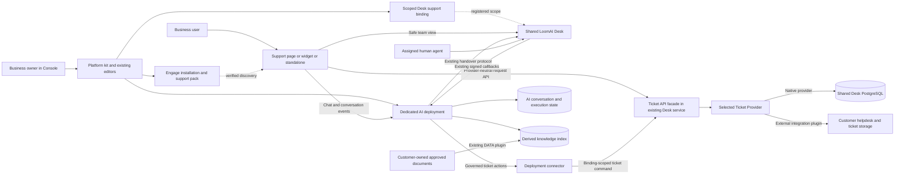
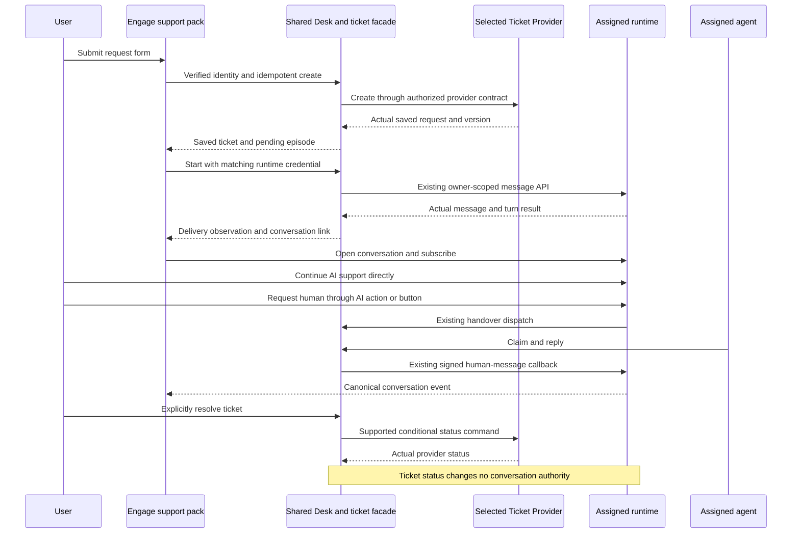

# 010.57 AI Support Experience Kit Solution and Implementation Plan

Date: 3 November 2026
Status: Native implementation deployed and core hosted journeys qualified; see the execution record for explicit residual limits
Product: AI Support Experience Kit, with Technical Support as its first preset

Implementation evidence, 4 November 2026:
[execution record](010_57_SUPPORT_EXPERIENCE_KIT_EXECUTION_RECORD.md) and
[dated production acceptance](../../../../../../../../verification-support/support-kit-01057/2026-11-04-production-acceptance.md).
The native release is live, including Console adoption and legacy retirement.
This does not turn the wider acceptance matrix, optional email delivery or known
AI follow-up failures below into all-green results. The execution ledger is the
current phase/status source; the detailed checklists retain the full design scope.

## 1. Product Decision

Build a reusable support experience from the existing Platform, Engage
workspace/widget and shared LoomAI Desk. Do not build another chat engine,
deployment behavior, per-customer helpdesk service or release mechanism.

A business connects approved support knowledge and optional diagnostic tools,
brands its support workspace, assigns its team and installs it in its website
or application. Its users ask AI for help, submit a tracked request, follow the
request later and continue with a human without repeating the conversation.

The primary surface is a dedicated support page powered by the current
workspace. A floating/docked widget and a standalone branded address are
additional presentations. A page is not a separate AI deployment. Max mode is
a layout, not another backend delivery channel.

Here, in-app support means support for the business's users inside its
application. An employee IT/service-management suite is outside this release.
The generic kit must not inherit Console terminology, account roles, resource
types, credentials or internal diagnostics.

The owner authorized full first-release implementation and live Console
adoption. Existing LoomAI tickets are disposable: use fresh ticket records and
retire the legacy store without building data-import or compatibility paths.
Preserve actual S3 knowledge, configuration and isolation. Framework behavior
changes still require a separately evidenced proposal; unimplemented capabilities
must not be advertised as ready.

## 2. Product Composition and Scope

- **Platform:** editable support template, knowledge/action plugins, connection
  and identity profiles, deployment and ordinary version/publish/apply flows.
- **Engage:** branded support page, companion widget and standalone workspace
  through a support experience pack using the existing chat engine.
- **Desk:** existing human conversations, agents, assignments and Action Review;
  a proposed new opt-in capability supplies the first Ticket Provider, with
  Desk-managed storage. An external ticketing integration can replace that
  provider without replacing Engage or Desk's human-channel capability.
- **Framework and generic Chat UI:** reusable foundations, not owners of ticket
  records, helpdesk workflows or support-specific semantic decisions.

Market the outcome as: **Help customers resolve problems and keep every request
connected to the conversation.** Technical Support is the initial configurable
preset, not a hardcoded domain. The broader AI Customer Experience kit remains
the discovery/guidance starting point; it does not gain ticketing implicitly.

Ticketing and human support are separate capabilities. AI plus tracked requests
can work without staffed agents. Desk stores tickets only when its native
provider is selected; an external provider owns its own ticket records.
Enabling human handover additionally requires an actual channel and
assigned team. No agent availability or response-time promise is invented.

### First release includes

- A selectable kit and Technical Support preset using the current template.
- Customer-owned approved document knowledge and optional configured READ tools.
- Support page, companion widget and standalone delivery, including both website
  and standalone installations on one deployment.
- Request form, authenticated My Requests, request detail and explicit
  resolve/cancel/reopen operations.
- A generic Ticket Provider boundary from the beginning, with Desk-managed
  storage as the first production implementation and canonical conversation links.
- Confirmed AI ticket creation and authorized own-ticket READ actions through
  ordinary plugins; form and action use the same backend lifecycle.
- Existing human handover/replies, safe assigned-agent profiles and a Tickets
  view in the existing Desk UI.
- In-app updates, visible delivery failures and optional email notifications
  when a verified recipient and delivery integration are configured.
- Full configuration preview, generated installation instructions and real
  customer-staging/production acceptance evidence.
- Mandatory adoption by LoomAI Console as the first real customer of the kit,
  retaining its approved S3 knowledge connection and qualified configuration,
  then retiring its superseded custom ticketing implementation.

### Explicitly deferred

- SLAs, omnichannel routing, email-to-ticket ingestion, ticket merging, private
  notes, automatic prioritization and organization-wide requester access.
- App-scoped operator roles and a new agent-routing/assignment engine. Use
  existing deployment-target SUPPORT assignments.
- Arbitrary form/schema builders, arbitrary browser-configured URLs or code.
- Production adapters for specific external helpdesks and migration from those
  external systems. LoomAI's own Console cutover remains in first-release scope.
  The provider contract, selection seam and adapter tests are included now;
  bidirectional replication/synchronization is not the replacement model.
  Existing external case integrations are not universal ticket adapters.
- Autonomous remediation writes, except the explicitly installed ticket action.
- Mandatory specialists, new chain engines or speculative framework changes.
- Simultaneous widget instances, anonymous cross-origin identity merging and
  cross-origin synchronization of unsent drafts.
- Managed customer file storage, per-deployment ticket databases and new
  capacity/recovery/draining architecture.

## 3. Source Baseline and Actual Gaps

These findings describe source inspected on 3 November, not new live proof.

- `Platfrom/ui/src/pages/CustomerSupportPage.tsx` already provides intake,
  request history, status changes, resource selection and team presentation.
- `CustomerSupportContext.tsx`, `SupportWorkspace.tsx` and
  `supportWorkspaceDocument.ts` in `Platfrom/ui/src/components/customer/`
  coordinate the existing workspace and isolated-frame support host. The chat
  itself already uses the generic experience, not a second chat implementation.
- `experience-packs/generic-workspace-experience/` provides tools, presentation,
  open/refresh-conversation APIs and state subscriptions.
- `experience-packs/dealership-experience/` demonstrates a separate domain pack
  with injected tools/results and Platform installation discovery.
- `product-templates/ai-support-workspace/` supplies a reusable CONVERSATIONAL
  template, customer-owned document DATA plugin, optional specialist assistance
  and optional Desk handover.
- `product-services/loomai-desk-service/` supplies a shared, binding-scoped human
  channel, profiles, assignments, projections, callbacks and Action Review.
  Its existing case-context integration reads external cases; it is not a
  generic ticket store.
- `Platfrom/backend/.../experiencekit/` already composes draft deployments,
  consumers and Engage installations through canonical product services.

The remaining gaps are substantive but bounded:

1. Console `SupportRequesterService` requires Console customer-account scope.
   Its case/resource/consent contracts are not reusable external requester APIs.
2. Generic ticket persistence, requester security and ticket lifecycle must be
   added to Desk. They are not a widget configuration switch.
3. `AIWorkspaceExperiencePackRegistry` currently registers generic and dealership
   packs only. Support needs registration, schema, asset packaging and preview.
4. `max-mode-widget/src/mount.ts` creates a viewport-fixed singleton. A public
   script does not currently offer a contained support-page target. Reuse the
   isolated-frame host pattern first, with a bounded installer/pack host API.
5. Current packs each manage one active controller. Preserve one engine per
   document; do not mount two engines to simulate shared conversation state.
6. Embedded/standalone installations have separate identities and browser
   storage. Shared request history must use verified identity and server-owned
   conversation links, not coincidentally equal local-storage keys.

### Relationship to 010.54

[010.54](010_54_SUPPORT_TEMPLATE_SPECIALISTS_RESOLUTION_PLANS_AND_PRODUCTIZATION_SPEC.md)
correctly prohibited converting the Console case registry into an undeclared
universal customer database. It also limited Desk to human-channel state.
Approval of this proposal explicitly extends Desk with a narrow, opt-in
support-ticket product. It does not move customer inventory, orders, billing or
other operational data into LoomAI deployments.

External case systems remain authoritative where used. Do not copy their
tickets into Desk automatically or maintain two ticket writers.
The existing external-conversation-context integration does not implement the
new Ticket Provider contract; a complete adapter must be qualified explicitly.

## 4. Architecture and Data Ownership



**Platform** owns configuration, kit/resource relationships, reviewed endpoint
and identity profiles, secret references, publishing, assignment and activation.
It is not a gateway for every customer message or ticket read.

**Engage/support pack** owns presentation. Browser IDs, attachments, form fields
and context hints do not authorize ticket/resource access or human transitions.

**Runtime** remains authoritative for canonical conversations, safe AI/human
history, execution and control state. Its AI-state database remains an existing
storage choice; ticketing adds no runtime database or ticket tables.

**Desk** owns opt-in support tickets only when its native provider is selected.
It also hosts the provider-neutral API facade in the existing service, not a
new gateway deployment. For an external provider, Desk keeps only the necessary
identity/conversation mappings, operation receipts and integration metadata;
ticket contents/status remain authoritative upstream. Human-channel projections
remain projections, not a second authoritative transcript. Requesters are not
Desk operators.

**Customer systems** own documents and business operations. Diagnostic tools
read the actual system through approved integrations and current permissions.
A ticket reference or attached page grants no diagnostic authority.

### 4.1 Ticket Provider Contract Required from the First Release

Introduce a product-layer `TicketProvider` interface behind the request API and
governed actions. `DeskTicketProvider` is its first implementation. The pack,
Console setup, agent ticket views and AI ticket actions consume normalized
contracts, not Desk database entities or provider-specific payloads.

Required operations are `capabilities`, `createRequest`, `listOwnRequests`,
`getOwnRequest` and `linkConversation`. Lifecycle operations `resolveRequest`,
`cancelRequest` and `reopenRequest` are capability-declared: enable only those
the selected provider genuinely supports. Conversation linking may use a narrow
integration mapping when the external system has no suitable custom field;
it does not require copying the ticket into Desk.

Every call carries server-verified support-space/requester scope. The normalized
result contains an opaque request ID/reference, provider binding/provenance,
subject, approved status mapping, opaque version, timestamps, safe optional
upstream-status label and conversation links. Provider-specific status mapping
is reviewed configuration, not LLM/text
inference. Unsupported operations are explicit and disabled in UI/actions;
never emulate cancel, resolve or reopen with an unrelated upstream operation.

The neutral API uses `version` and `expectedVersion` as opaque strings. The
native Desk implementation can represent its numeric revision as a string;
external adapters preserve their actual ETag/version semantics. An adapter must
enforce conditional mutations or advertise the mutation unsupported rather than
claiming a false revision guarantee.

Configure exactly one active ticket provider for new requests per space through existing
Marketplace INTEGRATION/connection primitives. Ticket ACTION contributions use
that selected binding. Do not introduce a new plugin type, per-provider UI or
new integration service. The public manifest exposes only the safe binding
reference and effective capabilities; endpoints/secrets remain server-registered.

With an external provider, listing and mutations must enforce requester ownership
upstream or through an authorized integration mapping. A successful service-key
login, matching email or a frontend filter is not enough. Preserve external IDs,
provenance, errors and idempotency limitations; never manufacture a receipt after
an uncertain external write. Do not send a mutation to another provider on error.

Exactly one provider is the source of truth. No dual writes, mirrored ticket
database or silent fallback to Desk storage when the external system is down.
Desk may continue human handover and show the linked external ticket independently
of which provider stores it. Conversation authority stays in the runtime.

Changing the selected provider affects new requests only. Existing request links
retain their provider binding/provenance until an explicitly reviewed migration;
never reinterpret an external ID as a native Desk ticket. This is preservation
of customer records, not simultaneous framework/runtime-version support.

The first release implements the native provider and contract tests using a
separate fake upstream adapter. Actual vendor adapters ship later with their own
credential, ownership, retry and live qualification. This proves replaceability
without claiming any specific external helpdesk is already supported.

## 5. Business Owner Setup

1. Select AI Support Experience and its Technical Support preset.
2. Name/brand it and select website, standalone or both.
3. Connect approved document storage and the existing document DATA plugin.
4. Connect supported identity for persistent requests. Optionally install READ
   integrations; documentation-only support remains a valid, disclosed setup.
5. Select the ticket provider (Desk-managed initially). Separately choose human
   handover and assign actual registered agents through the existing Desk
   process when needed.
6. Preview the page, form, request list, tools and AI/human/error states.
7. Publish/apply/verify normally, activate the Engage installations and copy
   the generated snippet or hosted address.

Kit selection creates configuration only: no paid services, AI calls, tickets or
agent assignments. Templates provide editable defaults, not lifetime runtime,
model or plugin restrictions. Reuse normal upgrades, reset and rollback.

## 6. End-User Support Page and Companion Widget

```text
Business logo       Help and support                    My requests

Your support team   [Photo Name] [Photo Name]     [Request help]

Request form, when opened: Subject / Details / Topic / Submit / Cancel

AI support conversation, always visible
Approved sources, diagnostic findings, useful action receipts
Attachments and human/AI controls when enabled
Composer
```

Keep chat visible when the form opens above it. My Requests opens a panel or
split view without destroying the current conversation. On narrow screens use
a full-width list/detail with a clear return to chat. Avoid crowded tools around
the docked composer; richer controls belong in the page/Max view/tool panel.

Agent portraits mean assigned team members, not online presence. Without a
staffed team, show AI/request-tracking help rather than a fake human roster.

The companion widget uses the same conversation and Request help/My Requests
commands. Opening the support page must restore the selected conversation,
not reset messages, attachments or confirmation state. The standalone address
uses the same pack in a full-page shell with its configured identity flow.

Only one engine is active per browser document. Layout/SPA navigation changes
must preserve the controller and avoid duplicate subscriptions/sends. Full
document navigation restores durable state; browser drafts are not ticket
storage. Across origins, authenticated users can reopen the same owned request.
Do not promise shared anonymous sessions or unsent drafts across origins.

## 7. My Requests Lifecycle

### 7.1 Creation

Create a request only through form submission or an explicitly confirmed ticket
action. Opening the page or asking an ordinary AI question creates no ticket.
The current internal Console can record a conversation-first support case;
that behavior must not become the generic kit's hidden default.

The first form has required subject (maximum 240 characters), required details
(maximum 12,000) and an optional configured topic. Contact name/email are profile
information, not ownership keys. Never request passwords or access keys.

Save the ticket before attempting its opening AI message. A save returns a real
reference even when AI is unavailable. Say "Request saved; conversation delivery
pending" instead of pretending the AI answered or discarding the submission.

Record the entry path explicitly. A form starts one saved opening message;
conversion of an existing conversation only links that conversation. An AI
ticket action runs inside an already persisted user turn and must not enqueue
that turn again. Linked-only episodes report `openingMessageRequired: false`
and delivery `NOT_REQUIRED`; `/start` returns the existing link without another
message or provider invocation. The UI must not treat all ticket receipts as
instructions to start a new conversation.

### 7.2 List and detail

All request views use the selected provider's normalized results and declared
capabilities. Provider-specific storage/status differences must not require a
different Engage support page or another My Requests implementation.

Show only the verified requester's own requests in the selected support space:
reference, subject, OPEN/RESOLVED/CANCELLED, last activity and unread indicator.
Provide status filters and bounded pagination. User-facing ticket-list search,
if later added, is ordinary UI search, not lexical AI decision logic.

Detail shows intake, visible status history and linked conversation episodes.
An individual agent appears only when the current handover has an actual claim.
Use existing deployment-target team assignments, not a second assignment engine.

Replies use the linked runtime conversation API. AI answers only in AI_ACTIVE;
HUMAN_PENDING/HUMAN_ACTIVE use the existing human-message path. Do not create a
parallel Desk comment thread and present it as canonical chat.

### 7.3 Status transitions

The following is the native Desk lifecycle. External adapters expose only their
supported transitions through the same capability-aware controls.

- Creation -> OPEN.
- OPEN -> RESOLVED by an explicit requester or currently assigned SUPPORT agent.
- OPEN -> CANCELLED by the requester.
- RESOLVED/CANCELLED -> OPEN by explicit requester reopening.
- A reply to a closed ticket first offers Reopen; it does not reopen silently.

Mutations require authorization, idempotency and expected revision. Conflicts
return safe current state for deliberate review/retry. Resolving a ticket does
not close the conversation, transfer authority or return it to AI.

If a terminal runtime conversation cannot accept messages, reopening creates
a new linked episode under the same ticket. It does not force a terminal
conversation back into an active state.

### 7.4 Chat-first conversion and anonymous help

An authenticated user can create a request from an existing conversation only
after server-side conversation ownership verification. Subject/details are
reviewable and editable; an AI summary is not proof a fix was performed.

Anonymous AI help is allowed when configured, but My Requests requires sign-in.
Never claim an anonymous conversation merely because the browser supplied its
ID or matching email. For release one, retain it separately and start an
authenticated episode, copying only user-approved issue text as untrusted input,
not as identity, resource permission or consent.

## 8. Identity and Authorization Contracts

### 8.1 Separate requester and operator identities

The business owner is the Platform customer that owns the deployment/Desk space.
The requester is that business's end user. These are different principals;
end-user ticket creation must not require the business owner's Console role.

Keep Desk agents on the existing Supabase/OIDC login and role checks. End users
do not register as agents, gain Console accounts or enter the agent directory.

Add a separate requester API security chain. The first direct-runtime profile
validates the original supported Supabase identity token against the exact
issuer/JWKS/audience registered for that support space. Engage and the existing
runtime external identity broker use the same profile. Derive the requester
key from support-space scope plus verified issuer/subject, never email,
user-editable claims or a submitted customerId.

Ticket list/detail/status require no runtime call or AI inference and remain
available during an AI-runtime outage when identity validation is available.
Desk's current operator decoder is not already this binding-scoped requester
implementation. Add reviewed endpoint/issuer profiles and bounded decoder
caching; never fetch a JWKS URL chosen by an incoming token.

### 8.2 Conversation ownership and runtime credentials

For conversation link/start operations, the browser additionally supplies its
short-lived runtime credential in a dedicated header. Desk calls only the
registered runtime's existing `GET /api/chat/me/auth-context` and owner-scoped
conversation API. Check customer/tenant/deployment and the exact requester
mapping. The supported direct broker maps provider subject to runtime subjectId;
record that relationship explicitly rather than matching by email.

Forward the credential only to its exact runtime and never persist/log it.
Runtime public tokens use a runtime-specific signed format; do not assume an
OIDC JWT/JWKS or share the runtime signing secret with Desk. Normal chat remains
browser-to-deployment after setup. The ticket-start bridge is not a new general
chat proxy.

### 8.3 Host and private-adapter support

Use existing Engage host identity/token callbacks for a signed-in host app.
A supported token avoids another login; a script cannot securely infer identity
from DOM variables. Unsupported identity providers need a reviewed adapter or
the kit's supported sign-in profile, not a claim of arbitrary automatic SSO.

Keep the existing private backend-mediated path. Its host verifies its session
and supplies a short-lived requester assertion to Desk using server-registered
issuer/audience/subject mapping plus per-binding server authentication. Runtime
calls retain the existing private assertion and trusted-backend authentication.
Implement this as a second explicit requester adapter, not an auth fallback;
no private keys enter browser configuration. Console is the first candidate
for this path and requires separate qualification from the direct profile.

The proposed private requester assertion contains `iss`, `aud`, immutable `sub`,
`iat`, `exp`, `jti`, `spaceId` and permitted requester operations. Enforce a
maximum five-minute lifetime, registered asymmetric signing keys and a
per-binding server credential. Derive customer/tenant/deployment from the
registered space, not assertion roles or form fields. Its stable requester
namespace is configured separately from the runtime's case-specific principal
mapping; never equate them by email. The host adapter performs this mapping
server-side and does not expose the assertion or credential to the widget.

### 8.4 Required permission boundaries

- Requesters access their own tickets in an enabled space, not all company tickets.
- Agents need current SUPPORT on the exact deployment-target binding. OWNER or
  REVIEWER alone grants neither ticket handling nor conversation reads.
- Diagnostic actions recheck actual customer-system permission and any required
  consent. Ticket ownership alone is insufficient.
- Staging/production have separate bindings and credentials. App/installation
  IDs and public origins are routing/presentation values, not authentication.
- Private host cookies retain CSRF. Bearer routes use permitted origins, no-store
  responses and safe errors. A JWT subject cannot assign its own agent roles.

Provider logout/revocation follows actual token/session semantics. Assignment
revocation is enforced on the next operation; do not promise instantaneous
revocation of an already issued provider access token.

## 9. Native Desk Data Model and Provider Storage

Use Desk-owned Flyway migrations in `db/desk-migration`. Add no PostgreSQL
service and no Platform copy of every customer's tickets.
Ticket payload/status tables below belong to `DeskTicketProvider` only. External
providers use the existing connection/secret stores plus minimal requester,
provider-reference, episode and command mappings, not native ticket replicas.

Proposed records:

- `desk_support_space`: immutable customer/tenant/deployment/target scope, Desk
  binding, selected ticket-provider binding, reviewed identity/endpoint profile
  references, permitted installation/origin references, flags and revision.
- `desk_support_requester`: space-scoped verified identity key and optional
  verified, consented contact information; never an operator assignment.
- `desk_support_ticket`: opaque ID, readable reference, space/requester,
  subject/details/topic, status, revision, timestamps and last-seen marker.
- `desk_support_ticket_episode`: ticket, conversation ID, episode number,
  original runtime target/release and opening-message delivery observation.
- `desk_support_ticket_event`: bounded status/delivery audit with actual actor
  reference, not a second transcript.
- `desk_support_ticket_operation`: scoped idempotency fingerprint/result and
  delivery observation for cross-service commands.
- Optional `desk_support_notification`: preferences, event/recipient dedup key,
  delivery state and safe failure; reuse outbox patterns without mixing ticket
  business events into the human-channel FIFO records.

Unique/foreign-key constraints include support-space ownership. Repeated IDs in
another customer/target must neither collide nor authorize access.
Correlate handover events using the registered binding, runtime scope,
conversation and original owner, never conversationId alone.

Knowledge files remain in customer-owned trusted storage with the existing DATA
plugin. Vectors remain derived knowledge. Do not index private tickets,
transcripts, contacts or diagnostics into a public/shared knowledge source.
Chat attachments stay chat attachments; persistent ticket files require an
already configured ownership-checked storage integration. No hidden managed
customer file store is created.

Disclose retention. Start with a configurable 30-day closed-ticket retention
default and align transcript/file retention where supported. If transcript
retention is shorter, show it; ticket retention cannot promise history exists.
Do not purge active requests through a closed-ticket sweep. Reuse ordinary
service cleanup, not a new general records-management engine.
For external providers, upstream retention/deletion remains authoritative;
clearing LoomAI's mapping is not proof the external ticket was deleted.

Provide an owner-authorized, service-admin purge for an exact closed test or
retention-eligible ticket. Remove its private ticket payload and owned child
records transactionally, retaining only the minimal permitted audit tombstone.
Do not cascade deletion into the runtime conversation, shared binding, operator
or customer. Purge must reject pending ticket-delivery operations rather than
lose uncertain work. Treat disablement as stopping new requests, not deleting
history or automatically closing an active human conversation.

## 10. Proposed APIs

Routes below are new implementation contracts unless explicitly marked
existing. Freeze DTOs/OpenAPI/tests in S0. Example identifiers are illustrative.

### 10.1 Administration and provisioning

Extend existing Platform Desk enablement/binding provisioning with proposed
`PUT /api/desk/admin/v1/bindings/{bindingId}/support-space`. Configuration names
ticketing/human features, reviewed identity/runtime profiles and revision.
Reuse owner checks and existing service-admin trust. Secret material stays
server-side; a public installation never contains Desk's administration key.
Use the same service-admin namespace for the exact, owner-authorized ticket
purge, with expected revision and idempotency. Do not grant the global admin
key to owners' browsers; Console delegates only after its normal ownership gate.

### 10.2 Requester API

Prefix: `/api/desk/requester/v1/spaces/{spaceId}`.
This is the first hosted facade for the provider-neutral contract, not a claim
that every ticket is stored in Desk. Dispatch through the registered provider;
do not serialize native ticket entities directly into the support pack.

- `GET /session`: safe authenticated requester and effective provider capabilities,
  no operator roles or provider credentials.
- `GET /team`: approved assigned-agent names/photos, no account email, private
  directory, permissions or invented presence. Anonymous pages use neutral
  team copy in release one; this projection initially requires authentication.
- `POST /requests`: save subject/details/topic; linking an existing conversation
  uses optional `existingConversationId` and additionally requires runtime
  ownership proof. Omit it for form-first creation.
- `GET /requests?status=OPEN&cursor=...&limit=20`: own list, maximum page size 50.
- `GET /requests/{requestId}`: own details, episodes and safe lifecycle state.
- `POST /requests/{requestId}/start`: deliver the saved opening message, using
  the matching runtime credential and stored episode/key.
- `POST /requests/{requestId}/resolve`, `/cancel`, `/reopen`: explicit transitions.
- `PUT /requests/{requestId}/seen`: advance a last-seen marker, not ticket status.

Creation example:

```http
POST /api/desk/requester/v1/spaces/space-example/requests
Authorization: Bearer <supported provider identity token>
Idempotency-Key: request-submit-unique-id
Content-Type: application/json

{
  "subject": "My approved guide does not appear in answers",
  "details": "I connected our guide and need help checking the setup.",
  "topic": "knowledge"
}
```

```json
{
  "id": "req-example",
  "reference": "SUP-1042",
  "providerBindingId": "tpb-example",
  "subject": "My approved guide does not appear in answers",
  "status": "OPEN",
  "version": "0",
  "conversation": {
    "episodeId": "episode-example",
    "conversationId": "support-conversation-example",
    "delivery": "PENDING"
  }
}
```

Return 201 on initial save and the original safe result for identical replay.
A reused key with changed input returns 409. Saving an episode reference does
not claim the runtime conversation already exists or has an AI answer.

`/start` additionally uses
`X-LoomAI-Runtime-Authorization: Bearer <runtime token>`. Body:
`{ "expectedVersion": "0" }`. Opening text, conversation target and message key
come from saved server state. A new command key does not create another initial
message key. Runtime credentials are not accepted for unrelated requester reads.

Status-command example:

```http
POST /api/desk/requester/v1/spaces/space-example/requests/req-example/resolve
Authorization: Bearer <supported provider identity token>
Idempotency-Key: resolve-unique-id
Content-Type: application/json

{ "expectedVersion": "2" }
```

Return typed 401 for expired sign-in, 404 for unknown/foreign tickets, 409 for
revision/idempotency conflicts and safe 503 for unavailable dependencies.
Never turn a failed mutation into a successful ticket/action receipt.

### 10.3 Agent API

Extend existing `/api/desk/v1/bindings/{bindingId}` with `GET /tickets`,
`GET /tickets/{ticketId}` and `POST /tickets/{ticketId}/resolve`.
Use current SUPPORT, session CSRF and bearer checks plus revision/idempotency.

The ticket view shows intake/status/episode metadata. A ticket is not permission
to fetch every AI conversation through a new admin transcript API. Release-one
human transcript/reply controls appear after existing handover creates the
binding-owned channel conversation. Any separately integrated historical context
still needs its own approved authorization.

Claim/reply/return-to-AI/close keep the existing conversation APIs. A ticket
does not permit agent messages while AI owns the conversation. Proactive human
takeover is not added implicitly.

### 10.4 Governed ticket actions

Use an ordinary Marketplace ACTION contribution and existing connector, not a
new plugin type. Proposed service resource:
`POST /api/desk/integrations/v1/spaces/{spaceId}/ticket-commands`.

Require a distinct binding-scoped connector credential plus caller projection
from the authenticated runtime-to-connector trace path. Reuse
`TraceContextDto.authContext` and reviewed forwarding/templates after negative
tests. A credential or arbitrary browser-supplied trace header alone does not
grant all-user access. Do not expose scope/principal fields as model parameters.

AI inputs are subject/details/topic or an opaque own-ticket reference.
Customer/tenant/deployment/requester/conversation come from trusted scope.
Use the same ticket service/idempotency lifecycle as the form. Creation is a
WRITE requiring authenticated identity and ordinary explicit confirmation.
Ticket READ actions need no vector space unless they actually retrieve indexed
content. No AI resolve/cancel action is installed by default.
The service delegates to `TicketProvider`; action definitions do not hardcode
Desk SQL, a vendor API or a second ticket implementation.

## 11. Delivery and Conversation Sequence



Reuse existing canonical
`POST /api/chat/me/conversations/{conversationId}/messages`, stable
`Idempotency-Key` and actual outcomes. A timeout is UNKNOWN, not proof of failure
or permission to send a new message/key. Observe history/completed-turn results
through existing contracts before declaring completion or exposing retry.

Opening-message observations are PENDING, UNKNOWN, USER_MESSAGE_PERSISTED,
COMPLETED and FAILED, following the existing internal support model, plus
NOT_REQUIRED for an already-linked conversation with no new opening message.
Keep them separate from ticket status and conversation control. A provider
error can leave a saved user message; show it without inventing an answer.

Creation/linking/message delivery are not one cross-database transaction. Save
the operation/episode and use bounded retry with the same identity/key. No new
workflow/recovery service is needed. If ticketing is unavailable, ordinary AI
help may remain available but must not claim a tracked request was saved.
Desk/channel outage never silently changes human authority back to AI.

## 12. Updates, Notifications and Agent UI

Reuse runtime conversation events for messages and AI/human control. Refresh
My Requests on entry/focus, explicit refresh and a bounded 15-second poll while
visible; pause while hidden. No new streaming broker/WebSocket service.

Unread status uses trusted activity/last-seen markers. Do not infer resolution,
urgency or assignment from message words, sentiment or an AI narrative.

Optional email covers a real human reply during an existing handover and an
explicit ticket status change. Use a verified, consented address, safe reference
and protected link, never transcript text or reusable auth tokens. Deduplicate
by space/ticket/event/recipient; bound retries and expose failure. Without email,
say "Updates in My Requests." Delivery failure does not roll back saved work.
Notify a human reply only after its normal callback is acknowledged as accepted
by the runtime; a pending outgoing Desk message is not proof of user delivery.

Add Tickets beside Conversations/Reviews in Desk, not another operator app.
Show intake/status and authorized human controls. AI-only tickets do not grant
unrestricted transcript access or implicit takeover. Reuse existing deployment-
target assignments rather than adding application-specific roles or routing.

## 13. Support Pack and Script Installation

Create `experience-packs/support-experience/`, code `support`; select its initial
version in S0. Reuse generic conversation/state/action-renderer APIs. Extract
domain-neutral host code once; do not copy chat networking/message components.
Ticket forms/lists belong in the support pack, not generic widget components.

Proposed pack configuration, not a valid current generic-pack payload:

```json
{
  "schemaVersion": "loomai-support-experience-config-v1",
  "app": { "assistantLabel": "Example Support", "title": "Help and support" },
  "support": {
    "ticketProviderBindingId": "tpb-example",
    "spaceId": "space-example",
    "requestLabel": "My requests",
    "topics": [{ "code": "knowledge", "label": "Knowledge and documents" }],
    "teamVisible": true
  },
  "capabilities": {
    "tickets": true,
    "handover": true,
    "attachments": true,
    "currentPage": false
  },
  "copy": { "welcomeMessage": "Ask a question or submit a support request." }
}
```

Theme/tools/auth reuse existing configuration leaves, not competing settings.
Effective capability requires configured/verified services, not a public boolean.
Manifest contains only safe Desk requester origin/space references; no service
keys, private assertions, operator roles or diagnostic-consent grants.
Only supported provider operations appear in preview/live controls. A display
label such as My Requests is not the provider binding or an ownership decision.

Add a generic installer container/presentation host option. The local selector
controls layout, never identity, authorization or a remote fetch destination.
Proposed page snippet, **not currently supported syntax**:

```html
<div id="company-support"></div>
<script async
  src="https://api.loomai.pro/api/public/ai-workspace/install.js"
  data-installation-id="awi_pub_example"
  data-container="#company-support"
  data-presentation="page"></script>
```

Allow known presentation values only. If the selector is missing/invalid, show
an installation error, not an unexpected full-screen overlay. Reuse the current
isolated-frame support-host pattern for contained chat. Extract its bridge from
Console, retaining exact origin/source/nonce checks, safe asset URLs and
integrity verification. Never interpolate user text into executable frame HTML.

The pack owns the roster/form/ticket shell; the iframe contains the same widget
engine. Keep it mounted through layout/SPA changes in a persistent host. Do not
destroy/recreate the frame on every host render or refactor the widget into a
multi-instance framework to deliver this page. The generated guide must explain
the persistent-host requirement and full-navigation restoration behavior.

## 14. Template, Knowledge and AI Behavior

Publish a new immutable revision of the current support TEMPLATE and ordinary
ticket ACTION contributions. Use existing document DATA and Desk INTEGRATION
plugins. Keep CONVERSATIONAL behavior and the approved executor/retrieval
profile. No new runtime type or specialist plugin type is required.

Editable support areas can start as Product setup and Service/support policy.
Existing specialist assistance/resolution definitions are optional. Ordinary
users must not choose a knowledge domain, vector space or internal specialist.

Document ownership, approval, indexing/freshness and readiness must be visible.
Do not promise useful answers before real knowledge is connected. No new
customer inherits internal LoomAI tools, storage keys, staff or canary credentials.

Default tools: Ask about setup, Explain support options, Request help and
My Requests. UI commands open UI; semantic questions go through the LLM.
Do not phrase-match a query to select sources, resolve a ticket, manufacture an
escalation or override an AI action decision.

Prompts guide grounded answers, targeted non-secret clarifications, honest
uncertainty and handover. READ diagnostics distinguish current observation from
unavailable evidence. Use only explicitly configured bounded recovery, not
silent search-all or lexical semantic repair. A status change proves no fix.

The package has quality candidates not accepted as global defaults. Select the
latest actually qualified profile during implementation; source-only candidates
and historical scores are not current quality proof. Models/settings remain
editable through normal releases.

## 15. Console Configuration, Preview and Readiness

Reuse kit catalogue/setup/overview and existing Knowledge, Connections, Engage
and Desk editors. Do not create another configuration portal or redesign the
admin/operator interface. Kit overview links actual resources and distinguishes
saved preferences from enabled ticketing or a staffed human channel.

Preview immediately reflects branding/logo/theme, topics, tools, ticket controls,
authentication, attachments, agent-display policy and handover. Show clearly
illustrative Open/Resolved/delivery-pending/unavailable states. Preview makes no
ticket, provider call or handover; real team data needs existing authorization.

Readiness checks current ownership and verified assignment, packaged support
assets, supported identity, enabled same-scope support space, approved knowledge,
selected provider capabilities/ownership connectivity, required action connectivity
and origins. Human readiness additionally checks
the actual channel/team. Do not block deliberate AI-plus-ticket-only support
because human help is disabled.

Reuse existing custom domains, runtime-origin updates, authentication redirects
and explicit activation. Ticketing follows the selected deployment target; the
customer does not choose another unrelated environment for Desk.

## 16. Promotion and Mandatory LoomAI Console Migration

Use matching published template/plugin/pack shapes in staging and production,
with separate credentials, document prefixes, spaces/bindings and endpoints.
Promote configuration and independently verify production. Do not transfer
staged tickets, conversations, vectors or test identities as promotion data.

Roll out additive Desk persistence/requester APIs and Platform provisioning
before exposing the support pack or public kit entry. Keep new capability flags
disabled until qualification. Rollback disables new entry/creation and restores
the previous asset selection without dropping saved ticket tables or force-
closing conversations. It does not require old/new runtime fleets in parallel.

Normal runtime upgrades within a target preserve support-space/ticket identity.
Update a changed registered endpoint through trusted provisioning, not a client
URL. Conversation episodes retain original target provenance. An app assignment
change must not silently rebind an existing request to another customer/target.

### 16.1 LoomAI Is a Required Kit Customer

Console migration is part of completion, not an optional future adoption. LoomAI
must install and use the same Support kit, support pack, Ticket Provider contract
and Desk-managed provider that another customer receives. A visual replacement
over the old Console ticket database does not pass this requirement.

Initially leave existing support available while the kit is qualified. Create
a fresh kit installation through the normal customer setup in staging, and
repeat the normal setup/cutover for production under LoomAI's actual owner.
Do not merely relabel the existing service as a kit or use staff SQL/manual
seeded credentials to hide setup gaps. Permanent parallel old/new support
systems are not required; a straightforward maintenance/cold cutover is valid.

Reuse existing deployment identity only where the supported product lifecycle
allows it. Otherwise use the ordinary new deployment/assignment path and retire
the superseded owned resources after acceptance. Do not add a generic migration
engine or preserve an old runtime fleet for this one installation.

### 16.2 Preserve the Actual S3 Knowledge and Configuration

Before changes, capture current live source bindings, document/plugin identities,
approved source hashes/versions, active index status, model/provider profile,
retrieval/planning limits, prompts, specialist definitions, diagnostics, Desk
assignment and Engage/private-host settings. Historical notes and source-only
template candidates are not authoritative live configuration.

Connect the kit to LoomAI's existing approved S3 document storage through the
normal owned `documentStorageBindingRef` and document DATA installation. Keep
the same bucket, endpoint/region, document objects and approved knowledge library.
Retain each environment's existing scoped identity and prefix: staging must not
read production data or use its credential. Reuse secret references, not copied
plaintext keys, a new bucket, mounted fallback files or fictional Acme guides.

The existing library includes 13 reviewed LoomAI support guides in source; verify
the actual live inventory rather than assuming all are active. If a fresh
deployment needs its own index, refresh/approve/index from the same authorized
S3 objects and reconcile real indexing work. Do not copy vectors between targets,
delete source documents or rebuild knowledge from tickets. Compare source hashes,
attribution and representative retrieval before and after cutover.

Carry forward the currently qualified optimized behavior as a measured baseline:
model, executor mode, bounded iterative READ planning/RAG cooperation, evidence
budgets, prompts and configured specialist/resolution capabilities. Capture exact
values at implementation time. Do not replace them with generic bootstrap
defaults, assume a later model is better, or promote unqualified source candidates.
Tune only against the explicit quality run in section 18.

### 16.3 Keep Console Integration Logic, Not Another Ticket System

Replace Console's custom form/history/chat composition with the reusable support
pack and a thin authenticated host adapter. The same adapter supports the global
dock, persistent navigation state, My Requests, agent roster and request form.
Console is an integration client, not a special ticket provider.

LoomAI-only diagnostic ACTION contributions remain installation-specific plugins.
Adapt them to resolve the authoritative ticket through `TicketProvider` plus
the verified Console requester and actual resource permissions. Preserve explicit
diagnostic consent, its revocation and selected-resource ownership on each read.
Where needed, keep a minimal Console integration-context mapping for ticket IDs,
selected resource references and consent. It must not duplicate ticket text,
status, lifecycle or the transcript in a second case store.

Update the Desk inspector's LoomAI context integration to read the new ticket
authority and authorized diagnostic context. Preserve the actual agent's SUPPORT
check and the separation between resolving a ticket and returning chat to AI.
No old-case-registry adapter may remain as a compulsory dependency of the kit.
The generic external-case integration remains available for other providers;
retire only LoomAI's superseded legacy-case wiring.

### 16.4 Cutover and Retirement

1. Export/backup existing Console case records, consent, episode references and
   configuration privately; inventory exact tables, routes, jobs and references.
2. Current LoomAI tickets are owner-approved disposable records. Stop their old
   writers, clean their exact owned records and start fresh native-provider
   requests. No ticket import, historical transcript adapter or data-retention
   decision blocks this greenfield cutover. Preserve the S3 document connection,
   approved source data, identity security and unrelated product records.
3. Complete staged lifecycle and AI-quality qualification. Stop new legacy case
   writes for the bounded cutover, reconcile only real pending support work and
   switch Console to the verified kit/provider/assignment. No dual writes.
4. Verify production sign-in, request creation/history, S3 retrieval, diagnostic
   consent, AI ticket action, human handover/reply/AI return and the global dock.
5. Remove unused legacy controllers/services/stores, UI state and API clients,
   legacy runtime/case bridges, configuration/flags and case-specific Desk
   callbacks. Reuse genuinely generic components instead of deleting shared code.
6. After accepted data disposition and production proof, use a forward migration
   to retire unreferenced old case tables/foreign keys. Keep immutable historical
   Flyway migrations. Remove only exact obsolete services/credentials/resources
   after proving no other product uses them. Keep the S3 source connection and
   shared Desk/database; do not run a global infrastructure cleanup.
7. Prove old ticket endpoints and background writers are no longer active, new
   requests persist only through the selected provider, and backups/audit are
   retained according to the agreed policy.

Review `SupportCaseController`, `SupportCaseService`, `SupportCaseStore`,
`SupportDeskStore`, Console request components/API clients and the old case-bound
runtime bridge for retirement. Review diagnostic/auth/resource/team services
individually: their necessary checks move into the thin integration, not into
the generic widget or an undeclared second ticket store. A directory-wide delete
of `backend/support` is not the cleanup strategy.

Keep a clear rollback boundary. Before legacy schema retirement, a cutover can
be reversed only with a deliberate single-writer/data decision. After retirement,
ordinary asset/version rollback does not recreate old case tables or migrate
tickets back. Prefer a scoped roll-forward; any backup restore is explicit.
Do not introduce a new recovery/draining subsystem for this migration.

External vendor adapters remain separate qualification work. Installing one is
not automatic migration/replication, and an outage must not create Desk tickets.

## 17. Implementation Phases and File Targets

Each phase gets a separate scoped commit and verification record. All phases
remain unchecked until their deliverables are implemented and verified.
Backend contracts precede page polish; keep unrelated infrastructure work out.

### S0 Contract and Mechanics Qualification

- [ ] Freeze support-space/requester mapping, DTOs/OpenAPI, idempotency and
  delivery behavior in focused tests.
- [ ] Freeze `TicketProvider`, opaque versioning, operation capabilities and
  normalized error/status contracts; prove a second fake-upstream adapter can
  run the same request contract tests without writing native ticket payloads.
- [ ] Prove the existing canonical API starts a new saved conversation ID,
  replays safely and rejects an existing foreign conversation.
- [ ] Prove host identity -> runtime subject mapping and separate requester
  authorization without an agent/Console account.
- [ ] Prove contained isolated-frame chat without global overlay/second engine.

Targets: consumer tests of existing runtime HTTP contracts, installer/generic
host tests and Desk contract tests. No framework behavior change is presumed.
Exit: no ownership or opening-message assumption remains disguised as UI work.

### S1 Desk Tickets and Requester Backend

- [ ] Add migrations in `product-services/loomai-desk-service/src/main/resources/db/desk-migration/`.
- [ ] Add support-space/ticket/requester services and separate security chain in
  `product-services/loomai-desk-service/src/main/java/com/loomai/desk/`.
- [ ] Implement `DeskTicketProvider` behind the provider-neutral facade; keep
  native persistence out of pack, controller and action contracts.
- [ ] Implement save/list/detail/start/status/seen, delivery observation,
  disclosed retention, exact closed-ticket purge and optional notification
  preferences/outbox.
- [ ] Test real PostgreSQL constraints/transactions, two users/customers/targets,
  changed replay, invalid identity, foreign IDs, runtime outage and purge
  isolation/rollback without deleting shared or runtime-owned records.

Exit: My Requests works without an AI query and cannot expose another user's
ticket or become a second transcript store.

### S2 Provisioning and Governed Actions

- [ ] Extend Platform `.../backend/desk/` activation/provisioning for support-space
  identity, endpoint and capability configuration.
- [ ] Add ordinary ticket ACTION manifests/connector mappings and scoped secrets.
- [ ] Resolve the ticket provider through existing INTEGRATION/connection
  bindings; no new plugin type or silent default after an external failure.
- [ ] Implement safe create/read receipts and normal confirmation.
- [ ] Test spoofed trace, credential-only access, revoked binding, own-ticket
  scope and READ tools without irrelevant vector-space requirements.
- [ ] Implement/qualify private-host requester adapter separately; preserve
  existing private runtime and Shopify contracts.

Exit: form and action share one authorized ticket service and replay contract.

### S3 Support Pack, Contained Host and Desk UI

- [ ] Add `experience-packs/support-experience/` with page/form/list/detail/team
  components and support action presentations.
- [ ] Extract the isolated-frame host bridge without Console account assumptions.
- [ ] Extend `max-mode-widget/src/installer/` with bounded container/presentation
  mounting and reuse existing conversation/state APIs.
- [ ] Add Tickets to `product-services/loomai-desk-service/ui/src/`, retaining
  current conversation/review controls and actual operator authentication.
- [ ] Verify layout/SPA transitions, refresh, drafts/attachments, confirmation,
  account switching and no duplicate sends/subscriptions.

Exit: a neutral host installs support through the generated script without
Console/dealership imports in generic components.

### S4 Kit, Template and Customer Setup

- [ ] Register/schema-validate/package the support pack in the existing AI
  Workspace registry, asset catalogue, CI/container delivery and preview.
- [ ] Extend `product-templates/ai-support-workspace/` with support-kit composition,
  actual ticket fixtures and meaningful non-LoomAI sample documents.
- [ ] Add a definition through `.../backend/experiencekit/` and reuse UI
  `components/kits/`, setup, resource overview and advanced editors.
- [ ] Model ticketing separately from `humanSupportEnabled`; preferences do not
  imply a live Desk binding or assigned team.
- [ ] Make provider choice/capabilities explicit in setup and previews; retain
  the same form, My Requests and detail UI for native and contract-test adapters.
- [ ] Complete preview, identity/setup guidance, installation, readiness and
  explicit activation using existing release machinery.

Exit: a customer configures the kit without SQL, hardcoded IDs or another
publish/promotion implementation.

### S5 Hosted Customer-Journey Qualification

- [ ] Run section 18 in customer staging then production with matched published
  configuration and isolated real dependencies.
- [ ] Qualify a non-LoomAI business using its own knowledge/requesters and the
  separate Console private-host adapter.
- [ ] Verify page/widget/standalone, both channels on one deployment and owned
  My Requests across authenticated surfaces.
- [ ] Record first-attempt AI outcomes, failures, actual receipts and human
  replies; a later retry does not erase the original result.
- [ ] Run LoomAI's current and kit-backed support quality suites against the
  same approved S3 content, record exact profiles/prompts and review the known
  follow-up/compound-answer failure cases before accepting production cutover.
- [ ] Clean exact fixtures/resources through normal owned APIs and retain audit.

Exit: critical trust/lifecycle checks pass and measured quality meets reviewed
product acceptance. Healthy containers are not end-to-end proof.

### S6 Mandatory Console Adoption, Legacy Retirement and Guides

- [ ] Publish owner, host installation/auth, agent, retention and outage guides
  beside the pack/template, with exact supported versus deferred modes.
- [ ] Describe only qualified capabilities in public products/kit pages.
- [ ] Install/verify the kit for LoomAI through the normal customer setup in
  staging and production, using the existing scoped S3 document connections.
- [ ] Switch Console support page/dock, My Requests and diagnostics to the
  support pack and selected Ticket Provider through its thin host adapter.
- [ ] Complete backup/record disposition, single-writer cutover and removal of
  the old Console ticketing code, endpoints, writers and unreferenced schema.
- [ ] Re-run production quality and full request/human lifecycle after cleanup;
  preserve the accepted optimized settings and reusable template defaults.
- [ ] Record deployed source/assets/images, verification and limitations in the
  execution record and working context.

Exit: LoomAI Console actually runs on the new kit, its real S3 knowledge and
approved optimized configuration; superseded ticketing is retired. Another
customer can use the same kit without internal LoomAI dependencies. No universal-
helpdesk or automatic arbitrary-integration claim.

## 18. Acceptance and Verification

### End-to-end business journey

1. Customer selects kit, creates drafts, connects own approved knowledge and
   supported identity, then previews it. No AI/ticket/paid provisioning on preview.
2. Publish/apply/verify staging and enable ticketing. AI-and-ticket-only works
   with human help deliberately disabled.
3. Install script into a neutral support page. Opening the page creates no
   request or AI query and does not cover unrelated host content.
4. Ask documented and unsupported questions. Use approved evidence; expose
   uncertainty without inventing policies or asking users for knowledge domains.
5. Submit form: one saved ticket/reference, opening message once and linked
   conversation. Simulate uncertainty and verify replay does not duplicate it.
6. Navigate/reload/return to My Requests: own saved history persists; another
   known user cannot see/mutate the ticket by ID.
7. Configure an authorized READ tool and try compound knowledge/diagnostic
   questions. Distinguish current facts, unavailable evidence and guidance.
8. Ask AI to create a request: fill fields, cancel once, confirm once, inspect
   actual receipt and single saved record.
9. Enable handover and assign a real agent. Transfer using both AI and button;
   agent claims/replies in Desk, user receives it, explicit AI return works.
10. Resolve while human control remains active: no implicit AI return/close.
    Reopen deliberately; terminal chat gets a clearly linked new episode.
11. Activate production through the normal flow. Same capability setup, separate
    dependencies, no copied staging tickets/vectors/test identities.

### Critical negative and regression cases

- Known-real cross-requester/customer/target IDs denied server-side on every
  list/detail/start/status/action path, not just hidden in UI.
- Invalid/expired issuer/audience, spoofed principal, wrong adapter and service-
  key-only requests cannot obtain unauthorized requester access.
- OWNER/REVIEWER without SUPPORT denied; revoked SUPPORT fails next operation;
  agent registration alone grants no ticket access.
- Conversation-link ownership fails closed; runtime and requester tokens are
  not interchangeable or forwarded to browser-selected destinations.
- Duplicate submits/start/actions, changed replay and timeout never produce
  duplicate tickets/messages, unexpected costs or fabricated success.
- The same provider contract suite passes for native Desk and a fake external
  upstream, including own-request isolation, opaque versions, unsupported
  transitions, uncertain writes and outage with no fallback/dual storage.
- Provider selection changes never reinterpret historical references; external
  records remain upstream and human handover remains independent of storage.
- AI-action and chat-first conversion receipts never enqueue the triggering
  user message again; repeated `/start` on those links invokes no provider.
- Ticket metadata remains accessible during runtime outage, transcript errors
  are visible, and Desk outage never grants AI human-conversation authority.
- Logout/account switching clears private views/caches/subscriptions; a new
  identity does not inherit another user's ticket, transcript or draft.
- Embedded/standalone restore owned requests; anonymous identities are not
  silently merged and production never reads staging tickets.
- Escape text and enforce declared size/type limits; no arbitrary assets,
  redirects or endpoints. No secrets/tokens in manifests, URLs, preview events,
  analytics, logs or saved ticket JSON.
- Regress existing generic/dealership widgets, Shopify/private adapters, Desk
  conversation lifecycle and Action Review for touched shared behavior.

Desktop is primary. Verify dark/light, basic narrow navigation, text fitting,
safe areas and no uncontrolled host overlay. Preserve labels, keyboard focus
and dialog dismissal in shared controls without an accessibility redesign.

Measure AI quality separately from hard authorization/side-effect safety. Include
multi-turn paraphrases, incomplete issues, unsupported claims and no-human cases.
Do not demand perfect semantics through restrictive keyword validators or hide
failures through unapproved fallback. Critical identity/confirmation/lifecycle
tests remain mandatory even when semantic acceptance allows model uncertainty.

### Mandatory LoomAI Knowledge and AI Quality Proof

Use LoomAI's actual support installation as the product reference, not a
documentation-only fictional demo. Reuse
`product-templates/ai-support-workspace/review/support-library-quality-scenarios.json`
and the existing support-quality multi-turn/paraphrase runners and reviews under
`verification-support/support-quality-01054/`. The prepared library has 18 review
questions; the historical comparison has nine primary turns plus six additional
turns. Reconcile overlap into a fixed, reviewed suite rather than claiming these
counts represent independent passed scenarios.

Before migration capture a fresh baseline on current live Console routes. Run
the same scenarios on the new kit with the same approved S3 documents, identity
and authorized resources. Compare actual source IDs/citations, correctness,
completeness, conversational subject handling, action observations and latency.
Record model/settings/prompt and knowledge versions so an improvement is not
mistakenly attributed to the pack when the provider or source content changed.

Cover at least setup, embedded versus standalone, optional custom domains,
knowledge freshness, action confirmation, ticketing, human support and diagnostic
consent. Include compound questions, pronouns/ordinal follow-ups, unavailable
diagnostics, unsupported policy questions and a request for human help after AI
has already answered. Review real answers manually or through a disclosed
semantic evaluator; do not grade quality by keyword presence.

The historical accepted production sample was seven pass, one partial and one
fail out of nine. It retained wrong-subject follow-up and partial-compound
limitations. That is a baseline, not a green result for the new kit. Read fresh
evidence and retain first failures; retries must not erase them.

Proposed product acceptance target: at least 85% fully correct/useful first-attempt
answers on the frozen reviewed suite, no regression on the core supported setup
and ticket/handover journeys, and explicit reporting of every partial/failure.
This is an offline release-quality target, not a hard validator on each live
LLM response. Authorization, ownership, consent, confirmation and human-control
tests must pass independently. Any accepted residual semantic limitation needs
an explicit recorded product decision, not a hidden fallback or relaxed score.

Use bounded configuration/prompt tuning cycles, starting from the verified live
profile. Prefer better grounding instructions, relevant source descriptions,
structured diagnostic evidence and appropriate context budgets. Do not introduce
lexical routing, forced all-source retrieval, an answer-replacement script or
unapproved framework changes. If a reproducible framework gap remains, propose
it for review rather than endlessly increasing budgets or changing unrelated code.

After qualification, publish the reusable non-secret improvements into the
versioned Support template/prompt defaults and prove a fresh neutral installation
inherits them. Keep LoomAI-specific guides, resource actions, credentials and
consent adapters in its instance overlay. Existing customer releases do not
change silently. Repeat the production quality/lifecycle sample after legacy
cleanup; a staged pass alone does not close Console migration.

## 19. Dependencies and Readiness Claims

Real prerequisites: existing shared Desk, owned document access, configured AI,
supported requester identity, allowed origins/registered runtime and actual
agents when human help is advertised. A custom hostname additionally needs DNS;
the existing hosted app address can qualify first. No new server, external
ticket vendor or framework release is assumed necessary.

If S0 discovers a missing runtime/framework contract, record its owner, use
case, evidence, minimal proposed fix and focused tests for review before code.
Do not bypass ownership, invent an endpoint or add a duplicate ticket engine.

First-release completion requires S0-S6, including real Console adoption,
preserved S3 knowledge, accepted production AI quality and retirement of the old
ticketing implementation. Record-history disposition must be resolved before
destructive cleanup; it is not permission to defer the system cutover indefinitely.
Advanced routing, proactive takeover, generic external vendor adapters and
organization-wide access remain explicitly deferred, not implicit promises.

## 20. Tracking and Related Contracts

Current state: **implementation started; no new live capability is claimed**.
Track progress in sibling
[execution record](010_57_SUPPORT_EXPERIENCE_KIT_EXECUTION_RECORD.md) and dated evidence under
`verification-support/support-experience-kit/`. Record source/assets, test
counts/skips, exact hosted identities, first-attempt results and scoped cleanup.
Do not publish credentials or private transcripts.

Proposal qualification on 3 November: current support, Desk, pack, installer,
identity-broker and canonical-message source contracts were inspected; a bounded
independent review found no blocking contradiction. Relative references, JSON
examples, section/phase sequence, code-fence balance and whitespace were checked.
These are documentation checks, not implementation tests or hosted proof.

Owner-requested amendment: the Ticket Provider boundary, normalized version/
capability contract and adapter contract tests are first-release work. Only
specific production vendor adapters and external-vendor data migrations remain
deferred. Desk is the
first provider, not a mandatory ticket-storage backend for every future kit.

Owner clarification: LoomAI Console must become a real kit customer, reusing its
current S3 knowledge and qualified optimized behavior, with new answer-quality
evidence and retirement of the superseded internal ticketing. This supersedes
the earlier optional-adoption wording; it is now a mandatory completion gate.

- [010.48 Managed Desk](010_48_LOOMAI_DESK_MANAGED_HUMAN_SUPPORT_AND_REVIEW_SERVICE_IMPLEMENTATION_PLAN.md).
- [010.50 Engage channels](010_50_ENGAGE_EMBEDDED_AND_STANDALONE_CUSTOMER_SETUP.md).
- [010.51 Preview](010_51_ENGAGE_CUSTOMER_APPEARANCE_AND_VISUAL_PREVIEW.md).
- [010.52 Connections and domains](010_52_ENGAGE_CONNECTION_COMPLETE_PREVIEW_AND_CUSTOM_DOMAINS_PLAN.md).
- [010.54 Internal support](010_54_LOOMAI_INTEGRATION_SUPPORT_DEPLOYMENT_AI_WORKSPACE_AND_DESK_SOLUTION_PLAN.md).
- [010.54 Support template](010_54_SUPPORT_TEMPLATE_SPECIALISTS_RESOLUTION_PLANS_AND_PRODUCTIZATION_SPEC.md).
- [010.56 Experience kits](010_56_BUSINESS_AI_EXPERIENCE_KITS_IMPLEMENTATION.md).
- [Desk API](../../../../../../../../product-services/loomai-desk-service/API_CONTRACT.md).
- [Desk external case context](../../../../../../../../product-services/loomai-desk-service/EXTERNAL_CONVERSATION_CONTEXT.md).
- [Support template package](../../../../../../../../product-templates/ai-support-workspace/README.md).
- [Generic workspace types](../../../../../../../../experience-packs/generic-workspace-experience/src/types.ts).
- [Dealership pack](../../../../../../../../experience-packs/dealership-experience/README.md).

The governing design is **one reusable support experience, the current chat
engine, explicitly owned tickets and optional humans through existing Desk**.
