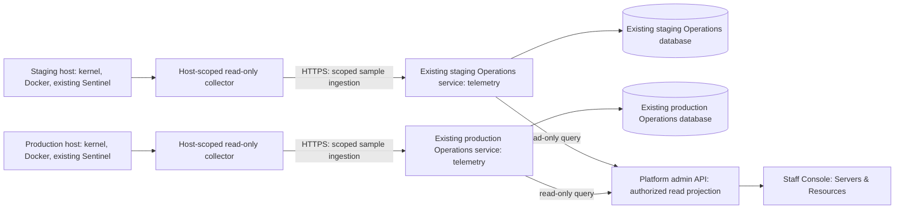

# 010.60 Server Resource Optimization and Admin Monitoring Solution Plan

- Status: implemented and hosted-qualified on staging and production, 5 November 2026.
- Created: 5 November 2026.
- Scope: shared Platform infrastructure and all deployment products, not dealership-specific logic.
- Outcome: improve dedicated-deployment density and give Platform administrators an accurate view of server usage without adding a new deployment-admission dependency.
- Execution: [implementation and verification record](010_60_SERVER_RESOURCE_OPTIMIZATION_EXECUTION_RECORD.md).
- Related: [010.40 small deployment profile](010_40_SMALL_PERSISTENT_LUCENE_DEPLOYMENT_PROFILE_IMPLEMENTATION_PLAN.md), [010.46 optional Operations service](010_46_OPTIONAL_DEPLOYMENT_OPERATIONS_MODULE_AND_SERVICE_SEPARATION_PLAN.md), [010.43 backup options](010_43_COOLIFY_PLATFORM_DISASTER_RECOVERY_AND_BACKUP_OPTIONS_PLAN.md), [current working context](../../../../../../../../Final_Documentation/Development_Guides/LLM-guides/CODEX_WORKING_CONTEXT.md).

## 1. Recommended Solution

Keep Hetzner and Coolify, retain deployment-local customer runtimes and integration boundaries, and optimize the resources already purchased before changing hosting platforms.

Deliver two related but independently reversible workstreams:

1. Resource optimization: correct shared CPU pinning, qualify smaller initial JVM heaps and service pools, and keep builds and heavy background work from competing with customer traffic.
2. Admin monitoring: add a read-only **Servers & Resources** screen to the existing Platform staff console, with host/container measurements, short history, ownership grouping and actionable warnings.

Monitoring remains available independently of whether admission policy is disabled, observing or enforcing. A missing metrics collector or unavailable Operations service must not block ordinary deployment, promotion, chat, actions or indexing. The existing two-environment customer allowance remains a separate enforced product-allocation rule.

Do not introduce Kubernetes, automatic replica scaling, a replacement capacity engine, a new time-series database or another framework release for this work. Buying more application RAM or adding a deployment-only host is the next infrastructure step if measured demand still requires it.

## 2. Measured Baseline

Read-only host and Docker inspection on 5 November 2026, approximately 00:15-00:17 UTC:

| Measurement | Staging | Production |
| --- | --- | --- |
| Exposed logical CPU threads | 8 | 4 |
| Usable RAM | 15.24 GiB | 15.24 GiB |
| Available RAM | 2.98 GiB | 8.86 GiB |
| Occupied swap | 4.79 GiB | 0 |
| Running AI runtime/connector pairs | 4 | 2 |
| Combined measured memory for those pairs | 3.47 GiB | 1.85 GiB |
| All PostgreSQL containers combined | 0.43 GiB | 0.57 GiB |
| Vector-service container memory | 0.08 GiB | 0.05 GiB |
| Runtime CPU affinity | CPU 7 for every runtime | CPU 3 for every runtime |
| Connector CPU affinity | CPU 6 for every connector | CPU 2 for every connector |

These are short, low-load observations, not measured customer capacity. Occupied swap does not establish active swapping during the sample. PostgreSQL totals include shared infrastructure databases; moving only customer AI state would reclaim less. Current small vector indexes do not establish future vector-memory requirements.

Current settings for each running pair:

| Process | Initial/minimum Java heap | Maximum Java heap | Container memory ceiling | CPU quota |
| --- | --- | --- | --- | --- |
| Runtime | 256 MiB | 768 MiB | 1,024 MiB | 1 CPU |
| Connector | 128 MiB | 512 MiB | 768 MiB | 0.25 CPU |

The combined 1.75 GiB ceiling is not permanently reserved RAM. Warm observed pairs consumed approximately 0.85-0.95 GiB. Loaded classes, native memory, pools, buffers and threads must be measured before attributing that footprint to heap size or a memory leak.

Earlier estimates of five-to-seven environments per cleaned host remain planning estimates. Shared CPU pinning and the absence of concurrent-load qualification prevent treating them as guaranteed service capacity.

## 3. Existing Code and Reuse Boundaries

Paths below are relative to the repository root.

| Existing area | Current role | Use in this plan |
| --- | --- | --- |
| `Platfrom/backend/.../deployment/service/CoolifyDeploymentProvider.java` | Applies target-profile JVM and per-service container settings | Keep as the source of provider configuration; do not make lasting Docker-only edits |
| `Platfrom/backend/.../deployment/service/CoolifyApiClient.java` | Provider API requests and resource settings | Reuse permitted resource identity/readback; do not expose provider credentials to the browser |
| `V141__behavior_runtime_process_isolation.sql` and `V185__customer_runtime_worker_capacity.sql` | Historical role-level CPU/heap defaults | Explain the current affinity; change through a new migration/profile revision, never rewrite applied migrations |
| `product-services/deployment-operations-service/` | Optional capacity policy and explicit lifecycle jobs with its own PostgreSQL database | Add an independent telemetry package, retention and read API; do not mix samples into admission decisions |
| `Platfrom/backend/.../deployment/operations/` | Policy/lifecycle adapter and core authority boundary | Preserve it; add a separate telemetry client rather than changing the assessment contract/deadline |
| `CustomerEnvironmentQuotaService` | Default-two workspace allowance | Keep unchanged; metrics are not occupancy authority |
| `Platfrom/ui/src/layout/AppShell.tsx` and `src/App.tsx` | Existing staff navigation and routes | Add an admin-only global monitoring route without changing the customer shell |
| `Platfrom/ui/src/pages/PlatformDiagnosticsPage.tsx` | Shared-service health, logs and existing operational commands | Link to monitoring; do not duplicate its controls or treat service health as usage history |
| `verification-support/deployment-operations/provider-host-entry.py` | Restricted native lifecycle entry point, including volume reclamation | Do not reuse its mutation authority for telemetry; any collection wrapper must be a separate read-only contract |

`.../` in backend paths means `src/main/java/com/ai/fabric/platform/backend/`.

The Operations service currently exposes assessment/outcome and lifecycle APIs, not a server-metrics API. Its existing API filter uses one powerful service key; a telemetry-source credential must not inherit that authority.

Both hosts already run Coolify Sentinel. Public documentation describes metrics collection and local history, but installation of Sentinel alone does not prove that collection is enabled or that the installed version offers the required bulk interface. Check that capability before reuse; do not invent a public Coolify metrics endpoint.

The older [observability foundation](../../../../../../../Operations/observability/OBSERVABILITY_AND_RELIABILITY_FOUNDATION_PLAN.md) and [starter design](../../../../../../../Operations/observability/LOOMAI_OBSERVABILITY_STARTER_DESIGN.md) are broader proposals, not proof that Grafana/OTel/Sentry are installed. This plan does not make that entire stack a prerequisite or adopt historical global release-blocking rules.

## 4. Optimization Workstream

### 4.1 CPU Scheduling First

Remove the shared per-role CPU affinity in a staging canary. Initially retain the existing runtime/connector CPU quotas, memory ceilings and `ActiveProcessorCount=1` so the experiment changes scheduling rather than increasing JVM concurrency at the same time.

Today, different runtimes are assigned the same logical CPU. This restricts their combined execution even if the host has idle CPUs elsewhere. It is a potential burst bottleneck, not a demonstrated explanation for every past load incident. CPU affinity does not reserve those CPUs exclusively against unrelated host processes.

Persist qualified settings in the existing target-profile/provider flow, using a reviewed canary profile or the existing canary target. Verify that clearing affinity is actually sent to Coolify and read back from the running container; omission of a field must not silently retain the old pinning. Do not remove CPU quotas, grant unlimited memory or add a new scheduler.

### 4.2 JVM and Pool Right-Sizing

Profile an unchanged baseline before reducing maximum memory. Capture heap use/commit, native footprint when available, container working set, thread counts, pool sizes, garbage collection and application latency separately from external model latency.

First candidates for a controlled experiment:

- Runtime initial/minimum heap: `-Xms64m` instead of `-Xms256m`.
- Connector initial/minimum heap: `-Xms32m` instead of `-Xms128m`.
- Retain current `-Xmx`, container ceilings and selected capabilities initially.

These values are test candidates, not approved production defaults. Lower initial heap does not guarantee lower warm memory if the application's live objects dominate. Do not force garbage collection on a timer or repeatedly rewrite live container limits.

Inspect connection/thread pools, polling frequency and enabled components before changing them. Preserve enough connections for interactive requests and configured background workers. Do not globally enable lazy initialization or remove dependencies merely to improve an idle screenshot.

A supported Small profile comes only after measurements. Express it through existing deployment/provider profiles and template defaults, not a second publishing mechanism or a permanent template restriction. Preserve Standard as a normal alternative and preserve normal later upgrades.

This work does not switch vector engines to Lucene; 010.40 retains that separate qualification scope. Do not alter retrieval policy, prompts, result caps or AI semantics to reduce infrastructure use.

### 4.3 Builds and Background Work

- Keep CI-built immutable images for Platform services that already use them; do not count this as a new saving.
- Identify remaining source-built demos and their actual build locations before changing settings.
- Use CI/registry images or a separate build host where needed. Disable build fallback onto customer-serving hosts only after verifying installed Coolify support and replacement build capacity.
- Avoid concurrent demo rebuild storms. Bound concurrent indexing work through existing worker settings and stagger large rebuilds where supported.
- Do not suspend live synchronization or drop callbacks to make resource charts look better.

### 4.4 Resource Cleanup and Growth

Identify a container's provider application, current deployment/target/release and routing before recommending removal. Label unresolved items **Unmapped**, not **Safe to delete**. A stopped service can retain disk/storage and still count against the workspace allowance.

Developer fixtures and old duplicate containers may be cleanup candidates. Customer staging, current product demos, production services and external/customer-owned resources are not automatically disposable. Follow existing authorized removal and preserve configuration unless deletion was explicitly intended.

If memory remains limiting, compare a same-architecture 32 GB Hetzner rescale with another deployment-only host. Confirm the actual quote, availability, restart requirements and backup posture. More RAM is not high availability. Add new deployments through existing target/profile placement rather than implementing automatic live migration.

Do not buy managed PostgreSQL solely to reclaim the current small database footprint. A future managed database can be chosen for independent backup/recovery/availability. If shared physically, retain separate staging/production environments, logical databases and restricted roles. Dealership inventory remains an external integration, not a Platform-owned business database.

## 5. Admin Monitoring Architecture

### 5.1 Observation Only



There is no arrow from telemetry into chat, indexing, apply authorization, release readiness or workspace quota counting.

Use each environment's existing Operations service and database. A production Platform administrator may view both hosts through an explicit server-side source registry pointing to those services. Do not join the staging and production control-plane databases, copy customer credentials or infer that an ordinary customer/operator account has fleet access.

Reference existing provider/server and target records rather than inventing a second placement registry. Deduplicate physical hosts across target profiles: two profiles using the same Coolify server are one server in monitoring. Show container counts and deployment-environment counts separately; neither is the count of customer workspaces.

### 5.2 Collection Choice

Use one scheduled collector per physical host, not a new collector per customer deployment. It sends a bounded numeric/status batch approximately every 60 seconds to that host's configured Operations telemetry endpoint.

Reuse the installed Sentinel's current/bulk measurements where a verified local interface exists. Supplement missing affinity, limits, swap, restart or cgroup fields with fixed host/kernel/Docker reads. If the installed Sentinel version lacks a usable metrics interface, the same collector can read those measurements directly; selecting this explicit source must be recorded, not hidden as an equivalent fallback.

Collection must not depend on browser activity or call a privileged command for every chart point. A root-owned fixed host script/systemd timer is sufficient for the initial fleet; no new Java daemon, public metrics port or full agent platform is required. Do not modify or fork Sentinel.

The collector may need privilege for Docker/cgroup inspection. Keep this privilege host-local, with fixed command paths, no user-provided shell fragments and no generic remote-command endpoint. Do not give the collector's remote credential provider administration or lifecycle rights. Do not mount a raw Docker socket into Platform, Operations or a customer runtime to implement this feature.

Its output is an allowlisted projection. Never send environment variables, full inspect documents, process command lines, connection URLs, health-check log output, transcripts, prompts, request bodies, customer files or IP-level visitor analytics.

### 5.3 Ownership of Responsibilities

| Owner | Responsibility | Must not do |
| --- | --- | --- |
| Host collector | Read fixed local measurements; identify boot/container incarnation; submit bounded batches | Execute deployment mutations or accept arbitrary commands |
| Operations telemetry package | Authenticate sources, store short history, aggregate, expire samples, serve read queries | Change policy outcomes, grants, deployments, quotas or resource settings |
| Platform admin adapter | Authorize staff; resolve approved telemetry sources; join existing resource ownership metadata into a safe projection | Pass provider/service credentials to the UI or synchronously collect metrics during apply |
| Admin UI | Show freshness, measurements, trends and informational warnings | Treat observations as permission to delete, scale, deploy or bypass a quota |
| Existing release/provider path | Apply approved resource-profile changes and verify actual running settings | Depend on a green metrics dashboard to authorize normal basic deployment |

### 5.4 Storage and Retention

Add independent telemetry tables through the Operations service's existing Flyway migration location. Do not add a customer database, a second Operations database or a new control-plane time-series database.

Minimal logical records:

- `operations_host_samples`: source/server ID, boot ID, observation time, reception time, collection duration, supported-field flags and host measurements.
- `operations_resource_samples`: source/server ID, stable provider-resource reference when known, container incarnation/start identity, observation time, role/limits/measurements and health/restart fields.

Use typed columns for core metrics; only bounded reviewed metadata is allowed. Uniqueness includes source and sample identity so duplicate delivery does not duplicate history. Counter resets after reboot/restart start a new interval, not a negative rate. A resource incarnation remains distinct even if a provider name is reused.

Start with one-minute raw samples for 24 hours and five-minute aggregates for seven days. Store mean and maximum where useful; sum event/rate numerators with their valid durations rather than averaging percentages blindly. Coarser UI windows may aggregate further but must not imply raw precision. Purge in bounded scheduled batches and index source/resource/time queries. No partitions, permanent event lake or unlimited retention in the first release.

Metadata needed to map a sample to a deployment is derived from trusted provider handles and Platform records. Do not trust a collector-supplied customer ID as ownership authority. Preserve deployment/target attribution for the observation time where available; unmapped records remain visible to administrators without invented attribution.

Measure monitoring's own CPU, RAM, database rows and disk growth during qualification. Increase sampling/retention only for an explicit operational need. History begins when collection is enabled; never generate fake historical data from the current snapshot.

## 6. Metrics and Interpretation

### 6.1 Server Overview

- CPU thread count, total CPU utilization, 1/5/15-minute load averages and CPU steal time when available.
- Total/available memory, swap total/occupied, swap-in/out rates and memory-pressure signals where supported.
- Root filesystem total/used/free and inode usage; distinct approved data mounts shown separately, not double-counted.
- Network receive/transmit rates and supported disk I/O rates, without visitor/IP analytics.
- Running/stopped/unhealthy container counts, recent restarts/OOM events, collection time and data freshness.

Load average is not CPU percentage. Occupied swap is not the same as current swap activity. Disk free space is not an interchangeable RAM resource.

### 6.2 Resource and Deployment Breakdown

- Container working-set memory, configured hard/soft limits and swap allowance.
- CPU usage in core-equivalents, configured CPU quota, affinity set and quota-throttled-period ratio where observable.
- Role: runtime, connector, vectorization worker, AI-state database, vector service, shared Platform/Engage/Desk, build/demo or unmapped.
- Health, age, restart count, available OOM evidence and immutable image/source identity when known.
- Aggregated deployment/target footprint across its owned services, alongside a separate shared-service bucket.

Show both container CPU and normalized server CPU with units. Docker-style container CPU can exceed 100% of one core. A missing field or unsupported source is `null`/unsupported, not zero.

Define `workingSetBytes` using the selected source's documented semantics, for example cgroup v2 current memory minus inactive file cache. Do not label it exact Java heap or process RSS. Host usage and sums of container measurements will not necessarily match because of cache, shared pages and host processes.

Java heap/native/GC and connection-pool panels are conditional on authenticated existing instrumentation being available. Do not expose public Actuator endpoints or require runtime/framework changes to close basic host monitoring. Optional diagnostics that require a different diagnostic image or a restart are a separately recorded canary action, not a production polling side effect.

### 6.3 Warnings and Analytics

Provide a small, deterministic informational warning set:

- Low available memory sustained over a configured window.
- Active sustained swapping or memory pressure; occupied swap alone remains an observation.
- Sustained CPU utilization, high steal time, quota throttling or many runtimes sharing one affinity set.
- Resource memory approaching its ceiling, OOM evidence, repeated restarts or failing health.
- Low disk/inodes and abnormal growth.
- Missing/stale telemetry, unsupported fields and unmapped resource ownership.

Warnings show the metric, units, window, threshold and evidence timestamp. Collision warnings indicate a potential bottleneck, not proof of current latency. This is numerical/configuration analysis, not LLM interpretation of user messages or hidden semantic routing.

First release provides in-screen warnings, top consumers, time-window mean/maximum, observed peaks and before/after comparison. It does not add email/pager delivery, automatic remediation, AI-generated root-cause claims or a monitoring-based deployment gate.

Before/after comparisons identify profile, image, enabled capabilities and workload. If data is not directly comparable, label the difference rather than claiming a percentage improvement. An observed peak is only the highest sampled/retained value, not a guaranteed instantaneous process peak or a forecast.

## 7. Admin Screen and User Journey

### 7.1 Placement and Access

- Navigation: **Servers & Resources**, near existing Platform Diagnostics in the staff shell.
- Proposed route: `/infrastructure/monitoring`.
- Scope: global infrastructure, independent of the currently selected deployment in the workspace header.
- Initial permission: active `PLATFORM_ADMIN`, enforced by the backend and an explicit frontend route guard. Ordinary customer, Desk agent and operator access is not implied.
- Keep existing staff layout and customer product pages unchanged. Add contextual links from Platform Diagnostics and deployment diagnostics.

Reuse the existing MUI theme, tables, chart dependency if present, React Query and shared formatters. Use the current icon library. This is a compact operational surface, not another marketing dashboard or an unrelated UI extraction.

### 7.2 Overview Layout

```text
Servers & Resources                      Last received 42s ago   Refresh
[All environments | Staging | Production] [1h | 24h | 7d]

Server        CPU / threads   Available RAM   Swap activity   Disk   Freshness
Staging       ...             ...             ...             ...    ...
Production    ...             ...             ...             ...    ...

Attention needed: affinity overlap / memory pressure / stale collector

CPU trend [percent]                 Available memory trend [GiB]
Swap activity [MiB/s]               Disk usage trend [GiB]

Top consumers       [Memory | CPU | Restarts]  [All roles v] [Search]
Resource / deployment   Server   Role   Memory / limit   CPU   Health
...
```

Values in this wireframe are intentionally unspecified; implementation must render real data or an explicit unavailable state, never demo metrics in the production route.

### 7.3 Inspector Drawer

Selecting a server or resource opens a right-hand drawer instead of losing the fleet view.

Server drawer: capacity, current measurements, trends, resource counts, source capability/version, collector freshness and explained warnings.

Resource drawer: deployment/target and role, active container/image identity, current footprint versus configured envelope, CPU quota/affinity, restart/OOM evidence, available JVM details and a short history. Include links to the existing deployment and exact trusted Coolify resource where permitted.

The drawer is read-only. Do not add Stop, Delete, Clear cache, Rescale or Apply optimization buttons. A recommendation can link to an existing reviewed configuration flow; it must not perform a mutation.

### 7.4 Practical States and Behavior

- Show `Never received`, `Fresh`, `Stale`, `Partial`, `Disabled` and `Unavailable` distinctly.
- With 60-second collection, use an initial 180-second stale boundary. This is a display setting, not execution authorization.
- Last-known values remain timestamped and visibly stale; gaps remain gaps in charts.
- A history period with insufficient data shows its actual coverage. Empty history is not healthy/zero usage.
- Refresh re-queries stored observations; it does not force an SSH/Docker collection per click. Show the actual collector cadence.
- Poll visible views approximately every 30 seconds, pause while hidden and cache duplicate requests. Drawer/history queries run only for the selected scope.
- Provide labeled controls, ordinary keyboard navigation, readable dark/light themes and a horizontally scrollable table at narrow widths. Desktop is primary; no separate mobile application or broad accessibility redesign is required.
- Clear auth-scoped query data on logout/account changes. Do not retain fleet data in local storage or reuse the cache across customer/staff identities.

## 8. API and Security Contract

The following routes are proposed additions, not existing endpoints.

### 8.1 Operations Telemetry API

Use an independent prefix, for example `/internal/v1/telemetry`:

- `POST /samples`: host-scoped collector batch ingestion.
- `GET /servers`: current summaries and source freshness.
- `GET /servers/{serverId}/resources`: paginated current resource projections.
- `GET /servers/{serverId}/history`: bounded approved host metric series.
- `GET /servers/{serverId}/resources/{resourceId}/history`: bounded approved resource series.

Separate credentials by capability. Collector tokens permit only sample ingestion for their configured host and cannot call policy, outcomes, lifecycle, telemetry reads or other hosts. Platform query credentials permit telemetry reads, not lifecycle execution. Neither is the existing powerful Operations key.

Add an explicit route-scoped authentication boundary alongside the existing `OperationsApiFilter`; do not implement a permissive catch-all bypass or share a collector key with `/internal/v1/deployment-operations`. Authorization tests must prove the separation in both directions.

Derive source identity from the credential. Validate claimed server/boot/sample identity against that source, constrain time skew, use idempotent sample keys and prevent stale deliveries replacing a newer latest observation. These hard checks protect telemetry integrity and credential scope, not AI semantics. Telemetry is never billing authority or a trusted deployment-approval certificate.

Start with fixed batch/query bounds: 200 resources and 256 KiB per batch, at most seven days per history query, eight approved metric series and approximately 600 returned points per query. Aggregate to an appropriate interval. Reject or explicitly mark truncation/partial coverage; do not silently drop resources and report a complete fleet total. Exceeding these initial bounds should trigger an explicit batching adjustment, not an automatic infrastructure freeze.

### 8.2 Platform Admin API

Mirror approved read projections under `/api/admin/infrastructure/monitoring/`, adding Platform-owned deployment/target labels and server-side source selection. Support server/environment/role filters and bounded pagination.

Never accept arbitrary upstream URLs, shell commands, PromQL, SQL, filesystem paths, hostnames or provider resource IDs outside the configured admin registry. The browser does not call Sentinel, Docker, Coolify, Operations or SSH directly.

Use a dedicated telemetry HTTP client with a short bounded read timeout and response size. Do not lengthen the existing one-second optional-policy assessment deadline or turn dashboard reads into lifecycle calls. Query configured sources independently so one unavailable host does not hide the other. Return partial-source status and freshness, not a fabricated all-green result.

TLS is required for cross-host delivery. Store credentials through existing trusted service configuration, with no values committed to plans, screenshots, responses or client bundles. A collector needs no AWS, OpenAI, Supabase admin or customer integration credential.

## 9. Phases and Acceptance

The bounded phases below are closed. Their exact source identities, hosted tests, measured limits and operational corrections are recorded in the linked execution record. This is not a high-load capacity guarantee.

### O0. Baseline and Ownership

- [x] Capture the initial live host/pair measurements and confirm shared role-level CPU pinning.
- [x] Review provider configuration, staff navigation and existing Operations boundaries.
- [x] Record required versus duplicate/unmapped workloads and source capabilities on each host.
- [x] Create a repeatable read-only baseline collector with explicit metric semantics and no credential output.

Acceptance: measurements are reproducible; required live demos and customer environments are identified; no state is deleted by observation.

### O1. Scheduling Canary

- [x] Apply reviewed canary affinity changes and persist the target defaults in V234; prove the provider emits explicit empty affinity.
- [x] Prove cleared affinity in native readback and preserve CPU/memory ceilings.
- [x] Run multiple deployment runtimes concurrently, recording CPU/throttling observations and latency without claiming a controlled per-core throughput gain.
- [x] Verify normal chat, actions and handover remain working before production adoption.

Acceptance: no new permissions or unlimited envelopes; evidence demonstrates improved scheduling freedom without claiming an unmeasured concurrency guarantee. Commit/config change and rollback are separate from monitoring UI work.

### O2. Qualified Small Profile

- [x] Capture unchanged JVM/pool baseline, then test initial-heap candidates.
- [x] Measure startup, warm use, representative chat and bounded indexing; report actual process metrics and do not invent unavailable GC/native-memory detail.
- [x] Retain maxima/pools; the qualified change reduces initial heaps only and uses existing target-profile primitives.
- [x] Adopt in staging first and production only after the same enabled capabilities pass.

Acceptance: optimization does not reduce AI quality, disable integrations or lose conversation/indexing/Desk state. Standard remains available. No new framework release is expected.

### M1. Collection and History Backend

- [x] Add the independent Operations telemetry package, scoped source/read credentials and Flyway migration.
- [x] Install/enable one fixed host-native collector per physical host; do not depend on an unverified Sentinel API.
- [x] Implement ingestion, current/history readback, retention and source health independent of admission mode.
- [x] Measure collection/storage overhead and prove source/key isolation.

Acceptance: live staging and production samples arrive with actual timestamps and no secret payloads. Collection continues when policy is `DISABLED`. Stopping telemetry creates an unavailable/stale observation, not a failed release or a blocked product request.

### M2. Admin Console

- [x] Add the admin-only Platform read adapter, server registry and route guard.
- [x] Build overview, filters, trends, top consumers and read-only inspectors.
- [x] Integrate staff navigation and trusted deployment links without changing customer layouts.
- [x] Test partial-source failure, unsupported metrics, no history, stale data, logout and direct-link authorization in focused backend/browser fixtures; hosted qualification remains below.

Acceptance: an administrator can explain which services consume resources and inspect their configured limits without SSH. Customer/agent/operator access is denied by the API, not merely hidden by navigation. The view remains useful when one host is unavailable.

### O3. Workload Separation and Capacity Decision

- [x] Remove exact owned stopped cutover containers without deleting volumes, databases or customer metadata.
- [x] Offload the remaining 21 serving-app source builds to bounded CI and enable explicit image-only host updaters.
- [x] Compare short before/after observations on the monitoring screen and benchmark.
- [x] Keep the current hosts for this bounded workload; retain longer-duration capacity qualification as a follow-up, not an unproven purchase or customer-count promise.

Acceptance: no rebuild storm on customer-serving hosts and no inferred right to remove customer staging. Report real reclaimed memory/disk and remaining constraints. Do not automatically raise workspace quotas because a chart has spare RAM.

### V1. Live Product and Operational Qualification

- [x] Exercise two or more active deployments simultaneously; do not qualify only one idle runtime.
- [x] Run dealership indexed inventory/policy follow-ups and Support/Acme confirmation/cancel/receipt/Desk journeys; record exact coverage, not a claim to retest every product feature.
- [x] Run one bounded staging indexing update while chat continues and remove its derived index afterward.
- [x] Restart existing runtime/connector processes, verify retained conversations and native health, and use cold replacement for file-backed demos without reopening graceful drain.
- [x] Record available CPU, memory, restart/OOM and request timing; retain provider variability and unavailable diagnostics as explicit measurement limits.
- [x] Pause collection, observe stale metrics with passing product queries, restore it and verify fresh observations.

Set workload/concurrency and acceptance limits before each qualification run. Compare failures and latency with an unchanged baseline; do not loosen bounds afterward to declare success. No universal record-count, customer-count or memory guarantee is published from a short sample.

## 10. Rollback and Definition of Done

Rollback scheduling and JVM changes independently by restoring the previously qualified target-profile settings through a new ordinary apply. Do not rewrite immutable release history or restore database snapshots just to reverse heap settings.

Telemetry can be disabled by its own setting or host timer. Keep retained history until normal expiry, and keep the existing policy/lifecycle APIs unchanged. The staff UI/API addition can be rolled back separately; additive telemetry tables do not need destructive rollback. No customer app-assignment change is required for the monitoring screen.

Completion means:

1. A measured, supported resource configuration is adopted with focused product evidence, or the baseline remains with an explicit reason it could not be improved.
2. Staging and production server/container measurements are available to administrators with honest freshness, history, limits and ownership grouping.
3. Monitoring's security boundary, bounded retention and overhead are verified.
4. Metrics outages do not affect the customer deployment/chat/promotion journey, and the existing core environment allowance is not bypassed.
5. Capacity figures state the tested workload and enabled capabilities rather than claiming arbitrary tenant density.

Documentation approval is not implementation closure, authorization to purchase infrastructure or permission to delete running resources.

## 11. Deferred Work

- Kubernetes/ECS migration, automatic replicas or another central admission/recovery system.
- Automatic memory-limit shrinking, automatic rescaling and production idle scale-to-zero.
- Cross-customer runtime/connector consolidation or a new shared business-inventory database.
- Native-image conversion; consider a bounded connector experiment later, with runtime-selected capabilities and serialization verified.
- Mandatory managed PostgreSQL/vector migration, vectors copied during promotion or a storage-engine switch to improve an idle chart.
- Full logs/traces/APM, arbitrary query editors, traffic/IP analytics, billing metering, email/pager alerting and customer-facing fleet dashboards.
- New resource deletion buttons or automatic cleanup triggered by numerical warnings.

## 12. Primary References

- [Docker resource constraints](https://docs.docker.com/engine/containers/resource_constraints/): distinct CPU affinity/quota and hard/soft memory controls.
- [Java 21 command options](https://docs.oracle.com/en/java/javase/21/docs/specs/man/java.html): initial/minimum versus maximum Java heap.
- [Coolify resource limits](https://coolify.io/docs/applications/configuration/resource-limits): application limits and verification after changing them.
- [Coolify Sentinel](https://coolify.io/docs/core/observability/monitoring/sentinel) and [metrics](https://coolify.io/docs/core/observability/monitoring/metrics): existing host agent, separate metrics enablement and version-dependent resource coverage.
- [Coolify build servers](https://coolify.io/docs/core/infrastructure/servers/build-servers): build/deployment separation; verify installed-version support before changing roles.
- [Coolify scaling](https://coolify.io/docs/core/infrastructure/scaling/overview): shared-state, load-balancing and operational responsibilities.
- [Hetzner server FAQ](https://docs.hetzner.com/cloud/servers/faq/): CPU characteristics, architecture and rescaling constraints.
- [Spring Boot native images](https://docs.spring.io/spring-boot/reference/packaging/native-image/index.html): a future footprint option, not a qualified drop-in replacement.

References were reviewed on 5 November 2026. Public upstream capabilities do not establish availability in our installed versions; use native/source readback during implementation.
