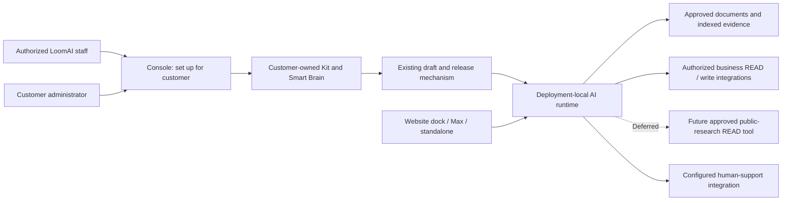

# 010.63 Assisted Customer Setup, AI Behaviour And Dealership Optimization

## 1. Decision Summary

- Date: 2026-11-06.
- Status: **Section 4 is approved for full implementation**, including complete removal of closer rewriting. Other recommendations remain proposals except the previously approved simpler customer-owned setup/access workflow for item 1. Public web search and similar audit findings are deferred. Source/live evidence is tracked in the [execution record](010_63_ASSISTED_CUSTOMER_SETUP_IMPLEMENTATION_RECORD.md).
- Scope: assisted customer setup and handover, configurable answer behaviour, contextual next suggestions, and a richer dealership experience. External research is a deferred future option, not an active delivery item.
- Baseline: Platform source `e82515ff0af3188a40213abb3c6cb31129dcf498`, including the existing local worktree; its framework dependency is `0.8.45`. Framework contracts were inspected from the immutable `ai-fabric-framework-v0.8.45` tag, not the older, dirty sibling checkout.
- Evidence: source analysis, not a new live quality run or confirmation of every hosted customer's effective configuration.

**Recommendation 1: create for the customer, then hand over access.** Staff can already create individual resources for a selected customer. A second login can belong to that customer. However, the complete Kit creation flow is customer-only, and there is no complete live cross-customer transfer workflow. Add an audited staff-assisted entry into the existing Kit orchestrator; do not start with a transfer engine.

**Recommendation 2: separate conversation tone and answer breadth.** Expose named presets with their generated prompt/configuration details in Advanced, using the existing editable draft and release path. Answer breadth is permission to offer general advice and inference, not provider sampling temperature or internet access. Public research waits until these optimizations have measured results.

**Recommendation 3: connect existing next-step recommendations before generating more.** The runtime exposes sanitized `suggestions`, but the widget's canonical adapter drops them. The separate attachment-suggestions endpoint has different context, prompting and fallback behaviour. Repair the primary response path first and make suggestion origins honest.

**Recommendation 4: improve evidence and the buying journey before adding more write actions.** Reuse the existing inventory, detail, comparison, attachments, policy evidence, enquiry and human-support components. Fill authoritative data gaps, activate one consistent policy set, and make the next useful step obvious. Never turn a request receipt into a claimed booking.

These are generic Platform and Engage improvements with dealership-specific configuration/rendering in its experience pack. They do not require a new customer business database, another deployment lifecycle or an automatic framework release.

## 2. Product And Engineering Constraints

The governing rules remain [Platform operating context](../../../../../../../../Final_Documentation/Development_Guides/LLM-guides/PLATFORM_LLM_SESSION_OPERATING_CONTEXT.md), [Platform philosophy](../../../../../../../../Final_Documentation/Development_Guides/LLM-guides/AI_FABRIC_PLATFORM_PRODUCT_PHILOSOPHY.md) and [framework philosophy](../../../../../../../../Final_Documentation/Development_Guides/LLM-guides/AI_FABRIC_FRAMEWORK_PHILOSOPHY.md).

- Meaning, relevance, source selection and next-step reasoning remain LLM-driven. No keyword/regex routing, lexical replacement decisions or forced search-all on a miss.
- Tenant ownership, identity, permissions, external execution, required confirmation, network destinations and configured spending bounds remain hard boundaries.
- An imperfect optional recommendation or tone mismatch is a quality issue, not a reason to reject an otherwise useful authorized answer.
- Any recovery must be named, configured, bounded and visible. Fixed prompts must not masquerade as successful AI recommendations.
- Templates supply adjustable starting settings. Use the existing draft -> publish -> apply -> verify path; preserve reset-to-original-template behaviour.
- UI uses **Smart Brain** through the existing terminology constant. Backend ownership, IDs and APIs remain deployment-based. This is not a rename of the `SMART_BRAIN` event-driven behaviour.
- Preserve website dock, Max workspace, standalone Engage, anonymous/private authentication, page attachments across navigation, confirmations and Desk handover.
- Do not automatically migrate existing installations to a new style, prompt, model or source policy.

## 3. Admin Builds For A Customer And Hands It Over

Implementation note: the baseline/missing-item analysis below predates the
approved simplified workflow. The [execution record](010_63_ASSISTED_CUSTOMER_SETUP_IMPLEMENTATION_RECORD.md)
is authoritative for completed source and verification. The follow-up adds
customer-controlled staff operator grants; it does not implement the broader
invitation engine or cross-customer transfer described as future options here.

### 3.1 What works today

Customer ownership and the login that created a resource are different concepts. Deployments, consumers and Engage installations carry customer ownership. The customer account is the isolation boundary; it is not an employee's personal collection of resources.

Staff UI already supports selecting a customer when creating deployments and Engage installations. Deployment assignment roles also exist for scoped staff access. Separately, a consumer assignment connects an Engage app to a deployment/release/target: it is not permission for a person to administer the customer's products.

Another `CUSTOMER_ADMIN` login with the same `customerId` inherits customer-wide deployment administration. This is sufficient for a simple company handover, but is **not** a selected-app-only permission. `PlatformUserEntity` currently has one `customerId`; one login spanning multiple customer workspaces is not a completed membership model.

Source: [deployment access](../../../../../../../../Platfrom/backend/src/main/java/com/ai/fabric/platform/backend/deployment/service/DeploymentAccessService.java), [user entity](../../../../../../../../Platfrom/backend/src/main/java/com/ai/fabric/platform/backend/security/entity/PlatformUserEntity.java), [assignment service](../../../../../../../../Platfrom/backend/src/main/java/com/ai/fabric/platform/backend/deployment/service/DeploymentAssignmentService.java), [consumer assignment](../../../../../../../../Platfrom/backend/src/main/java/com/ai/fabric/platform/backend/tenant/service/PlatformCustomerConsumerService.java).

### 3.2 What is missing

- **Whole-Kit staff creation:** `ExperienceKitService.create()` derives its owner from `requireCustomerActor()`. Staff component creation does not automatically create a complete customer Kit record.
- **A coherent invite and acceptance journey:** current user administration is not a complete secure customer invitation/handover product.
- **Live transfer between different customers:** deployment rebinding has publication/release/consumer guards. Same-customer tenant migration and import-as-new-deployment are not a whole-stack ownership transfer.
- **True self-exclusion for a global admin:** removing a deployment assignment does not remove `PLATFORM_ADMIN` authority. Self-demotion/disable and last-admin protections must also be respected.

Source: [Kit service](../../../../../../../../Platfrom/backend/src/main/java/com/ai/fabric/platform/backend/experiencekit/ExperienceKitService.java), [deployment service](../../../../../../../../Platfrom/backend/src/main/java/com/ai/fabric/platform/backend/deployment/service/DeploymentService.java), [tenant migration](../../../../../../../../Platfrom/backend/src/main/java/com/ai/fabric/platform/backend/deployment/service/DeploymentTenantMigrationService.java), [user administration](../../../../../../../../Platfrom/backend/src/main/java/com/ai/fabric/platform/backend/security/service/PlatformUserAdminService.java).

### 3.3 Recommended workflow

1. Staff selects or creates the **intended customer workspace first**.
2. **Set up for customer** selects a Kit and uses its existing creation, configuration, infrastructure, release and Engage services under that explicit customer scope.
3. Staff configures the customer's connections, documents, branding, staging and production using normal editors. Existing customer resource limits still apply.
4. **Invite customer administrator** sends an expiring invitation through the existing identity provider. The recipient signs in or registers and explicitly accepts the target workspace. No password sharing or automatic same-email identity linking.
5. The recipient opens the Kit, Smart Brain, Engage app, knowledge, connections and Desk links with their own session. Handover is not complete until this independent access works.
6. Staff chooses **Keep LoomAI support access** or **Remove temporary delegated access**. Explain the scope being retained/removed. Global Platform administration is separate and must not be described as revoked by this switch.

Do not implement this by impersonating a customer principal or accepting `customerId` from an untrusted browser without staff authorization. Refactor the existing orchestrator to accept an explicitly authorized target customer while retaining the actual actor for auditing. Its bootstrap, target, connection and installation calls must all use that same validated customer, not whichever customer is attached to the staff login.

The operation audit should identify actor, target customer, created resource IDs, invited recipient, acceptance and access changes. Reuse existing operation keys and activity/audit services rather than creating another workflow engine.

### 3.4 Retain or remove access

- **Retain:** use existing supported staff deployment roles, plus explicitly authorized access to the other resources required for support. A deployment assignment alone does not grant all Kit, Engage or Desk permissions.
- **Remove:** revoke the applicable temporary delegation and sessions as appropriate, without touching runtime service credentials, app assignment or the customer's infrastructure.
- **Global admin:** disclose its administrative authority. Genuine exclusion requires changing the person's global role using a separately authorized administrator, not a misleading unassign checkbox.
- **Different existing customer:** do not update `customerId` with SQL. Initially recreate/import reviewed configuration under the destination customer, rebind its own secrets/storage and verify before any explicit app switch. A future identity-preserving transfer needs its own asset/secret/Desk/domain review.
- **Existing login in another customer:** do not silently move it. Multi-workspace membership or an intentionally separate login is a separate product decision.

**Verdict:** feasible and worth implementing. Same-workspace handover should be the first release. Cross-customer live transfer is unnecessary for the normal integration-team setup journey.

### 3.5 Approved customer-controlled collaboration

The customer can grant/revoke an existing active LoomAI operator email from
Account & team. Grants cover that workspace's product setup/configuration and
existing permitted release operations. They do not promote staff roles or grant
customer-user/global administration. Staff use their own session and scoped
editors; no customer impersonation or ownership transfer occurs.

Revocation is a live authorization denial for subsequent requests, including
older deployment assignments for that same operator/workspace. It does not
invalidate the staff member's global login, stop already-executing work, roll
back saved changes, or disable customer services. Global administrator/machine
authority remains separate. Grant/audit records live in the existing Platform
database; there is no new service or customer database.

## 4. Configure How The AI Replies And Uses Outside Information

### 4.1 Owner decisions and implementation boundary

Final-review revision, 2026-11-07:

- Customers choose predefined **Conversation tone** and **Answer breadth** profiles. Their generated prompt/configuration details belong in **Advanced**, not the first-step form.
- "Temperature" in the original request meant answer breadth: how widely the assistant may advise beyond supplied business evidence. Do not map it to a provider sampling parameter or call it a hallucination allowance.
- The model remains responsible for semantic decisions. Presets guide it through prompts and declared configuration, never keyword/phrase matching, output-text scoring or hard validators policing the meaning of every sentence.
- Remove generic-closer phrase rewriting entirely, including its property and UI/configuration option. Do not disable PII/security sanitization. Other evidenced semantic-rewriting defects remain deferred.
- **Defer public web search** until the other optimizations are measured. No search-provider connection, crawler, external network capability or web-search control is included in this implementation.

The owner approved all section 4 profile work and full closer removal. Record source, focused verification and actual live adoption separately; approval is not proof of deployment.

### 4.2 Customer journey and editor placement

Place **AI Behaviour** beside the existing behaviour/configuration editor under a Kit's Smart Brain. Reuse the same component and draft for customers and authorized staff. This does not replace deployment behaviour types, activation sources, specialist plans or their existing editors.

The normal customer view contains:

- **Conversation tone:** a named preset with a short business-facing description and example.
- **Answer breadth:** Grounded, Advisory or Exploratory, with a clear explanation of what changes.
- **Answer length:** Brief, Balanced or Detailed; a separate presentation preference.
- **Next steps:** Off or Contextual, implemented with the response/suggestions work in section 5 rather than generic closing text.
- **Try a conversation:** existing supported preview, accurately distinguishing live settings from draft-only prompt overlays.
- **Advanced:** collapsed prompt/configuration details, custom brand guidance and supported technical settings.

All Engage channels connected to that Brain inherit its answer policy. Engage continues to own branding, layout, display format and channel/tool visibility. Do not create independent tone copies for website, Max and standalone channels.

### 4.3 Conversation tone presets

Initial presets are domain-neutral and independently combinable with answer breadth:

- **Professional:** clear, composed, respectful; direct answers without unnecessary formality.
- **Warm:** approachable and reassuring; conversational language without exaggerated familiarity or unsupported reassurance.
- **Consultative:** explain useful trade-offs and ask relevant questions to help the customer decide; do not force a question after every answer.
- **Technical:** precise terminology and structured explanations suited to experienced users; explain assumptions and avoid invented technical facts.

Tone changes wording and organization, not evidence authority, available actions, confirmation, tenant access or spending limits. None of these profiles requires a particular sentence ending or deterministic replacement of the model's wording.

### 4.4 Answer breadth presets

**Grounded** is the conservative business default. Answer customer/business questions using approved documents and authorized live business actions. Explain the supported part and what is missing. This still uses the model's language and reasoning abilities; it does not claim to remove pretrained knowledge.

**Advisory** also permits general knowledge, reasonable inference and practical recommendations beyond supplied documents. Clearly distinguish general advice or inference from verified business facts when that distinction matters. For example, explain typical electric-car motorway considerations without requiring a dealership document to contain the whole explanation.

**Exploratory** permits wider comparisons, alternatives, brainstorming and clearly identified assumptions, including options outside the currently indexed catalogue where appropriate. The model should explain when an option is general guidance rather than something the business supplies. It must not claim current web research, current external prices or verified availability without a real supporting integration.

Common rules across all three:

- Business-specific prices, stock, availability, policies, commitments and action outcomes still need approved business evidence. Wider advice cannot invent or overwrite these facts.
- No automatic web access or hidden source expansion. The LLM chooses authorized sources/actions within the existing published orchestration policy; existing recovery requires its named allow-policy.
- A failed stock/policy lookup remains visible. General guidance may accompany the limitation, but must not masquerade as a successful lookup.
- No semantic phrase filters or mandatory citation requirement for every general explanatory sentence. Evaluate quality with representative conversations, accepting measured model imperfection.
- Missing optional knowledge does not automatically reject a useful answer. Do not ask customers to choose internal vector-space or knowledge-domain names.
- Authorization, trusted identifiers, required action fields, confirmation and budgets remain hard boundaries. Answer breadth does not modify them.

The real provider **generation temperature** remains a separate model-compatible advanced option. Selecting an answer-breadth preset does not change it, the orchestration temperature or the model unless the user explicitly edits those settings.

### 4.5 Presets update the same editable configuration

The shared [Prompts editor](../../../../../../../../Platfrom/ui/src/pages/PromptsPage.tsx) already owns `systemPrompt`, `intentExtractionPrompt`, `actionSelectionPrompt`, `clarificationPrompt`, `answerGenerationPrompt`, `retrievalPrompt` and `assistantUiPrompt`. The [Providers editor](../../../../../../../../Platfrom/ui/src/pages/ProvidersPage.tsx) owns provider generation parameters. Reuse these draft sections and the current publish/apply path.

1. Selecting a preset shows its effect and updates its owned prompt/configuration fragment in the editor buffer. It does not immediately save or change a live app.
2. Persist stable preset IDs/revisions and their expanded configuration in the same deployment version, so reopening the editor preserves the chosen profiles and published releases are reproducible.
3. Preserve unrelated custom prompts, action/schema guidance, compound-retrieval instructions, integrations and credentials. Show a diff before replacing an already-customized profile-owned fragment; never overwrite the whole prompt document just to change tone.
4. Direct advanced edits make the affected profile **Custom**. Detect this from exact configuration identity/provenance, not by interpreting prompt wording. Reapplying/resetting a preset is explicit.
5. Resolve curated prompt conflicts at composition time. In particular, reconcile "use only supplied evidence" instructions with Advisory/Exploratory rather than appending contradictory instructions and hoping one wins. Keep policy/trust instructions distinct from style guidance.
6. Save -> validate -> publish -> apply uses the existing versioning mechanism. Templates may supply initial choices; they do not lock future customer changes or force upgrades of existing deployments.
7. Preview must accurately show which parts it can simulate. Prompt-only POC overlays cannot claim to preview provider options or post-processing that require a runtime apply. No hidden production edits to make a preview look successful.

Use small meaningful profiles, not a second independent prompt store, duplicate behaviour engine or opaque numerical "creativity" slider. A profile remains a starting point that the customer can customize.

### 4.6 Immediate correction: remove generic-closer rewriting entirely

AI Fabric `0.8.45` defaults `removeGenericAssistanceClosers` to true and uses sentence/paragraph phrase lists in `ResponseSanitizer.applyAnswerHygiene`. This is semantic rewriting, not a security control, and can remove useful advice or next steps. The previous suggestion to treat its default-enabled behavior as normal tone tuning was incorrect.

Required correction:

- Remove `applyAnswerHygiene`, its closer-specific sentence/paragraph matching helpers, both phrase lists and `ai.response-sanitization.remove-generic-assistance-closers`. No replacement phrase matcher or opt-in option.
- No `promptConfig.removeGenericAssistanceClosers`, Console toggle or generated runtime property remains in the final implementation. The owner requested replacing the two superseded default-off commits, not retaining their switch.
- Preserve the existing sanitizer, PII detection/redaction, safe projections and identity/action boundaries. Never switch the whole sanitizer off to change conversational style.
- Tone and next-step prompts guide wording; no server-side stylistic rewriting is permitted. Preserve model-authored ordinary/compound/suggestion text while still redacting protected data.
- Use focused tests and an immutable framework patch release; consume released artifacts in product builds. Remove the temporary false overrides from serving applications only after upgrading their runtime library.
- Similar audit findings in section 4.9 are tracked but deferred, not part of this fix. Formal parsing, exact IDs, configuration provenance, security detectors and presentation-only labels are not semantic violations.

At analysis time, the published `0.8.45` library defaulted the old mechanism on. Removing only the Platform override before upgrading would reactivate it. Adopt the removal release first, then remove the obsolete runtime entry; never switch off the whole sanitizer as a shortcut.

**Implemented 2026-11-07:** framework `0.8.46` removes the matcher and property;
all six managed runtime environments adopted it before the obsolete environment
records and process values were removed. Section 4's shared profiles, Advanced
editor, normal publication and hosted checks are complete. See the
[execution record](010_63_ASSISTED_CUSTOMER_SETUP_IMPLEMENTATION_RECORD.md) and
[customer guide](../../../../../../../../Final_Documentation/External_User_Guides/LOOMAI_AI_BEHAVIOUR_GUIDE.md).
The four findings in 4.9 and public research remain deferred.

### 4.7 Public research is deferred

No public-search tool or search provider will be implemented in this scope. General model knowledge and an actual internet lookup are different capabilities. Neither Advisory nor Exploratory can claim to have searched the web.

Revisit only after tone, answer breadth, current-source handling and next-step improvements have measured results. A future design may reuse an authorized READ Action plugin or a provider-hosted search capability, with provenance, credentials and execution bounds. Do not add a standalone Python bridge or new plugin type now.

### 4.8 Acceptance and implementation order

1. Remove the closer matcher/property, qualify the bounded framework change and adopt its published release. Leave other findings deferred.
2. Implement the approved profiles in the existing shared draft/editor and advanced view.
3. Verify selection, Custom/reset, save/reopen, versioned release, same-Brain channel consistency and prevention of unrelated prompt loss.
4. Compare the same multi-turn questions across profiles, including missing evidence, compound stock/policy questions, useful general advice, action confirmation and human handover. No lexical quality gates or guaranteed model-perfect pass claims.
5. Retain default measured settings in the appropriate template only after qualification. Existing deployments change only through explicit normal configuration updates.

**Verdict:** named tone and answer-breadth presets are the product controls. Prompt/configuration details stay advanced. Phrase-based closer rewriting is removed, not retained as an option. Public research waits for evidence from these optimizations.

### 4.9 Similar defects raised for owner review; not fixed here

Read-only source audit, also checked against the immutable `0.8.45` tag where noted. These are source findings, not a claim that live failure injection reproduced them:

- **Widget overwrites the model's narrative:** [useChatFlow.ts](../../../../../../../../max-mode-widget/src/hooks/useChatFlow.ts) automatically prefers [summarizeShopifyMcpCatalogResult](../../../../../../../../max-mode-widget/src/shopifyMcpResults.ts) when a product-shaped payload exists, even if a backend answer was supplied. It can discard qualifications/comparison/uncertainty. Structured product rendering is fine; substituting the main answer without an explicit presentation choice is the issue. Recommend preserving the authored answer and keeping the product count/list in the existing result presentation.
- **READ evidence substituted after generation failure:** `InformationGenerationResponseSupport.fromReadActionEvidence` can return raw evidence text as a successful answer instead of surfacing generation failure. The `0.8.45` tag protects exceptions when conversation history exists, but its no-history path still permits this substitution. Recommend separating successful evidence retrieval from failed answer generation, or using a named explicit recovery policy with visible outcome, not generic success.
- **Deterministic post-action answer fallback and lexical message suppression:** `PostActionGenerationSupport` uses deterministic facts/counts after failed/empty forced READ generation and filters message strings such as "ok"/"success". Present in `0.8.45`. Diagnostics do disclose `deterministicFallbackUsed`; this is not wholly hidden. Forced generation is not itself explicit permission for an alternate answer. Recommend separately authorized recovery and a truthful structured result presentation without replacing the LLM answer or hiding the generation failure.
- **Static no-context response masks provider failure:** `RagResponseGenerationSupport` can turn failed empty-context generation into a fixed limitation response that the RAG result treats as successful. In `0.8.45`, history-bearing exception paths are protected; no-history failures can still take this path. Recommend an explicit generation outcome and preserving any usable retrieved data, not pretending the static text was a generated answer.

The runtime/widget fixed suggestions after generation failure are already recorded in section 5 and are not new findings. Relationship-module behavior remains deferred. No other framework/router/widget correction is authorized by the closer-default fix; obtain review before changing these paths.

## 5. Make Next Suggestions Useful And Trustworthy

### 5.1 Three existing mechanisms must not be confused

**Authored starter queries and tool buttons** come from experience-pack configuration. They are useful shortcuts, not dynamically inferred next steps. The current panel can label these "AI Suggestions", which obscures their origin.

**Same-turn next-step recommendations** exist in the framework response. The sanitizer projects `NextStepRecommendation` fields such as `intent`, `query`, `rationale` and `confidence` into canonical `suggestions`; the runtime exposes them. `canonicalChatResult()` currently does not translate them to the widget's existing next-step representation. Wiring this is the first concrete fix.

Same-turn does not necessarily mean generated after observing the final answer. Current handling can copy `intent.nextStepRecommended`, selected during intent extraction before fresh READ results arrive. Exposing it fixes a transport gap, not every relevance problem. Measure that distinction before promising result-aware recommendations; a bounded, explicitly requested refresh can use the final authorized turn when needed.

**Independent attachment suggestions** call `/api/chat/me/suggestions` after a ten-second timer. They use a separate generation prompt, explicit temperature `0.4` and token limit `300`, with no server-loaded conversation history. This is not equivalent to the query pipeline's `smartSuggestionsEnabled`, which controls a separate framework enrichment step. In the inspected default curated executor mode, that enrichment is disabled.

Source: [canonical widget adapter](../../../../../../../../max-mode-widget/src/chatResult.ts), [suggestions hook](../../../../../../../../max-mode-widget/src/hooks/useSuggestionsController.ts), [runtime query and suggestions routes](../../../../../../../../ai-infrastructure-module/ai-fabric-runtime/src/main/java/com/ai/fabric/runtime/web/ChatRuntimeController.java), [framework sanitizer](https://github.com/Loom-AI-Labs/ai-fabric-framework/blob/ai-fabric-framework-v0.8.45/ai-infrastructure-module/ai-fabric-core/src/main/java/ai/fabric/security/ResponseSanitizer.java).

### 5.2 Specific weaknesses to correct

- The main response adapter drops useful sanitized recommendations. Do not recover them by reading the raw framework `result` object.
- The independent endpoint builds its action catalogue from registry metadata rather than a demonstrated caller-filtered public capability view. It can advertise an unavailable/internal action even though clicking it does not itself authorize execution.
- In non-budget-bound paths the endpoint can replace unavailable/invalid AI suggestions with fixed strings and return success. The widget also substitutes generic strings on request failure. Neither should appear as a successful model recommendation.
- The hook cancels a timer, not an already running response. Results can arrive after attachments, identity or conversation state changed.
- Attachment-triggered requests can spend provider allowance while the tray is closed. The dock does not need a large suggestion panel.
- The independent endpoint ignores normal managed answer-prompt overlays and has its own generation settings. Tuning the main deployment alone does not reliably tune this path.

These are source findings to address, not a claim that a fresh live session reproduced every case.

### 5.3 Recommended response-first design

1. Preserve sanitized canonical next steps through runtime -> adapter -> message UI. Reuse existing message-level next-step components. Start with the existing public shape rather than a new recommendation service.
2. Show up to two or three relevant choices after a successful AI answer. Zero recommendations is valid; do not demand exactly four or pad with generic text.
3. Give the LLM the current request, authorized conversation evidence, selected items, effective source policy and eligible public capability catalogue. Encourage a useful refinement, an explanation/policy step or a genuine next business step when appropriate; these are guidance, not hard-coded category quotas.
4. Label **Try asking** for authored starters and **Suggested next steps** for model recommendations. If configured authored alternatives are shown after an outage, retain their authored origin and the unavailable status; otherwise omit optional suggestions without discarding the answer.
5. Clicking a suggestion submits a normal query or opens an explicitly configured UI control. It must not call a write receiver directly or imply confirmation has already occurred.
6. Bind asynchronous results to conversation/auth/context revisions. Abort or ignore stale work; clear stale choices on logout, identity change and human takeover. Do not cancel the user's active action draft merely because a suggestion refreshed.
7. Optional **More ideas** can request a fresh bounded suggestion using server-authorized conversation context, but only when requested/visible. Remove hidden recurring generation as the default.

For normal next-step hints, extra RAG enrichment is not automatically necessary. First measure what same-turn recommendations provide. Enable/qualify `smartSuggestionsEnabled` separately only when its extra evidence improves relevance enough to justify cost and latency.

During pending confirmation, show the real confirm/edit/cancel flow instead of competing suggestions. During human control, do not introduce model-generated next moves into the agent's conversation. Preserve existing generic handover and authentication UI.

A richer typed suggestion can later include a public capability ID and trusted selection reference. Treat it as a hint, never a grant. Display it only where the capability is available or explicitly requires sign-in, and recheck authority on use. Do not gate an otherwise safe answer on suggestion confidence or invent a lexical relevance filter.

### 5.4 Examples of useful dealership next steps

- After a stock shortlist: compare selected options, explain suitability for a stated use, or check an approved delivery policy.
- After a comparison: inspect a supported differentiator, view current details for one option, or request a test drive where the action exists.
- After a policy answer: explain the relevant requirement or connect it to the selected vehicle only when policy applicability is known.
- After an enquiry receipt: show the request reference/status if a real status API exists, or offer the configured human-support path. Do not suggest "confirm booking" when only an enquiry was created.

These are illustrative model-guidance examples. They must not become query-term rules that choose the next action in application code.

**Verdict:** high-value, bounded work. Fix the canonical mapping, context freshness and origin handling before building a more elaborate recommendation system.

### 5.5 Approved focused implementation, 9 November 2026

The owner approved suggestions #1 and #2 as one response-first workstream.
Canonical transport was already delivered; final-result relevance remains the
actual backend change, not another widget adapter.

- Reuse the released framework `PipelineStep` extension inside the deployment
  runtime. When the existing managed Next steps profile is enabled, one bounded
  generation pass uses the completed answer and authorized result context to
  select up to two recommendations. This adds a model call within the main
  query, not another browser request or an extra retrieval pass. Off makes no
  additional call. No framework modification/release is needed for this path.
- This explicit result-aware policy replaces provisional extraction-time hints.
  Empty output is valid. Optional suggestion failure leaves the answer intact,
  with an empty list and diagnostic outcome, never fabricated alternatives or
  restoration of provisional hints. Spending/control interruptions retain their
  existing hard boundary.
- Remove automatic attachment suggestion generation from the widget entirely.
  Configured composer starters are labelled `Try asking`; generated message
  choices are `Suggested next steps`. Only the latest completed AI turn shows
  those controls, not earlier turns, loading states or human-controlled chats.
- The independent authenticated attachment-ideas API may remain for deliberate
  external callers. It must not expose the global action catalogue, pad output,
  turn provider failure into successful fixed suggestions, or return raw model
  output. It is not the source of executable conversation next steps.
- Verification is scoped to runtime contracts, widget lifecycle and live
  suggestion quality. No provider/model change, source-routing repair, template
  default rollout or other deferred semantic audit fix is part of this work.

Execution/evidence: [suggestion reliability record](../../../../../../../../verification-support/ai-behaviour-01063/2026-11-09-suggestion-reliability.md).

## 6. A Richer Dealership Experience

### 6.1 Reuse what is already built

The dealership pack already supplies configurable Browse/Current context tool groups, vehicle cards/detail/comparison presentations, selection, attachment/context hooks and enquiry presentations. The generic widget already supports tool rails, action renderers and handover. The recent style implementation preserves **Current** and adds twelve opt-in designs across dock, Max and standalone modes, including expandable technical metadata and optional long-answer collapse.

Do not rebuild these as a dealership-only chat application. See [010.29 injectable UI](010_29_GENERIC_MAX_MODE_INJECTABLE_ACTION_UI_AND_DEALERSHIP_EXPERIENCE_PLAN.md) and [010.61 implementation](010_61_ENGAGE_STYLE_IMPLEMENTATION_RECORD.md).

Source: [dealership tool groups](../../../../../../../../experience-packs/dealership-experience/src/tool-groups.ts), [tool rail](../../../../../../../../experience-packs/dealership-experience/src/tool-rail.ts), [action presentations](../../../../../../../../experience-packs/dealership-experience/src/action-presentations.ts).

### 6.2 Data improvements come before more promises

**Inventory parity:** the demo website's `Vehicle` model has richer fields, including range, seats and location, than several simulator-synced/indexed/read projections. Existing renderers correctly show missing values as Unknown/Not supplied. Audit the full chain from authorized provider payload -> data plugin -> index -> READ response -> trusted target -> presentation. Populate only fields the provider actually supplies, including official image references and freshness.

Do not patch the AI's facts from the independent website's seeded inventory. The AI integration must remain demonstrably driven by the Auto Trader simulator or authorized external dealership system. A missing feature is not evidence that the vehicle lacks it.

**Useful optional fields:** manufacturer features, range with its stated test basis, seats, boot capacity, branch/location and availability timestamps. Add fields only when the official source or an approved additional integration provides them. Remove/defer unsupported starters such as a specific luggage-space comparison when there is no trustworthy supporting data.

**Policies:** choose one approved active fixture/customer policy set with effective dates and provenance. The repository contains older six-document examples and a newer three-document customer-storage pack with conflicting details, including 45-minute versus 30-minute test drives. Their presence does not prove both are active or that either richer pack is deployed. Inspect live registrations/content before changing anything. Replace/activate sources with the existing indexing lifecycle and retire superseded sources; do not index both sets or copy vectors during promotion.

**Knowledge coverage:** provide approved delivery, warranty/aftercare, test-drive requirements, deposits/reservation terms where applicable, opening/location/accessibility and human-contact expectations. A document category should be offered only when approved content exists. Indexing more text is not a substitute for identifying the correct current policy.

Source: [demo website model](../../../../../../../../product-demos/autotrader-dealership-demo/backend/src/main/java/com/loomai/demo/dealership/inventory/Vehicle.java), [current storage fixture guidance](../../../../../../../../product-demos/autotrader-dealership-demo/backend/deployment/customer-storage-policy-pack/README.md), [older fixture guidance](../../../../../../../../product-demos/autotrader-dealership-demo/backend/deployment/document-sources/README.md).

**9 November 2026 implementation:** inventory evidence now reaches indexing,
READ results, trusted targets and the dealership renderer through new immutable
plugin/template revisions. Qualified on Northfield staging and production,
including a real RAG query with zero actions. Optional facts remain optional;
range test basis is unknown, and location is advertiser town rather than precise
branch tracking. No website-seed enrichment, framework release, semantic text
matching or prompt/profile change. One production follow-up still borrowed a
location from another vehicle despite correct source data; retained as an open
model-quality limitation. Policy audit found only three short active originals,
not duplicate fixture sets. The richer replacement pack remains pending scoped
S3 upload access and indexing qualification. See the
[execution and verification record](../../../../../../../../verification-support/ai-behaviour-01063/2026-11-09-dealership-evidence-completeness.md).

### 6.3 Proposed layout and journey

**Website dock:** keep a compact branded input, attachment indicators and minimize/open controls. No large tool rows consuming the conversation area. A useful response can open Max deliberately; adding a page attachment must not force it open.

**Max and standalone:** keep conversation central, Browse and This vehicle always accessible, and a compact context shelf showing the selected vehicle(s)/page(s). Removing a final attachment returns to Browse unless the detail page itself still supplies context. Navigation preserves chat and attachments.

**Results:** concise explanation plus the existing structured inventory/detail/comparison renderer. Make price, current availability, source freshness and meaningful differences easy to scan. Keep full model text and technical evidence inspectable without showing raw provider JSON as the main result. Never collapse a confirmation, uncertainty, error or human reply out of view.

**Policy access:** provide configured shortcuts for available policies or let the model answer compound stock-and-policy questions. Sources is an evidence view, not automatically a complete policy library. Add a policy-browser UI only if a real list/open contract is required and authorized; do not label retrieved excerpts as the whole knowledge base.

**Action states:** distinguish collecting details, ready for review, awaiting confirmation, submitted, failed/uncertain and cancelled. Use clear request receipts, not a success colour alone. Keep sign-in at the actual protected capability boundary and human handover visible when enabled.

The generic layer owns context shelves, selection controls, suggestion display, async state and action status. The dealership pack owns car-specific labels, attributes, comparison columns, questions and renderers. No `vehicleId`, stock-system rules or dealership keyword handling enters the generic widget.

### 6.4 Which additional capabilities are worth adding

**First, improve existing actions:** current stock search, detail, comparison, test-drive request and callback request. Ensure selection resolves trusted targets and the final receipt includes the exact requested vehicle, reference and actual receiver outcome. Show absent details honestly. Enquiry actions remain capability-gated; the external read-only template must not unexpectedly gain writes.

**Next, useful READ integrations:** enquiry status for the authorized requester, branch/opening information, real appointment-slot lookup, and approved manufacturer/charging information. Each needs an actual external contract. Public general-information research is not a substitute for live appointment or customer-request state.

**Later, approved business writes:** Auto Trader Deal/lead creation or dealership CRM integration where partner permissions and receiver contracts are agreed. Reservation, confirmed booking, payment and finance quoting are separate capabilities, not wording upgrades to today's test-drive request.

All business state stays with the integrated provider/customer system. LoomAI may persist conversation/AI state and allowed integration delivery records; it must not introduce a new per-deployment inventory, CRM or booking database to make the demonstration look complete. Simulator writes remain explicitly fictional.

Source: [declared demo actions](../../../../../../../../product-demos/autotrader-dealership-demo/backend/deployment/runtime/ai-actions.yml), [external read-only template migration](../../../../../../../../Platfrom/backend/src/main/resources/db/migration/V221__client_dealership_read_only_external_template.sql).

**Verdict:** the strongest next demo is a coherent shortlist -> comparison -> policy -> enquiry -> human journey, not a larger toolbar. Fill data gaps and use the components already built before expanding external writes.

## 7. Configuration, Storage And Responsibility

- **Platform database:** customer ownership, accepted invitations/delegation, existing Kit/app/consumer records, prompt/provider/plugin draft selections and release/audit history. No new database required by this proposal.
- **Existing identity provider:** login, registration, invitation/acceptance delivery and session lifecycle. Platform remains authoritative for resource authorization.
- **Deployment-local AI state:** conversations, trusted targets and action/confirmation state under the existing contract. Optional suggestion state can remain turn/client-scoped unless history requires persistence.
- **Existing object source and vector service:** approved policy documents and derived searchable evidence. Staging/production continue indexing their selected sources independently.
- **Integration connections:** customer/provider credentials remain server-side secret bindings, including any approved research-provider key.
- **External systems:** authoritative inventory, business availability, appointments and enquiry/lead outcomes.
- **Engage:** presentation preferences, eligible controls, origin-labelled recommendations and citations. It is not the authority for ownership, source access or action execution.

The diagram is the proposed composition, not evidence that the optional research tool or staff Kit entry point already exists. Visitor AI traffic remains deployment-local, not routed through a new shared Platform chat gateway.

## 8. Recommended Delivery Order

### O1. Close existing quality and presentation gaps

Wire sanitized same-turn next steps, label starters honestly, eliminate hidden AI-success fallbacks, and prevent stale suggestion responses. Audit authoritative inventory fields and active policy sources. Reuse the existing quality runner and structured presentations. No model/provider change is necessary just to measure these gaps.

### O2. Add assisted setup and secure handover

Add the staff customer selector to the existing Kit orchestration boundary, invitation/acceptance and an explicit retain/remove support choice. Prove another account can independently manage the complete Kit. Do not implement cross-customer live transfer in this phase.

### O3. Add the simple AI Behaviour editor

Deliver named tone and Grounded/Advisory/Exploratory answer-breadth presets as specified in section 4, with prompt/configuration details in Advanced. Reuse existing length/initiative controls, managed-prompt round trips, accurate preview and release diffs. Qualify successful defaults per template before making them defaults for newly created customers. Complete closer removal is independently authorized, not contingent on shipping this whole editor.

### O4. Public research: deferred, separate approval

Do not implement now. Revisit provider selection, READ integration, citations and execution limits only after evaluating O1/O3. No current implementation or customer UI exposes web search as an available profile.

### O5. Extend business capabilities where contracts exist

Add genuinely supported status/slot/lead integrations, not placeholder buttons. Update the dealership template and pack only after the receiver and full confirmation/receipt flow are verified.

O1 and the bounded O2 access work can progress independently. Keep shared contracts and integrated verification with the main implementation stream. No new capacity, draining, recovery-service or broad framework-release project belongs in these milestones.

## 9. Acceptance And Verification

### Assisted setup

- Staff creates a complete Kit for customer A without impersonating A; every generated resource is owned by A.
- A's invited administrator accepts with their own identity and can access the Kit, Brain, Engage, knowledge and allowed Desk functions. Account B cannot enumerate or access A's resources.
- Removing delegated staff access denies subsequent requests for that workspace without revoking the staff member's unrelated login or customer service integrations/app assignment. Already-executing work may finish. The UI honestly distinguishes retained global administration.
- Duplicate setup/invite submissions are bounded/idempotent; invitation expiry/revocation is enforced. Existing admin and customer self-service creation still work.

### Behaviour; future public-research qualification deferred

- Tone and answer-breadth presets round-trip through draft, supported preview, published release and template defaults without discarding custom advanced instructions. Prompt/configuration details remain advanced.
- Compare the same representative queries under brief/warm/consultative settings. Assess usefulness manually; do not hard-reject useful answers because wording differs.
- All current breadth profiles make no public-research calls or web-check claims. Future research-specific provenance, external content and destination tests belong to deferred O4.
- Test missing stock facts, general advice, explicit assumptions and unrelated recommendations. Preserve approved business facts and visible limitations; no hidden semantic fallback.
- Confirm actual provider compatibility before sending advanced sampling-temperature options. Do not alter either provider temperature as a side effect of tone or answer breadth.

### Suggestions and dealership journey

- Canonical sanitized `suggestions` render without reading raw `result`; empty/malformed optional entries do not break the main answer. No internal catalogue or sensitive metadata is exposed.
- Starter, generated, unavailable and explicitly configured alternative states remain distinguishable. No hidden generation when unused, stale response after context/auth changes or automatic business write on render.
- Test no attachment, one vehicle, multiple vehicles, attached pages across navigation, pending confirmation/cancel, sign-in boundary and human takeover/return.
- Verify shortlist and comparison, both clause orders of stock-plus-policy questions, follow-up references, unsupported attributes, exact enquiry details, cancellation, confirmation and truthful receipt wording.
- Repeat the focused live sequence at least twice to expose model variability. Inspect actual source/action choices and outcomes, not query-term pass/fail heuristics. Record semantic misses for review; trust-boundary violations have no acceptable tolerance.
- Reuse [current workspace quality scenarios](../../../../../../../../verification-support/autotrader-dealership-demo/current-workspace-quality.scenarios.json), [quality runner](../../../../../../../../verification-support/autotrader-dealership-demo/current-workspace-quality.mjs) and [site journey checks](../../../../../../../../Platfrom/loomai-site/scripts/dealership-quality-check.mjs). Use isolated simulated write targets for enquiry tests; do not create real customer leads merely to qualify UI.
- Keep Current style available. Check dock, Max and standalone on desktop plus basic mobile navigation, with no overlapping controls or loss of conversation state.

Record effective template/version, runtime/framework, model, prompt revision, mode/position, source registrations, READ policy, action eligibility and suggestion origin for each comparison. Capture latency, provider calls and token usage. A good-looking screenshot alone is not proof of a working action or better model quality.

## 10. Scope Of Approval Requested

Approve O1-O3 as focused improvements if this direction matches the product vision. O4 needs a separate provider/source-permission choice; O5 depends on actual customer/partner APIs. No external provider spending, live mutation, new framework release or cross-customer transfer is approved just by accepting the analysis.

Expected implementation is primarily Platform, runtime-adapter, generic Engage and dealership-pack work. Existing framework APIs cover the starting design. If qualification exposes a necessary framework contract gap, document the exact reproduction and proposed bounded change for owner review before implementing/releasing it.

Related plans: [010.32 compound retrieval](010_32_COMPOUND_INFORMATION_RETRIEVAL_AND_KNOWLEDGE_SOURCE_ROUTING_CORRECTION_PLAN.md), [010.33 LLM-driven semantic decisions](010_33_LLM_DRIVEN_SEMANTIC_DECISIONS_AND_EXPLICIT_RECOVERY_POLICY_PLAN.md), [010.45 customer console](010_45_CUSTOMER_RESOURCE_CONSOLE_PROGRESSIVE_UI_PLAN.md), [010.47 adjustable template upgrades](010_47_TEMPLATE_BOOTSTRAP_AND_NORMAL_DEPLOYMENT_UPGRADES_EXECUTION.md), and [010.55 first-client readiness](010_55_PAUL_RIGBY_FIRST_DEALERSHIP_CLIENT_READINESS_AND_PILOT_PLAN.md).
