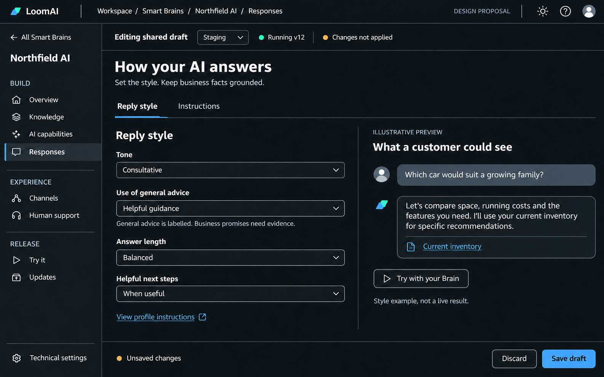
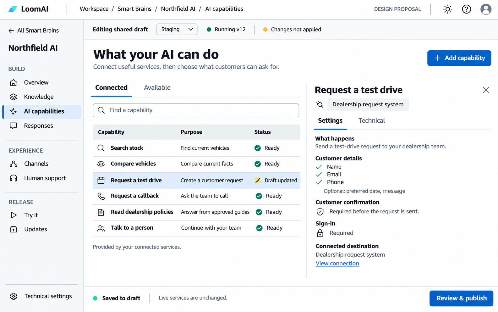
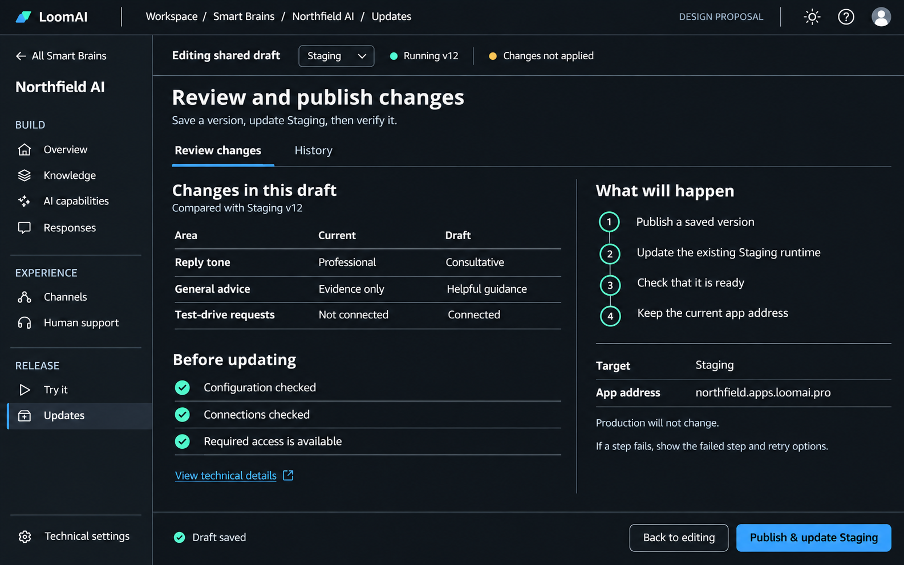

# 010.64 Smart Brain Workspace: Outcome-Led UI And Navigation Redesign

Date: 7 November 2026
Status: **Implemented, deployed to staging and production, and hosted UI verified.**
Scope: Customer-visible Smart Brain configuration and the same resource workspace for authorized staff.

Owner clarification: the existing Customer Home/resource lists, Kits, Engage editors, Support/requests, Account/team, notifications and sign-in/onboarding designs remain. Only their entry links into the Smart Brain workspace change where relevant. See [the implementation record](010_64_SMART_BRAIN_WORKSPACE_IMPLEMENTATION_RECORD.md) for verification and rollout evidence.

## 1. Recommendation

Replace the collection of configuration pages with **one Smart Brain workspace**. Organize it around what the customer wants to achieve:

- **Knowledge:** What does my AI know?
- **AI capabilities:** What can it do for my customers?
- **Responses:** How should it answer?
- **Channels:** Where will customers use it?
- **Human support:** When and how does my team help?
- **Try it:** Does the experience work?
- **Updates:** What will change when I publish?

Keep the Kit as the business-product starting point. Opening its Smart Brain enters this operational workspace; opening an Engage app enters that app's own configuration. Neither page should contain a second editable copy of the other's settings.

Use `/smart-brains/:brainId/...` as the resource-scoped UI root. `brainId` is the existing deployment ID, not a new backend entity. Keep the existing deployment, plugin, configuration, version and release APIs.

The design should feel like the Kit pages in its typography, colors, spacing and polish, but like an AWS resource console in its navigation and information density. It is a work surface, not a marketing page.

## 2. Why The Current UI Feels Confusing

The latest visual pass changed surfaces without resolving the information architecture:

- `/plugins?deploymentId=...` and `/prompts?deploymentId=...` present independent tools instead of recognizable sections of one Brain.
- The resource wrapper adds a Brain header, status chips, technical tabs and a Back button; the underlying pages can repeat resource selection, context and save controls.
- Plugins, Actions, Providers and AI behaviour describe implementation categories. They do not immediately explain which customer outcome a control affects.
- Plugin installation, connection configuration, action definition and reply settings have different save interactions. Their draft-versus-live consequences are not consistently obvious.
- Large forms and stacked advanced sections force users to scroll past unrelated settings.
- Staff and customer routes reuse several editors, but place them in different navigation structures. A staff member assisting a customer cannot rely on one consistent resource story.

**There is also a status accuracy issue, not just a design issue.** `CustomerDeploymentAdvanced` currently prefixes any nonempty `activeVersion` with `Live`. This can produce the screenshot's `Live draft`. The redesign must derive applied version and runtime status from authoritative target state, not infer them from a string being present.

## 3. Visual Layouts

These three images are the original generated design proposals using fictional Northfield example data, not implementation screenshots. Current local screenshots are linked in the implementation record. Both light and dark mode are required. The pictures illustrate hierarchy and composition; the interaction and truthfulness rules below take precedence over illustrative status text.

### 3.1 Responses: One Task, Immediate Visual Understanding



The customer sees the result they are shaping before seeing prompt syntax. The style example is explicitly illustrative. A real test is a separate, intentional action.

### 3.2 AI Capabilities: List And Contextual Detail



One list answers what the AI can do. Selecting a row opens its settings in the same viewport. Technical implementation details remain available without dominating the page. Dealership labels come from the installed integration metadata, not from hardcoded generic UI logic.

### 3.3 Updates: A Clear End To The Configuration Story



The customer sees what changes, which environment is affected, and which steps will run. The production interface shows actual progress or failures; the image's instructional failure annotation is not production copy.

Design assets and the reusable image-generation brief are in [the design directory](designs/010_64_smart_brain_workspace/README.md).

## 4. One Navigation System

### 4.1 Workspace And Resource Levels

At workspace level, retain concise access to **Kits**, **Smart Brains**, **Engage apps**, **Support** and **Account**. Existing staff-wide administration remains outside the Brain workspace.

Inside a Brain, replace the workspace sidebar with the resource sidebar. Do not show a full global rail, a second Brain rail and the old horizontal editor tabs together.

The resource frame contains:

- A slim utility bar: Console identity/home, breadcrumb, theme, help and account.
- A sidebar: Back to all Smart Brains, Brain name, outcome sections and Technical settings.
- One context strip: `Editing shared draft`, selected target, applied version/runtime state and unapplied-change state.
- One task title and the current task content.
- One fixed task footer with the appropriate save or publish command.

The LoomAI brand link must retain the established route back to `loomai.pro`. A separate Console breadcrumb/home control returns to workspace resources.

Recommended sidebar grouping:

```text
All Smart Brains
Northfield AI

BUILD
  Overview
  Knowledge
  AI capabilities
  Responses

EXPERIENCE
  Channels
  Human support

RELEASE
  Try it
  Updates

Technical settings
```

Do not add another `Configuration` tab before showing these sections. The resource workspace is the configuration context. Its sidebar stays in the same order as the customer progresses; Overview highlights the next useful step instead of introducing a separate wizard.

### 4.2 Canonical Route Hierarchy

```text
/kits
/kits/:kitId
/smart-brains
/smart-brains/:brainId                         Overview
/smart-brains/:brainId/knowledge               Sources and documents
/smart-brains/:brainId/knowledge/sources/:sourceId
/smart-brains/:brainId/capabilities            Connected / Available
/smart-brains/:brainId/capabilities/add
/smart-brains/:brainId/capabilities/:capabilityKey
/smart-brains/:brainId/responses               Reply style
/smart-brains/:brainId/responses/instructions
/smart-brains/:brainId/responses/advanced
/smart-brains/:brainId/channels
/smart-brains/:brainId/human-support
/smart-brains/:brainId/try
/smart-brains/:brainId/updates                  Review changes / History
/smart-brains/:brainId/updates/:releaseId
/smart-brains/:brainId/settings                Technical settings index
/smart-brains/:brainId/settings/models
/smart-brains/:brainId/settings/storage
/smart-brains/:brainId/settings/access
/smart-brains/:brainId/settings/delivery
/smart-brains/:brainId/settings/technical-files
```

An Engage app remains an independent resource. A resource-scoped app route such as `/engage/apps/:appId` can wrap the existing app editor; it must not create another app record or make an embedded-only installation require a standalone address.

Use an actual stable capability/install/action identity for `capabilityKey`. A renamed display label must not break a deep link. Where one plugin contributes several capabilities, each detail route must resolve to the same backing installation and its relevant action/source, not create duplicate installations.

### 4.3 Environment Is Context, Not A Second Brain

Example:

```text
/smart-brains/dep-fb1094af/responses?targetProfileId=dtp-example
```

- Resolve the authorized Brain from the path. Do not let a stale globally selected Brain override it.
- Preserve the exact target profile ID when moving between sections, refreshing or opening a deep link. Display Staging or Production as the customer label.
- Do not infer a target from a profile's display name. If several authorized targets need disambiguation, show their meaningful location/profile detail on selection, not several unexplained environment duplicates.
- The current backend has **one shared deployment draft**. Switching targets does not create or select separate Staging and Production drafts.
- Show `Editing shared draft` and the selected target's actual applied state. Explain the shared draft at first use and in the selector tooltip.
- Say `Running v12` only with supporting runtime state; otherwise use `Applied v12`, `Not deployed`, `Update failed` or `Status unavailable` as appropriate.
- A Brain configuration can exist without running infrastructure. Overview and Updates must support that state without presenting it as a broken live service.

### 4.4 Same UI For Customer And Staff

Use the same resource pages, section labels and editors for both. Authorized staff can enter the customer's resource workspace through the existing assistance/access mechanism, with an explicit customer context and their real actor identity retained in audit records.

`Technical details` is a depth preference, **not an authorization mechanism**. Backend permissions still govern every read and write. Customers must not receive staff capabilities simply because they expand an advanced panel.

Staff-wide marketplace publishing, platform infrastructure and cross-customer administration remain in their existing staff areas. Preserve access to those tools without forcing them into the customer navigation. A customer granted additional configuration rights sees the relevant additional controls in the same resource workspace.

## 5. Page-By-Page Content And Outcomes

### 5.1 Overview

Root: `/smart-brains/:brainId`
Outcome: **Know whether the AI is ready and what to do next.**

Show the selected target's real state, the most important blocking issue or next setup step, and compact links to knowledge, capabilities, connected channels and human support. Distinguish saved configuration, applied release and runtime availability.

Show connected Kit, Engage and Desk resources as links to their actual records. Do not copy their settings into Overview or require every Brain to belong to a Kit. Avoid speculative analytics, large decorative cards and a mandatory setup checklist after configuration is complete.

Primary action is contextual: finish a missing connection, try the applied Brain, or review saved changes. Do not show several equally prominent Start/Configure/Publish commands.

### 5.2 Knowledge

Root: `/knowledge`
Title: **What your AI knows**
Outcome: **Give the AI approved information and know whether it is usable.**

Use a searchable source list with at most two primary views: Sources and Documents. Each source shows its purpose, type, last synchronization and actual indexing/connection state. Selecting a source opens a detail pane with its document list, connection settings and relevant issue.

Primary actions: `Upload documents` and `Connect a source`, according to permission and the existing staging-upload contract. Show storage setup only when required for that task.

Keep these states distinct: uploaded to storage, awaiting approval, indexing, indexed and available for retrieval. A successful upload is not proof the AI can answer from the file.

Retain optional LoomAI-hosted and BYO S3-compatible storage. Staging and Production can use one customer bucket with chosen prefixes. Production indexes the selected source files; it does not copy staging vectors or silently include staging-only documents. Runtime read credentials stay scoped; platform provisioning credentials never appear here.

Move vector infrastructure and embedding-model settings to Technical settings. Retain collection/source scope and allowlist controls in the appropriate advanced knowledge view. The redesign must not silently force search-all or alter retrieval decisions.

### 5.3 AI Capabilities

Root: `/capabilities`
Title: **What your AI can do**
Outcome: **Connect useful tasks and understand their requirements.**

Use Connected and Available views. Connected is a compact list; selection opens a contextual detail pane. Available reuses the existing catalogue and its install form rather than embedding a second marketplace below the installed list.

For a dealership, readable capabilities might be Search stock, Compare vehicles, Request test drive, Request callback and Talk to a person. The generic screen uses typed contribution metadata for these labels and actions. A support or Shopify integration uses the same layout without dealership logic.

Selected details show purpose, customer inputs, destination, confirmation/sign-in requirements, connection state and a secondary Technical view. Keep required input types, trusted identifiers, ownership and final confirmation rules intact. READ capabilities do not require a vector space merely to appear in this list.

Existing plugin types remain implementation primitives:

- DATA contributes information under Knowledge; its connection can be linked from Capabilities without being installed twice.
- ACTION contributes tasks and customer requests under AI capabilities.
- INTEGRATION contributes a connected service or channel, linked to its owning configuration.
- INFERENCE_PROFILE belongs to AI model settings, not the customer's task list.
- SPECIALIST and AUTOMATION appear only where an actual customer-facing API and runtime contract support their configuration. This plan does not invent a customer Behaviour management API.
- TEMPLATE remains a bootstrap/reset choice, not a permanent restriction or a second install performed by this page.

**Current action-editor reality:** both staff and customer code have action JSON, parsed previews, anonymous-access controls, HTTP route forms and webhook forms. There is not a complete visual action-definition builder to relocate.

Preserve those controls in the capability's Technical view. A guided action form is explicit new UI work: map supported fields to the existing draft schema, preserve unknown fields, prove round-trip parity, and retain a technical editor for unsupported fields. Do not claim it already exists or narrow the action schema to fit the mockup. Standard customer configuration should use the installed plugin's existing form wherever available.

Secrets remain references or write-only fields. A friendly layout must not expose stored credentials.

### 5.4 Responses

Root: `/responses`
Title: **How your AI answers**
Outcome: **Shape communication without editing a prompt first.**

The first view has four controls and an illustrative customer preview:

- Tone: Professional, Warm, Consultative or Technical, using the existing preset identities.
- Use of general advice: `Your information only`, `Helpful guidance` or `Broader ideas`, mapped to the existing grounded, advisory and exploratory profiles.
- Answer length: Brief, Balanced or Detailed.
- Helpful next steps: Off or When useful, using the current off/contextual settings.

General advice is not model sampling temperature, internet access or permission to invent business promises. Business-specific facts remain grounded; uncertainty and general guidance remain visible. The UI must not introduce semantic text matching or hidden answer rewriting.

Preset selection updates the editor representation through the existing composition contract. Propose one `Save draft` command instead of a confusing Review, Apply to editor, then Save sequence. Preserve base custom prompts, unselected profile settings and unknown metadata. The canonical server-side composer remains authoritative.

The right pane shows a labelled style illustration without automatically calling a provider on every change. `Try with your Brain` runs an explicit test. Do not present an illustration as a model result.

Instructions and Advanced are focused subviews for editable prompt details, curated baseline/reset, compiled changes, retrieval settings, prompt snapshots and temporary test-session overrides. Do not stack every advanced control underneath the four main choices. Snapshot restore is not deployment rollback.

### 5.5 Channels

Root: `/channels`
Title: **Where customers meet your AI**
Outcome: **Put the branded experience on a website or at its own address.**

Show the connected Engage resources and their website embed, Max workspace and standalone options. Both installation modes can coexist. Open the actual app/installation editor for branding, tools and preview; do not maintain another copy of that configuration inside the Brain.

Expose the practical result first: preview, address, installation snippet, authentication mode and any actual activation issue. Advanced origin/assignment details stay accessible. Preserve anonymous and private paths and supported Shopify adapters.

Custom domains keep the established TXT ownership, CNAME routing, HTTPS, runtime-origin/readiness and explicit activation workflow. A CNAME alone is not an active verified app. Do not imply arbitrary external identity-provider redirects are configured automatically.

### 5.6 Human Support

Root: `/human-support`
Title: **Bring your team into the conversation**
Outcome: **Let the AI hand over and involve authorized people.**

Show the selected provider/binding, assigned agents and the existing handover/contact-intake settings. Show action review as a distinct enabled capability, not as a synonym for conversation handover.

Open the real LoomAI Desk portal for conversations, reviews and supported agent administration. Do not recreate an operator inbox in this configuration page or introduce a per-Brain inbox service/database. External support providers remain replaceable through the existing integration contract.

Shared Supabase sign-in does not automatically grant operator or reviewer permissions. Display assignment state separately from authentication state.

### 5.7 Try It

Root: `/try`
Title: **Try your AI before customers do**
Outcome: **See the answer, sources and actions in the intended experience.**

Use a bounded two-pane test workspace: conversation and relevant result/context. Keep debug metadata behind Technical details. Preserve the real configured tools, attachments, authentication and handover rather than inventing a simplified second chat implementation.

Always distinguish **Applied target** from **Prompt preview**. The current prompt preview overlays seven managed prompt strings; it does not simulate every unsaved connection, action, model or storage setting. Unsupported draft testing must say so instead of silently calling the applied configuration.

Tests run only on explicit request and can incur provider usage. Normal configured actions and confirmations remain in force. Do not label a session read-only or sandboxed unless the backend enforces that property.

**API qualification needed:** `/poc` is currently a staff route, while the customer Prompts editor uses the deployment POC chat API with its own permission checks. The new shared route must qualify those customer-owned API permissions and exact target/session scope. Do not expose a staff runtime key or bypass authorization merely to make the mockup work.

### 5.8 Updates

Root: `/updates`
Title: **Review and publish changes**
Outcome: **Understand and apply a change to the intended environment.**

Show a concise difference between the saved shared draft and the selected target's applied version, real readiness results, and a plain-language summary of the affected products. History is a secondary view. Long diffs open a focused bounded pane instead of extending the entire page.

The primary command is `Publish & update Staging` or `Publish & update Production`. This is one UI intent sequencing the **existing publish, apply and verify mechanisms**, not a new versioning or approval system. Show the proposed changes and require the existing meaningful confirmation.

Display exact progress and failures. If publishing succeeds but applying fails, retain the published version and offer the existing apply/retry operation. Do not silently create another version, replace the app, or claim a rollback happened.

Keep version-only publishing, historical restore and permitted rollback available in contextual advanced actions. Direct Production updates remain supported; staging promotion is an available route, not a new mandatory approval gate. Do not promise zero downtime or add recovery/draining redesign to this UI work.

### 5.9 Technical Settings

Root: `/settings`
Outcome: **Reach deeper controls without crowding everyday setup.**

Use a short index leading to focused subpages: AI models, Storage & search, Access, Event delivery and Technical files. Move the current long Providers screen into these bounded tasks.

Retain provider/model parameters, orchestration versus generation configuration, explicit configured provider fallback policy, embedding and vector settings, runtime/connector profile wiring, webhook policies/deliveries, raw configuration and permitted import/export functions. Use accurate units and names in these views; natural language must not conceal technical meaning.

Keep workspace-wide provider/catalogue administration in staff tools. Unsupported customer contracts remain unavailable with a clear reason, not nonfunctional editors or silently ignored controls.

## 6. Editing, Saving And Publishing: One Consistent Contract

Do not introduce another backend draft, a second configuration store or a second release engine. A small frontend editor adapter can expose the active editor's dirty state and existing save/discard callbacks to the shared footer.

The footer reflects the real operation:

- **Local edits:** `Unsaved changes`, Discard and Save draft.
- **Saved changes:** `Draft saved; live configuration unchanged` and Review & publish.
- **Installing/updating a plugin:** its existing server command already saves the draft. After success, show Draft updated; do not require a redundant Save of the same installation.
- **Read-only access:** explain the permission and omit write commands.
- **Failed save:** keep the input and show the real error with retry; never display Saved optimistically.

Guard unsaved navigation between sections, Brains and targets, plus reload/close where supported. Reuse the existing configuration-panel safeguard and workspace editor state rather than discarding their behavior. Do not make every drawer open count as dirty forever.

Conflicting draft revisions must follow the existing concurrency contract and surface a reload/review choice. Do not silently overwrite another editor's change or discard unknown configuration fields.

## 7. Desktop Layout Without Long Vertical Pages

The objective is **no page-level vertical scrolling for normal desktop tasks**, not hiding content or shrinking text until it fits.

- Primary design size: 1440 x 900. Qualify at 1366 x 768 and 1280 x 800 as well.
- Use a `100dvh` frame, approximately 56 px utility bar, 64-72 px resource context strip, 200-220 px sidebar and 56-64 px task footer.
- Use compact page headings around 26 px, body text around 14-15 px, stable field dimensions and normal letter spacing.
- Lists search/filter and paginate roughly 6-10 visible rows rather than grow indefinitely.
- A selected item opens a collapsible split detail pane; its header and actions remain reachable.
- Long forms use focused child views or task drawers. Raw JSON, long documents and diffs may scroll **inside their bounded pane**.
- Give each pane one scroll owner. Avoid nested scrolling containers, modal-inside-drawer chains and fixed elements that cover form controls.
- Allow at most one small set of task tabs inside the resource page. Remove the old technical editor tab bar once the sidebar owns navigation.
- Keep the existing support conversation session across navigation. Its minimized dock must not cover Save/Publish or reset when a resource page changes.

Basic mobile navigation remains supported through a collapsible resource menu and a full-width selected task. Natural vertical scrolling on small screens and long content is acceptable. Desktop is the primary configuration experience; do not create a separate mobile product or a broad accessibility project. Retain labelled controls, keyboard focus and existing basic accessibility while changing layout.

## 8. Visual System And Natural Language

Reuse the Kit design tokens and existing MUI component system. Do not adopt another frontend framework merely to imitate AWS. Borrow the [Cloudscape service-navigation pattern](https://cloudscape.design/patterns/general/service-navigation/) for resource hierarchy and breadcrumbs, its [split-panel pattern](https://cloudscape.design/components/split-panel/) for contextual details, and [content-layout guidance](https://cloudscape.design/components/content-layout/) for clear task structure.

Use restrained surface differences, thin borders, recognizable icons and one primary accent. Light and dark modes share geometry and hierarchy. Reserve green for verified positive state, amber for pending/warning, and red for failure; do not use success color for a saved draft that has not been applied.

Do not make every section a floating card or put cards inside cards. Use unframed form groups, list rows, separators and genuine detail panels. Keep Kit-style polish without hero-sized typography, gradients, or decorative illustrations inside configuration work.

Recommended customer vocabulary:

- Plugins -> **AI capabilities** or **Connected services**, according to the contribution.
- Prompts / AI behaviour -> **Responses**; editable prompts -> **Instructions**.
- Providers -> **AI models** and **Storage & search**, in focused technical views.
- RAG -> **Answers from your knowledge**.
- Vector space -> **Knowledge collection**, with the actual identifier in Technical details.
- POC -> **Try it**.
- Publish/apply -> **Publish & update [environment]**, with exact steps in progress/history.
- Draft -> **Saved changes, not yet live**, rather than Live draft.

Prefer purposeful verbs: Connect a source, Upload documents, Add a capability, Save draft, Try your AI, Review changes. Do not use a generic Configure button for every outcome.

Translate stable backend status/error codes into actionable wording, keeping the original detail accessible. Do not infer error meaning through semantic phrase matching. Distinguish enabled, connected, synchronized, indexed, verified and running.

## 9. Preserve Functionality And Reuse The Existing Code

This is a reorganization of the customer-facing surface, not permission to remove advanced capabilities or alter AI behavior. Preserve the capability inventory from [010.36's baseline](010_36_ADMIN_OPERATOR_UI_CAPABILITY_BASELINE_2026_10_14.md), then reconcile it against current code before implementation.

Existing surfaces to reuse or extract:

- [App routes](../../../../../../../../Platfrom/ui/src/App.tsx): customer/staff mounts and current route availability.
- [Resource wrapper](../../../../../../../../Platfrom/ui/src/components/customer/CustomerDeploymentAdvanced.tsx): replace repeated header/editor tabs; correct misleading Live labeling.
- [Marketplace editor](../../../../../../../../Platfrom/ui/src/pages/MarketplacePage.tsx): catalogue, version/install form, installed contributions and impact.
- [Actions editor](../../../../../../../../Platfrom/ui/src/pages/ActionsPage.tsx): catalog JSON/preview, route wiring, anonymous controls and webhook configuration.
- [Prompts editor](../../../../../../../../Platfrom/ui/src/pages/PromptsPage.tsx) and [profile mapping](../../../../../../../../Platfrom/ui/src/aiBehaviourProfiles.ts): canonical composition, seven-string preview, curated baselines and snapshots.
- [Providers editor](../../../../../../../../Platfrom/ui/src/pages/ProvidersPage.tsx): preserve deeper controls while splitting focused views.
- [Customer knowledge/connection projections](../../../../../../../../Platfrom/ui/src/pages/CustomerKnowledgeConnectionsPage.tsx): reuse authorized customer resources and task entry points.
- [Revisions editor](../../../../../../../../Platfrom/ui/src/pages/RevisionsPage.tsx): retain canonical version/publish/apply/history operations.
- [Configuration panel](../../../../../../../../Platfrom/ui/src/components/customer/CustomerConfigurationPanel.tsx) and [editor-state registration](../../../../../../../../Platfrom/ui/src/workspace/useDeploymentWorkspaceEditorState.ts): build on existing navigation protection and editor lifecycle.
- [Kit overview](../../../../../../../../Platfrom/ui/src/components/kits/ExperienceKitOverview.tsx): align styling and resource entry points without moving Kit composition into Brain settings.

New UI work includes the resource router/shell, context resolution, editor extraction, shared footer coordination, contextual capability presentation and the simplified task interactions. The guided action editor and shared customer Try view need explicit contract qualification; they are not already complete components waiting to be restyled.

No framework/runtime change is expected for navigation and layout. If extraction reveals a genuine customer permission or payload gap, record it and propose the smallest supported API change before implementation. Do not hide that gap with staff credentials, fake preview results or a second backend workflow.

## 10. Phased Implementation After Design Approval

Phases A-F are implemented locally. Phase G has local read-only customer/staff API-backed checks and isolated write-workflow tests; it is **not a hosted rollout**. Each phase's evidence and limits belong in the implementation record. No commit, push or live deployment is authorized by the local-review request.

### Phase A: Route, Capability And Layout Baseline

Record every currently reachable control, role, owning API and save consequence. Approve the route tree, sidebar, theme tokens and truthfulness rules. Define the editor adapter and exact target resolution. Preserve the current customer/staff capability baseline for comparison.

### Phase B: Shared Resource Frame And Deep Links

Introduce the resource-scoped shell for customer and authorized staff. Update Kit, Brain list and app entry links. Prove refresh, direct links, invalid IDs, permissions, target persistence and unsaved navigation. Move existing editors into the new shell initially so no section is a dead end.

Old query-based bookmarks may resolve to the corresponding canonical route as small redirects; do not maintain two independently evolving page implementations. Owned links use the new hierarchy immediately.

### Phase C: Responses And Consistent Editing

Deliver the Responses proposal in light/dark mode, real preset composition, illustrative preview, explicit provider tests, advanced prompt access and one accurate save footer. Verify that editing and saving do not publish or reset unrelated fields.

### Phase D: Capabilities And Knowledge

Deliver list/detail capabilities, existing catalogue install forms, connection/task settings and focused knowledge/source views. Preserve technical action configuration and lossless schemas. Implement any guided action fields only within the qualified existing schema; record unsupported advanced fields honestly.

### Phase E: Connected Experience And Testing

Connect Channels, Human support and Try it to existing canonical app, support and test APIs. Qualify customer scope before exposing tests. Keep actual Engage/Desk ownership, authentication, session continuity and domain workflows intact.

### Phase F: Review, Update And Remove Duplication

Deliver the Updates screen over existing publish/apply/verify operations, target-aware history and actual failure/retry states. Finish focused technical settings. Remove old duplicate selectors, Save/Apply bars, editor tabs and obsolete in-page navigation. Keep staff-global tools outside this scope.

### Phase G: Live Journey And Parity Check

Verify the complete customer journey and the same assisted staff journey on staging, then deploy the UI-only changes to production after approval. Record screenshots and actual actions/results. Do not expand this phase into a new framework release matrix, infrastructure capacity redesign or recovery/draining project.

## 11. Acceptance And Review Decisions

The redesign is complete only when the following are demonstrated:

- From a Kit, a customer can open its Brain, understand its target/live state, connect knowledge, configure a capability, adjust answers, test, review and update without losing context.
- A Brain without a Kit or infrastructure still has an intelligible setup route.
- An authorized staff member uses the same resource pages; a non-authorized actor cannot access them by editing a URL.
- Every retained current capability has a documented destination. No advanced function disappears because it did not fit the simplified view.
- `/smart-brains/:brainId/...` deep links identify the resource; refresh and back/forward preserve the exact target and task selection.
- Shared draft, local unsaved edits, saved version, target-applied version and runtime health cannot be confused.
- Prompt preview is not represented as full-draft testing; no provider request runs on a mere style-control change.
- Desktop normal tasks fit the bounded workspace at the named viewport sizes; long content uses deliberate contained scrolling. Mobile basic navigation remains usable.
- Light/dark text and fields remain legible; primary actions are reachable and not covered by the support dock.
- Saving, installing and publishing use their existing backend mechanisms and preserve unknown fields, secrets, permissions and action confirmation requirements.
- A failed save/apply/test shows its real outcome and a bounded next action, not a misleading success state.

Review the local implementation against the three visual proposals, route/sidebar and page responsibilities. **The running hosted Console has not been changed by this local implementation.** A live rollout requires the owner's review first.

## 12. Relationship To Existing Plans

This proposal supersedes the presentation/navigation arrangement of the recent configuration reskin. It does not undo the approved behavior profiles or backend product capabilities.

- [010.45 Customer Resource Console Progressive UI Plan](010_45_CUSTOMER_RESOURCE_CONSOLE_PROGRESSIVE_UI_PLAN.md): keep the product-oriented console and progressive detail, replace the confusing subpage structure described here.
- [010.63 Assisted Setup, AI Behaviour And Dealership Optimization](010_63_ASSISTED_CUSTOMER_SETUP_AI_BEHAVIOUR_AND_DEALERSHIP_OPTIMIZATION_PROPOSAL.md): retain approved assistance and behavior configuration; present them through the new resource workspace.
- [010.36 Admin/Operator Capability Baseline](010_36_ADMIN_OPERATOR_UI_CAPABILITY_BASELINE_2026_10_14.md): parity reference, reconciled with current code rather than treated as proof of today's deployed state.
