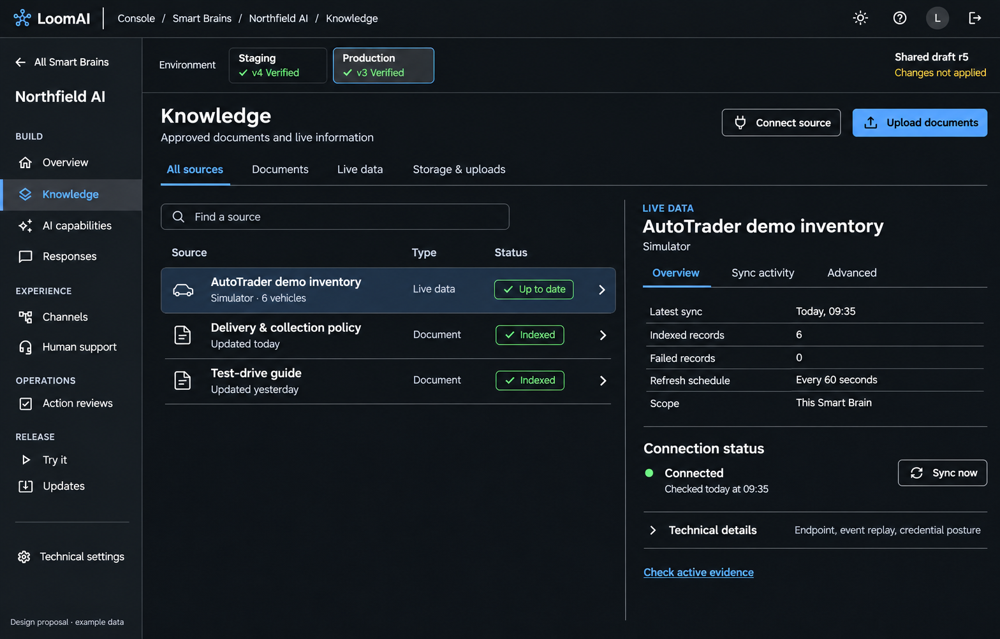
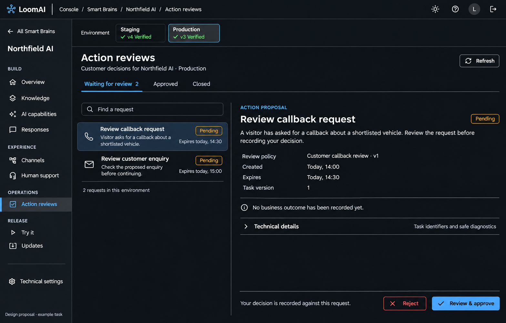

# 010.64 Follow-up: One Home For Brain-Scoped Operations

Date: 8 November 2026.
Status: **Implemented, committed, deployed to staging/production and verified.**
Parent: [Smart Brain workspace](010_64_SMART_BRAIN_OUTCOME_LED_WORKSPACE_AND_NAVIGATION_REDESIGN_PLAN.md).

## 1. Recommendation

If a customer task requires a Smart Brain, it belongs inside that Smart Brain's
workspace, not in the main Console menu with another Brain/release selector.
Give every function one canonical route and one implementation. Existing Kit
and resource-list shortcuts navigate there; they do not embed another editor.

This is a focused completion of the approved 010.64 resource navigation, not a
restoration of the rejected 010.65 customer-wide redesign. Keep Customer Home,
Kits, Engage, Support, Account and sign-in layouts. The staging developer
presentation remains independent and unchanged.

## 2. What The Code Shows

Source inspection, not a new live operational verification:

- `CustomerConsoleShell.tsx` still exposes Knowledge & data, Connections, Human
  support and Action reviews as global links. Their pages require Brain context.
- `CustomerKnowledgeConnectionsPage.tsx` adds its own Brain and Target release
  selectors, then a Manage panel over the underlying existing editors.
- `BrainKnowledgePage.tsx` already reuses `DocumentKnowledgePage` for storage,
  discovery, source operations, evidence and retention, and `IntegrationsPage`
  for live connections. These functions therefore have overlapping entrances.
- `IntegrationsPage` can render both live-data and handover operations. Its
  Knowledge embedding can repeat controls owned by Brain Human support.
- `CustomerActionReviewsPage` selects the Brain and target before mounting
  `HumanReviewPage`; no canonical Brain review route currently exists.
- The old Connections page also hosts deployment-specific vector binding.
  Moving only its sync table would lose this pre-deployment configuration path.

The problem is routing and page composition, not a missing backend service.

## 3. Two Clear Navigation Levels

### Main Console: Workspace Resources

Keep these existing entries and layouts:

```text
Home
My kits
Smart Brains
Engage apps
Account & team
Help & requests
```

Remove the four Brain-specific entries from the customer main menu once their
canonical resource routes are complete. Notifications and the existing global
utilities remain available. Do not add a second permanent global rail beside
the Brain rail.

### Inside One Smart Brain

```text
All Smart Brains
Northfield AI

BUILD
  Overview
  Knowledge
  AI capabilities
  Responses

EXPERIENCE
  Channels
  Human support

OPERATIONS
  Action reviews

RELEASE
  Try it
  Updates

Technical settings
```

Human support is for conversation handover and team connection. Action reviews
are decisions about proposed operations. Keep them distinct; neither is the
Platform release approval process. Opening LoomAI Desk does not create another
Console inbox or bypass its operator authentication.

Staff assisting a customer uses the same Brain content where authorized.
Retain staff fleet/admin tools outside it. Matching layout never grants staff
customer review authority; the current customer-session decision rule remains.

## 4. Knowledge: Documents And Live Information



The picture is generated using fictional Northfield data. Its counts, times,
verification and connection statuses are illustrative, not hosted evidence.
Implementation must use actual API states and existing permissions.

Within Knowledge, use one compact tab bar:

- **All sources:** the single combined source list.
- **Documents:** the same list filtered to documents, not a second inventory.
- **Live data:** connected external sources and synchronization controls.
- **Storage & uploads:** hosted/BYO storage, selected prefixes and uploads.

Selecting a source opens its detail in the same workspace with an addressable
source ID. The list and detail own bounded scrolling. On smaller screens the
detail is a full-width view with Back to sources. No outer page of nested cards,
repeated heading/selector or Manage button that opens the whole page again.

### Document Detail Must Retain

- Actual source status, audience, file metadata, active and candidate versions.
- Preview extracted content/chunks; register/discover approved stored objects.
- Index, refresh revision, reconcile and exact-source index-removal confirmation.
- Manifest/work failures and indexing/version history, clearly separate from
  successful activation. File presence is not proof of retrieval readiness.
- Existing registration audience/category confirmation, including public scope.
- Removal of derived registration/index evidence must not claim to delete the
  source object. Preserve the existing precise confirmation and command scope.

Storage remains usable before infrastructure exists where the current contract
allows it. Applied-runtime source operations still require their actual target.
Keep Check active evidence and advanced evidence-retention controls reachable
as focused subroutes; they are not extra global menu items.

### Live Source Detail Must Retain

- Source count, indexed count, failures, freshness and last successful sync.
- Actual polling schedule, provider correlation and operational errors.
- Explicit authorized Sync now/reconciliation command; no automatic run on open.
- Inbound webhook URL/copy, registration/signature posture, event history and
  permitted manual replay under Sync activity or Advanced.
- Safe connection/authority, protected-resource bindings, token posture,
  persistence and runtime indexing-channel diagnostics under Advanced.

Use source metadata for labels. These are generic controls, not AutoTrader
conditionals; a Shopify or support source uses the same layout later.

## 5. Split The Mixed Connections Page By Ownership

Do not replace the current mixed page with another mixed Connections destination.
Distribute its existing content once:

- Data synchronization and its inbound events: **Knowledge -> Live data**.
- Document object-storage bindings and uploads: **Knowledge -> Storage & uploads**.
- Deployment vector-service binding: **Technical settings -> Storage & search**,
  retaining the existing pre-deployment binding control.
- Handover connector/status, delivery notices, retry/expiry commands and Desk
  activation: **Human support**.
- Action receiver routes: retain their current **AI capabilities** owner.

`IntegrationsPage` should expose explicitly scoped data/handover content or
shared child views over the same existing controller. Knowledge must not mount
handover controls and Human support must not repeat the data-sync tables.
Do not copy fetching, command handlers or authorization into a new page.

There is no demonstrated customer-wide reusable connection-library editor in
these routes. Do not invent one merely to justify retaining a global Connections
link. A future genuinely workspace-owned library would be a separate resource.

## 6. Action Reviews Inside The Brain



The sample pending tasks are fictional. This proposal does not install a review
policy, change the dealership template or make every enquiry require review.

Use the existing `HumanReviewPage` functionality as a resource-scoped content
view rather than nesting its old page header and Brain/environment selectors.

- One task list with status filters/search over records actually available from
  the existing API. Do not invent historical tasks beyond returned data.
- One selected task detail: summary, status, policy/version, creation/expiry,
  safe message/failure and actual outcome when supplied.
- Keep authorized Approve/Reject, the existing explicit confirmation and exact
  task/version decision contract. Opening a row never records a decision.
- Decision recorded, execution succeeded, execution failed and outcome unknown
  are separate states. Approval is not a claim that a booking/lead exists.
- Keep controls visible in the detail footer. No Save draft or Publish command
  for this live operational task. Preserve busy-context guards.
- Preserve customer authority, allowed decisions, scope, expiry/concurrency and
  failure handling. A global administrator/operator layout is not permission to
  decide for the customer. Foreign or unavailable task IDs remain explicit errors.

## 7. Canonical Routes And Old Links

Recommended UI routes; additions are proposed, not claims they already exist:

```text
/smart-brains/:brainId/knowledge
/smart-brains/:brainId/knowledge/documents
/smart-brains/:brainId/knowledge/sources/:sourceId
/smart-brains/:brainId/knowledge/connections
/smart-brains/:brainId/knowledge/connections/:sourceId
/smart-brains/:brainId/knowledge/storage
/smart-brains/:brainId/knowledge/discover
/smart-brains/:brainId/knowledge/proof
/smart-brains/:brainId/knowledge/retention
/smart-brains/:brainId/human-support
/smart-brains/:brainId/action-reviews
/smart-brains/:brainId/settings/storage
```

The route identifies the Brain; the shared environment header identifies the
authorized target. Existing commands continue to use deployment ID, exact target
and serving release. Remove page-level Brain, Target release and environment
selectors once that shared context has resolved.

Old customer URLs become navigation adapters, not a second editable screen:

- `/document-knowledge?deploymentId=...` -> that Brain's Documents view; preserve
  source/detail/upload intent when present.
- `/integrations?deploymentId=...` -> that Brain's Live data view; preserve the
  selected connection. A handover-specific link goes to Human support instead.
- `/human-support?deploymentId=...` -> that Brain's Human support.
- `/human-review?deploymentId=...` -> that Brain's Action reviews.

Validate ownership using the existing Brain resolver before fetching scoped data.
An explicit release must belong to the same Brain/target. Preserve requested
target/release/source/task where supported; never silently replace an invalid
scope with another or move an old task to today's release.

If no Brain is provided, show the existing resource picker/list with a small
instruction to choose a Brain; carry only an allow-listed destination intent.
After selection, open the canonical route. Do not create an operational global
page that guesses the last Brain from another session.

For an absent target, use the existing authorized environment resolution rules;
when ambiguous, ask through the shared chooser. Review eligibility still uses
the existing verified-environment contract, not merely the visible toggle.

## 8. Reuse, Not Duplicate Implementation

- `SmartBrainShell`, `BrainWorkspaceContext`, `BrainEnvironmentSwitch` remain the
  single resource frame, target context and selector.
- `BrainKnowledgePage` owns list/filter/detail routing. Reuse the existing
  `DocumentKnowledgePage` task modes and `HostedDocumentStorageSetup` operations.
- Recompose `IntegrationsPage` data versus handover views; reuse current command
  and query contracts, warnings, operation identities and permission checks.
- Reuse `HumanReviewPage` review controller/content under the new Brain route.
  Retire the customer-only duplicate selection wrapper after redirect coverage.
- Reuse `CustomerExistingVectorBinding` at its storage-settings owner, preserving
  its readiness and pre-apply availability rather than losing it in the move.
- Existing Kit/Overview shortcuts navigate to these homes. Delete obsolete
  customer read/edit wrappers once no call site depends on their old composition.
  Keep shared components and intentional staff-wide entry points.

No backend API, schema, framework release, storage migration or new business
state is expected. Raise any genuine contract gap before broadening scope.

## 9. Focused Implementation And Acceptance

1. Establish canonical scoped routes/legacy adapters and shared target context.
2. Consolidate Knowledge and split mixed connection/handover content without
   removing any existing command, safe diagnostic or pre-deployment storage path.
3. Mount Action reviews in the Brain frame with unchanged decision authority.
4. Remove duplicate customer main-menu entries and update Kit/Brain shortcuts.
5. Verify before deployment: old and new links, missing/foreign/ambiguous scopes,
   same-Brain environment changes, upload/index/source and sync/replay flows,
   review confirmation/cancel/outcome states, busy/dirty navigation and read-only
   access. Use isolated fixtures for writes; no real customer enquiry needed.
6. Check dark/light desktop with no normal page-level vertical/horizontal scroll,
   basic mobile Back navigation, no covered task buttons, unchanged developer
   profile and retained staff fleet tools. Qualification scope scales to these
   pages, not the whole framework or every product.

## 10. Execution Record

- Complete: canonical Knowledge/Documents/Live data/Storage and Action reviews
  routes, legacy navigation adapters and exact target/release/source/task context.
- Complete: customer main menu has resource-level destinations only. Staff global
  administration remains available. Kit shortcuts use the canonical Brain tasks.
- Complete: existing document, storage, sync, webhook, handover and review
  controllers are reused. The old customer Manage wrappers are retired; vector
  binding is available once under Technical settings / Storage, including before
  first deployment. Header environment drives its scoped view.
- Complete: source master/detail layout, status/error diagnostics, mobile Back,
  review filtering, explicit approval/rejection and version-bound confirmation.
  Live tasks do not expose a misleading Publish command.
- Local checks: 75 focused navigation, review-authority, storage-scope, profile
  and existing change-preview tests passed. The isolated browser harness passed
  13 knowledge/sync/review flows without hosted writes. Production build passed.
- Complete: 44 existing vector/settings regressions passed. Independent review
  corrected source/webhook identity filtering, covered by a distinct-ID fixture.
- Complete: exact-source UI image `d343ca48a9026b747d18d581a5ef5dee309db5c9`
  published by CI `42471212481`; backend skipped. Document-storage CI
  `42471212536` passed. Staging job `v1qjak2mtjxpkz8zo4mdm8sc` and production
  `q8t75ftdc23jwy9jwm74k8w4` finished; both native containers are healthy.
- Complete: hosted source list/detail, old-link redirect, separate human-support
  view, review route, dark/light desktop and basic mobile navigation. No outer
  desktop page overflow; staging developer / production standard retained.
- Qualification boundary: the owned hosted Support fixtures have Action reviews
  disabled in their applied runtime configuration. The UI reports that actual
  state; no live approval or capability enablement was performed. Decision,
  cancellation, exact task/version and permissions were exercised in isolated
  browser/contract fixtures instead. This UI release does not enable runtime
  capabilities or rewrite existing customer configuration.

No backend, schema, framework, runtime, prompt, AI-routing or customer
configuration change is required. Test writes stay in isolated memory fixtures.
Evidence: `verification-support/brain-scoped-operations/README.md` from repo root.
