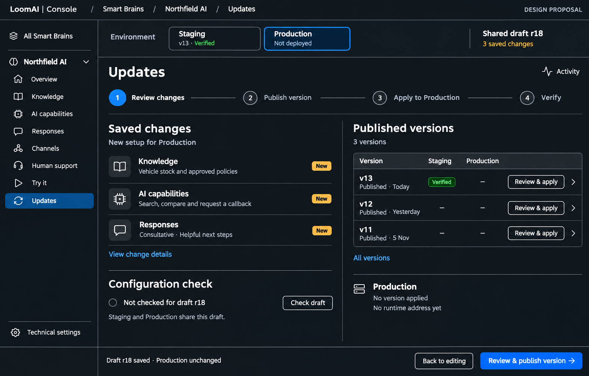
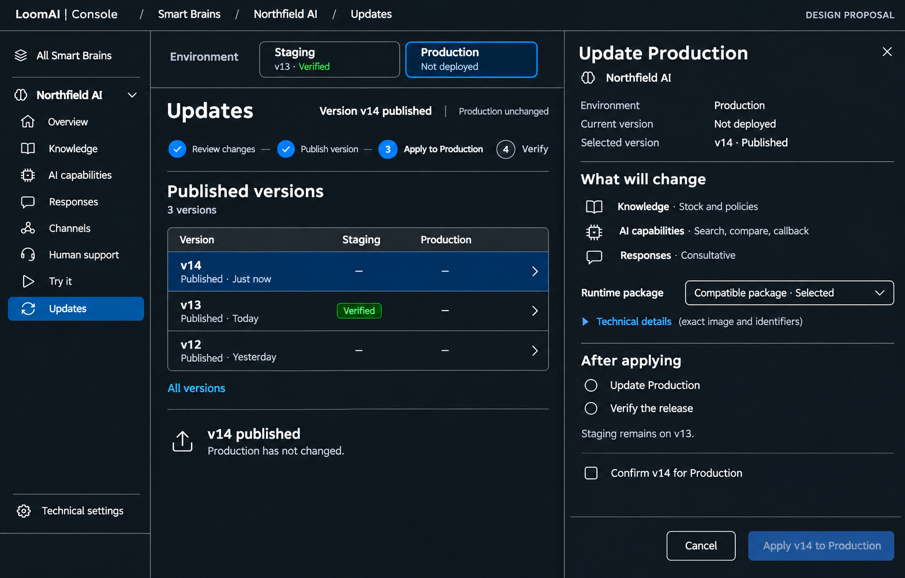
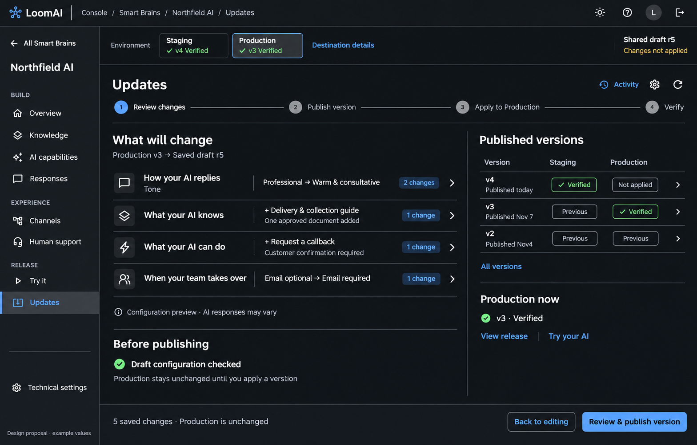
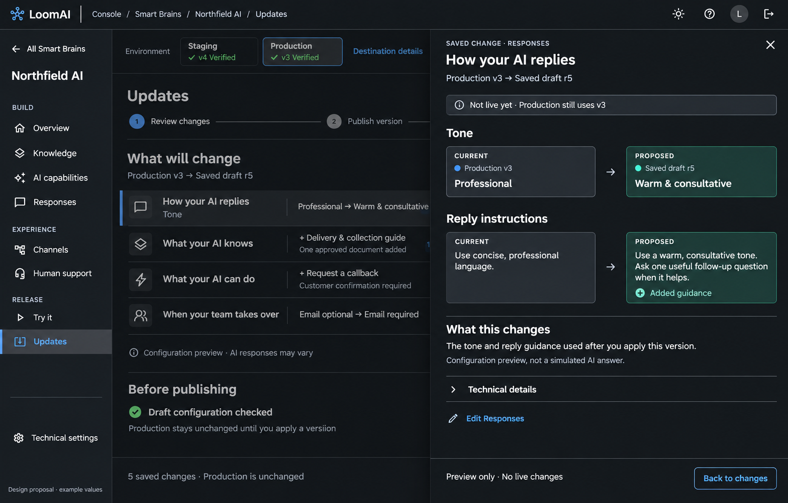

# 010.64 Follow-up: Clear Updates And Version Journey

Date: 7 November 2026
Status: **Implemented, committed, deployed to staging and production, and live UI verified on 8 November 2026.**
Parent: [Smart Brain outcome-led workspace](010_64_SMART_BRAIN_OUTCOME_LED_WORKSPACE_AND_NAVIGATION_REDESIGN_PLAN.md).

Execution evidence: [Updates journey verification](../../../../../../../../verification-support/brain-updates-journey/README.md).

## 1. Recommendation

Keep Updates inside the existing Smart Brain workspace. Make the normal journey
visible: **Review changes -> Publish version -> Apply to an environment -> Verify**.
Published versions are normal customer controls, not advanced administration.

Keep the existing shared draft, versions, release engine and authorization. This
is a frontend information-architecture and interaction change, not a new release
system, approval requirement or mandatory staging gate.

## 2. Why The Current Screen Is Confusing

Source inspection confirms the owner's observations:

- `SmartBrainShell.tsx` puts a small Environment dropdown between shared-draft
  and applied-state labels. The distinction between editing a shared draft and
  choosing a destination is easy to miss.
- `BrainUpdatesPage.tsx` leads with a combined publish/update intention, but
  actually publishes first, then requires review of the version and compatible
  runtime source before applying. The prominent wording hides that real sequence.
- Published versions and Apply live inside an Advanced drawer containing the
  much broader `RevisionsPage`. Normal version selection is mixed with exports,
  raw differences, artifact configuration and operational detail.
- History lists releases, not all published versions. A version that was
  published but never applied is therefore difficult to discover.
- Technical summaries such as raw action IDs, entity types and provider wiring
  dominate the comparison instead of explaining the customer-facing change.
- Staging connections, app assignment, production promotion and release history
  appear as sibling tabs despite belonging to different moments in the journey.

## 3. Proposed Layouts

These are generated design proposals with fictional Northfield data, not live
status or test evidence. Production is intentionally not deployed in this example.

### 3.1 Review Saved Changes And See Published Versions

One viewport contains:

- The existing resource sidebar and breadcrumb, unchanged in purpose.
- A labelled Staging / Production segmented selector with each environment's
  applied version and verification state, when those states are known.
- Shared draft revision and a factual saved-change indicator, kept separate
  from the environment selection.
- A short stage indicator: Review, Publish, Apply to the selected environment,
  Verify. It reflects progress; later stages are not arbitrary action buttons.
- A left pane showing outcome-led saved changes and the current draft check.
- A right pane showing the latest published versions and their environment state.
- One footer command: **Review & publish version** for saved unpublished changes.

On an already configured environment, compare with its actual applied version.
On a first deployment, say **New setup for Production**, not an invented
before/after comparison. A failed or unavailable comparison must remain visible.

### 3.2 Apply A Published Version

After publication, select the newly published row and open one focused review
panel. An existing version's **Review & apply** opens the same panel, without
publishing again. No modal is stacked inside a drawer.

Show the Brain, exact environment, current version, proposed version, compact
change summary and compatible runtime selection. The primary action explicitly
names both: **Apply v14 to Production**. The main page has no competing command
while this panel owns the task.

The image's runtime-package wording is illustrative. Implementation must show
the real package label/tag, preserve the exact artifact selection and compatibility
rules, and never invent a selected or compatible package. Exact image references
and IDs remain available under Technical details. The selected target's concrete
profile name is shown when needed to disambiguate otherwise identical environments.

## 4. Environment Selection

Replace the tiny dropdown in the shared context strip; do not add another selector
inside Updates. Other Brain sections keep the same selected target and URL scope.

- For the usual two authorized environments, show visible Staging and Production
  choices. Selecting one changes inspection/apply context, not the shared draft.
- Environment options come from authorized backend targets; do not manufacture
  a Production target or offer server/profile names as additional environments.
- If multiple authorized targets share an environment, selecting that environment
  opens a compact target chooser with meaningful names. Never choose one silently.
- Missing requested target stays an explicit error, not a fallback to another.
- Show **Not deployed**, **Applied v13**, **Verification pending**, **Verified**,
  **Update failed** or **Status unavailable** only from corresponding evidence.
- Publishing does not change either environment. Applying names the one target
  affected. Switching context is guarded during dirty or in-flight operations.

No replacement of authorization with a visual selector, and no staging/production
draft split, is proposed.

## 5. Versions Are First-Class

Keep a compact grid visible on the default page, with 3-5 recent rows. **All
versions** opens a focused list in the same Updates route, not the old full editor.

Each row shows version label, publication time/state, and separate Staging and
Production application/verification states. A published configuration version
is not itself a verified or failed release; retain those separate meanings.

Use **Review & apply** for a permitted version not applied to the chosen target,
**View release** for the current one, and visible progress for an in-flight update.
A historical failed attempt belongs in release details/activity; do not label
the immutable version itself failed or confuse it with the active release.

Selecting a row reveals a small contextual detail panel. Publication metadata,
changes, indexing impact and release attempts remain reachable. IDs, hashes,
compiled artifacts, export/import and supported restore/rollback operations stay
under Technical details or a contextual action menu. They are not removed.

Only status already supported by the existing versions/releases/verification
data is shown. Unknown environment state is **Unavailable**, not a grey dash
claiming no deployment. Older inactive use of a version may appear in Activity.

## 6. Sequential Action Rules

1. **Review:** show saved changes and draft-specific validation. A successful
   configuration check is not proof of runtime or connection health.
2. **Publish:** review the saved revision, confirm and call the existing publish
   command. On success, retain the immutable returned version and move to Apply.
3. **Apply:** review that exact version against the exact target, select the real
   compatible runtime and confirm. Use the existing apply command and operation
   identity. This must not republish, silently restore the draft or activate apps.
4. **Verify:** show actual release progress and verification. Apply/verify failure
   retains the version and exposes the supported retry for that step, not a new
   publication. Verification failure is not presented as a successful rollout.
5. **Done:** show the applied version, verification outcome, **Try your AI** and
   a link to connected channels. App assignment/activation remains explicit.

Use one next action in the task footer. Normal publication need not update an
environment: the user can close the Apply panel and leave a published version.
Going to another page must preserve server-recorded progress on return.

Do not introduce duplicate confirmation gates beyond the meaningful publish and
exact-target apply reviews. Do not add recovery/draining machinery or pretend
the asynchronous apply/verify workflow can be cancelled if no API supports it.

## 7. Promotion, Connections And Activity

- Keep **Promote tested staging** as a contextual production entry point when an
  eligible staging candidate exists. Reuse the current customer promotion flow,
  including its preflight and explicit later app switch. Ordinary Apply does not
  secretly perform promotion or bypass that workflow. Direct production updates
  remain supported; promotion is not a compulsory approval gate.
- Missing connections are a concrete prerequisite with a link to their existing
  owner page/task, not an unexplained sibling tab in the release sequence.
- After staging verification, **Connect Engage app** is a next task/Channels link,
  not part of publishing a version. Preserve current assignment commands.
- **Activity** is a focused secondary view of actual update attempts, progress,
  errors and verification runs. Keep it distinct from the versions catalogue.
- Applying/promoting production never copies staging vectors or silently changes
  document selection, customer integration credentials or app activation.

## 8. Implementation Scope After Approval

Reuse `BrainUpdatesPage`, `SmartBrainShell`, `BrainCustomerReleaseTasks` and the
existing API client. Extract reusable scoped version/detail controls from
`RevisionsPage` where needed instead of nesting that entire page inside a drawer.
Use one command implementation per publish/apply/verify operation and one target
context; do not create a parallel customer release flow.

Outcome summaries use structured metadata and established configuration fields,
not AI-generated claims or semantic text matching. If a friendly name is missing,
show its truthful technical label in details rather than inventing an outcome.

Required checks before rollout:

- Saved draft, published-unapplied version, no infrastructure, applied/verified,
  apply failure, verification failure and in-flight state.
- Existing-version apply never publishes; retry never republishes.
- Explicit/missing/duplicate target handling, stale draft/target review and real
  compatible-source selection; editor/operator/read-only permissions retained.
- Shared draft persists across environments; exact URL target persists on reload.
- Promotion, app assignment, restore/rollback and technical export/import remain
  reachable with their existing semantics and authorization.
- Dark and light theme geometry, normal desktop tasks at 1440x900 and 1280x800
  without page-level scrolling; bounded lists/details own their scroll areas.
- Basic small-screen navigation and labelled/focusable controls; no broad mobile
  or accessibility redesign. Support remains minimized without covering actions.

This proposal changes presentation and sequencing only. Any genuine API gap found
during implementation must be reported before expanding backend scope.

## 9. Approved Follow-up: Intuitive Change Previews

Owner approved on 8 November 2026. The original summary-only comparison is
replaced with clickable outcome rows and one focused Current / Proposed panel.
The existing publication, target apply, verification and authorization remain.

- Main heading: **What will change**. Show actual structured choices such as
  Professional -> Consultative, named capability/source additions, and changed
  field counts. No model-generated explanation or inferred business result.
- Click any row to compare the exact selected environment's current runtime
  with the saved draft. Labels, known reply guidance, capability confirmation
  settings, declared source names and supported model settings are readable.
- Preserve long instructions in bounded scrollable values. Unsupported settings
  retain an honest changed-settings summary and field-name-only Technical details;
  never project arbitrary connection payloads, credential values or secret refs.
- Catalogue labels come from actual profile metadata. List entries require
  stable unique identities before attributing an addition/removal to an item.
  Missing labels/identities do not justify inventing a friendly interpretation.
- First deployment says New setup. Missing/wrong-version evidence says comparison
  unavailable, not that all settings were newly added. Source configuration is
  not proof of active document indexing or successful service connectivity.
- The panel links back to the relevant existing editor with exact target retained.
  Inspecting/closing it is read-only; it never publishes, applies or runs AI.
- Current is compiled runtime configuration; Proposed is saved draft input.
  Publication can add generated guidance. This is a configuration comparison,
  not a promise of the final compiled diff or a simulated AI answer.

Implementation and qualification are tracked in
`verification-support/brain-updates-journey/change-preview/README.md`.
