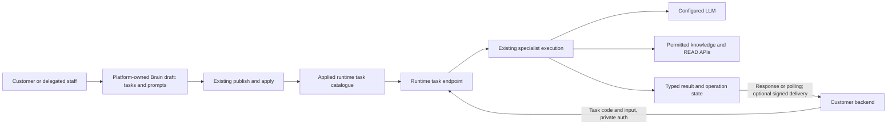

# 010.68 Managed Intelligence Tasks And External Agent Interoperability

Date: 2026-11-10

Status: assessment complete; owner subsequently authorized starting Managed Tasks.
Initial synchronous implementation is tracked in the [execution record](010_68_MANAGED_TASKS_IMPLEMENTATION_RECORD.md).
External-agent waiting and the later phases below are not included in that authorization.

Platform source reviewed: `c5bb0f1d85d4db62bb167b129e2d984d14cf856c`.

Framework baseline: published `0.8.46`, source `218730e5b18343576655fbd7108d63b4135f0cfc`.

## 1. Verdict

### Idea 1: A Smart Brain For Backend Services

**Yes, this is a good extension of LoomAI, and part of its foundation already exists. The complete customer-defined product does not exist yet.**

A customer should be able to define a named **Task** inside a Smart Brain: its purpose, managed instructions, input, expected result, permitted knowledge/tools and execution settings. Their application calls that task with business data, rather than sending a full system prompt or rebuilding the AI workflow in its backend.

This is a headless integration channel for the same Brain, not another chatbot, account type, deployment per task, or separate product orchestration engine. Useful examples include assessing a support request, recommending the next workflow step, extracting configuration from an API document, or proposing settings for another application.

**Recommend building the named, read-only, structured-result task first.** Use the existing execution framework and Platform release lifecycle. Start with the deployment's selected model; introduce independently selected per-task models only when routing is correctly propagated through every inference stage.

### Idea 2: Connecting Agents Written In Python

**Yes, support external agents. Do not make Python hosting part of the first release.**

A Python agent can run in the customer's service and expose an HTTP API or supported MCP tool. LoomAI can invoke it without knowing its implementation language. Existing connectors provide the short synchronous-call foundation. A long-running agent that returns an accepted job and completes later needs a new asynchronous delegation contract.

Python is not inherently more intelligent than Java or TypeScript. Its ecosystem contains useful agent libraries, but that is a reason to interoperate, not to rewrite our runtime. Official A2A SDKs exist for both [Python](https://github.com/a2aproject/a2a-python) and [Java](https://github.com/a2aproject/a2a-java), demonstrating a language-neutral integration route.

**Recommend HTTP integration first, durable event-driven delegation second, and a qualified A2A adapter when an actual integration requires it.** Do not claim that any arbitrary Python object or library can be connected without a service wrapper or supported protocol.

## 2. What We Actually Support Today

These are source-backed findings, not a new live qualification. No paid queries, deployments, external-agent jobs or framework tests were run for this assessment.

### 2.1 One-Time Answers: Present, But Not A Managed Task Contract

`POST /api/chat/me/query-once` runs the normal orchestration without persisting conversation turns. It accepts query/context/attachments and returns the canonical chat response.

It does **not** expose a named task with its own input/output schema, specialist selection and model policy. `mode`, `position` and `context` are not general-purpose configuration or permission overrides. `promptPreview` is separately scope-protected and is not an appropriate production service-task contract. Deployments with conversation control also reject the legacy query endpoints; query-once is therefore not universally available on every current Brain configuration.

Evidence: `ChatRuntimeController.java:199`, `ChatRuntimeController.java:257`, and `web/dto/ChatQueryRequest.java:18` under the runtime source root in section 13.

### 2.2 Event-Driven Smart Brain Operations: Present, But Fixed-Purpose

The runtime already exposes:

```text
POST /api/smart-brain/v1/triggers/{triggerCode}
GET  /api/smart-brain/v1/operations/{operationId}
POST /api/smart-brain/v1/operations/{operationId}/cancel
POST /api/smart-brain/v1/operations/{operationId}/replay
```

This path has private service authentication, scopes, CloudEvent inputs, idempotency, persistent operations/results, schedules, polling and optional signed outbound completion webhooks. Platform has configuration forms and an operations screen for it.

However, both Platform and runtime validate that each trigger uses `smart-brain-event-analyst@1`. The operation service binds that specialist directly. Its bundled prompt is read-only, retrieval and actions are disabled, and its fixed output is `summary`, `findings`, `recommendedNextSteps`.

Customers can configure registered triggers and delivery, **not arbitrary task prompts, result schemas or specialist targets through this path**. Supplying instructions inside the event data is not a substitute: its prompt deliberately treats event content as untrusted facts.

Important naming distinction: **Smart Brain is the UI label for deployments generally; `SMART_BRAIN` is also a particular backend behavior type.** An existing conversational dealership Brain does not automatically expose this event-operation behavior. The new task capability should not require converting it away from chat.

Evidence: `SmartBrainController.java:29`, `smartbrain/SmartBrainRuntimeConfig.java:5`, `SmartBrainOperationService.java:47`, `SmartBrainConfigurationService.java:26`, `DeploymentBehaviorCatalogService.java:480`, `BehaviorPage.tsx:826`, `BehaviorOperationsPage.tsx:332`.

### 2.3 Specialists, Schemas And Plans: Strong Primitives, Limited Product Exposure

The framework provides registered specialist definitions, prompt profiles, JSON Schema input/output contracts, structured generation, bounded execution, synchronous execution, asynchronous submission and scoped results. Fixed plans support sequential and parallel specialist stages; specialist chains provide managed delegation.

Platform already compiles customer-configurable conversational support areas and resolution plans into hash-verified specialist resources. Customers can choose instructions, allowed knowledge sources and READ actions there. This is a useful compiler/UI pattern, not a general public task API: its generated result is the support-specific `summary`/`answer` contract.

The separate runtime agentic endpoints support synchronous execution and asynchronous submit/status/cancel, but `DeploymentIntelligenceTeamService` binds one fixed team and accepts a `question`, not arbitrary named tasks.

Evidence: `deployment/specialist/SpecialistAssistanceCompiler.java:90`, `CustomerSpecialistAssistance.tsx:33`, `SpecialistAssistanceBundle.java:17`, `DeploymentIntelligenceTeamController.java:40`, `DeploymentIntelligenceTeamService.java:35`; framework `AIExecutionGateway`, `DefaultSpecialistManifestCompiler`, `PlanStage`.

### 2.4 Per-Task Model Selection: Not A Finished End-To-End Feature

Deployment models/providers and purpose-specific generation settings exist. `AIGenerationRequest` has a model field. However, the specialist invocation and manifest execution contracts do not contain a general per-task provider/model selector; the structured specialist finalizer invokes `LlmPurpose.GENERATION` without setting a task model.

Therefore, an API accepting `model` would not by itself prove that planning, retrieval-related inference and final output used that selection. A full task inference profile needs an explicitly propagated, server-resolved execution setting. It must not be implemented as a mutable global provider switch while concurrent tasks run.

Evidence: framework `SpecialistInvocation`, `SpecialistExecutionSpec`, `AIGenerationRequest`, `AICoreService.generateContent`, `DefaultStructuredSpecialistOutputFinalizer.java:175`.

### 2.5 Remote Tools: Present; Durable External-Agent Waiting: Missing

The generic REST connector can call external HTTP services with configured routes, authentication, payload/result mappings and bounded timeouts. A Python service with a compatible API can be used as an existing action; no new Python plugin type is necessary. Framework MCP execution uses configured synchronous MCP clients and `callTool`, subject to runtime/client setup and result mapping.

Neither is a complete asynchronous external-agent lifecycle. In particular, the REST connector defaults to treating all `2xx` responses as successful unless configured otherwise. An HTTP `202` job receipt is **not proof that the external agent finished**. Its receipt must not be presented as the completed intelligence result.

The framework has input-resume APIs, but the reviewed implementation keeps input waits and fixed-plan checkpoints in process-local stores. Durable V1 jobs are machine-triggered/read-only, and explicitly convert input/confirmation waits into `DURABLE_CONTINUATION_UNSUPPORTED`. We must not disguise an external-agent wait as a user-input wait or claim restart-safe continuation from these APIs.

No native A2A or external-agent completion/resume adapter was found in the reviewed runtime, connector and framework execution sources.

Evidence: `RestActionExecutionService.java:115`, `RestActionExecutionService.java:628`; framework `SpringAiMcpActionExecutor.java:94`, `EphemeralInputWaitStore`, `EphemeralPlanExecutionStore`, `DurableExecutionSubmissionPolicy`, `DurableAIExecutionGateway.java:443`.

## 3. Proposed Product Contract: Managed Tasks

### 3.1 Customer Journey

1. Open an existing Smart Brain and choose **Tasks**.
2. Select **Create task** and describe the outcome, or start from a small example such as structured assessment or document extraction.
3. Define input fields, result fields and managed instructions. Use forms first; JSON Schema and prompt details remain in Advanced. The existing configuration assistant may help author the draft.
4. Select the knowledge and READ capabilities it may use. Empty retrieval is valid: not every task requires RAG.
5. Test with a sample input and inspect the real output, validation findings, latency and available usage accounting.
6. Publish/apply through the existing Brain release mechanism.
7. Copy the generated API example and connect a scoped application identity. Subsequent requests supply business data, not the full prompt.

Task authoring and application invocation are different permissions. Delegated LoomAI staff use the same owned draft editor, not a parallel staff-only task system.

### 3.2 Definition Contents

These are proposed concepts, not currently supported manifest syntax:

- Stable task code and display name, scoped to the customer and Brain.
- Objective and managed instructions, versioned with the Brain draft/release.
- Input contract and structured JSON or text result contract.
- Execution target: one compiled local specialist initially; a supported resolution plan or external integration in later phases.
- Explicit allowed knowledge collections and READ actions; no obligation to configure vector spaces.
- Inference profile: inherit the Brain model initially; later select a configured task profile.
- Total deadline, output size and explicitly configured validation-feedback allowance.
- Execution/delivery options: short synchronous result or asynchronous operation with polling; use the existing signed completion delivery where applicable.
- Authorized callers and any permitted input-time options.

**One task does not mean one runtime, database or template.** Several tasks should share a Brain's installed services and owned credentials.

A single task does not need a specialist team. Start with one configured resolver; retrieval, coordinated specialists and business actions are optional capabilities, not mandatory steps for every service request.

### 3.3 What The Caller Can Control

An external caller selects the named task and supplies its declared input, business context and correlation/idempotency key. A task can declare a small set of legitimate options, such as locale, output detail or one of its configured profiles.

Do not pass the whole deployment configuration, provider secrets, unrestricted system prompt, arbitrary specialist name or scope list through `context`. Backend applications are authenticated callers, but request content does not grant additional authority. Runtime resolves task instructions, target, model policy and permitted sources from the applied configuration.

For a request to configure another system, the task returns a proposed configuration. The calling service remains responsible for validating and applying it. Actual writes are a separate explicitly authorized action, not implied by an AI recommendation.

### 3.4 Structured Does Not Mean Semantically Deterministic

We can provide a stable JSON shape, typed fields, a known schema revision and explicit success/failure outcomes. We cannot promise that repeated LLM calls always make the same decision or that schema-valid output is factually correct. Sampling temperature zero is not such a guarantee.

Use deterministic code or an actual rule engine for exact calculations and mandatory business rules. Let the LLM interpret context and recommend within that boundary. Where data is missing, permit a typed `NEEDS_INPUT` outcome or nullable/unknown fields rather than forcing invented values.

Hard validation should protect ownership, authentication, required execution fields and the declared machine-consumed output contract. Do not turn every optional field, confidence estimate or imperfect phrasing into a blocker. Optional bounded validation feedback may ask the LLM to correct actual contract errors; it must remain configured, visible and deadline-bounded, with no keyword-based decision replacement or hidden provider fallback.

## 4. Example Service Invocation

**All endpoints and fields in this section are proposed, not available APIs.** The existing `/api/smart-brain/v1/...` endpoints above remain distinct.

```http
POST /api/tasks/v1/tasks/recommend-next-step/runs
Idempotency-Key: support-case-781-assessment-1
Content-Type: application/json
```

The service also supplies the deployment's verified private runtime authentication. API keys alone must not be treated as permission to invent the tenant, subject or task grant.

```json
{
  "input": {
    "request": "Our application cannot connect to the inventory API.",
    "observations": {"httpStatus": 401, "credentialRecentlyRotated": true}
  },
  "options": {"locale": "en-GB"},
  "correlationId": "support-case-781"
}
```

An asynchronous submission returns `202` with a run ID and status URL, not a completed answer. A completed result could be:

```json
{
  "runId": "run-example-1",
  "taskCode": "recommend-next-step",
  "status": "SUCCEEDED",
  "configurationVersion": "ver-example",
  "outputSchemaVersion": "1",
  "output": {
    "recommendedStep": "verify-current-api-credential",
    "reason": "The supplied observations show an authentication rejection after rotation.",
    "missingInformation": ["provider credential validation result"]
  },
  "evidence": [{"sourceType": "CALLER_INPUT", "reference": "observations"}],
  "sideEffectsExecuted": false
}
```

The recommendation code is an example from this task's declared result contract, not a platform-wide classification or text-matching rule. The LLM chooses it. A supplied observation is labelled as caller input, not falsely promoted to a verified live check.

An optional synchronous endpoint can return the same result envelope for short tasks. A wait timeout must expose the actual run state rather than silently resubmitting the task.

## 5. Configuration And Data Movement



Platform is the configuration/control plane, not a compulsory proxy for every intelligence request. Calls go to the assigned runtime through the existing supported integration/auth path. An application can use existing assignment discovery instead of permanently hardcoding an obsolete runtime address.

Store task definitions with the existing Brain draft and immutable published configuration in the Platform database. Reuse prompt-revision/history mechanisms where they fit; do not build a second prompt repository. Freeze the resolved task/prompt/schema/configuration identity for each accepted run, so a later deployment does not reinterpret queued work.

Store durable run inputs/results and integration correlation state in the runtime's configured AI-state database, with tenant isolation, existing protection mechanisms and bounded retention. Add only necessary columns/tables in that database; no database per task, external agent or customer business entity. Synchronous stateless tasks can be offered without durable state; do not silently downgrade an asynchronous guarantee when persistence is unavailable.

Knowledge remains in existing document sources and vector services. A task need not copy documents or vectors. The customer's application remains the system of record for business state.

## 6. External Agents: Integration Options

### 6.1 Short HTTP Call: First Choice For An Initial Proof

Expose the Python agent behind a customer-managed HTTPS endpoint and configure it through an existing ACTION/connection. The agent receives only the declared input and returns a bounded JSON result within the task deadline.

Use a READ contract only if the agent actually has no business side effects; HTTP POST alone does not make it a write, and an endpoint called an agent is not automatically read-only. Tool/result mappings must expose the useful output rather than an opaque string or falsely verified evidence.

This path can work without a framework change when it fits the existing synchronous action, auth, timeout and result contracts. It still needs a concrete live integration proof. LoomAI does not install Python packages or execute uploaded code.

Distinguish two invocation modes: the application explicitly calls a task bound to this external agent, or an LLM selects a permitted external-agent action during a local task. The former needs no extra LLM routing decision. The latter remains within the task's declared capability catalogue; it cannot discover or invoke arbitrary remote agents.

LoomAI manages the task and delegation instructions. The external service owns its internal agent prompts, tools and model settings unless its API explicitly accepts a versioned configuration from LoomAI. Do not claim central control of an opaque remote agent's internals.

### 6.2 MCP Tool: Supported Foundation, Not Universal Agent Compatibility

An agent can be exposed as an MCP tool when the deployment has the matching configured client/transport and a compatible tool-result mapping. MCP defines tools that interact with external systems; it does not make every remote agent lifecycle available automatically. [MCP tools specification](https://modelcontextprotocol.io/specification/2026-07-28/server/tools)

MCP also defines a negotiated Tasks extension for deferred tool results. Our reviewed synchronous MCP executor does not implement that lifecycle. Supporting it would require an adapter and version/capability qualification, not merely enabling today's MCP action. [MCP Tasks extension](https://modelcontextprotocol.github.io/ext-tasks/specification/2026-07-28/tasks.html)

### 6.3 A2A: A Suitable Later Agent-Lifecycle Adapter

A2A defines agent discovery, tasks, results/artifacts and polling/streaming/push update mechanisms. It is a reasonable interoperability target for long-running independent agents, but it is not implemented in our reviewed code. Select and test an explicit SDK/protocol version; do not infer compatibility from an agent card alone. [A2A 1.0.1 specification](https://a2a-protocol.org/v1.0.1/specification/)

Do not require every customer to adopt A2A before an ordinary HTTP integration can work. Conversely, do not invent a universal protocol when a customer's existing agent already supports a qualified standard.

### 6.4 Hosting Python: Different Product, Defer

Uploading code and running it on LoomAI infrastructure introduces package isolation, sandboxing, secrets, network permissions, patching, resource accounting and customer-code lifecycle management. It is substantially more work than connecting a service and is not needed to validate either idea.

Customer-managed Python hosting is the recommended initial boundary. A later managed Python worker product should be considered separately, with its own business need and operational qualification.

## 7. Waiting For An External Completion Event

**Yes, we can add it. No, the full capability is not currently present.** Waiting must mean a persisted suspended operation, not an HTTP thread sleeping until a webhook arrives.

```mermaid
sequenceDiagram
  participant App as Customer application
  participant Run as LoomAI runtime task
  participant State as Existing AI-state database
  participant Agent as Customer Python agent
  App->>Run: Invoke named task
  Run->>State: Save run, target/config identity and delegation intent
  Run->>Agent: Submit permitted job with stable correlation/idempotency
  Agent-->>Run: Accepted plus external job ID
  Run->>State: Record external job and waiting state
  Run-->>App: Accepted plus run ID
  Note over Run,Agent: No open request or occupied worker required while waiting
  Agent->>Run: Authenticated completion event
  Run->>State: Validate scope/correlation and atomically accept once
  Run->>Run: Validate result; continue permitted next step if configured
  Run->>State: Save terminal output
  App->>Run: Read run result
  Run-->>App: Structured result with provenance
```

The incoming agent-completion event is **different from** the existing outbound webhook that tells the customer's application a LoomAI operation completed. They need separate direction, authentication and correlation contracts even if some signing/transport code is reusable.

Minimum lifecycle requirements:

- Persist the delegation identity before dispatch. Correlate tenant, Brain, run, configured agent binding, external job and accepted configuration.
- The receiver must tolerate a completion arriving before the submit response has been recorded. Authenticate it and reconcile it against the persisted intent; do not lose it or trust its claimed ownership.
- Authenticate the configured agent and validate freshness/replay protection. A public callback URL or possession of an operation ID is not sufficient.
- Accept duplicate identical events without re-running downstream steps. Reject conflicting completions visibly. Do not promise exactly-once network delivery.
- Preserve waiting state across restart. Do not automatically resubmit an uncertain external job; reconcile by its stable idempotency/correlation contract.
- Enforce one overall deadline. Late results cannot revive a cancelled/expired run. Remote cancellation is best effort unless the external contract proves otherwise.
- Validate the result schema and provenance. Remote text cannot add tools, scopes, target identities or permission to execute writes.
- Keep provider/network errors distinct from invalid structured output. No automatic provider substitution or lexical repair.

For a standalone external-agent task, a runtime integration adapter can own the remote job/result record. **For resuming a framework-owned specialist chain or fixed plan at an arbitrary external step, a generic framework extension is required.** Do not implement a parallel chain scheduler in Platform to avoid that boundary.

The extension should add an explicit external invocation/result-wait primitive and durable correlation/continuation to the existing execution architecture. A2A or MCP Tasks adapters can translate their protocol events into that primitive; protocol details should not be spread throughout the core.

## 8. Hard Boundaries Without Overengineering

- **Identity:** derive tenant, Brain and caller authority from verified authentication, never input JSON. Add task-specific invocation/read grants; the current broad event-trigger scope is not sufficient for a curated multi-task catalogue.
- **Configuration:** publishing authorizes the configured task, not arbitrary caller configuration injection. Runtime reads an applied immutable definition; authoring changes remain in the draft until normal publish/apply.
- **Secrets and network:** reuse owned secret references and approved connection configuration. Do not forward Platform credentials, LLM keys or raw conversation history to an agent by default. Restrict destinations and prevent redirect/SSRF-based secret disclosure.
- **Side effects:** first release returns analysis/configuration proposals. A task grant is not a universal write grant; real actions retain authorization, confirmation/review and receipts.
- **Output:** validate required machine-consumed structure, not semantic certainty through keyword rules. Make missing evidence and uncertainty visible.
- **Usage:** account for LoomAI inference normally. External agent inference may be billed/controlled by its owner; do not claim our token budget controls that provider without an explicit supported integration.
- **Failure:** show failure, timeout, needs-input or external-waiting states truthfully. Reuse existing status/trace concepts where appropriate rather than inventing a new recovery/capacity subsystem.

No new central scheduler service, message broker, customer business database or workflow canvas is required for the first proof. Some persistent state is genuinely necessary for a promise to survive an asynchronous wait.

## 9. UI Placement And Customer Story

Use one Brain-scoped **Tasks** section, for example proposed routes:

```text
/smart-brains/:brainId/tasks
/smart-brains/:brainId/tasks/:taskCode
```

Keep the existing approved Brain shell and outcome-led design. Do not redesign the customer-wide Console or add a competing global task editor.

The task detail has four focused views:

1. **Outcome:** purpose, managed instructions, input and expected result.
2. **Resources:** select existing knowledge, READ actions and optional configured agent connection. Link to the current editors instead of duplicating them.
3. **Try:** sample input, actual output, validation feedback and execution details.
4. **Use in your app:** applied configuration, authentication setup, request example and recent runs.

Advanced contains schema/prompt details, model policy and supported execution settings. Task updates appear in the existing Updates comparison/publish flow. A remote agent is configured once in Connections/AI capabilities and referenced by a task, not re-authored as a new Python plugin type.

## 10. Recommended Delivery Sequence

### Phase A: Named Structured Tasks

Moderate Platform/runtime work; reuse framework primitives before proposing a release.

- Add owned task definitions to the existing draft/release artifact and compile them into existing specialist/schema/prompt resources.
- Make this an optional execution capability alongside conversational deployments, not a mandatory behavior-type replacement.
- Resolve configured task targets in the runtime instead of the current fixed event analyst. Add scoped task invocation/read access and a simple customer form/test surface.
- Support one local read-only specialist, JSON/text output and the deployment model. Reuse the durable operation and completion-delivery foundation where its semantics fit.
- Record the accepted task/configuration identity with runs and retain truthful schema-validation findings.

Acceptance: a backend calls two independently configured tasks in one Brain without sending their prompts; each uses the correct applied definition, scope and output contract. Draft edits do not affect live calls. Pure-input tasks work without vectors.

### Phase B: Short External-Agent Integration

Small-to-moderate integration work when existing connectors suffice; no expected core framework change for this bounded case.

- Connect one real Python HTTP service through existing action/connection authoring.
- Prove permitted input projection, authentication, result mapping, timeout and side-effect classification.
- Demonstrate a local task using the external result and attributing it correctly.
- A remote `202` remains a pending receipt or an explicit unsupported async outcome, never a successful completed answer.

Acceptance: real Python agent round trip and denial of unauthorized input/credentials, with no code hosting or new plugin type.

### Phase C: Durable External Delegation

Larger, separate workstream; review the generic framework design before implementation.

- Define external invocation/result-wait state and its durable continuation through the existing execution gateway/plan model.
- Add one authenticated completion adapter, stable job correlation, atomic duplicate handling, deadlines and visible reconciliation.
- Prove restart/resume, early completion, duplicate/conflicting events and late-result behavior.
- Reuse current operation/result delivery instead of building an independent Platform orchestrator.

Acceptance: submit an external Python job, restart the waiting runtime, receive its completion and continue one allowed next step once. No worker remains blocked for the job duration.

### Phase D: Broader Configuration And Protocols

Only when demanded by a real use case:

- Per-task inference profiles propagated through all task LLM stages.
- Qualified A2A or MCP Tasks adapters using existing protocol libraries.
- Expose existing multi-specialist/resolution execution as task targets with verified machine-result contracts and durability, not a second plan builder.
- Explicitly governed write actions or human decisions where needed; do not assume existing durable read-only jobs support them.

Defer code hosting, arbitrary customer scripts, agent marketplaces and general workflow-design canvases.

## 11. Verification Needed Before Claiming Production Support

- Task authoring, publish/apply, reset/upgrade and staging/production isolation use existing resource/version rules.
- Correct task prompt/schema/model configuration, including concurrent tasks with different profiles; no cross-request model mutation.
- JSON contract success, valid uncertainty/needs-input, malformed output and configured bounded correction. Semantic quality measured separately from schema validity.
- Missing task/grant, foreign-tenant task/run, forged context and revoked credentials do not cross trust boundaries.
- Same idempotency key returns the same accepted run; changed payload conflicts; publication cannot reinterpret accepted work.
- Actual synchronous Python result and external timeout/error are represented honestly; `202` is not completion.
- Async phase: restart while waiting, early/duplicate/forged/conflicting/late completion and cancellation races.
- No unauthorized external writes, secret disclosure, hidden fallback or automatic uncertain job resubmission.

Tests should cover the supported task and integration contracts, not become a prerequisite to redesign unrelated capacity, draining, recovery or chat systems.

## 12. Recommended Decision

Proceed with **Managed Tasks** as a reusable Smart Brain capability, beginning with structured read-only intelligence for backend services. This uses our existing strengths: managed configuration, knowledge and tool access, structured execution, owned releases and observability.

Treat external Python agents as **connected services**. Prove short calls with current connectors first. The proposed event-completion scenario is worthwhile, but should be a clearly scoped second execution capability, with a reviewed framework extension for durable in-plan continuation.

The product promise is: **configure intelligence once in LoomAI; use it from an application, a service or an approved external-agent workflow.** It is not a guarantee of deterministic reasoning or a promise to run arbitrary customer code.

## 13. Evidence And Related Work

### Local Source Roots

- Runtime: `ai-infrastructure-module/ai-fabric-runtime/src/main/java/com/ai/fabric/runtime/`.
- Connector: `ai-infrastructure-module/ai-infrastructure-generic-rest-connector/src/main/java/com/ai/infrastructure/connector/rest/`.
- Platform backend: `Platfrom/backend/src/main/java/com/ai/fabric/platform/backend/`.
- Console: `Platfrom/ui/src/`.

Runtime files cited above are under `web/`, `smartbrain/`, `agentic/` or `specialist/assistance/` as their names indicate. Other key paths:

- `ai-infrastructure-module/ai-fabric-runtime/src/main/resources/ai-specialists/smart-brain-event-analyst.yml`: fixed prompt/schema/capability contract.
- Platform `deployment/behavior/DeploymentBehaviorCatalogService.java`: fixed trigger target validation and behavior compatibility.
- Platform `deployment/service/PublicProvisioningApiService.java:935`: behavior-dependent advertised endpoints.
- Platform `deployment/service/RailwayProvisioningPlanService.java:380`: optional specialist/async runtime setup and published bundle injection.
- Platform `deployment/entity/DeploymentPromptRevisionEntity.java`: existing managed prompt revisions.
- Console `pages/BehaviorPage.tsx`, `pages/BehaviorOperationsPage.tsx`, `components/customer/CustomerSpecialistAssistance.tsx`: existing configuration/operations surfaces.

### Exact Framework Baseline

Reviewed the clean `0.8.46` release worktree at `/Users/mahmoudashraf/.codex/worktrees/closer-removal-01063`, not the older sibling checkout's `main`. Runtime dependency `ai-infrastructure-module/pom.xml` also declares `0.8.46`. The durable/execution findings were rechecked against this release source.

Under framework `ai-infrastructure-module/ai-fabric-execution/src/main/java/ai/fabric/execution/`:

- `specialist/manifest/DefaultSpecialistManifestCompiler.java`, `SpecialistExecutionSpec.java`: existing resource compiler and execution fields.
- `specialist/client/SpecialistInvocation.java`, `gateway/AIExecutionGateway.java`: typed invocation and execution/resume APIs.
- `gateway/DefaultStructuredSpecialistOutputFinalizer.java:175`: structured final generation and purpose selection.
- `plan/PlanStage.java`: specialist and parallel stages, not a general remote-agent stage.
- `gateway/EphemeralInputWaitStore.java`, `gateway/EphemeralPlanExecutionStore.java`: process-local continuation/checkpoint state.
- `state/DurableExecutionSubmissionPolicy.java`, `gateway/DurableAIExecutionGateway.java:443`: durable read-only machine-job restrictions and unsupported continuations.
- `state/JdbcDurableExecutionRepository.java`, `chain/state/JdbcSpecialistChainExecutionRepository.java`: existing persistent execution foundations; persistence alone does not add external result continuation.

Framework `ai-fabric-actions-connector/.../connector/springai/SpringAiMcpActionExecutor.java:94` supplies the synchronous MCP tool path. Framework `ai-fabric-core/.../dto/AIGenerationRequest.java` and `core/AICoreService.java` supply generation/model/purpose primitives.

### Related Repository Documents

- [010.7 Query-once](010_7_RUNTIME_QUERY_ONCE_ENDPOINT_CONTRACT_PLAN.md).
- [010.22 Behavior productization](010_22_AI_FABRIC_0_7_0_LOOMAI_PLATFORM_PRODUCTIZATION_IMPLEMENTATION_PLAN.md).
- [010.37 Configuration assistant](010_37_PLATFORM_DEPLOYMENT_CONFIGURATION_ASSISTANT_IMPLEMENTATION_PLAN.md): reusable authoring and explicit validation-feedback pattern, not the public task API.
- [010.39 Outbound events](010_39_DEPLOYMENT_LOCAL_OUTBOUND_EVENT_INTEGRATIONS_IMPLEMENTATION_PLAN.md): avoid duplicating result-delivery work or treating an outbound notification as incoming-agent continuation.
- [010.54 Support specialists](010_54_SUPPORT_TEMPLATE_SPECIALISTS_RESOLUTION_PLANS_AND_PRODUCTIZATION_SPEC.md): existing configured specialist/resolution model.
- [010.66 Private plugin library](010_66_PLUGIN_LIBRARY_AND_GUIDED_DATA_PLUGIN_AUTHORING_PROPOSAL.md): reuse supported plugin authoring, not arbitrary protocol/code execution.

### Official External References

- [A2A protocol 1.0.1](https://a2a-protocol.org/v1.0.1/specification/).
- [Official A2A Java SDK](https://github.com/a2aproject/a2a-java) and [Python SDK](https://github.com/a2aproject/a2a-python).
- [MCP tools](https://modelcontextprotocol.io/specification/2026-07-28/server/tools) and [MCP Tasks extension](https://modelcontextprotocol.github.io/ext-tasks/specification/2026-07-28/tasks.html).

External specifications describe integration options, not current LoomAI support or a qualified SDK dependency. This assessment is complete; consult the execution record for the initial synchronous slice. Proposed async contracts and later integration phases are not implementation or live verification claims.
