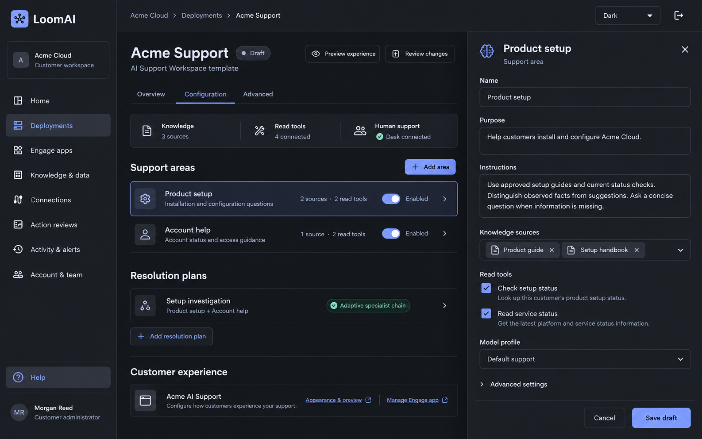

# Integration Support UI Review

**Status:** visual proposals for owner review, not implemented UI.

**Plan:** [010.54 Integration Support Solution](../../010_54_LOOMAI_INTEGRATION_SUPPORT_DEPLOYMENT_AI_WORKSPACE_AND_DESK_SOLUTION_PLAN.md).

Created 2026-10-30 with the built-in image-generation tool. The existing Console
shell screenshot and source theme informed the visual direction. Names, case
references, messages, domain checks and timestamps are fictional design content,
not evidence of hosted support operations. The `.example` domain is illustrative.

## 1. Request Form Inside Console

Help opens My requests; New request opens a right-side panel. The short form
captures summary/details and optional resource context. Status-check consent is
unchecked initially. Submitting saves the request and starts its conversation.

## 2. AI Assistance Inside Console

The submitted form appears as the first user message. The embedded Engage
workspace dominates the case page, with sources and a structured read result.
The right rail holds context, consent and case activity. In this example the
customer has explicitly enabled status checks between screens 1 and 2; no
automatic consent is implied. They can ask for a person or use the button.

## 3. Integration Team in Existing Desk

This is the separate managed Desk application, not another Console messenger.
Customer and AI messages are left-aligned; the human agent is right-aligned.
The proposed external-case panel shows verified case context. Return to AI
and Mark case resolved remain distinct operations. AI is paused while the
conversation is human-owned.

## 4. Customer Configures the Reusable Support Template

This proposed customer-owned deployment uses the AI Support Workspace template
with its own Product setup and Account help areas. A selected area opens a
sliding editor for purpose, instructions, knowledge, read tools and model
profile. The resolution capability shows adaptive specialist coordination, not
a fixed workflow that the current framework cannot declare. Changes stay in a
draft until the ordinary publish/apply flow. This is not already available UI.

See the [capability specification](../../010_54_SUPPORT_TEMPLATE_SPECIALISTS_RESOLUTION_PLANS_AND_PRODUCTIZATION_SPEC.md)
for current product gaps and the shared editor/configuration contract. These
sample area names are not mandatory LoomAI Platform concepts for every customer.
The original three customer/staff screens remain the baseline; optional executed
checks stay collapsed within the conversation, not a permanent agent dashboard.

## Prompt Set

Common direction: high-fidelity, edge-to-edge desktop product screenshots;
charcoal Console/Desk surfaces; Inter typography; compact icon navigation;
restrained periwinkle commands and teal support/status accents; 6px corners;
fictional Northfield Motor House account; no marketing hero, retail tools,
secret/log output or device frames. Keep the existing product shell recognizable.

- **Request-form prompt:** edit the current Console reference into Help /
  Integration support, a minimal My requests list and an open New integration
  request sliding panel. Include summary/details, Engage selection, affected
  app, unchecked status-check consent, disclosure preview, no-secrets notice,
  Cancel and Start support conversation. No AI answer yet.
- **AI-assistance prompt:** preserve screen 1's shell and replace the form with
  case SUP-1048. Show the submitted user message, an AI answer identifying a
  hypothetical CNAME issue, a Domain readiness result, documentation sources,
  a Talk to integration team command, consent/context rail and a composer.
  Clearly distinguish facts, advice and the absence of automatic changes.
- **Desk-handover prompt:** preserve the visual family but use Desk's icon rail,
  conversation queue, central human chat and right-side support-case context.
  Show the same case, AI handover history, an agent reply, current consent,
  Open app in Console, Return to AI and separate Mark case resolved. Customer
  and AI on the left, human agent on the right; no new per-customer inbox.
- **Template-configuration prompt:** preserve the Console shell, select
  Deployments for a fictional Acme Cloud customer, show an Acme Support draft
  created from AI Support Workspace, support-area rows, one adaptive resolution
  capability and a sliding area editor for purpose/instructions/source/read-tool
  bindings. Retain Configuration/Advanced depth and a synthetic appearance
  preview link; no mandatory topology canvas or real execution.

The images are review aids, not final pixel specifications. Exact responsive
layout, field contracts, generic widget placement and Desk context integration
must follow the approved plan during implementation.
