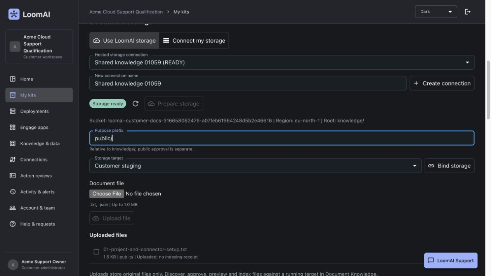
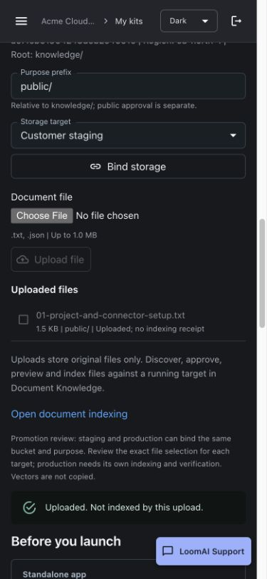

# Hosted Document Storage: Partial Live Acceptance

Observed: 4 November 2026. This is NOT full indexing/promotion acceptance.

## Source And Release

Source: `353cccce8bceb5dc703713aebe768af1ce6a4672`.

- [Document-storage regression CI](https://github.com/mahmoudashraf/AI-Fabric-Framework/actions/runs/41827861594): SUCCESS.
- [Immutable shared-service image CI](https://github.com/mahmoudashraf/AI-Fabric-Framework/actions/runs/41827861503): SUCCESS.
- Local Maven focused package: 301 tests / 17 suites / zero failures, errors or skips.
- UI production build, 15 scoped unit/API cases and 11 mocked browser scenarios passed.

Both hosts run the exact new backend and Console source. Native OCI revision,
configured image, exact Coolify job completion and container health were checked.

- Staging backend job: `k1378cl5d8iieetgph1c7c2n`.
- Staging Console job: `q6l38ot0tkgg5b033if7ok1u`.
- Production backend job: `ewu3ga8kholibgambo9wgerd`.
- Production Console job: `oifugt5cmr6va4l7h4kye741`.

Flyway 230/231/232 succeeded in both control-plane databases. The production
Northfield release identities remain `rel-ce54abe2` on customer staging and
`rel-d587186a` on production, both APPLIED_VERIFIED. No runtime/framework upgrade.

## Actual Customer UI And AWS

The existing signed-in Acme Support Owner, CUSTOMER_ADMIN, used its real Kit
page on developer staging, deployment `dep-b9a09c0a`. No administrator API key
substituted for the customer UI/API authority.

1. Created `Shared knowledge 01059`, configuration only.
2. Prepared a new private S3 bucket in `eu-north-1` through Console.
3. Uploaded the repository's meaningful fictional Acme project/connector setup
   guide, UTF-8 TXT, 1,485 bytes.
4. The source receipt is UPLOADED. Console displays "Uploaded; no indexing receipt".

Native S3 provider readback independently checked:

- All four Block Public Access settings true.
- BucketOwnerEnforced ownership, SSE-S3 AES256, HTTPS-only policy.
- Versioning Enabled, exact customer/connection/control-plane ownership tags.
- Object ContentLength and SHA256 match the upload receipt; provider VersionId present.

Connection `dsc-a07feb61-9642-48d5-b2e4-66160870daaa` and source upload
`du-78ae965c-6e4a-4b6c-b191-19f4bc68dd6e` belong only to that customer/tenant.
File bytes remain in S3, not the Platform database.

## Isolation And UI

- Anonymous storage API request: 401.
- Real other customer's request for Acme's deployment: 404.
- Other customer using its OWN deployment with Acme's connection ID: 404.
- Unsigned S3 read of the actual uploaded object: 403.
- Live mobile viewport: 390x844; document scroll width did not exceed viewport.
- Temporary viewport restored after the check. Physical phone hardware not claimed.

## Deliberately Unclosed

Hosting is enabled only on developer staging. Production source is deployed,
but hosted availability remains false; existing BYO indexing stays available.
The supplied provisioner key is backend-only/runtime-only, never in browser or
customer-runtime configuration. No IAM reader or access key has been created.

The owner must apply the restricted generated-reader delegation and read-only
permissions boundary in the supplied AWS account, then confirm the actual ARN.
Required for production contains the exact owner-facing files/steps. The boundary
must include GetObjectVersion for version-pinned reads, not only GetObject.

Still required: scoped reader success/write and out-of-prefix denial, normal
mode-neutral DATA release, preview/approval/index/reconcile, staging answer,
same-connection production source selection/indexing/activation and isolation.
No vectors or source files have been copied between environments. New published
public bootstrap successors exist, but enrollment defaults intentionally remain
on the existing starters until this provider path is qualified.
